# Lines & Angles — Practice Set

**Bank code:** `GEO-LNA` · **Section:** Geometry · **30 questions** — Easy 8 · Medium 18 · Hard 4

**Lecture capsule:** [01-lines-angles.md](../../05-geometry/01-lines-angles.md)

> Every angle in a transversal figure is x or 180 - x; decide which from the stated facts, never from how the figure looks, because plane figures are not drawn to scale.

Every question below is live in the question bank under the ID shown — the sheet and the portal are the same questions. Attempt a level with the clock running, then check Part C.

---

## Part A — Questions

> **Quantitative Comparison — the four choices are always the same, so they are not reprinted:**
> **(A)** Quantity A is greater · **(B)** Quantity B is greater · **(C)** The two quantities are equal · **(D)** The relationship cannot be determined from the information given

### Level 1 · Easy — 8 questions · ~5 min

*warm-up — these must be automatic*

**Q1** · `GEO-LNA-001` · MCQ · 40s

Two angles are complementary. One angle measures 34°. What is the measure of the other angle?

**(A)** 34°  
**(B)** 46°  
**(C)** 56°  
**(D)** 146°  
**(E)** 156°

**Q2** · `GEO-LNA-002` · MCQ · 40s

Two angles are supplementary. One angle measures 112°. What is the measure of the other angle?

**(A)** 22°  
**(B)** 58°  
**(C)** 68°  
**(D)** 78°  
**(E)** 248°

**Q3** · `GEO-LNA-005` · Numeric Entry · 35s

Angles A and B are a linear pair. Angle A measures 73°. What is the measure of angle B, in degrees?

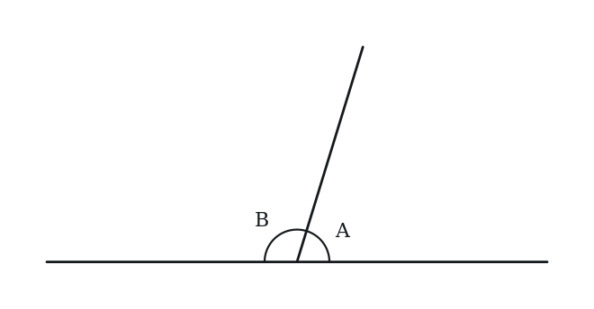

*Numeric entry — write the number.*

**Q4** · `GEO-LNA-009` · Numeric Entry · 35s

Ray OB bisects right angle AOC. What is the measure, in degrees, of angle AOB?

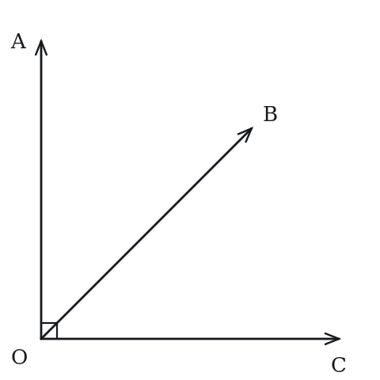

*Numeric entry — write the number.*

**Q5** · `GEO-LNA-011` · QC · 45s

Two lines intersect forming angles p, q, r, and s arranged so that p and r are vertical angles, and q and s are vertical angles.

> **Quantity A:**  p + q
> **Quantity B:**  180°

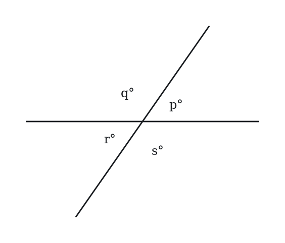

**Q6** · `GEO-PLT-002` · MCQ · 45s

Lines l and m are parallel and are cut by a transversal t. An interior angle of 110° is formed at line l, on the left side of t. What is the measure of the alternate interior angle at line m?

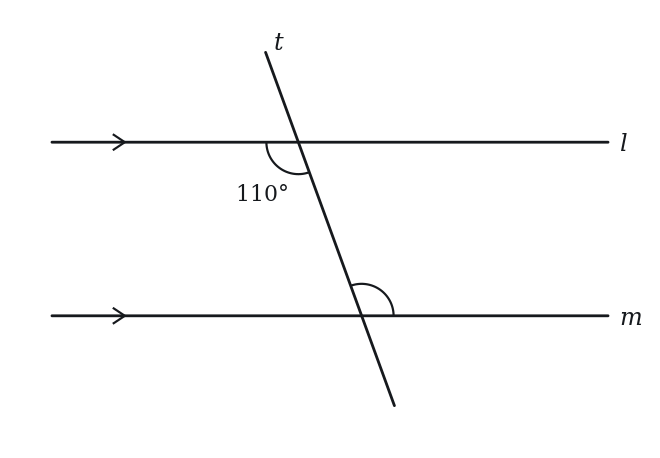

**(A)** 70°  
**(B)** 80°  
**(C)** 110°  
**(D)** 140°  
**(E)** 180°

**Q7** · `GEO-PLT-003` · Numeric Entry · 45s

Two parallel lines are cut by a transversal. A co-interior (same-side interior) angle measures 72°. What is the measure, in degrees, of the other co-interior angle?

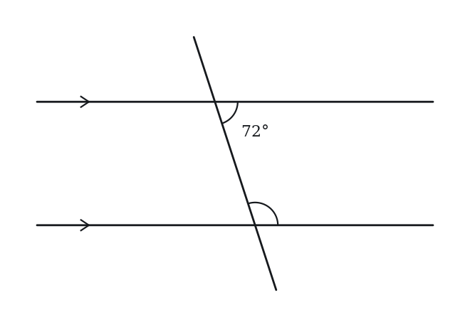

*Numeric entry — write the number.*

**Q8** · `GEO-PLT-006` · QC · 40s

Lines a and b are parallel and are cut by a transversal. One interior angle measures 80°.

> **Quantity A:**  The measure of the angle that is alternate interior to the 80° angle
> **Quantity B:**  80°

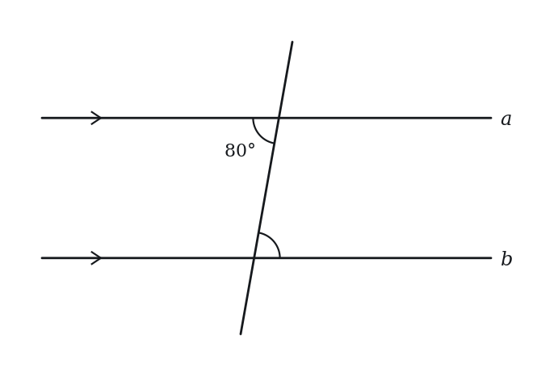

---

### Level 2 · Medium — 18 questions · ~25 min

*two or three steps, one planted trap each*

**Q9** · `GEO-LNA-016` · MCQ · 70s

Two angles are supplementary. The larger angle is 40° more than three times the smaller angle. What is the measure of the larger angle?

**(A)** 100°  
**(B)** 115°  
**(C)** 130°  
**(D)** 145°  
**(E)** 160°

**Q10** · `GEO-LNA-017` · MCQ · 65s

Two lines intersect forming four angles. One angle is labeled (5x + 10)° and the angle vertically opposite to it is labeled (3x + 50)°. What is the value of x?

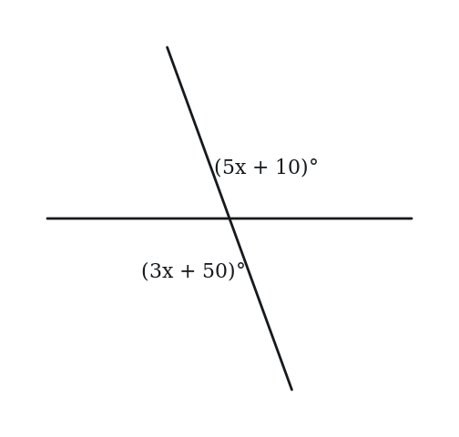

**(A)** 10  
**(B)** 15  
**(C)** 20  
**(D)** 25  
**(E)** 30

**Q11** · `GEO-LNA-027` · MCQ · 80s

Three lines meet at a single point. The six angles formed (going around the point) are in the ratio 1:2:3:1:2:3. What is the measure of the largest angle?

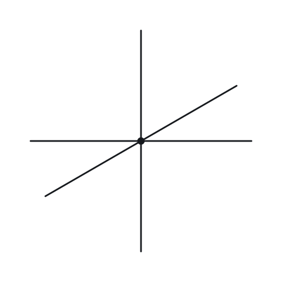

**(A)** 60°  
**(B)** 90°  
**(C)** 100°  
**(D)** 120°  
**(E)** 180°

**Q12** · `GEO-LNA-029` · Numeric Entry · 65s

Two complementary angles are in the ratio 2:7. What is the measure, in degrees, of the larger angle?

*Numeric entry — write the number.*

**Q13** · `GEO-LNA-034` · Select all that apply · 80s

Two parallel lines are intersected by a transversal. Which of the following pairs of angles are always equal? Indicate all such pairs.

**(A)** Corresponding angles  
**(B)** Interior angles on the same side of the transversal  
**(C)** Alternate interior angles  
**(D)** Alternate exterior angles  
**(E)** Exterior angles on the same side of the transversal

**Q14** · `GEO-LNA-035` · MCQ · 75s

Ray OB bisects angle AOC. Angle AOB = (4x + 7)° and angle BOC = (6x - 13)°. What is the measure of angle AOC?

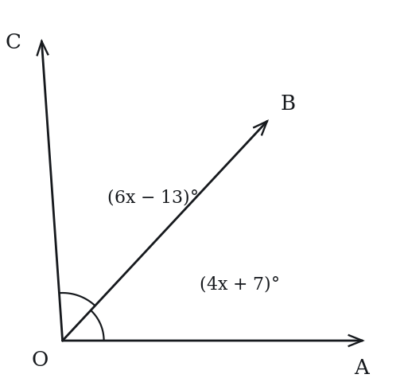

**(A)** 27°  
**(B)** 47°  
**(C)** 54°  
**(D)** 94°  
**(E)** 108°

**Q15** · `GEO-LNA-036` · QC · 80s

Angle M is 20° more than its supplement.

> **Quantity A:**  Angle M
> **Quantity B:**  100°

**Q16** · `GEO-LNA-044` · Numeric Entry · 100s

Ray OD bisects angle AOB, and ray OE bisects angle BOC, where A, O, C are collinear (B is not on line AC). Angle AOB = 70°. What is the measure, in degrees, of angle DOE?

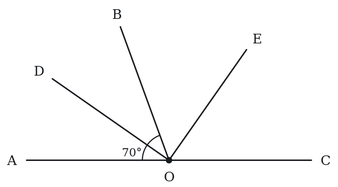

*Numeric entry — write the number.*

**Q17** · `GEO-LNA-047` · QC · 95s

Angle A and angle B are supplementary. Angle A and angle C are complementary.

> **Quantity A:**  B - C
> **Quantity B:**  90°

**Q18** · `GEO-LNA-049` · MCQ · 85s

Two lines intersect. One of the angles is twice the measure of an adjacent angle. What is the measure of the smallest angle formed at the intersection?

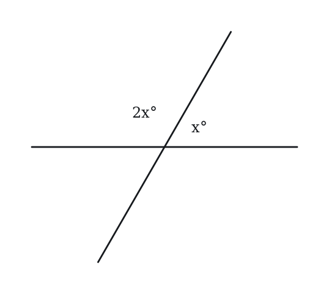

**(A)** 45°  
**(B)** 60°  
**(C)** 72°  
**(D)** 80°  
**(E)** 90°

**Q19** · `GEO-LNA-054` · MCQ · 115s

Five rays OA, OB, OC, OD, OE emanate in order from point O. The angles between consecutive rays are AOB = x°, BOC = 2x°, COD = 3x°, DOE = 4x°, and EOA = 5x°. What is the measure of angle COD?

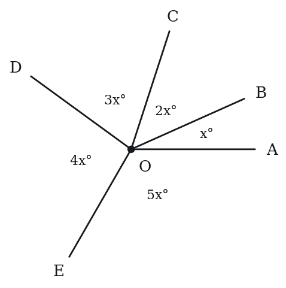

**(A)** 48°  
**(B)** 60°  
**(C)** 72°  
**(D)** 84°  
**(E)** 96°

**Q20** · `GEO-PLT-016` · QC · 75s

Lines j and k are parallel and are cut by transversal t. Angle A at line j measures (2y + 10)°. The angle at line k that corresponds to angle A measures (y + 55)°.

> **Quantity A:**  y
> **Quantity B:**  45

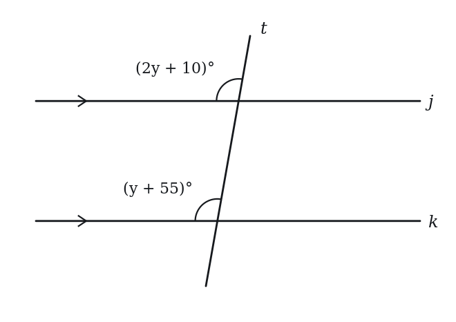

**Q21** · `GEO-PLT-018` · MCQ · 80s

In triangle ABC, line DE is drawn parallel to BC, with D on AB and E on AC. If AD = 6, DB = 4, and DE = 9, what is the length of BC?

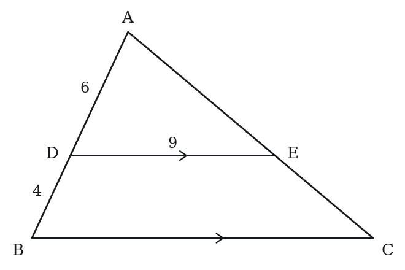

**(A)** 12  
**(B)** 13.5  
**(C)** 15  
**(D)** 18  
**(E)** 21

**Q22** · `GEO-PLT-020` · Numeric Entry · 70s

Two parallel lines are cut by a transversal. Two angles lie between the parallel lines and on the same side of the transversal, one at each line, and measure (3x + 10)° and (x + 50)°. What is x?

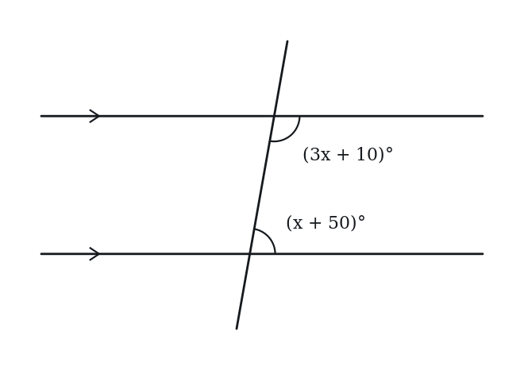

*Numeric entry — write the number.*

**Q23** · `GEO-PLT-023` · Select all that apply · 85s

Lines a and b are parallel, cut by transversal t. Angle 1 is an acute angle at line a that lies between the two lines.

Which of the following statements are true?

Indicate all such statements.

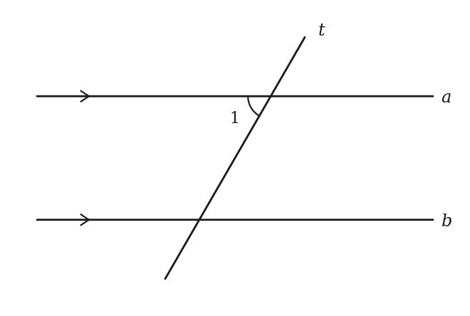

**(A)** The corresponding angle at line b equals Angle 1  
**(B)** The co-interior angle at line b equals Angle 1  
**(C)** The alternate interior angle at line b equals Angle 1  
**(D)** The co-interior angle at line b equals 180° − Angle 1  
**(E)** The angle at line b vertically opposite the alternate interior angle equals Angle 1

**Q24** · `GEO-PLT-030` · QC · 85s

In triangle ABC, DE is parallel to BC, with D on AB and E on AC. AD = 3, DB = 5. The area of triangle ABC = 100.

> **Quantity A:**  Area of trapezoid BCED
> **Quantity B:**  9/64 × Area of triangle ABC

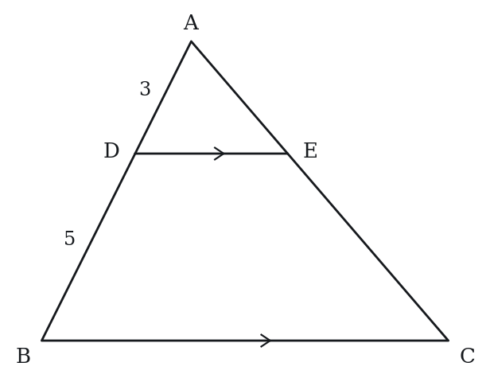

**Q25** · `GEO-PLT-037` · MCQ · 90s

AB ∥ CD. Point E lies between the two parallel lines. Angle ABE = 35° and angle CDE = 50°. What is the measure of angle BED?

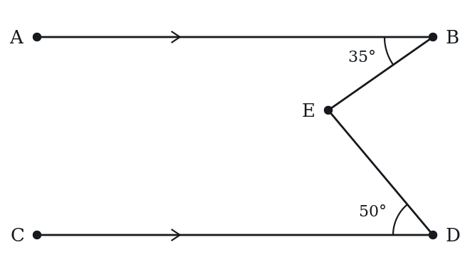

**(A)** 75°  
**(B)** 80°  
**(C)** 85°  
**(D)** 95°  
**(E)** 115°

**Q26** · `GEO-PLT-044` · Select all that apply · 105s

Lines a ∥ b. Transversal t creates angles with a and b. A second transversal s (not parallel to t) also cuts a and b at different points.

Which of the following statements are always true?

Indicate all such statements.

**(A)** Corresponding angles formed by t with a and b are equal  
**(B)** The angle that t makes with a equals the angle s makes with b  
**(C)** Co-interior angles formed by s with a and b sum to 180°  
**(D)** Alternate interior angles formed by t are equal to alternate interior angles formed by s  
**(E)** Alternate exterior angles formed by t with a and b are equal to each other

---

### Level 3 · Hard — 4 questions · ~7 min

*where 162+ is won or lost*

**Q27** · `GEO-LNA-045` · Select all that apply · 90s

The measures of two angles are x degrees and y degrees, where x > y > 0, and the two angles are supplementary. Which of the following could be the value of x - y?

Indicate all such values.

**(A)** 0  
**(B)** 45  
**(C)** 90  
**(D)** 170  
**(E)** 180

**Q28** · `GEO-LNA-050` · Select all that apply · 105s

AB ∥ CD ∥ EF, in that order from top to bottom. A transversal cuts all three lines. The angle above AB and to the left of the transversal measures 65°.

Which of the following angles must equal 65°?

Select all that apply.

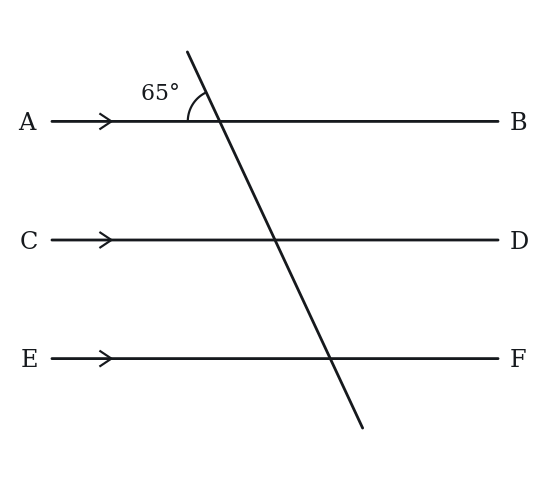

**(A)** The corresponding angle at CD  
**(B)** The angle at CD above CD and to the right of the transversal  
**(C)** The angle at CD below CD and to the right of the transversal  
**(D)** The corresponding angle at EF  
**(E)** The alternate exterior angle at EF (outside all three lines)

**Q29** · `SEC-PG-019` · QC · 95s

Line segment AD has length 40. Point B lies on AD, and segment BD has length 22. Point C also lies on AD, and segment BC has length 5.

> **Quantity A:**  The length of AC
> **Quantity B:**  The length of AB

**Q30** · `SEC-PG-024` · Select all that apply · 125s

A cycling route runs in a straight line from a trailhead to a lookout 62.5 kilometers away. A water station stands on the route 47.2 kilometers from the trailhead, and a ranger is always within 0.8 kilometer of the water station, measured along the route. A cyclist's bicycle broke down on the route at a point less than 0.6 kilometer before the lookout. Which of the following could be the distance, in kilometers, along the route between the bicycle and the ranger?

Indicate all such values.

**(A)** 13.5  
**(B)** 14.0  
**(C)** 14.8  
**(D)** 15.6  
**(E)** 16.1  
F. 16.5

---

## Part B — Answer Key

| Q | ID | Level | Type | Answer |
|---|---|---|---|---|
| 1 | `GEO-LNA-001` | easy | MCQ | **C** |
| 2 | `GEO-LNA-002` | easy | MCQ | **C** |
| 3 | `GEO-LNA-005` | easy | Numeric Entry | **107** |
| 4 | `GEO-LNA-009` | easy | Numeric Entry | **45** |
| 5 | `GEO-LNA-011` | easy | QC | **C** |
| 6 | `GEO-PLT-002` | easy | MCQ | **C** |
| 7 | `GEO-PLT-003` | easy | Numeric Entry | **108** |
| 8 | `GEO-PLT-006` | easy | QC | **C** |
| 9 | `GEO-LNA-016` | medium | MCQ | **D** |
| 10 | `GEO-LNA-017` | medium | MCQ | **C** |
| 11 | `GEO-LNA-027` | medium | MCQ | **B** |
| 12 | `GEO-LNA-029` | medium | Numeric Entry | **70** |
| 13 | `GEO-LNA-034` | medium | Select all that apply | **A, C, D** |
| 14 | `GEO-LNA-035` | medium | MCQ | **D** |
| 15 | `GEO-LNA-036` | medium | QC | **C** |
| 16 | `GEO-LNA-044` | medium | Numeric Entry | **90** |
| 17 | `GEO-LNA-047` | medium | QC | **C** |
| 18 | `GEO-LNA-049` | medium | MCQ | **B** |
| 19 | `GEO-LNA-054` | medium | MCQ | **C** |
| 20 | `GEO-PLT-016` | medium | QC | **C** |
| 21 | `GEO-PLT-018` | medium | MCQ | **C** |
| 22 | `GEO-PLT-020` | medium | Numeric Entry | **30** |
| 23 | `GEO-PLT-023` | medium | Select all that apply | **A, C, D, E** |
| 24 | `GEO-PLT-030` | medium | QC | **A** |
| 25 | `GEO-PLT-037` | medium | MCQ | **C** |
| 26 | `GEO-PLT-044` | medium | Select all that apply | **A, C, E** |
| 27 | `GEO-LNA-045` | hard | Select all that apply | **B, C, D** |
| 28 | `GEO-LNA-050` | hard | Select all that apply | **A, C, D, E** |
| 29 | `SEC-PG-019` | hard | QC | **D** |
| 30 | `SEC-PG-024` | hard | Select all that apply | **B, C, D** |

---

## Part C — Worked Solutions

### Q1 · `GEO-LNA-001` — Answer: C

Complementary angles sum to 90°. Other angle = 90° - 34° = 56°.

**Trap.** Students confuse complementary (90°) with supplementary (180°) and calculate 180° - 34° = 146°, choosing D.

### Q2 · `GEO-LNA-002` — Answer: C

Supplementary angles sum to 180°. Other angle = 180° - 112° = 68°.

**Trap.** Students subtract from 90° (complementary) instead of 180°, getting 90° - 112° which is negative, then guess 22°.

### Q3 · `GEO-LNA-005` — Answer: 107

A linear pair of angles are adjacent angles that together form a straight line, so they sum to 180°. Angle B = 180° - 73° = 107°.

**Trap.** Students think linear pairs are equal (like vertical angles) and write 73°.

### Q4 · `GEO-LNA-009` — Answer: 45

An angle bisector divides an angle into two equal parts. 90° ÷ 2 = 45°. Each resulting angle measures 45°.

**Trap.** Students confuse bisecting with complementary pairs and answer 90° or 45° + 45° = 90° (then write 90 instead of 45).

### Q5 · `GEO-LNA-011` — Answer: C

p and q are adjacent angles formed by two intersecting lines, so they form a linear pair. A linear pair always sums to 180°. Therefore p + q = 180° = Quantity B.

**Trap.** Students think p + q could vary depending on the actual angle values, not recognizing that adjacent angles at an intersection always sum to 180°.

### Q6 · `GEO-PLT-002` — Answer: C

Alternate interior angles are equal when two parallel lines are cut by a transversal. The alternate interior angle is between the two parallel lines, on the opposite side of the transversal — it equals 110°.

**Trap.** Students think alternate interior angles are supplementary (giving 70°). They are equal, not supplementary. Co-interior (same-side interior) angles are supplementary.

### Q7 · `GEO-PLT-003` — Answer: 108

Co-interior angles (also called same-side interior or consecutive interior angles) are supplementary — they sum to 180°. So the other angle = 180° − 72° = 108°.

**Trap.** Students write 72° thinking co-interior angles are equal like alternate interior angles. They are supplementary, not equal.

### Q8 · `GEO-PLT-006` — Answer: C

Alternate interior angles are equal when lines are parallel. So the alternate interior angle = 80° = Quantity B.

**Trap.** Students think alternate interior angles are supplementary (making Quantity A = 100°) and choose A.

### Q9 · `GEO-LNA-016` — Answer: D

Let the smaller angle = x. Then the larger angle = 3x + 40. Since they are supplementary: x + (3x + 40) = 180. 4x + 40 = 180. 4x = 140. x = 35°. Larger angle = 3(35) + 40 = 105 + 40 = 145°.

**Trap.** Students set up x + 3x + 40 = 90 (using complementary instead of supplementary), getting x = 12.5°, larger = 77.5°, then choose the nearest option.

### Q10 · `GEO-LNA-017` — Answer: C

Vertical angles are equal. 5x + 10 = 3x + 50. 2x = 40. x = 20.

**Trap.** Students set the angles as supplementary (5x + 10 + 3x + 50 = 180), getting 8x + 60 = 180, x = 15.

### Q11 · `GEO-LNA-027` — Answer: B

All six angles around a point sum to 360°. The ratio 1:2:3:1:2:3 has parts totaling 1+2+3+1+2+3 = 12. Each part = 360°/12 = 30°. Largest angle = 3 × 30° = 90°.

**Trap.** Students notice the pattern 1:2:3 repeating and assume the angles are 30°, 60°, 90° by just looking at a 180° half — they get 90° by luck here but misunderstand the method.

### Q12 · `GEO-LNA-029` — Answer: 70

Let the angles be 2k and 7k. They are complementary: 2k + 7k = 90°. 9k = 90°. k = 10°. Larger angle = 7 × 10° = 70°.

**Trap.** Students find k = 10° and report 10° as the answer, forgetting to multiply by 7 to get the larger angle.

### Q13 · `GEO-LNA-034` — Answer: A, C, D

When parallel lines are cut by a transversal: Corresponding angles are equal (A). Alternate interior angles are equal (C). Alternate exterior angles are equal (D). Co-interior (same-side interior) angles are supplementary, not equal (B is wrong). Same-side exterior angles are also supplementary (E is wrong).

**Trap.** Students include B (co-interior) thinking all named angle pairs between parallel lines are equal, confusing co-interior with alternate interior.

### Q14 · `GEO-LNA-035` — Answer: D

Since OB bisects angle AOC, angle AOB = angle BOC: 4x + 7 = 6x − 13 → 20 = 2x → x = 10. Then angle AOB = 47°, so angle AOC = 2 × 47° = 94°.

**Trap.** Students compute the half-angle (47°) and report it as the full angle AOC, choosing B.

### Q15 · `GEO-LNA-036` — Answer: C

Let angle M = x. Its supplement = 180° - x. Given: x = (180° - x) + 20°. x = 200° - x. 2x = 200°. x = 100°. Quantity A = 100° = Quantity B.

**Trap.** Students write x - (180 - x) = 20, getting the same answer by coincidence, or set up x = (180 - x) - 20, getting x = 80°, choosing B.

### Q16 · `GEO-LNA-044` — Answer: 90

Angle AOB = 70°, so angle BOC = 180° - 70° = 110° (since AOC is a straight line). OD bisects AOB: angle BOD = 70°/2 = 35°. OE bisects BOC: angle BOE = 110°/2 = 55°. Angle DOE = angle BOD + angle BOE = 35° + 55° = 90°.

**Trap.** Students compute angle DOE as (70° + 110°)/2 = 90°... they actually get the right answer but for a partially wrong reason. The real trap is computing DOE = AOB/2 = 35° (forgetting the BOE component), getting 35°.

### Q17 · `GEO-LNA-047` — Answer: C

Let angle A = a. Then B = 180° - a (supplementary) and C = 90° - a (complementary). B - C = (180° - a) - (90° - a) = 180° - a - 90° + a = 90°. The 'a' terms cancel. Quantity A = 90° = Quantity B always, regardless of the value of a.

**Trap.** Students assign a specific value to A (like 60°), compute B = 120° and C = 30°, find B - C = 90° and choose C, but for the wrong reason — they do not see the algebraic cancellation that guarantees it's always true.

### Q18 · `GEO-LNA-049` — Answer: B

Let the smaller adjacent angle = x. The larger adjacent angle = 2x. Since they form a linear pair: x + 2x = 180°. 3x = 180°. x = 60°. The four angles are 60°, 120°, 60°, 120° (vertical pairs). The smallest angle = 60°.

**Trap.** Students set x + 2x = 360° (total angles around the intersection) instead of 180° (linear pair), getting x = 120° and choosing E or a wrong option.

### Q19 · `GEO-LNA-054` — Answer: C

The five angles around point O sum to 360°: x + 2x + 3x + 4x + 5x = 15x = 360, so x = 24°. Then angle COD = 3x = 72°.

**Trap.** Students compute BOD as BOC only (3x = 72°), forgetting to add COD (x), or compute the full angle AOD instead of just BOD.

### Q20 · `GEO-PLT-016` — Answer: C

Corresponding angles are equal when lines are parallel: 2y + 10 = y + 55 → y = 45. Quantity A = 45 = Quantity B.

**Trap.** Students confuse 'corresponding angle' with 'co-interior supplement' and set up (2y + 10) + (y + 55) = 180°, giving 3y + 65 = 180 → y = 38.3, then say Quantity B is greater.

### Q21 · `GEO-PLT-018` — Answer: C

By the Triangle Proportionality Theorem, DE/BC = AD/AB. AB = AD + DB = 6 + 4 = 10. So 9/BC = 6/10 → BC = 90/6 = 15.

**Trap.** Students use AD/DB = DE/BC, i.e., 6/4 = 9/BC → BC = 6, using the part-to-part ratio instead of the part-to-whole ratio AD/AB.

### Q22 · `GEO-PLT-020` — Answer: 30

Co-interior angles are supplementary: (3x + 10) + (x + 50) = 180 → 4x + 60 = 180 → 4x = 120 → x = 30.

**Trap.** Students set the angles equal (3x + 10 = x + 50 → 2x = 40 → x = 20), treating co-interior angles as alternate interior angles.

### Q23 · `GEO-PLT-023` — Answer: A, C, D, E

A: Corresponding angles are equal — true. B: Co-interior angles are supplementary, not equal — false (Angle 1 is acute so 180° − Angle 1 ≠ Angle 1). C: Alternate interior angles are equal — true. D: Co-interior angles sum to 180°, so the co-interior angle = 180° − Angle 1 — true. E: The alternate interior angle equals Angle 1, and its vertically opposite angle equals it — true.

**Trap.** Students include B, thinking co-interior angles are equal like alternate interior. Co-interior is the one named-pair relationship that is supplementary, not equal.

### Q24 · `GEO-PLT-030` — Answer: A

AD/AB = 3/(3+5) = 3/8. Area ratio (ADE):(ABC) = (3/8)² = 9/64. Area of ADE = 9/64 × 100 = 14.0625. Area of trapezoid BCED = 100 − 14.0625 = 85.9375. Quantity B = 9/64 × 100 = 14.0625. Quantity A (85.9375) > Quantity B (14.0625).

**Trap.** Students compute area ratio as AD/DB = 3/5 (part-to-part) instead of AD/AB = 3/8 (part-to-whole), getting (3/5)² = 9/25 for the area ratio of ADE, and then confusingly compare it to Quantity B.

### Q25 · `GEO-PLT-037` — Answer: C

Draw a line EF through E parallel to AB (and CD). Since EF ∥ AB, angle ABE and angle BEF are alternate interior angles → angle BEF = 35°. Since EF ∥ CD, angle CDE and angle DEF are alternate interior angles → angle DEF = 50°. Angle BED = angle BEF + angle DEF = 35° + 50° = 85°.

**Trap.** Students incorrectly use co-interior angles: 180° − 35° = 145° or 180° − 50° = 130°, then try to combine them and arrive at 95° (choosing D). The key insight is to draw an auxiliary line through E parallel to both AB and CD.

### Q26 · `GEO-PLT-044` — Answer: A, C, E

A: Corresponding angles are always equal for any transversal crossing parallel lines — true. B: The angle t makes with a need not equal the angle s makes with b (s is an independent transversal) — false. C: Co-interior angles for any transversal crossing parallel lines sum to 180° — true for s as well. D: Alternate interior angles for t are equal to each other, and those for s are equal to each other, but the angles for t and s need not be equal — false. E: Alternate exterior angles formed by a single transversal with parallel lines are always equal — true.

**Trap.** Students include B or D, thinking all transversal angles with the same pair of parallel lines are related to each other. Each transversal is independent — its angles depend on its slope.

### Q27 · `GEO-LNA-045` — Answer: B, C, D

Supplementary angles have measures that add to 180, so x + y = 180.
Then x - y = 180 - 2y. Since x > y > 0, y is greater than 0 and less than 90.
So x - y is greater than 0 and less than 180.
A: 0 would need x = y. Not possible.
B: 45 (y = 67.5). Possible.
C: 90 (y = 45). Possible.
D: 170 (y = 5). Possible.
E: 180 would need y = 0. Not possible.
Answer: B, C, D.

**Trap.** Rejecting 45 because it makes y = 67.5, not a whole number. Nothing says the measures are integers. Accepting 180 overlooks that y must be greater than 0.

### Q28 · `GEO-LNA-050` — Answer: A, C, D, E

The given 65° angle is above AB and to the left of the transversal. Because AB ∥ CD ∥ EF, the transversal makes the same angles with all three lines.
At CD: the angle above CD and to the left of the transversal corresponds to the given angle, so it is 65° (A correct). The angle above CD and to the right forms a linear pair with it, so it is 115° (B wrong). The angle below CD and to the right is vertical to the corresponding angle, so it is 65° (C correct).
At EF: the corresponding angle is 65° (D correct), and the angle below EF and to the right of the transversal is the alternate exterior angle to the given angle, so it is also 65° (E correct).
Answer: A, C, D, E.

**Trap.** Students include B, not realizing the angle above CD and to the right of the transversal forms a linear pair with the 65° angle and so measures 115°, or exclude E, thinking alternate exterior angles only apply to the nearest parallel line.

### Q29 · `SEC-PG-019` — Answer: D

Since B is on AD with BD = 22, we get AB = 40 - 22 = 18, so Quantity B is fixed at 18. But C is only pinned down as a point of AD that is 5 units from B, and there are two such points: one 5 units toward A, giving AC = 13, and one 5 units toward D, giving AC = 23. Both lie within the segment, since 13 and 23 are both between 0 and 40. So Quantity A can be less than 18 or greater than 18, and the relationship cannot be determined.

**Trap.** Students place C automatically on the far side of B, compute AC = 23, and answer that Quantity A is greater. Saying that C is on the segment and 5 units from B leaves two legitimate positions, and the two give opposite comparisons.

### Q30 · `SEC-PG-024` — Answer: B, C, D

Measure everything from the trailhead. The bicycle sits strictly between 62.5 - 0.6 = 61.9 and 62.5, since 'less than 0.6 kilometer before the lookout' excludes both endpoints. The ranger sits somewhere from 47.2 - 0.8 = 46.4 to 47.2 + 0.8 = 48.0. The gap between them is smallest when the bicycle is as far back as possible and the ranger as far forward as possible: 61.9 - 48.0 = 13.9. It is largest when the bicycle is as far forward as possible and the ranger as far back as possible: 62.5 - 46.4 = 16.1. Both extremes come from the bicycle's excluded endpoints, so the distance runs strictly between 13.9 and 16.1. Only 14.0, 14.8 and 15.6 qualify.

**Trap.** Students take 16.1 because it looks like the stated maximum. Reaching 16.1 would require the bicycle to be exactly at the lookout, which the phrase 'less than 0.6 kilometer before the lookout' forbids, so the top of the range is open. Others compute the center gap 62.5 - 47.2 = 15.3 and spread it only by 0.8, missing the 0.6 from the bicycle's own uncertainty.
