# Triangles — Fundamentals — Practice Set

**Bank code:** `GEO-TRI` · **Section:** Geometry · **30 questions** — Easy 7 · Medium 17 · Hard 6

**Lecture capsule:** [02-triangles-fundamentals.md](../../05-geometry/02-triangles-fundamentals.md)

> Angles sum to 180 and an exterior angle equals the two remote interiors; the third side is squeezed between the difference and the sum of the other two.

Every question below is live in the question bank under the ID shown — the sheet and the portal are the same questions. Attempt a level with the clock running, then check Part C.

---

## Part A — Questions

> **Quantitative Comparison — the four choices are always the same, so they are not reprinted:**
> **(A)** Quantity A is greater · **(B)** Quantity B is greater · **(C)** The two quantities are equal · **(D)** The relationship cannot be determined from the information given

### Level 1 · Easy — 7 questions · ~5 min

*warm-up — these must be automatic*

**Q1** · `GEO-TRI-001` · MCQ · 35s

In a triangle, two of the interior angles measure 55° and 75°. What is the measure of the third interior angle?

**(A)** 40°  
**(B)** 45°  
**(C)** 50°  
**(D)** 55°  
**(E)** 60°

**Q2** · `GEO-TRI-003` · MCQ · 35s

What is the area of a triangle with base 10 and height 6?

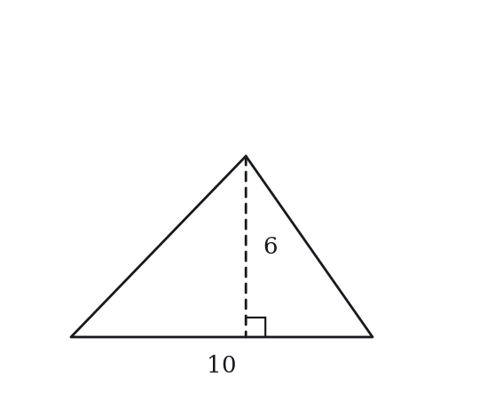

**(A)** 15  
**(B)** 20  
**(C)** 24  
**(D)** 30  
**(E)** 60

**Q3** · `GEO-TRI-006` · MCQ · 45s

An exterior angle of a triangle measures 110°. One of the two non-adjacent interior angles is 60°. What is the other non-adjacent interior angle?

**(A)** 40°  
**(B)** 50°  
**(C)** 55°  
**(D)** 60°  
**(E)** 70°

**Q4** · `GEO-TRI-007` · MCQ · 55s

Which of the following sets of lengths could be the sides of a triangle?

**(A)** 1, 2, 3  
**(B)** 2, 3, 6  
**(C)** 3, 4, 8  
**(D)** 4, 5, 8  
**(E)** 5, 6, 12

**Q5** · `GEO-TRI-010` · QC · 40s

In triangle XYZ, angle X = 40° and angle Y = 60°.

> **Quantity A:**  Angle Z
> **Quantity B:**  80°

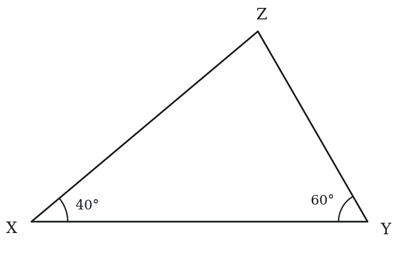

**Q6** · `GEO-TRI-012` · Numeric Entry · 45s

A triangle has a base of 14 and an area of 42. What is the height of the triangle (measured perpendicularly to the base)?

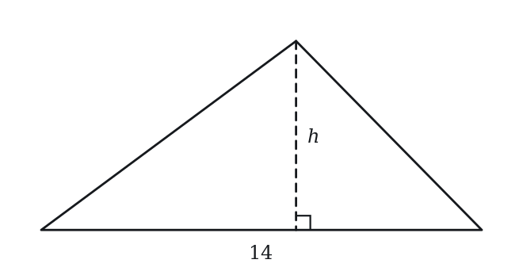

*Numeric entry — write the number.*

**Q7** · `GEO-TRI-018` · MCQ · 50s

A triangle has angles in the ratio 1:2:3. What is the measure of the largest angle?

**(A)** 60°  
**(B)** 75°  
**(C)** 80°  
**(D)** 90°  
**(E)** 120°

---

### Level 2 · Medium — 17 questions · ~25 min

*two or three steps, one planted trap each*

**Q8** · `GEO-TRI-019` · MCQ · 65s

In triangle ABC, the exterior angle at vertex C measures 130°. If angle A = 70°, what is the measure of angle B?

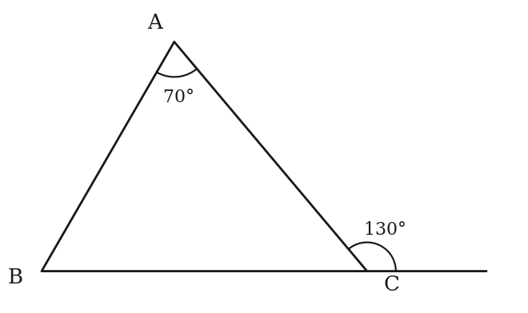

**(A)** 50°  
**(B)** 60°  
**(C)** 65°  
**(D)** 70°  
**(E)** 80°

**Q9** · `GEO-TRI-029` · Select all that apply · 80s

In triangle DEF, DE = EF = 9 and DF = 12. Which of the following statements are true?

Indicate all such statements.

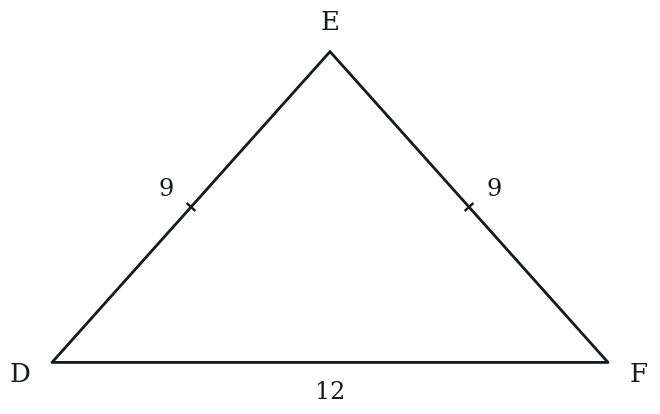

**(A)** Triangle DEF is isosceles  
**(B)** Angle D = Angle F  
**(C)** Angle E = 60°  
**(D)** Angle D = Angle E  
**(E)** Angle E is the largest angle of the triangle

**Q10** · `GEO-TRI-031` · QC · 85s

Triangle ABC has sides 7, 24, and 25. Triangle DEF has sides 9, 40, and 41.

> **Quantity A:**  Area of triangle ABC
> **Quantity B:**  Area of triangle DEF

**Q11** · `GEO-TRI-034` · MCQ · 70s

In triangle ABC, D is the midpoint of BC. AD is called a median. If the area of triangle ABC is 48, what is the area of triangle ABD?

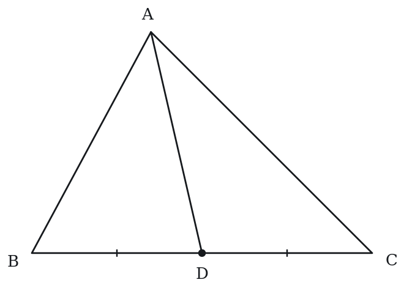

**(A)** 12  
**(B)** 16  
**(C)** 24  
**(D)** 32  
**(E)** 36

**Q12** · `GEO-TRI-036` · Numeric Entry · 85s

An isosceles triangle has a base of 10 and the two equal sides are each 13. What is the area of the triangle?

*Numeric entry — write the number.*

**Q13** · `GEO-TRI-041` · MCQ · 75s

In triangle ABC, D is a point on BC such that AD is the altitude from A. If AB = 15, BD = 9, and angle ADB = 90°, what is the length of AD?

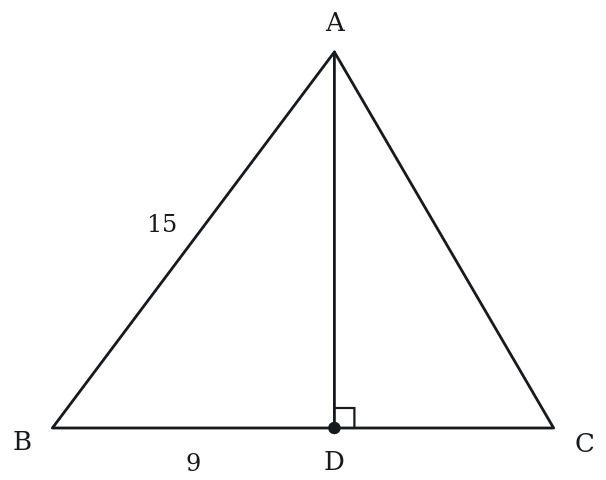

**(A)** 6  
**(B)** 9  
**(C)** 12  
**(D)** 13  
**(E)** 15

**Q14** · `GEO-TRI-051` · Numeric Entry · 100s

In triangle ABC, angle A = 90°, AB = 6, and BC = 10. Point D is on BC such that AD ⊥ BC. What is the length of AD?

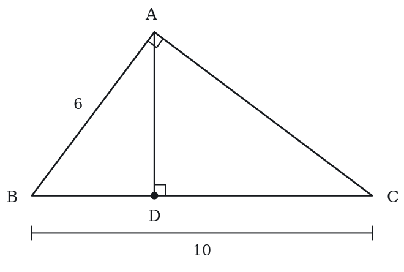

*Numeric entry — write the number.*

**Q15** · `GEO-TRI-053` · QC · 90s

A triangle has integer side lengths a < b < c with c = 10.

> **Quantity A:**  The maximum possible perimeter of the triangle
> **Quantity B:**  27

**Q16** · `GEO-TRI-055` · Numeric Entry · 85s

In a triangle, the exterior angles at two vertices are 125° and 110°. What is the measure of the third interior angle?

*Numeric entry — write the number.*

**Q17** · `GEO-TRI-061` · MCQ · 90s

In triangle ABC, angle A = 2 × angle B and angle C = 3 × angle B. What type of triangle is this?

**(A)** Equilateral  
**(B)** Isosceles acute  
**(C)** Right scalene  
**(D)** Obtuse scalene  
**(E)** Isosceles right

**Q18** · `GEO-TRI-062` · QC · 95s

A triangle has sides of length x, x+2, and x+4 where x > 0 and the triangle is valid.

> **Quantity A:**  The minimum integer value of x
> **Quantity B:**  3

**Q19** · `GEO-TRI-067` · QC · 115s

Triangle ABC is isosceles with AB = AC = 10 and BC = 12. Triangle DEF is isosceles with DE = DF = 13 and EF = 10.

> **Quantity A:**  Area of triangle ABC
> **Quantity B:**  Area of triangle DEF

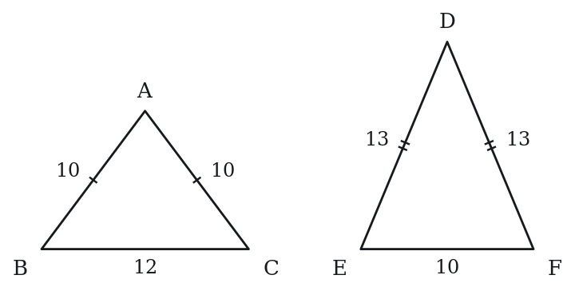

**Q20** · `GEO-TRI-KMF-003` · Select all that apply · 70s

Three radio masts stand on a level plain, and their bases do not all lie on one straight line. The base of mast P sits 30 meters from the base of mast Q and 18 meters from the base of mast R.

Which of the following length, in meters, could separate the bases of masts Q and R?

Select all that apply.

**(A)** 10  
**(B)** 12  
**(C)** 20  
**(D)** 36  
**(E)** 48  
F. 50

**Q21** · `GEO-TRI-KMF-006` · Numeric Entry · 75s

In the figure, line m is horizontal. Lines p and q each cross m, and then cross each other at point V below m. At the left crossing, the angle between the leftward part of m and the downward part of p measures 128 degrees. At the right crossing, the angle between the rightward part of m and the downward part of q measures 117 degrees. What is the measure, in degrees, of the angle at V that opens upward toward m?

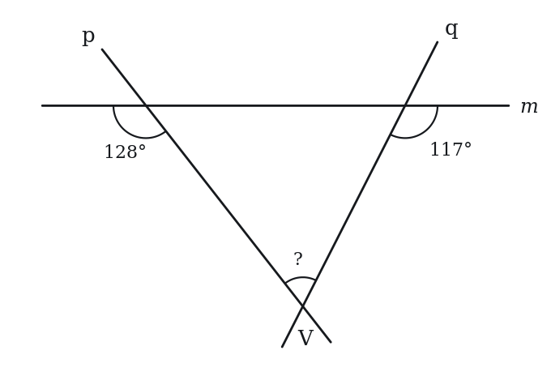

*Numeric entry — write the number.*

**Q22** · `GEO-TRI-KMF-010` · QC · 80s

The side lengths of a triangle, in centimeters, are 6, 9 and t, where t is an integer.

> **Quantity A:**  The number of different values that t can have
> **Quantity B:**  11

**Q23** · `GEO-TRI-KMF-013` · MCQ · 120s

In triangle JKL, side KL has length 14 and the perpendicular distance from J to line KL is 10. Points M and N are the midpoints of sides JK and JL. Point P lies on the opposite side of line KL from J, at a perpendicular distance of 3 from line KL. What is the area of triangle PMN?

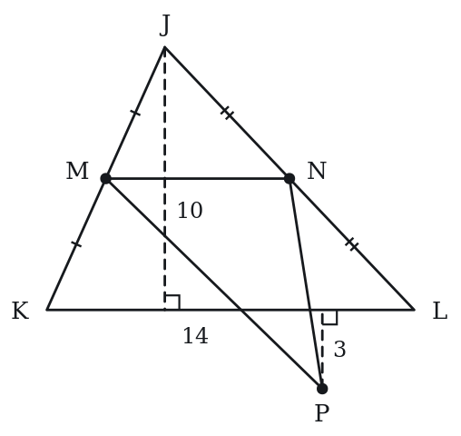

**(A)** 10.5  
**(B)** 28  
**(C)** 35  
**(D)** 45.5  
**(E)** 56

**Q24** · `SEC-PG-011` · Select all that apply · 95s

In triangle DEF, DE = 7 and EF = 16. Which of the following could be the perimeter of triangle DEF?

Indicate all such values.

**(A)** 30  
**(B)** 34  
**(C)** 38  
**(D)** 44  
**(E)** 46  
F. 52

---

### Level 3 · Hard — 6 questions · ~10 min

*where 162+ is won or lost*

**Q25** · `GEO-TRI-052` · MCQ · 95s

Triangle ABC is similar to triangle DEF. The area of ABC is 50 and the area of DEF is 98. If the perimeter of ABC is 30, what is the perimeter of DEF?

**(A)** 36  
**(B)** 38  
**(C)** 40  
**(D)** 42  
**(E)** 45

**Q26** · `GEO-TRI-KMF-004` · Numeric Entry · 80s

Triangle PQR has PQ = 7 and QR = 15, and the length of side PR is a whole number. How many different perimeters are possible for the triangle?

*Numeric entry — write the number.*

**Q27** · `GEO-TRI-KMF-009` · Select all that apply · 120s

On a scale drawing, town X is 7 cm from town Y and town Y is 4 cm from town Z; the three towns need not lie on one straight line. The real distance from X to Y is 84 km.

Which of the following values could be the real distance, in km, from X to Z?

Indicate all such values.

**(A)** 30  
**(B)** 40  
**(C)** 84  
**(D)** 120  
**(E)** 140  
F. 180

**Q28** · `GEO-TRI-KMF-012` · QC · 100s

In triangle PQR, PQ = 5, QR = 12, and PR = 12.5.

> **Quantity A:**  The measure of angle Q, in degrees
> **Quantity B:**  The sum of the measures of angles P and R, in degrees

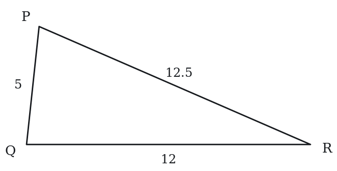

**Q29** · `GEO-TRI-KMF2-001` · Select all that apply · 100s

In the figure above, angle ACB is a right angle and CD is perpendicular to AB. Which of the following must be true?

Indicate all such statements.

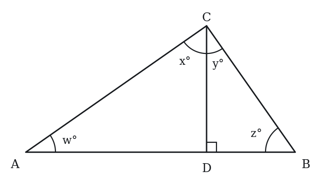

**(A)** w + x = 90  
**(B)** w = x  
**(C)** x = z  
**(D)** w + y = 90  
**(E)** x + y = 90

**Q30** · `SEC-PG-039` · MCQ · 105s

In triangle JKL above, the three angle bisectors meet at point N. If angle NLJ measures 21 degrees and angle NJL measures 34 degrees, what is the measure, in degrees, of angle JKN?

Note: Figure not drawn to scale.

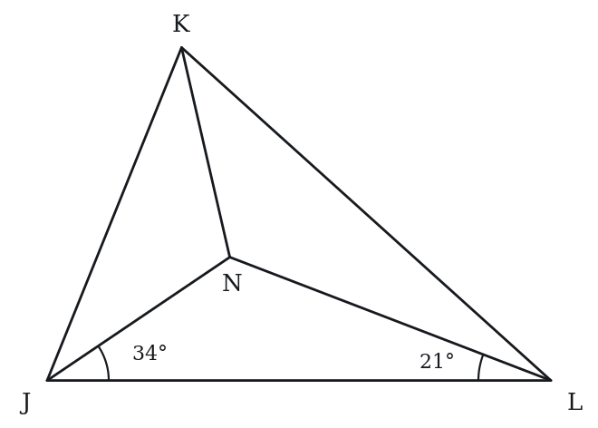

**(A)** 27.5  
**(B)** 35  
**(C)** 55  
**(D)** 70  
**(E)** 110

---

## Part B — Answer Key

| Q | ID | Level | Type | Answer |
|---|---|---|---|---|
| 1 | `GEO-TRI-001` | easy | MCQ | **C** |
| 2 | `GEO-TRI-003` | easy | MCQ | **D** |
| 3 | `GEO-TRI-006` | easy | MCQ | **B** |
| 4 | `GEO-TRI-007` | easy | MCQ | **D** |
| 5 | `GEO-TRI-010` | easy | QC | **C** |
| 6 | `GEO-TRI-012` | easy | Numeric Entry | **6** |
| 7 | `GEO-TRI-018` | easy | MCQ | **D** |
| 8 | `GEO-TRI-019` | medium | MCQ | **B** |
| 9 | `GEO-TRI-029` | medium | Select all that apply | **A, B, E** |
| 10 | `GEO-TRI-031` | medium | QC | **B** |
| 11 | `GEO-TRI-034` | medium | MCQ | **C** |
| 12 | `GEO-TRI-036` | medium | Numeric Entry | **60** |
| 13 | `GEO-TRI-041` | medium | MCQ | **C** |
| 14 | `GEO-TRI-051` | medium | Numeric Entry | **4.8** |
| 15 | `GEO-TRI-053` | medium | QC | **C** |
| 16 | `GEO-TRI-055` | medium | Numeric Entry | **55** |
| 17 | `GEO-TRI-061` | medium | MCQ | **C** |
| 18 | `GEO-TRI-062` | medium | QC | **C** |
| 19 | `GEO-TRI-067` | medium | QC | **B** |
| 20 | `GEO-TRI-KMF-003` | medium | Select all that apply | **C, D** |
| 21 | `GEO-TRI-KMF-006` | medium | Numeric Entry | **65** |
| 22 | `GEO-TRI-KMF-010` | medium | QC | **C** |
| 23 | `GEO-TRI-KMF-013` | medium | MCQ | **B** |
| 24 | `SEC-PG-011` | medium | Select all that apply | **B, C, D** |
| 25 | `GEO-TRI-052` | hard | MCQ | **D** |
| 26 | `GEO-TRI-KMF-004` | hard | Numeric Entry | **13** |
| 27 | `GEO-TRI-KMF-009` | hard | Select all that apply | **B, C, D** |
| 28 | `GEO-TRI-KMF-012` | hard | QC | **B** |
| 29 | `GEO-TRI-KMF2-001` | hard | Select all that apply | **A, C, E** |
| 30 | `SEC-PG-039` | hard | MCQ | **B** |

---

## Part C — Worked Solutions

### Q1 · `GEO-TRI-001` — Answer: C

The sum of all interior angles in any triangle is 180°. Third angle = 180° - 55° - 75° = 180° - 130° = 50°.

**Trap.** Students sometimes subtract only one angle instead of both: 180° - 75° = 105°, or add incorrectly.

### Q2 · `GEO-TRI-003` — Answer: D

Area = ½ × base × height = ½ × 10 × 6 = ½ × 60 = 30.

**Trap.** Forgetting the ½ factor and calculating 10 × 6 = 60.

### Q3 · `GEO-TRI-006` — Answer: B

By the Exterior Angle Theorem, an exterior angle equals the sum of the two non-adjacent interior angles. So: 110° = 60° + other angle. Other angle = 110° - 60° = 50°.

**Trap.** Setting the exterior angle equal to only one interior angle, or subtracting from 180° instead of applying the theorem directly.

### Q4 · `GEO-TRI-007` — Answer: D

Triangle inequality: the sum of any two sides must be strictly greater than the third side. Check option D (4, 5, 8): 4+5=9 > 8 ✓, 4+8=12 > 5 ✓, 5+8=13 > 4 ✓. All others fail: A: 1+2=3 (not > 3), B: 2+3=5 < 6, C: 3+4=7 < 8, E: 5+6=11 < 12.

**Trap.** Accepting 1+2=3 for set A — the inequality must be STRICT (sum must be greater than, not equal to the third side).

### Q5 · `GEO-TRI-010` — Answer: C

Angle Z = 180° - 40° - 60° = 80°. Quantity A = 80° = Quantity B.

**Trap.** Students subtract only one of the two angles, or subtract from 360° instead of 180°, and answer that Quantity A is greater.

### Q6 · `GEO-TRI-012` — Answer: 6

Area = ½ × base × height. 42 = ½ × 14 × h. 42 = 7h. h = 42/7 = 6.

**Trap.** Using Area = base × height (forgetting the ½): 42 = 14 × h, giving h = 3.

### Q7 · `GEO-TRI-018` — Answer: D

Let angles be x, 2x, 3x. Sum = 6x = 180°. So x = 30°. Angles are 30°, 60°, 90°. The largest angle is 90°.

**Trap.** Treating the ratio parts as the actual angles (1+2+3=6, not 180).

### Q8 · `GEO-TRI-019` — Answer: B

By the Exterior Angle Theorem, the exterior angle at C = angle A + angle B. So 130° = 70° + angle B. Angle B = 60°. Verification: Angle C (interior) = 180° - 130° = 50°. Check: 70° + 60° + 50° = 180° ✓

**Trap.** Confusing the exterior angle theorem. Some set exterior angle = one interior angle; others try to use 180° - 130° = 50° as the answer directly.

### Q9 · `GEO-TRI-029` — Answer: A, B, E

DE = EF, so the triangle is isosceles (A) and the angles opposite the equal sides, angle F and angle D, are equal (B). Angle E would be 60° only in an equilateral triangle (C is false). Angle D is not equal to angle E (D is false). The largest angle is opposite the longest side, DF = 12, which is angle E (E is true). Correct: A, B, E.

**Trap.** C is true only for an equilateral triangle. D picks the wrong pair of equal angles (those opposite the unequal side).

### Q10 · `GEO-TRI-031` — Answer: B

Check both for right triangles: ABC: 7²+24²=49+576=625=25² ✓ Right triangle. Area = ½×7×24 = 84. DEF: 9²+40²=81+1600=1681=41² ✓ Right triangle. Area = ½×9×40 = 180. Quantity B (180) > Quantity A (84).

**Trap.** Not recognizing these as Pythagorean triples (7-24-25 and 9-40-41) and failing to compute the areas correctly.

### Q11 · `GEO-TRI-034` — Answer: C

Since D is the midpoint of BC, BD = DC = BC/2. Triangles ABD and ADC share the same height (from A perpendicular to BC). Area of ABD = ½ × BD × h = ½ × (BC/2) × h = ½ × area of ABC = 48/2 = 24.

**Trap.** Thinking the median divides the triangle in ratio 2:1 (like the centroid divides a median), rather than in half (1:1).

### Q12 · `GEO-TRI-036` — Answer: 60

Draw the altitude from the apex to the base. It bisects the base, creating two right triangles with hypotenuse 13 and base leg 5. Height = √(13² - 5²) = √(169 - 25) = √144 = 12. Area = ½ × 10 × 12 = 60.

**Trap.** Using 13 as the height instead of computing it: ½ × 10 × 13 = 65.

### Q13 · `GEO-TRI-041` — Answer: C

Triangle ABD is a right triangle with the right angle at D. AB = 15 (hypotenuse), BD = 9 (one leg). AD = √(AB² - BD²) = √(225 - 81) = √144 = 12.

**Trap.** Adding instead of applying the Pythagorean theorem: AD = AB - BD = 6.

### Q14 · `GEO-TRI-051` — Answer: 4.8

Since angle A = 90° and AD ⊥ BC: Using the geometric mean relationship in a right triangle. AC = √(BC² - AB²) = √(100 - 36) = √64 = 8. Area of ABC = ½ × AB × AC = ½ × 6 × 8 = 24. Also Area = ½ × BC × AD = ½ × 10 × AD. So 24 = 5 × AD. AD = 24/5 = 4.8.

**Trap.** Using AD = AB × AC / BC² or some incorrect formula. A common error is AD = 6 × 8/10 = 4.8 (happens to be right via area method) but students often set up AD = √(AB × AC) = √48 ≈ 6.9.

### Q15 · `GEO-TRI-053` — Answer: C

Since a < b < c = 10, the largest choices are b = 9 and a = 8. The triangle inequality holds (8 + 9 = 17 > 10), so the maximum perimeter = 8 + 9 + 10 = 27. Quantity A = 27 = Quantity B, so the quantities are equal.

**Trap.** Trying a = b = 9 (violating the strict inequality a < b < c), giving perimeter = 28, or not recognizing the strict inequalities.

### Q16 · `GEO-TRI-055` — Answer: 55

Interior angle at vertex 1 = 180° - 125° = 55°. Interior angle at vertex 2 = 180° - 110° = 70°. Sum of all interior angles = 180°. Third interior angle = 180° - 55° - 70° = 55°.

**Trap.** Treating the exterior angles as interior angles and computing 180° - 125° - 110° = -55° (negative, impossible). Or adding the exterior angles directly.

### Q17 · `GEO-TRI-061` — Answer: C

Let angle B = x. Then angle A = 2x, angle C = 3x. Sum = 6x = 180°, x = 30°. Angles: A = 60°, B = 30°, C = 90°. Since one angle is 90°, it's a right triangle. All angles are different, so it's scalene. It's a right scalene triangle.

**Trap.** Stopping at x = 30° and identifying it as angle A rather than angle B, or not recognizing that 90° makes it right.

### Q18 · `GEO-TRI-062` — Answer: C

For a valid triangle, the sum of any two sides must exceed the third. The binding constraint is the two shorter sides vs. the longest: x + (x+2) > x+4. 2x+2 > x+4. x > 2. So x must be greater than 2. The minimum integer value of x is 3. Quantity A = 3 = Quantity B.

**Trap.** Testing only one inequality (x + x+2 > x+4) and not checking the other two, or finding x > 2 but then saying the minimum is 2 (forgetting it must be STRICTLY greater).

### Q19 · `GEO-TRI-067` — Answer: B

Triangle ABC: base = 12, equal sides = 10. Height from A to BC: h₁ = √(10² - 6²) = √(100-36) = √64 = 8. Area = ½ × 12 × 8 = 48. Triangle DEF: base = 10, equal sides = 13. Height from D to EF: h₂ = √(13² - 5²) = √(169-25) = √144 = 12. Area = ½ × 10 × 12 = 60. Quantity B (60) > Quantity A (48).

**Trap.** Using the equal sides as the heights instead of computing perpendicular heights; e.g., Area ABC = ½ × 12 × 10 = 60 and Area DEF = ½ × 10 × 13 = 65.

### Q20 · `GEO-TRI-KMF-003` — Answer: C, D

The three bases form a genuine triangle, since they are not collinear, with two sides 30 and 18.
Triangle inequality, upper bound: QR < 30 + 18 = 48, strictly.
Triangle inequality, lower bound: QR > 30 - 18 = 12, strictly.
So the allowed range is 12 < QR < 48.
A. 10 is at or below 12 -- false.
B. 12 would make the bases collinear -- false.
C. 20 lies strictly inside the range -- true.
D. 36 lies strictly inside the range -- true.
E. 48 would make the bases collinear -- false.
F. 50 exceeds the sum of the other two sides -- false.
Selected: C and D.

**Trap.** Reading the inequalities as inclusive admits the two endpoint values 12 and 48, but each of those forces the three bases onto one line, which the stem rules out.

### Q21 · `GEO-TRI-KMF-006` — Answer: 65

At the left crossing the interior angle (between the rightward part of m and the downward part of p) is 180 - 128 = 52 degrees, since the two angles lie along straight line m.
At the right crossing the interior angle (between the leftward part of m and the downward part of q) is 180 - 117 = 63 degrees.
The triangle formed by m, p and q has angle sum 180, so the angle at V = 180 - 52 - 63 = 65 degrees.
Check: 52 + 63 + 65 = 180, and 180 - 52 = 128 and 180 - 63 = 117 match the marked angles.

**Trap.** Subtracting the two given angles from 360 without taking supplements first gives 360 - 128 - 117 = 115, which is the wrong answer.

### Q22 · `GEO-TRI-KMF-010` — Answer: C

A triangle needs each side to be shorter than the sum of the other two.
t < 6 + 9 = 15.
9 < 6 + t gives t > 3.
6 < 9 + t holds for every positive t.
So 3 < t < 15, and the integers allowed are 4, 5, ..., 14.
Count = 14 - 4 + 1 = 11.
Quantity A = 11 = Quantity B.
Check the ends: t = 4 gives 4 + 6 = 10 > 9 (valid); t = 14 gives 6 + 9 = 15 > 14 (valid); t = 3 gives 3 + 6 = 9, which only flattens the triangle, and t = 15 does the same.

**Trap.** Treating 3 and 15 as allowed values or subtracting without adding one: 15 - 3 = 12 values, so Quantity A looks greater (choice A).

### Q23 · `GEO-TRI-KMF-013` — Answer: B

1. M and N are midpoints, so MN is parallel to KL and MN = 14/2 = 7.
2. Line MN is halfway up the triangle, so it is 10/2 = 5 above line KL.
3. P is 3 below line KL, so its perpendicular distance to line MN is 3 + 5 = 8.
4. Area of triangle PMN = (1/2)*7*8 = 28.
Check: the distance from P to the apex-side line is measured across the whole gap, so the 5 between MN and KL must be added to the 3.

**Trap.** Using only the 3-unit distance from P to KL as the height of triangle PMN gives (1/2)*7*3 = 10.5, choice A.

### Q24 · `SEC-PG-011` — Answer: B, C, D

The third side DF must be greater than the difference of the two known sides and less than their sum: 16 - 7 = 9 and 16 + 7 = 23, so 9 < DF < 23. Adding the two known sides, the perimeter is DF + 23, which must satisfy 32 < perimeter < 46. Of the choices, 34, 38 and 44 fall strictly inside that interval. 30 is too small, and 46 and 52 are too large, with 46 excluded because the bound is strict.

**Trap.** Students include 46, forgetting that the inequality is strict. A third side of exactly 23 would make D, E and F collinear, which is not a triangle, so a perimeter of exactly 46 is impossible.

### Q25 · `GEO-TRI-052` — Answer: D

Area ratio = 50:98 = 25:49. Side ratio = √(25/49) = 5/7. Perimeter ratio = 5:7 (same as side ratio). Perimeter of DEF = 30 × (7/5) = 42.

**Trap.** Using the area ratio directly for the perimeter: 30 × (98/50) = 58.8. Must take the square root of the area ratio to get the linear scale factor.

### Q26 · `GEO-TRI-KMF-004` — Answer: 13

By the triangle inequality, PR must satisfy 15 - 7 < PR < 15 + 7, so 8 < PR < 22.
Whole-number values of PR: 9, 10, ..., 21, which is 21 - 9 + 1 = 13 values.
Perimeter = 7 + 15 + PR = 22 + PR, so each different PR gives a different perimeter, from 31 to 43.
There are 13 different perimeters.
Check: 43 - 31 + 1 = 13.

**Trap.** Counting the boundary values PR = 8 and PR = 22 (which give degenerate triangles) as well gives 15; counting 9 through 21 but subtracting instead of adding 1 gives 12.

### Q27 · `GEO-TRI-KMF-009` — Answer: B, C, D

Scale: 84 km for 7 cm is 12 km per cm. The real distance from Y to Z is 4 * 12 = 48 km.
X, Y and Z form a triangle (possibly flat), so XZ lies between |84 - 48| = 36 and 84 + 48 = 132 km.
A: 30 < 36. False.
B: 40 is between 36 and 132. True.
C: 84 is between 36 and 132. True.
D: 120 is between 36 and 132. True.
E: 140 > 132. False.
F: 180 > 132. False.
Answer: B, C, D.

**Trap.** Using only the upper bound XZ < 132 and ignoring the lower bound |84 - 48| = 36 keeps 30 (choice A) in the answer; using only the lower bound keeps 140 and 180 (choices E and F).

### Q28 · `GEO-TRI-KMF-012` — Answer: B

1. The angles of a triangle sum to 180, so Quantity B = 180 - (measure of angle Q).
2. So Quantity A < Quantity B exactly when angle Q < 90.
3. Angle Q lies opposite the longest side PR = 12.5. Compare PQ^2 + QR^2 = 25 + 144 = 169 with PR^2 = 156.25.
4. Since 169 > 156.25, the side opposite Q is shorter than it would be in a right triangle, so the angle opposite PR is acute: Q < 90.
5. Therefore Q < 180 - Q, so Quantity B is greater.
Check: with legs 5 and 12, a right angle at Q would need PR = 13. Shortening PR to 12.5 closes the angle at Q, so Q is less than 90 and P + R is more than 90.

**Trap.** Noticing the 5 and 12 sides and assuming a 5-12-13 right triangle gives Q = 90 and P + R = 90, so the quantities look equal (choice C).

### Q29 · `GEO-TRI-KMF2-001` — Answer: A, C, E

There are three right triangles in the figure, and each one gives a relation.
In triangle ACD the angle at D is a right angle, so the other two angles add to 90: w + x = 90. Statement A is true.
In triangle ABC the angle at C is a right angle, so w + z = 90.
Setting those two equal, w + x = w + z, so x = z. Statement C is true.
The right angle at C is divided by CD into the two angles x and y, so x + y = 90. Statement E is true.
Statement B claims w = x. Together with w + x = 90 that would force both to be 45 degrees, which happens only when triangle ABC is isosceles. Nothing in the figure requires that.
Statement D claims w + y = 90. Since x + y = 90 already, this would again force w = x, the same special case.
So the relations that always hold are w + x = 90, x = z and x + y = 90.

**Trap.** Students read the picture as symmetric and accept w = x, option B. The altitude to the hypotenuse makes each small triangle similar to the whole, which pairs the angles as x = z and y = w, not w = x.

### Q30 · `SEC-PG-039` — Answer: B

Since JN bisects angle J, the full angle J is 2(34) = 68 degrees. Since LN bisects angle L, the full angle L is 2(21) = 42 degrees. The three angles of triangle JKL sum to 180, so angle K = 180 - 68 - 42 = 70 degrees. KN bisects angle K, so angle JKN is half of that: 35 degrees.

**Trap.** Students find angle K = 70 and stop, choosing 70 without halving it for the bisector. Others forget to double the two given half-angles, computing 180 - 34 - 21 = 125 and then halving to 62.5. The two given angles are halves and the answer is a half, so both doublings and one halving are needed.
