# The Pythagorean Theorem — Practice Set

**Bank code:** `GEO-PYT` · **Section:** Geometry · **30 questions** — Easy 7 · Medium 17 · Hard 6

**Lecture capsule:** [03-pythagorean-theorem.md](../../05-geometry/03-pythagorean-theorem.md)

> Know 3-4-5, 5-12-13, 8-15-17 and 7-24-25 on sight; the theorem runs backwards to find a leg, and it reaches into three dimensions for a space diagonal.

Every question below is live in the question bank under the ID shown — the sheet and the portal are the same questions. Attempt a level with the clock running, then check Part C.

---

## Part A — Questions

> **Quantitative Comparison — the four choices are always the same, so they are not reprinted:**
> **(A)** Quantity A is greater · **(B)** Quantity B is greater · **(C)** The two quantities are equal · **(D)** The relationship cannot be determined from the information given

### Level 1 · Easy — 7 questions · ~7 min

*warm-up — these must be automatic*

**Q1** · `GEO-PYT-001` · MCQ · 40s

A right triangle has legs of length 3 and 4. What is the length of the hypotenuse?

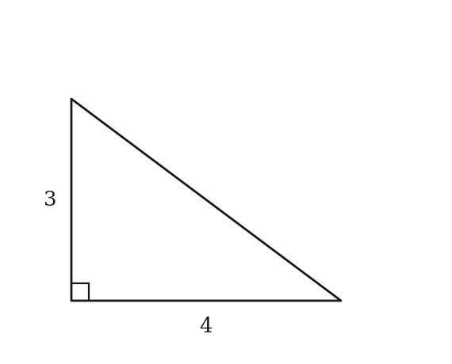

**(A)** 5  
**(B)** 6  
**(C)** 7  
**(D)** 12  
**(E)** 25

**Q2** · `GEO-PYT-004` · MCQ · 45s

What is the length of the diagonal of a rectangle with length 5 and width 12?

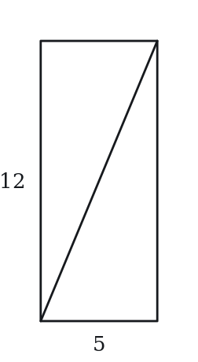

**(A)** 11  
**(B)** 13  
**(C)** 15  
**(D)** 17  
**(E)** 60

**Q3** · `GEO-PYT-005` · QC · 45s

A right triangle has legs a = 9 and b = 12.

> **Quantity A:**  The hypotenuse of the triangle
> **Quantity B:**  15

**Q4** · `GEO-PYT-006` · MCQ · 55s

Which of the following sets of three numbers can be the side lengths of a right triangle?

**(A)** 2, 3, 4  
**(B)** 3, 4, 6  
**(C)** 5, 12, 13  
**(D)** 6, 7, 8  
**(E)** 4, 5, 7

**Q5** · `GEO-PYT-008` · MCQ · 45s

A right triangle has a hypotenuse of 10 and one leg of 8. What is the length of the other leg?

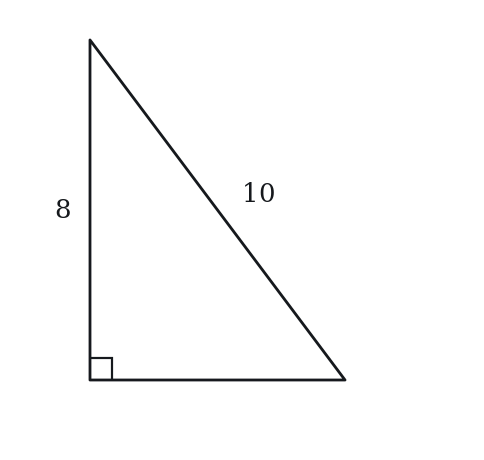

**(A)** 2  
**(B)** 4  
**(C)** 6  
**(D)** 9  
**(E)** 18

**Q6** · `GEO-PYT-035` · MCQ · 80s

The side lengths of a right triangle are consecutive integers. What are the three side lengths?

**(A)** 1, 2, 3  
**(B)** 2, 3, 4  
**(C)** 3, 4, 5  
**(D)** 4, 5, 6  
**(E)** 5, 6, 7

**Q7** · `GEO-PYT-044` · Numeric Entry · 85s

Right triangle ABC has legs AB = 3 and BC = 4 with the right angle at B. A square is constructed on the outside of the triangle with the hypotenuse AC as one of its sides. What is the area of that square?

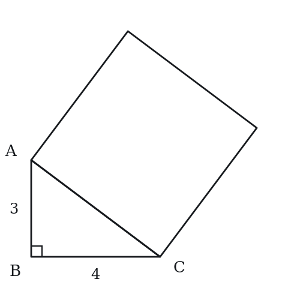

*Numeric entry — write the number.*

---

### Level 2 · Medium — 17 questions · ~25 min

*two or three steps, one planted trap each*

**Q8** · `GEO-PYT-016` · MCQ · 70s

A rectangle has a diagonal of length 20 and a width of 12. What is the area of the rectangle?

**(A)** 96  
**(B)** 128  
**(C)** 192  
**(D)** 240  
**(E)** 256

**Q9** · `GEO-PYT-017` · QC · 65s

A right triangle has a hypotenuse of 25 and one leg of 7.

> **Quantity A:**  The length of the other leg
> **Quantity B:**  24

**Q10** · `GEO-PYT-020` · Numeric Entry · 75s

A ladder 15 feet long leans against a vertical wall. The base of the ladder is 9 feet from the wall. How high up the wall does the ladder reach, in feet?

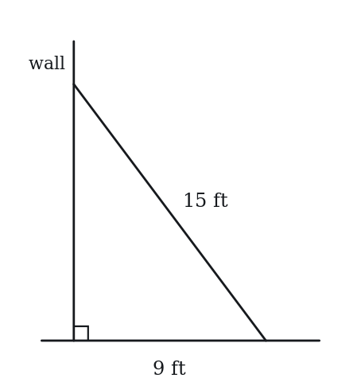

*Numeric entry — write the number.*

**Q11** · `GEO-PYT-021` · MCQ · 75s

The area of a right triangle is 30 square units. One leg has length 5. What is the length of the hypotenuse?

**(A)** 8  
**(B)** 10  
**(C)** 11  
**(D)** 13  
**(E)** 25

**Q12** · `GEO-PYT-024` · Numeric Entry · 90s

A right triangle has a perimeter of 30 and a hypotenuse of 13. What is the area of the triangle?

*Numeric entry — write the number.*

**Q13** · `GEO-PYT-026` · Select all that apply · 90s

Right triangle XYZ has integer side lengths and a hypotenuse of length 65. Which of the following could be the length of one of its legs? Select all that apply.

**(A)** 16  
**(B)** 33  
**(C)** 40  
**(D)** 50  
**(E)** 60

**Q14** · `GEO-PYT-027` · QC · 75s

In a right triangle, one leg has length 5.

> **Quantity A:**  The hypotenuse of the right triangle when the other leg = 12
> **Quantity B:**  The hypotenuse of the right triangle when the other leg = 13

**Q15** · `GEO-PYT-028` · MCQ · 80s

A right triangle has legs in the ratio 3:4. If the hypotenuse is 20, what is the length of the shorter leg?

**(A)** 8  
**(B)** 10  
**(C)** 12  
**(D)** 15  
**(E)** 16

**Q16** · `GEO-PYT-030` · Select all that apply · 85s

For a triangle with sides a, b, and c where c is the longest side, which of the following conditions guarantee that the triangle is NOT a right triangle? Select all that apply.

**(A)** a² + b² > c²  
**(B)** a² + b² < c²  
**(C)** a² + b² = c²  
**(D)** c² − a² = b² + 1  
**(E)** a + b > c only (with no information about squares)

**Q17** · `GEO-PYT-041` · MCQ · 100s

In right triangle ABC with right angle at C, the altitude from C meets AB at point D. If AD = 4 and DB = 9, what is the length of CD?

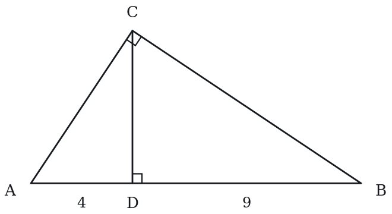

**(A)** √13  
**(B)** 5  
**(C)** 6  
**(D)** 6.5  
**(E)** 7

**Q18** · `GEO-PYT-042` · QC · 95s

A rectangular box has length 6, width 6, and variable height h.

> **Quantity A:**  Space diagonal when h = 7
> **Quantity B:**  Space diagonal when h = 8

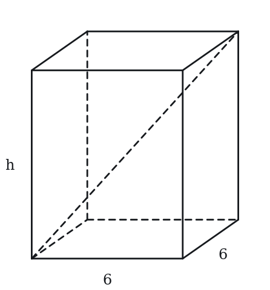

**Q19** · `GEO-PYT-051` · Select all that apply · 100s

For a right triangle with legs a, b and hypotenuse c, which of the following statements are always true? Select all that apply.

**(A)** a + b > c  
**(B)** a + b = c  
**(C)** c > a and c > b  
**(D)** a² + b² = c²  
**(E)** c² > a² + b²

**Q20** · `GEO-PYT-053` · Numeric Entry · 105s

A rectangular box has a square base with side length 6 and a height of 2. What is the length of the space diagonal (connecting opposite corners through the interior), rounded to the nearest integer?

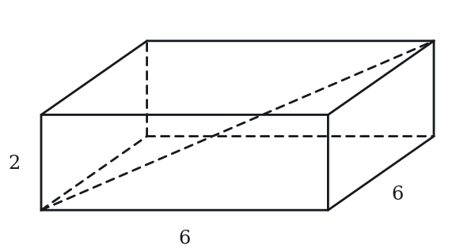

*Numeric entry — write the number.*

**Q21** · `GEO-PYT-056` · QC · 125s

Let T be a right triangle with legs a and b and hypotenuse c. Define the ratio R = (a² + b² + c²) / (ab).

> **Quantity A:**  R for the (3, 4, 5) right triangle
> **Quantity B:**  R for the (5, 12, 13) right triangle

**Q22** · `GEO-PYT-KMF-001` · MCQ · 85s

A triangular sail has sides whose lengths are in the ratio 8 to 15 to 17. The sail encloses an area of 240 square feet. What is the perimeter of the sail, in feet?

**(A)** 40  
**(B)** 60  
**(C)** 80  
**(D)** 120  
**(E)** 160

**Q23** · `GEO-PYT-KMF-005` · QC · 90s

A 17-foot ladder rests against a vertical wall with its top exactly 15 feet above the level ground. The top then slips 3 feet straight down the wall, and the foot of the ladder slides along the ground directly away from the wall.

> **Quantity A:**  The distance the foot of the ladder slides along the ground
> **Quantity B:**  3 feet

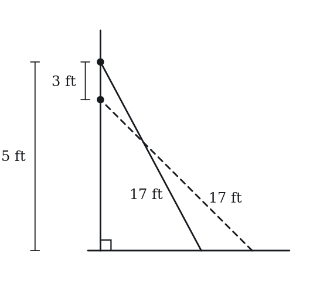

**Q24** · `SEC-PG-008` · Numeric Entry · 85s

All angles in the figure above are right angles, and the lengths of the six segments are as marked. What is the straight-line distance from point P to point Q?

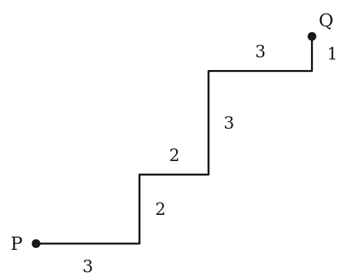

*Numeric entry — write the number.*

---

### Level 3 · Hard — 6 questions · ~11 min

*where 162+ is won or lost*

**Q25** · `GEO-PYT-045` · Select all that apply · 105s

Right triangle PQR has legs PQ = 9 and QR = 12, with right angle at Q. Point S lies on PR such that QS is perpendicular to PR. Which of the following statements are true? Select all that apply.

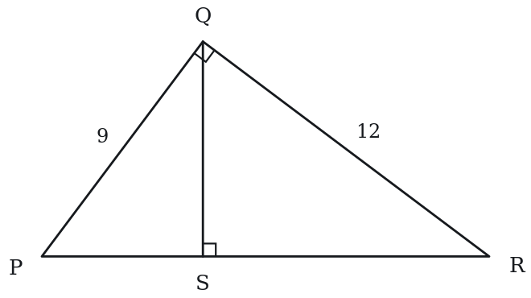

**(A)** PR = 15  
**(B)** QS = 7.5  
**(C)** PS = 27/5  
**(D)** The area of triangle PQS is 27  
**(E)** The area of triangle PQR is 54

**Q26** · `GEO-PYT-048` · MCQ · 105s

A right triangle has an area of 84 and a hypotenuse of 25. What is the perimeter of the triangle?

**(A)** 50  
**(B)** 56  
**(C)** 60  
**(D)** 63  
**(E)** 70

**Q27** · `GEO-PYT-049` · Numeric Entry · 105s

A right triangle has legs a and b with a > b. If a − b = 7 and the hypotenuse is 13, what is the value of a + b?

*Numeric entry — write the number.*

**Q28** · `GEO-PYT-KMF-004` · QC · 110s

A right triangle has legs of length p and q, both greater than 1, and hypotenuse h. A second right triangle is formed by shortening every leg of the first one by 1 unit.

> **Quantity A:**  The longest side of the second triangle
> **Quantity B:**  h - 1

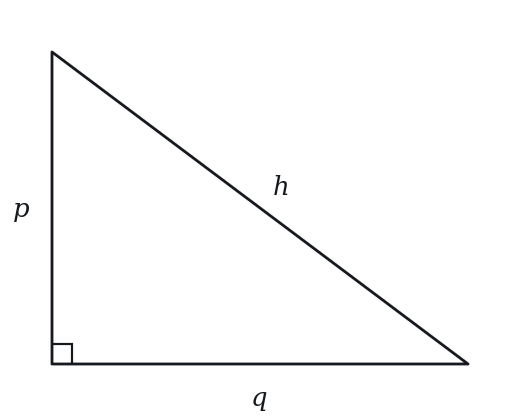

**Q29** · `SEC-PG-012` · Select all that apply · 125s

A rectangular photograph has a diagonal 25 centimeters long. One side of the photograph is longer than 7 centimeters and shorter than 15 centimeters. Which of the following could be the area, in square centimeters, of the photograph?

Indicate all such values.

**(A)** 150  
**(B)** 180  
**(C)** 240  
**(D)** 294  
**(E)** 300  
F. 320

**Q30** · `SEC-PG-027` · MCQ · 115s

The advertised size of a television is the length of the diagonal of its rectangular viewing screen. For a television advertised as 55-inch, if the lengths of the sides of the viewing screen are in the ratio 16 to 9, which of the following is closest to the area, in square inches, of the viewing screen?

**(A)** 697  
**(B)** 1,100  
**(C)** 1,293  
**(D)** 1,485  
**(E)** 3,025

---

## Part B — Answer Key

| Q | ID | Level | Type | Answer |
|---|---|---|---|---|
| 1 | `GEO-PYT-001` | easy | MCQ | **A** |
| 2 | `GEO-PYT-004` | easy | MCQ | **B** |
| 3 | `GEO-PYT-005` | easy | QC | **C** |
| 4 | `GEO-PYT-006` | easy | MCQ | **C** |
| 5 | `GEO-PYT-008` | easy | MCQ | **C** |
| 6 | `GEO-PYT-035` | easy | MCQ | **C** |
| 7 | `GEO-PYT-044` | easy | Numeric Entry | **25** |
| 8 | `GEO-PYT-016` | medium | MCQ | **C** |
| 9 | `GEO-PYT-017` | medium | QC | **C** |
| 10 | `GEO-PYT-020` | medium | Numeric Entry | **12** |
| 11 | `GEO-PYT-021` | medium | MCQ | **D** |
| 12 | `GEO-PYT-024` | medium | Numeric Entry | **30** |
| 13 | `GEO-PYT-026` | medium | Select all that apply | **A, B, E** |
| 14 | `GEO-PYT-027` | medium | QC | **B** |
| 15 | `GEO-PYT-028` | medium | MCQ | **C** |
| 16 | `GEO-PYT-030` | medium | Select all that apply | **A, B, D** |
| 17 | `GEO-PYT-041` | medium | MCQ | **C** |
| 18 | `GEO-PYT-042` | medium | QC | **B** |
| 19 | `GEO-PYT-051` | medium | Select all that apply | **A, C, D** |
| 20 | `GEO-PYT-053` | medium | Numeric Entry | **9** |
| 21 | `GEO-PYT-056` | medium | QC | **B** |
| 22 | `GEO-PYT-KMF-001` | medium | MCQ | **C** |
| 23 | `GEO-PYT-KMF-005` | medium | QC | **A** |
| 24 | `SEC-PG-008` | medium | Numeric Entry | **10** |
| 25 | `GEO-PYT-045` | hard | Select all that apply | **A, C, E** |
| 26 | `GEO-PYT-048` | hard | MCQ | **B** |
| 27 | `GEO-PYT-049` | hard | Numeric Entry | **17** |
| 28 | `GEO-PYT-KMF-004` | hard | QC | **B** |
| 29 | `SEC-PG-012` | hard | Select all that apply | **B, C, D** |
| 30 | `SEC-PG-027` | hard | MCQ | **C** |

---

## Part C — Worked Solutions

### Q1 · `GEO-PYT-001` — Answer: A

Apply the Pythagorean theorem: c² = a² + b².
c² = 3² + 4² = 9 + 16 = 25.
c = √25 = 5.
This is the classic (3, 4, 5) Pythagorean triple.

**Trap.** Students who forget to take the square root at the end select E (25) instead of 5.

### Q2 · `GEO-PYT-004` — Answer: B

The diagonal of a rectangle divides it into two right triangles. The diagonal is the hypotenuse.
c² = 5² + 12² = 25 + 144 = 169.
c = √169 = 13.
This is the (5, 12, 13) Pythagorean triple.

**Trap.** Students who add 5 + 12 = 17 (treating the diagonal as the sum of the sides) select D.

### Q3 · `GEO-PYT-005` — Answer: C

Apply the Pythagorean theorem: c² = 9² + 12² = 81 + 144 = 225.
c = √225 = 15.
Quantity A = 15 = Quantity B.
This is a scaled (3, 4, 5) triple multiplied by 3: (9, 12, 15).

**Trap.** Students who estimate rather than compute may doubt that the hypotenuse is exactly 15 and select D.

### Q4 · `GEO-PYT-006` — Answer: C

Test each set using a² + b² = c² (c is the largest value):
A: 2² + 3² = 4 + 9 = 13 ≠ 4² = 16. Not a right triangle.
B: 3² + 4² = 9 + 16 = 25 ≠ 6² = 36. Not a right triangle.
C: 5² + 12² = 25 + 144 = 169 = 13². YES — right triangle!
D: 6² + 7² = 36 + 49 = 85 ≠ 8² = 64. Not a right triangle.
E: 4² + 5² = 16 + 25 = 41 ≠ 7² = 49. Not a right triangle.
Only option C satisfies the Pythagorean theorem.

**Trap.** Students may assume any set with familiar-looking numbers forms a right triangle without verifying with the theorem.

### Q5 · `GEO-PYT-008` — Answer: C

Apply the Pythagorean theorem: a² + b² = c².
8² + b² = 10²
64 + b² = 100
b² = 100 - 64 = 36
b = √36 = 6.
This is a scaled (3, 4, 5) triple multiplied by 2: (6, 8, 10).

**Trap.** Students who compute 10 - 8 = 2 (subtracting instead of using the theorem) select A.

### Q6 · `GEO-PYT-035` — Answer: C

For consecutive integers n, n+1, n+2 to form a right triangle:
n² + (n+1)² = (n+2)²
n² + n² + 2n + 1 = n² + 4n + 4
2n² + 2n + 1 = n² + 4n + 4
n² − 2n − 3 = 0
(n−3)(n+1) = 0
n = 3.
Sides are 3, 4, 5. Check: 9 + 16 = 25 ✓.
This is the only set of three consecutive integers forming a right triangle.

**Trap.** Students who test each option by checking the triangle inequality (valid for all options) rather than the Pythagorean theorem may struggle to eliminate wrong answers.

### Q7 · `GEO-PYT-044` — Answer: 25

Step 1: Find the hypotenuse AC.
AC² = AB² + BC² = 3² + 4² = 9 + 16 = 25.
AC = 5.
Step 2: The area of the square with side length AC.
Area = AC² = 5² = 25.
Note: The area of the square on the hypotenuse (25) equals the sum of the areas of the squares on the two legs (9 + 16 = 25). This is the geometric interpretation of the Pythagorean theorem.

**Trap.** Students who compute AC = 5 but then compute the square's perimeter (20) or confuse area with side length and enter 5 make the final-step error.

### Q8 · `GEO-PYT-016` — Answer: C

Step 1: Find the length of the rectangle using the Pythagorean theorem.
length² + 12² = 20²
length² + 144 = 400
length² = 256
length = 16.
Step 2: Calculate the area.
Area = length × width = 16 × 12 = 192.

**Trap.** Students who use the diagonal as one dimension compute 20 × 12 = 240 (option D) without first finding the actual length.

### Q9 · `GEO-PYT-017` — Answer: C

Apply the Pythagorean theorem: 7² + b² = 25².
49 + b² = 625
b² = 576
b = 24.
Quantity A = 24 = Quantity B.
This is the (7, 24, 25) Pythagorean triple.

**Trap.** Students who estimate instead of computing may guess D (cannot be determined) without verifying the exact value.

### Q10 · `GEO-PYT-020` — Answer: 12

The ladder, wall, and ground form a right triangle. The ladder is the hypotenuse (15 ft), the distance from wall to base is one leg (9 ft), and the height on the wall is the other leg (h).
9² + h² = 15²
81 + h² = 225
h² = 144
h = 12.
The ladder reaches 12 feet up the wall.

**Trap.** Students who compute 15 - 9 = 6 (subtracting instead of using the theorem) enter 6.

### Q11 · `GEO-PYT-021` — Answer: D

Step 1: Find the other leg using the area formula.
Area = ½ × leg₁ × leg₂
30 = ½ × 5 × leg₂
leg₂ = 60/5 = 12.
Step 2: Find the hypotenuse using the Pythagorean theorem.
c² = 5² + 12² = 25 + 144 = 169.
c = √169 = 13.
This is the (5, 12, 13) Pythagorean triple.

**Trap.** Students who find leg₂ = 12 and then select B (confusing leg₂ with the hypotenuse) or who forget to apply the theorem and pick C (estimating 5 + 12 − 6 = 11) make characteristic errors.

### Q12 · `GEO-PYT-024` — Answer: 30

Step 1: Find the sum of the two legs.
leg₁ + leg₂ = perimeter − hypotenuse = 30 − 13 = 17.
Step 2: Use the Pythagorean theorem to find the product of the legs.
leg₁² + leg₂² = 13² = 169.
Step 3: Use the identity (leg₁ + leg₂)² = leg₁² + 2·leg₁·leg₂ + leg₂².
17² = 169 + 2·leg₁·leg₂
289 = 169 + 2·leg₁·leg₂
2·leg₁·leg₂ = 120
leg₁·leg₂ = 60.
Step 4: Area = ½ × leg₁ × leg₂ = ½ × 60 = 30.
(Check: legs are 5 and 12; 5 + 12 + 13 = 30 ✓; ½ × 5 × 12 = 30 ✓.)

**Trap.** Students who try to solve for individual legs by setting up a quadratic spend too much time. The identity (a+b)² = a²+b²+2ab shortcut avoids this.

### Q13 · `GEO-PYT-026` — Answer: A, B, E

A value L is a leg if 65² − L² = 4225 − L² is a perfect square. A: 4225 − 256 = 3969 = 63² ✓; C: 4225 − 1600 = 2625, not a perfect square ✗; B: 4225 − 1089 = 3136 = 56² ✓; D: 4225 − 2500 = 1725, not a perfect square ✗; E: 4225 − 3600 = 625 = 25² ✓. So A, C, and E (triples 16-63-65, 33-56-65, 25-60-65).

**Trap.** Students who only test scaled (3,4,5) or (5,12,13) triples will miss the (16,63,65) and (33,56,65) triples, which are less well-known.

### Q14 · `GEO-PYT-027` — Answer: B

Quantity A: c² = 5² + 12² = 25 + 144 = 169, so c = 13.
Quantity B: c² = 5² + 13² = 25 + 169 = 194, so c = √194 ≈ 13.93.
Quantity B (≈13.93) > Quantity A (13).

**Trap.** Students who note that both values are 'around 13' and guess C fail to compute Quantity B precisely enough.

### Q15 · `GEO-PYT-028` — Answer: C

Let the legs be 3k and 4k.
Apply the Pythagorean theorem:
(3k)² + (4k)² = 20²
9k² + 16k² = 400
25k² = 400
k² = 16
k = 4.
Shorter leg = 3k = 12. Longer leg = 4k = 16.
Check: 12² + 16² = 144 + 256 = 400 = 20². ✓

**Trap.** Students who set 3k + 4k = 20 (treating the ratio as an additive split of the hypotenuse) get k = 20/7 ≈ 2.86 and a non-integer answer.

### Q16 · `GEO-PYT-030` — Answer: A, B, D

A right triangle satisfies a² + b² = c² exactly.
A: a² + b² > c² → angle opposite c is ACUTE. Triangle is NOT right. ✓
B: a² + b² < c² → angle opposite c is OBTUSE. Triangle is NOT right. ✓
C: a² + b² = c² → this IS the right triangle condition. Does NOT guarantee NOT right. ✗
D: c² − a² = b² + 1 → rearranging: c² = a² + b² + 1, so a² + b² ≠ c². NOT a right triangle. ✓
E: a + b > c is the triangle inequality, required for any valid triangle but does not exclude right triangles. ✗
Answers: A, B, D.

**Trap.** Students may mark E as correct, thinking the triangle inequality somehow rules out right triangles — it does not. Every right triangle satisfies a + b > c.

### Q17 · `GEO-PYT-041` — Answer: C

When the altitude is drawn from the right angle to the hypotenuse of a right triangle, the altitude is the geometric mean of the two hypotenuse segments.
CD² = AD × DB = 4 × 9 = 36.
CD = √36 = 6.
This follows from similar triangles: triangles ACD and CDB are both similar to ABC.

**Trap.** Students who use the arithmetic mean instead of the geometric mean compute CD = (AD + DB)/2 = (4+9)/2 = 6.5 and select D.

### Q18 · `GEO-PYT-042` — Answer: B

Quantity A: d = √(6² + 6² + 7²) = √(36 + 36 + 49) = √121 = 11.
Quantity B: d = √(6² + 6² + 8²) = √(36 + 36 + 64) = √136 ≈ 11.66.
Quantity B (≈11.66) > Quantity A (11).

**Trap.** Students who compute Quantity A = 11 exactly (a clean integer) but then estimate Quantity B as 'also about 11' without computing may mistakenly select C.

### Q19 · `GEO-PYT-051` — Answer: A, C, D

A: a + b > c — true. Proof: (a+b)² = a²+2ab+b² > a²+b² = c² (since 2ab > 0), so a+b > c. ✓
B: a + b = c — false. This is the degenerate case (collinear points, not a triangle). ✗
C: c > a and c > b — true. Since c² = a²+b² > a² (because b²>0), we get c > a. Similarly c > b. The hypotenuse is always the longest side. ✓
D: a² + b² = c² — true. This is the defining property of a right triangle (Pythagorean theorem). ✓
E: c² > a² + b² — false. This would describe an obtuse triangle, not a right triangle. ✗

**Trap.** Students who confuse 'the hypotenuse is longer than each individual leg' (true, option C) with 'the hypotenuse is longer than the sum of the legs' (false, option B) may incorrectly select B.

### Q20 · `GEO-PYT-053` — Answer: 9

The space diagonal formula: d = √(l² + w² + h²).
With l = 6, w = 6, h = 2:
d = √(6² + 6² + 2²) = √(36 + 36 + 4) = √76.
√76 ≈ 8.72.
Rounded to the nearest integer: 9.

**Trap.** Students who include only the base diagonal and forget the height dimension compute √(36+36) = √72 ≈ 8.49, which also rounds to 8 — the wrong answer.

### Q21 · `GEO-PYT-056` — Answer: B

Since a² + b² = c² for any right triangle, we have a² + b² + c² = c² + c² = 2c².
So R = 2c² / (ab).
For (3,4,5): R = 2(25) / (3×4) = 50/12 = 25/6 ≈ 4.167.
For (5,12,13): R = 2(169) / (5×12) = 338/60 = 169/30 ≈ 5.633.
Compare 25/6 vs 169/30: Convert to same denominator: 125/30 vs 169/30.
125 < 169, so 25/6 < 169/30.
Quantity A (25/6) < Quantity B (169/30). Quantity B is greater.

**Trap.** Students may assume R is constant for all right triangles (it is NOT — it depends on the specific shape). The ratio R = 2c²/(ab) varies with the triangle's proportions.

### Q22 · `GEO-PYT-KMF-001` — Answer: C

Let the sides be 8k, 15k, and 17k for some positive number k.
Since 8^2 + 15^2 = 64 + 225 = 289 = 17^2, the triangle is a right triangle with legs 8k and 15k.
Its area is (1/2)(8k)(15k) = 60k^2 = 240, so k^2 = 4 and k = 2.
The sides are 16, 30, and 34, so the perimeter is 16 + 30 + 34 = 80 feet.

**Trap.** Students find k = 2 correctly but then report the sum of the ratio numbers, 8 + 15 + 17 = 40, as the perimeter, forgetting to scale by k. That gives option A.

### Q23 · `GEO-PYT-KMF-005` — Answer: A

1. First position: the foot is sqrt(17^2 - 15^2) = sqrt(289 - 225) = sqrt(64) = 8 feet from the wall.
2. After the slip the top is at height 15 - 3 = 12 feet, so the foot is sqrt(17^2 - 12^2) = sqrt(289 - 144) = sqrt(145) from the wall.
3. sqrt(145) is about 12.04, so the foot slides about 12.04 - 8 = 4.04 feet.
4. 4.04 > 3, so Quantity A is greater.
Check: 12^2 = 144 < 145 < 169 = 13^2, so sqrt(145) > 12 and the slide exceeds 12 - 8 = 4, which is already more than 3.

**Trap.** Assuming the foot moves as far horizontally as the top moves vertically (a 3-foot slide for a 3-foot drop) gives equality, which is choice C.

### Q24 · `SEC-PG-008` — Answer: 10

Ignore the staircase shape and track only the net displacement. Moving from P to Q, the horizontal steps are 3, 2 and 3, for a total of 8 to the right. The vertical steps are 2, 3 and 1, for a total of 6 upward. The straight-line distance from P to Q is the hypotenuse of a right triangle with legs 8 and 6, which is a 6-8-10 triangle, so the distance is 10.

**Trap.** Students add all six segment lengths and answer 14, which is the length of the path walked, not the straight-line distance. The question asks for the direct segment PQ, so only the totals in each direction matter.

### Q25 · `GEO-PYT-045` — Answer: A, C, E

A: PR = √(81 + 144) = 15, true. B: QS = (9·12)/15 = 36/5 = 7.2, not 7.5 (7.5 is half of PR, the median to the hypotenuse), false. C: triangle PQS ~ triangle PRQ, so PS = PQ²/PR = 81/15 = 27/5, true. D: area of PQS = (1/2)(27/5)(36/5) = 486/25 = 19.44, not 27; 27 would be half of triangle PQR, which is true only if S were the midpoint of PR, so false. E: area of PQR = (1/2)(9)(12) = 54, true.

**Trap.** Treating S as the midpoint of PR, which gives QS = 7.5 (B) and half the area, 27 (D). S is the foot of the altitude, which is not the midpoint in a 9-12-15 triangle.

### Q26 · `GEO-PYT-048` — Answer: B

Let the legs be a and b.
Given: ½ab = 84 → ab = 168.
Given: a² + b² = 25² = 625.
Use the identity (a + b)² = a² + 2ab + b²:
(a+b)² = 625 + 2(168) = 625 + 336 = 961.
a + b = √961 = 31.
Perimeter = a + b + c = 31 + 25 = 56.
(Verification: legs are 7 and 24; 7×24=168 ✓, 7²+24²=625 ✓, 7+24+25=56 ✓.)

**Trap.** Students who try to find individual legs by solving a quadratic (t² − 31t + 168 = 0, so (t−7)(t−24)=0) get the right answer but waste time. The identity shortcut gives the perimeter directly.

### Q27 · `GEO-PYT-049` — Answer: 17

Given: a − b = 7 and a² + b² = 13² = 169.
Use the identity (a − b)² = a² − 2ab + b²:
7² = 169 − 2ab
49 = 169 − 2ab
2ab = 120
ab = 60.
Now use (a + b)² = a² + 2ab + b² = 169 + 2(60) = 169 + 120 = 289.
a + b = √289 = 17.
(Check: a=12, b=5; 12−5=7 ✓, 12+5=17 ✓, 12²+5²=169 ✓.)

**Trap.** Students who guess a=10, b=3 (since 10−3=7) quickly discover 10²+3²=109≠169 and then get stuck without the algebraic identity approach.

### Q28 · `GEO-PYT-KMF-004` — Answer: B

1. Let A be the new longest side (the hypotenuse of the second triangle): A^2 = (p - 1)^2 + (q - 1)^2 = p^2 + q^2 - 2(p + q) + 2 = h^2 - 2(p + q) + 2.
2. Quantity B squared is (h - 1)^2 = h^2 - 2h + 1, and both A and h - 1 are positive.
3. A^2 - (h - 1)^2 = -2(p + q) + 2 + 2h - 1 = 1 - 2(p + q - h).
4. The quantity p + q - h grows whenever either leg grows, so for legs greater than 1 it exceeds its value at p = q = 1, which is 2 - sqrt(2), about 0.586.
5. So 2(p + q - h) > 1.17 > 1, A^2 - (h - 1)^2 is negative, and Quantity B is larger.
6. Check: p = 3, q = 4, h = 5 gives A = sqrt(4 + 9) = 3.61 versus h - 1 = 4. With p = q = 1.5 the values are 0.71 versus 1.12. Quantity B wins every time.

**Trap.** Expecting that shortening both legs by 1 shortens the hypotenuse by exactly 1 (the way lengths add along a straight line), which makes the two quantities equal, choice C; in fact the hypotenuse shrinks by less than 1.

### Q29 · `SEC-PG-012` — Answer: B, C, D

Call the given side s. The other side is sqrt(625 - s^2) and the area is s * sqrt(625 - s^2). At s = 7 the other side is sqrt(625 - 49) = 24, giving area 168. At s = 15 the other side is sqrt(625 - 225) = 20, giving area 300. The area of a rectangle with a fixed diagonal grows as the rectangle moves toward a square, and a square with diagonal 25 would have side about 17.7, so on the whole interval 7 < s < 15 the area is still increasing. The area therefore runs strictly between 168 and 300. Of the choices, 180, 240 and 294 qualify; 150 is below the range, and 300 and 320 are at or above it.

**Trap.** Students include 300, which is the value at exactly s = 15, an endpoint the problem excludes. Others cap the area at 312.5, the largest possible for a diagonal of 25, and wrongly admit 300 and even 320 on that basis; the side restriction pulls the ceiling down to 300 and makes it unreachable.

### Q30 · `SEC-PG-027` — Answer: C

Write the sides as 16x and 9x. By the Pythagorean theorem the diagonal is x*sqrt(16^2 + 9^2) = x*sqrt(256 + 81) = x*sqrt(337). Setting x*sqrt(337) = 55 gives x^2 = 55^2/337 = 3,025/337, which is about 8.98. The area is (16x)(9x) = 144x^2, which is about 144 x 8.98 = 1,293 square inches.

**Trap.** Students treat 16, 9 and the diagonal as a 16-9-25 triple, set x = 55/25 = 2.2, and compute 144(2.2)^2 = 697. The hypotenuse of a 16-9 right triangle is sqrt(337), roughly 18.36, not 25, so the scale factor is close to 3, not 2.2.
