# Special Right Triangles — Practice Set

**Bank code:** `GEO-SPT` · **Section:** Geometry · **30 questions** — Easy 7 · Medium 17 · Hard 6

**Lecture capsule:** [04-special-right-triangles.md](../../05-geometry/04-special-right-triangles.md)

> 45-45-90 is 1 : 1 : sqrt(2) and 30-60-90 is 1 : sqrt(3) : 2; the hard part is spotting which side you were handed, not the ratio itself.

Every question below is live in the question bank under the ID shown — the sheet and the portal are the same questions. Attempt a level with the clock running, then check Part C.

---

## Part A — Questions

> **Quantitative Comparison — the four choices are always the same, so they are not reprinted:**
> **(A)** Quantity A is greater · **(B)** Quantity B is greater · **(C)** The two quantities are equal · **(D)** The relationship cannot be determined from the information given

### Level 1 · Easy — 7 questions · ~5 min

*warm-up — these must be automatic*

**Q1** · `GEO-SPT-001` · MCQ · 40s

In a 45-45-90 triangle, one leg has length 6. What is the length of the hypotenuse?

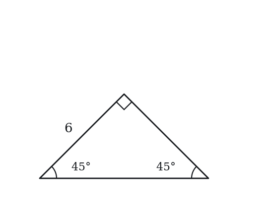

**(A)** 3√2  
**(B)** 6  
**(C)** 6√2  
**(D)** 6√3  
**(E)** 12

**Q2** · `GEO-SPT-002` · MCQ · 40s

In a 30-60-90 triangle, the shortest side has length 5. What is the length of the hypotenuse?

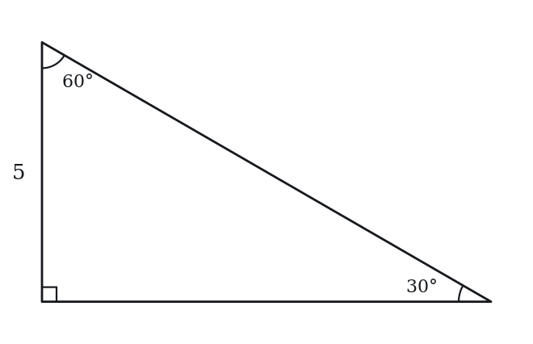

**(A)** 5  
**(B)** 5√2  
**(C)** 5√3  
**(D)** 10  
**(E)** 15

**Q3** · `GEO-SPT-005` · MCQ · 45s

In a 30-60-90 triangle, the longer leg has length 9√3. What is the length of the shorter leg?

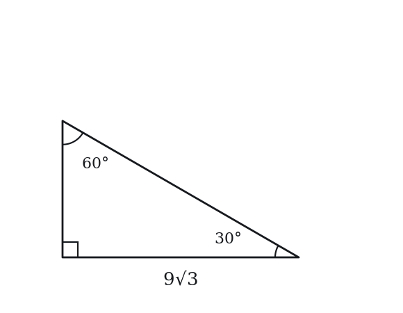

**(A)** 3√3  
**(B)** 9  
**(C)** 6√3  
**(D)** 9√2  
**(E)** 18

**Q4** · `GEO-SPT-006` · Numeric Entry · 50s

A square has a diagonal of length 8√2. What is the side length of the square?

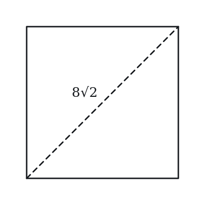

*Numeric entry — write the number.*

**Q5** · `GEO-SPT-010` · MCQ · 55s

An equilateral triangle has side length 10. What is its height?

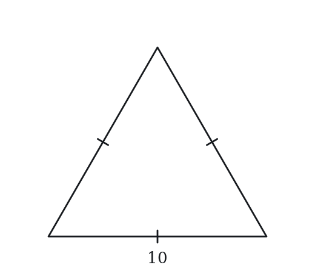

**(A)** 5  
**(B)** 5√2  
**(C)** 5√3  
**(D)** 10  
**(E)** 10√3

**Q6** · `GEO-SPT-013` · MCQ · 40s

A square has side length 9. What is the length of its diagonal?

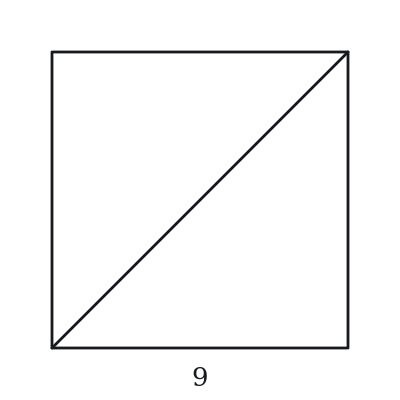

**(A)** 3√2  
**(B)** 9  
**(C)** 9√2  
**(D)** 9√3  
**(E)** 18

**Q7** · `GEO-SPT-014` · QC · 55s

In a 30-60-90 triangle with hypotenuse = 12:

> **Quantity A:**  The length of the longer leg
> **Quantity B:**  The length of the shorter leg × 2

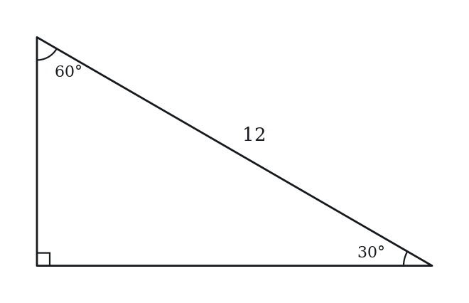

---

### Level 2 · Medium — 17 questions · ~23 min

*two or three steps, one planted trap each*

**Q8** · `GEO-SPT-016` · MCQ · 75s

A right triangle has angles of 30°, 60°, and 90°. The perimeter of the triangle is 18 + 6√3. What is the length of the hypotenuse?

**(A)** 3√3  
**(B)** 6  
**(C)** 9  
**(D)** 6√3  
**(E)** 12

**Q9** · `GEO-SPT-017` · MCQ · 65s

The area of a 45-45-90 triangle is 32. What is the length of the hypotenuse?

**(A)** 4  
**(B)** 4√2  
**(C)** 8  
**(D)** 8√2  
**(E)** 16

**Q10** · `GEO-SPT-018` · MCQ · 70s

The area of an equilateral triangle with side length s is 16√3. What is s?

**(A)** 4  
**(B)** 4√3  
**(C)** 8  
**(D)** 8√3  
**(E)** 16

**Q11** · `GEO-SPT-019` · QC · 80s

Triangle A is a 30-60-90 triangle with hypotenuse 10. Triangle B is a 45-45-90 triangle with hypotenuse 10.

> **Quantity A:**  The area of Triangle A
> **Quantity B:**  The area of Triangle B

**Q12** · `GEO-SPT-020` · Numeric Entry · 80s

A rectangle has a diagonal that makes a 30° angle with the longer side. If the diagonal has length 16, what is the area of the rectangle?

The area equals k√3. Give the value of k.

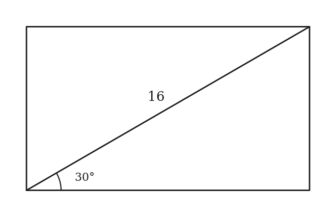

*Numeric entry — write the number.*

**Q13** · `GEO-SPT-022` · Select all that apply · 90s

In the right triangle shown, the hypotenuse has length 2k. Which of the following must be true? Indicate all such statements.

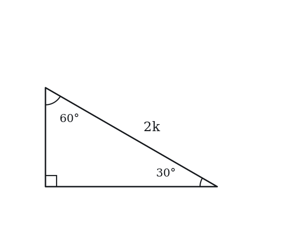

**(A)** The shorter leg has length k  
**(B)** The longer leg has length k√2  
**(C)** The longer leg has length k√3  
**(D)** The perimeter equals k(3 + √3)  
**(E)** The area equals (k²√3)/2

**Q14** · `GEO-SPT-024` · QC · 90s

A square has a diagonal of length d. A 30-60-90 triangle has a hypotenuse of length d.

> **Quantity A:**  The area of the square
> **Quantity B:**  The area of the 30-60-90 triangle

**Q15** · `GEO-SPT-029` · Select all that apply · 85s

A 45-45-90 triangle has hypotenuse h. Which of the following expressions equal the area of the triangle? Select all that apply.

**(A)** h²/4  
**(B)** (h/√2)²/2  
**(C)** h²√2/4  
**(D)** h²/(2√2)  
**(E)** h²√2/8

**Q16** · `GEO-SPT-031` · Numeric Entry · 65s

The diagonal of a square is 10. What is the area of the square?

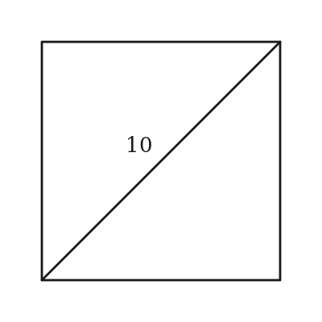

*Numeric entry — write the number.*

**Q17** · `GEO-SPT-032` · QC · 75s

An equilateral triangle has side length 6. A 45-45-90 triangle has legs of length 6.

> **Quantity A:**  Height of the equilateral triangle
> **Quantity B:**  Hypotenuse of the 45-45-90 triangle

**Q18** · `GEO-SPT-033` · MCQ · 85s

Two congruent 30-60-90 triangles are placed together along their hypotenuses to form a rectangle. If the hypotenuse of each triangle is 8, what is the area of the rectangle?

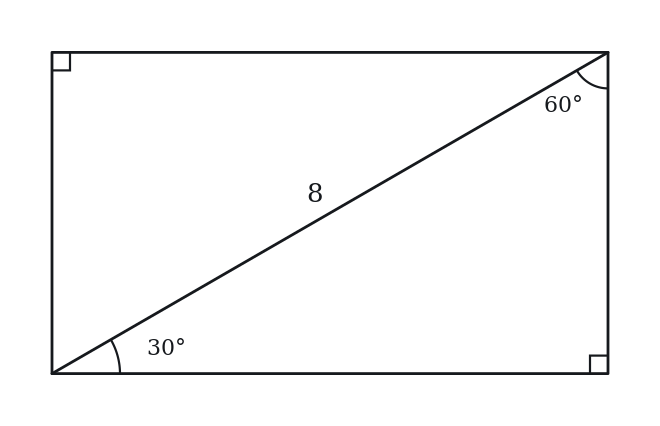

**(A)** 8√3  
**(B)** 16  
**(C)** 16√2  
**(D)** 16√3  
**(E)** 32

**Q19** · `GEO-SPT-035` · Numeric Entry · 80s

An equilateral triangle has height 12. The perimeter of the triangle is k√3. What is the value of k?

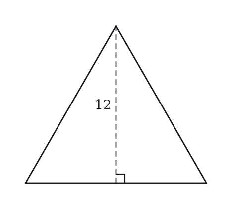

*Numeric entry — write the number.*

**Q20** · `GEO-SPT-036` · QC · 90s

In a 30-60-90 triangle, the longer leg = L.

> **Quantity A:**  The hypotenuse
> **Quantity B:**  L√2

**Q21** · `GEO-SPT-040` · MCQ · 85s

A regular hexagon has side length 6. What is the area of the hexagon?

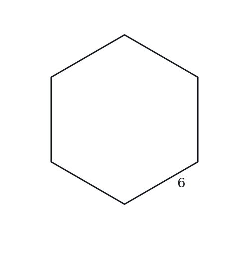

**(A)** 54  
**(B)** 36√3  
**(C)** 54√3  
**(D)** 108  
**(E)** 108√3

**Q22** · `GEO-SPT-042` · Numeric Entry · 100s

Two 30-60-90 triangles share a common hypotenuse of length 12, arranged as mirror images across the hypotenuse to form a kite (the hypotenuse becomes an interior diagonal). The area of the kite equals k√3. What is k?

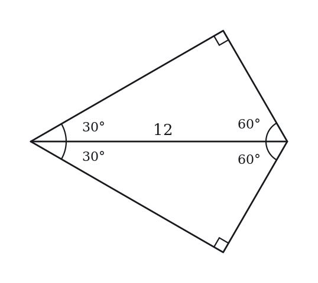

*Numeric entry — write the number.*

**Q23** · `GEO-SPT-050` · MCQ · 105s

The altitude from the right angle to the hypotenuse of a 30-60-90 triangle with hypotenuse 4 divides the hypotenuse into two segments. What is the length of the shorter segment?

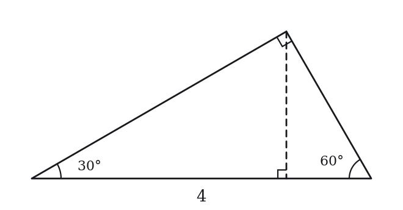

**(A)** 1/2  
**(B)** 3/4  
**(C)** 1  
**(D)** √3  
**(E)** 2

**Q24** · `SEC-PG-041` · QC · 85s

ABCD is a square, and AC is one of its diagonals.

> **Quantity A:**  (AB + BC)/AC
> **Quantity B:**  1.5

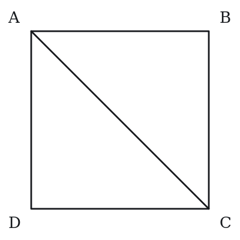

---

### Level 3 · Hard — 6 questions · ~10 min

*where 162+ is won or lost*

**Q25** · `GEO-SPT-041` · QC · 95s

The length of a diagonal of a certain square is d, and the length of each side of a certain equilateral triangle is also d.

> **Quantity A:**  The area of the square
> **Quantity B:**  The area of the triangle

**Q26** · `GEO-SPT-047` · MCQ · 95s

A 30-60-90 triangle is inscribed in a circle. The hypotenuse of the triangle is a diameter of the circle with length 10. What is the area of the region inside the circle but outside the triangle?

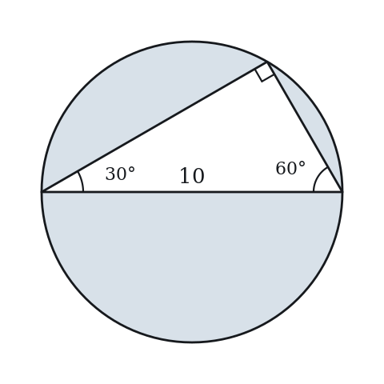

**(A)** 25π − 25√3  
**(B)** 25π − 12.5√3  
**(C)** 25π − 10√3  
**(D)** 25π − 12.5  
**(E)** 50π − 25√3

**Q27** · `GEO-SPT-051` · Numeric Entry · 95s

A 30-60-90 triangle has a perimeter of 12 + 4√3. The area of the triangle is k√3, where k is an integer. What is the value of k?

*Numeric entry — write the number.*

**Q28** · `GEO-SPT-054` · MCQ · 125s

In triangle ABC, angle B = 90°, angle A = 30°. The altitude from B to the hypotenuse AC meets AC at point D. If AD = 9, what is the area of triangle ABC?

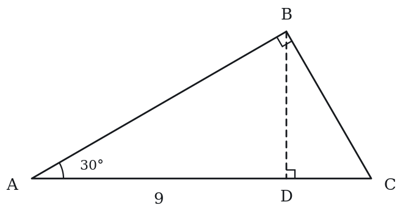

**(A)** 9√3  
**(B)** 18√3  
**(C)** 27√3  
**(D)** 36√3  
**(E)** 54√3

**Q29** · `GEO-SPT-KMF-001` · QC · 105s

A circle with center P has radius r. Points X and Y lie on the circle, and the measure of angle XPY is 90 degrees.

> **Quantity A:**  The perimeter of triangle XPY
> **Quantity B:**  3.4r

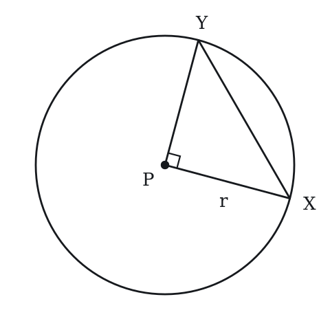

**Q30** · `GEO-SPT-KMF2-002` · Select all that apply · 105s

In the figure above, angle QPT is a right angle, R lies on PT, and PR = x. Which of the following must be true?

Indicate all such statements.

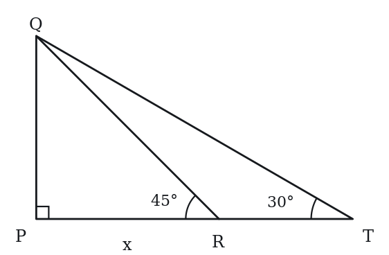

**(A)** PQ = x  
**(B)** QR = x*sqrt(2)  
**(C)** QT = 2x  
**(D)** PT = 2x  
**(E)** RT = x

---

## Part B — Answer Key

| Q | ID | Level | Type | Answer |
|---|---|---|---|---|
| 1 | `GEO-SPT-001` | easy | MCQ | **C** |
| 2 | `GEO-SPT-002` | easy | MCQ | **D** |
| 3 | `GEO-SPT-005` | easy | MCQ | **B** |
| 4 | `GEO-SPT-006` | easy | Numeric Entry | **8** |
| 5 | `GEO-SPT-010` | easy | MCQ | **C** |
| 6 | `GEO-SPT-013` | easy | MCQ | **C** |
| 7 | `GEO-SPT-014` | easy | QC | **B** |
| 8 | `GEO-SPT-016` | medium | MCQ | **E** |
| 9 | `GEO-SPT-017` | medium | MCQ | **D** |
| 10 | `GEO-SPT-018` | medium | MCQ | **C** |
| 11 | `GEO-SPT-019` | medium | QC | **B** |
| 12 | `GEO-SPT-020` | medium | Numeric Entry | **64** |
| 13 | `GEO-SPT-022` | medium | Select all that apply | **A, C, D, E** |
| 14 | `GEO-SPT-024` | medium | QC | **A** |
| 15 | `GEO-SPT-029` | medium | Select all that apply | **A, B** |
| 16 | `GEO-SPT-031` | medium | Numeric Entry | **50** |
| 17 | `GEO-SPT-032` | medium | QC | **B** |
| 18 | `GEO-SPT-033` | medium | MCQ | **D** |
| 19 | `GEO-SPT-035` | medium | Numeric Entry | **24** |
| 20 | `GEO-SPT-036` | medium | QC | **B** |
| 21 | `GEO-SPT-040` | medium | MCQ | **C** |
| 22 | `GEO-SPT-042` | medium | Numeric Entry | **36** |
| 23 | `GEO-SPT-050` | medium | MCQ | **C** |
| 24 | `SEC-PG-041` | medium | QC | **B** |
| 25 | `GEO-SPT-041` | hard | QC | **A** |
| 26 | `GEO-SPT-047` | hard | MCQ | **B** |
| 27 | `GEO-SPT-051` | hard | Numeric Entry | **8** |
| 28 | `GEO-SPT-054` | hard | MCQ | **B** |
| 29 | `GEO-SPT-KMF-001` | hard | QC | **A** |
| 30 | `GEO-SPT-KMF2-002` | hard | Select all that apply | **A, B, C** |

---

## Part C — Worked Solutions

### Q1 · `GEO-SPT-001` — Answer: C

In a 45-45-90 triangle, the sides are in ratio 1:1:√2. If each leg = 6, the hypotenuse = 6 × √2 = 6√2.

**Trap.** Students confuse 45-45-90 with 30-60-90 and multiply by √3 instead of √2, selecting 6√3.

### Q2 · `GEO-SPT-002` — Answer: D

In a 30-60-90 triangle, the sides are in ratio 1:√3:2. The shortest side (opposite 30°) = x = 5. The hypotenuse = 2x = 2 × 5 = 10.

**Trap.** Students use the 45-45-90 ratio and multiply by √2, selecting 5√2.

### Q3 · `GEO-SPT-005` — Answer: B

In a 30-60-90 triangle, the longer leg = x√3 where x is the shorter leg. So x√3 = 9√3, meaning x = 9. The shorter leg = 9.

**Trap.** Students divide 9√3 by 2 instead of √3, or confuse which ratio applies to which leg.

### Q4 · `GEO-SPT-006` — Answer: 8

The diagonal of a square creates a 45-45-90 triangle with the two sides. If the side = s, then diagonal = s√2. So s√2 = 8√2, giving s = 8.

**Trap.** Students divide 8√2 by 2 instead of √2, getting 4√2.

### Q5 · `GEO-SPT-010` — Answer: C

The altitude of an equilateral triangle bisects it into two 30-60-90 triangles. The hypotenuse of each is 10, the short leg is 5, and the long leg (the height) = 5√3.

**Trap.** Students confuse the 30-60-90 ratio and select 5√2 (the 45-45-90 result), or simply take half the side length (5).

### Q6 · `GEO-SPT-013` — Answer: C

The diagonal of a square divides it into two 45-45-90 triangles with the legs equal to the side length. Diagonal = leg × √2 = 9 × √2 = 9√2.

**Trap.** Students apply the 30-60-90 ratio and multiply by √3 instead of √2, selecting 9√3.

### Q7 · `GEO-SPT-014` — Answer: B

Shorter leg = 12/2 = 6. Longer leg = 6√3 ≈ 10.39. Quantity A = 6√3 ≈ 10.39. Quantity B = 6 × 2 = 12. Since 6√3 < 12 (because √3 < 2), Quantity B is greater.

**Trap.** Students think the longer leg is double the shorter leg (that is the hypotenuse), selecting C.

### Q8 · `GEO-SPT-016` — Answer: E

Let short leg = x. Then long leg = x√3 and hypotenuse = 2x. Perimeter = x + x√3 + 2x = x(3 + √3) = 18 + 6√3 = 6(3 + √3). So x = 6. Hypotenuse = 2x = 12.

**Trap.** Students set up x + x√3 + 2x correctly but then fail to factor: they try x = (18 + 6√3)/3 = 6 + 2√3 instead of factoring 6(3 + √3).

### Q9 · `GEO-SPT-017` — Answer: D

In a 45-45-90 triangle, both legs are equal. Let leg = a. Area = (1/2) × a × a = a²/2 = 32, so a² = 64 and a = 8. Hypotenuse = a√2 = 8√2.

**Trap.** Students find a = 8 and stop, selecting C (the leg) instead of computing the hypotenuse = 8√2.

### Q10 · `GEO-SPT-018` — Answer: C

Area of equilateral triangle = (s²√3)/4. Set (s²√3)/4 = 16√3. Then s²/4 = 16, so s² = 64 and s = 8.

**Trap.** Students drop the divisor 4 and solve s^2 = 16, choosing s = 4 (A); or choose 16 (E) by equating s with the area coefficient.

### Q11 · `GEO-SPT-019` — Answer: B

Triangle A (30-60-90): hypotenuse = 10, short leg = 5, long leg = 5√3. Area A = (1/2)(5)(5√3) = 25√3/2 ≈ 21.65. Triangle B (45-45-90): hypotenuse = 10, each leg = 10/√2 = 5√2. Area B = (1/2)(5√2)(5√2) = (1/2)(50) = 25. Since 25 > 21.65, Quantity B is greater.

**Trap.** Students assume the 30-60-90 triangle with its longer long leg must have a larger area, selecting A without computing. In fact 25√3/2 ≈ 21.65 < 25.

### Q12 · `GEO-SPT-020` — Answer: 64

The diagonal and two sides of the rectangle form a 30-60-90 triangle where the diagonal is the hypotenuse = 16. The angle between the diagonal and the longer side is 30°, so the longer side (adjacent to the 30° angle) is the long leg = 16 × (√3/2) = 8√3. The shorter side (opposite the 30° angle) is the short leg = 16 × (1/2) = 8. Area = 8 × 8√3 = 64√3, so k = 64.

**Trap.** Students pair the 30° angle with the wrong leg, taking the longer side as 16 × (1/2) = 8 instead of 16 × (√3/2) = 8√3, and treat the rectangle as having two sides of length 8.

### Q13 · `GEO-SPT-022` — Answer: A, C, D, E

In a right triangle with acute angles of 30° and 60° the sides are in the ratio 1 : √3 : 2. With hypotenuse 2k, the leg opposite the 30° angle is k and the leg opposite the 60° angle is k√3.
A: the shorter leg is k. True.
B: k√2 is the leg of a right triangle whose two acute angles are 45°. False.
C: the longer leg is k√3. True.
D: perimeter = k + k√3 + 2k = k(3 + √3). True.
E: area = (1/2)(k)(k√3) = (k²√3)/2. True.
So A, C, D and E.

**Trap.** Students pick B over C, carrying the √2 from the 45-45-90 ratio into a triangle whose acute angles are 30° and 60°.

### Q14 · `GEO-SPT-024` — Answer: A

Square: diagonal = d, so side = d/√2. Area = (d/√2)² = d²/2. 30-60-90 triangle: hypotenuse = d, short leg = d/2, long leg = d√3/2. Area = (1/2)(d/2)(d√3/2) = d²√3/8. Compare d²/2 vs d²√3/8: d²/2 = 4d²/8. Since 4 > √3 (≈1.732), Quantity A (4d²/8) > Quantity B (d²√3/8).

**Trap.** Students see the 30-60-90 triangle has a longer long leg relative to its width and assume it has more area without computing.

### Q15 · `GEO-SPT-029` — Answer: A, B

The legs are h/√2, so area = ½(h/√2)² = ½(h²/2) = h²/4. (A) h²/4 ✓; (B) (h/√2)²/2 = (h²/2)/2 = h²/4 ✓; (C) h²√2/4 ≈ 0.354h² ✗; (D) h²/(2√2) = h²√2/4 ≈ 0.354h² ✗; (E) h²√2/8 ≈ 0.177h² ✗. So A and B.

**Trap.** Students select C (h²√2/4) because they see √2 from the special triangle relationship and incorporate it into the area formula — but the √2 cancels when squaring the leg.

### Q16 · `GEO-SPT-031` — Answer: 50

The diagonal of a square creates two 45-45-90 triangles. Side = diagonal/√2 = 10/√2 = 5√2. Area = (5√2)² = 25 × 2 = 50. Alternatively, area of square = (diagonal²)/2 = 100/2 = 50.

**Trap.** Students compute side = 10/2 = 5 and area = 25, forgetting to divide by √2 (not 2) to go from diagonal to side.

### Q17 · `GEO-SPT-032` — Answer: B

Equilateral triangle height = (6√3)/2 = 3√3 ≈ 5.196. 45-45-90 hypotenuse = 6√2 ≈ 8.485. Quantity B ≈ 8.485 > Quantity A ≈ 5.196. Quantity B is greater.

**Trap.** Students confuse 3√3 and 6√2 by misremembering which is larger. 6√2 ≈ 8.49 and 3√3 ≈ 5.20, so Quantity B is clearly larger.

### Q18 · `GEO-SPT-033` — Answer: D

A rectangle's diagonal splits it into two congruent right triangles, so joining two congruent 30-60-90 triangles along their common hypotenuse restores a rectangle whose sides are the two legs. With hypotenuse 8: short leg = 4, long leg = 4√3. Area = 4 × 4√3 = 16√3.

**Trap.** Students confuse which sides form the rectangle and compute area = short leg × hypotenuse = 4 × 8 = 32.

### Q19 · `GEO-SPT-035` — Answer: 24

The height of an equilateral triangle with side s = s√3/2. Set s√3/2 = 12, so s = 24/√3 = 24√3/3 = 8√3. Perimeter = 3s = 3 × 8√3 = 24√3. So p/√3 = 24.

**Trap.** Students set s = 2 × 12 = 24 (doubling the height instead of dividing by √3/2), computing perimeter = 72.

### Q20 · `GEO-SPT-036` — Answer: B

In a 30-60-90 triangle: short leg = x, long leg = x√3 = L, so x = L/√3. Hypotenuse = 2x = 2L/√3 = 2L√3/3. Compare 2L√3/3 vs L√2: ratio = (2√3/3)/√2 = 2√3/(3√2) = 2/(√6) = 2√6/6 = √6/3 ≈ 2.449/3 ≈ 0.816 < 1. So the hypotenuse < L√2. Quantity B is greater.

**Trap.** Students assume the hypotenuse is the largest side and must be larger than L√2, confusing the 45-45-90 rule where hypotenuse = leg × √2.

### Q21 · `GEO-SPT-040` — Answer: C

A regular hexagon can be divided into 6 equilateral triangles, each with side length 6. Area of one equilateral triangle = (s²√3)/4 = (36√3)/4 = 9√3. Total area = 6 × 9√3 = 54√3.

**Trap.** Students compute area of each equilateral triangle as (1/2)(6)(6) = 18 (ignoring the height factor √3/2), getting total area = 108.

### Q22 · `GEO-SPT-042` — Answer: 36

Each 30-60-90 triangle with hypotenuse 12 has legs 6 and 6√3, so its area = ½(6)(6√3) = 18√3. The kite is two such triangles: total area = 2 × 18√3 = 36√3, so k = 36.

**Trap.** Students compute the area as 2 × (1/2)(short leg)(long leg) = (6)(6√3) = 36√3 directly — this is correct but they may double-count or use the wrong formula, getting 72√3.

### Q23 · `GEO-SPT-050` — Answer: C

In a 30-60-90 triangle with hypotenuse 4: short leg = 2, long leg = 2√3. The altitude from the right angle to the hypotenuse has length h = (short leg × long leg)/hypotenuse = (2 × 2√3)/4 = √3. The altitude divides the hypotenuse into segments: segment adjacent to 30° angle = (short leg)²/hypotenuse = 4/4 = 1. Segment adjacent to 60° angle = (long leg)²/hypotenuse = 12/4 = 3. Check: 1 + 3 = 4 ✓. The shorter segment = 1.

**Trap.** Students think the altitude splits the hypotenuse in half (each segment = 2) because they forget the geometric mean relationship.

### Q24 · `SEC-PG-041` — Answer: B

Let the side of the square be s. Then AB = BC = s, and AC is a diagonal, which for a square equals s*sqrt(2). Quantity A is therefore (s + s)/(s*sqrt(2)) = 2s/(s*sqrt(2)) = 2/sqrt(2) = sqrt(2). Since sqrt(2) is about 1.414, which is less than 1.5, Quantity B is greater. The side length cancels, so this holds for every square.

**Trap.** Students reason that going along two sides must be much longer than cutting across, and guess a ratio near 2, choosing A. The diagonal is already sqrt(2) times a side, so two sides compared with one diagonal gives only 2/sqrt(2) = sqrt(2), which falls just short of 1.5.

### Q25 · `GEO-SPT-041` — Answer: A

Square: a diagonal d means each side is d/sqrt(2), so the area is d^2/2 = 0.5d^2.
Equilateral triangle with side d: the height is d*sqrt(3)/2 (from a 30-60-90 triangle), so the area is (1/2)(d)(d*sqrt(3)/2) = (sqrt(3)/4)d^2, about 0.433d^2.
0.5d^2 > 0.433d^2.
Answer: A.

**Trap.** Taking d as the side of the square, which gives an area of d^2, or judging by perimeter and concluding the triangle is 'bigger' because its sides are longer. With diagonal d the square's side is only about 0.71d, yet its area is still greater.

### Q26 · `GEO-SPT-047` — Answer: B

The hypotenuse is the diameter = 10, so radius = 5. Circle area = π(5²) = 25π. Triangle: short leg = 5, long leg = 5√3. Area of triangle = (1/2)(5)(5√3) = 25√3/2 = 12.5√3. Region = 25π − 12.5√3.

**Trap.** Students compute the triangle area as (1/2)(10)(5√3) = 25√3 (using the diameter as base with wrong height), selecting A.

### Q27 · `GEO-SPT-051` — Answer: 8

Let short leg = x. Then long leg = x√3 and hypotenuse = 2x. Perimeter = x + x√3 + 2x = x(3 + √3). Set x(3 + √3) = 12 + 4√3 = 4(3 + √3). So x = 4. Short leg = 4, long leg = 4√3. Area = (1/2)(4)(4√3) = 8√3. Therefore k = 8.

**Trap.** Students find x = 4 (the short leg) and enter 4 as the area, or compute (1/2)(4)(4) = 8 while forgetting that the long leg is 4√3 (not 4), omitting the √3 factor.

### Q28 · `GEO-SPT-054` — Answer: B

Angle C = 60°, so triangle ABC is a 30-60-90 triangle.
In triangle ABD the angles are 30° at A and 90° at D, so angle ABD = 60° and ABD is also a 30-60-90 triangle. Side AD is opposite the 60° angle, so BD = 9/√3 = 3√3 and the hypotenuse AB = 2 × 3√3 = 6√3.
In triangle ABC, AB is opposite the 60° angle at C, so AB = BC√3, giving BC = 6.
Area = (1/2)(AB)(BC) = (1/2)(6√3)(6) = 18√3.

**Trap.** Students who forget the factor 1/2 in the area formula get 36√3 (D). Those who multiply AD by BD (9 × 3√3) and stop get 27√3 (C).

### Q29 · `GEO-SPT-KMF-001` — Answer: A

PX and PY are both radii, so PX = PY = r.
Angle XPY is 90 degrees, so triangle XPY is an isosceles right triangle with legs r and r.
In a 45-45-90 triangle the hypotenuse is sqrt(2) times a leg, so XY = r * sqrt(2).
Perimeter = r + r + r * sqrt(2) = (2 + sqrt(2)) * r.
Now compare (2 + sqrt(2)) with 3.4, which means comparing sqrt(2) with 1.4.
sqrt(2) = 1.41421..., and 1.4^2 = 1.96 while (sqrt(2))^2 = 2, so sqrt(2) > 1.4.
Therefore 2 + sqrt(2) = 3.41421... > 3.4.
Since r is a positive length, multiplying both sides by r preserves the inequality, so Quantity A > Quantity B.
Check numerically with r = 10: perimeter = 34.1421..., and Quantity B = 34. Quantity A is greater.
The comparison does not depend on r, so the answer is not D.

**Trap.** Rounding sqrt(2) to exactly 1.4, getting a perimeter of 3.4r, and concluding the two quantities are equal, which produces option C.

### Q30 · `GEO-SPT-KMF2-002` — Answer: A, B, C

The figure contains two right triangles sharing the leg PQ.
Triangle QPR has a right angle at P and a 45 degree angle at R, so its third angle is also 45 degrees and it is a 45-45-90 triangle. In such a triangle the two legs are equal and the hypotenuse is sqrt(2) times a leg.
So PQ = PR = x, which makes statement A true, and QR = x*sqrt(2), which makes statement B true.
Triangle QPT has a right angle at P and a 30 degree angle at T, so it is a 30-60-90 triangle. In such a triangle the side opposite the 30 degree angle is half the hypotenuse, and the side opposite the 60 degree angle is sqrt(3) times the shorter leg.
Here PQ is opposite the 30 degree angle at T, so the hypotenuse QT is twice PQ: QT = 2x. Statement C is true.
The remaining leg is PT = x*sqrt(3), which is about 1.73x, not 2x, so statement D is false.
Finally RT = PT - PR = x*sqrt(3) - x, about 0.73x, not x, so statement E is false.

**Trap.** Students carry the factor of 2 from the hypotenuse QT across to the base, answering PT = 2x as well. In a 30-60-90 triangle only the hypotenuse is twice the shortest side; the remaining leg is sqrt(3) times it.
