# Isosceles & Equilateral Triangles — Practice Set

**Bank code:** `GEO-IET` · **Section:** Geometry · **30 questions** — Easy 8 · Medium 16 · Hard 6

**Lecture capsule:** [05-isosceles-equilateral.md](../../05-geometry/05-isosceles-equilateral.md)

> Equal sides face equal angles; the altitude to the base of an isosceles triangle bisects it, and an equilateral triangle of side s has area s^2*sqrt(3)/4.

Every question below is live in the question bank under the ID shown — the sheet and the portal are the same questions. Attempt a level with the clock running, then check Part C.

---

## Part A — Questions

> **Quantitative Comparison — the four choices are always the same, so they are not reprinted:**
> **(A)** Quantity A is greater · **(B)** Quantity B is greater · **(C)** The two quantities are equal · **(D)** The relationship cannot be determined from the information given

### Level 1 · Easy — 8 questions · ~7 min

*warm-up — these must be automatic*

**Q1** · `GEO-IET-001` · MCQ · 45s

In an isosceles triangle, the apex angle measures 40°. What is the measure of each base angle?

**(A)** 40°  
**(B)** 60°  
**(C)** 70°  
**(D)** 80°  
**(E)** 140°

**Q2** · `GEO-IET-003` · Numeric Entry · 35s

An equilateral triangle has a side length of 6. What is the perimeter of the triangle?

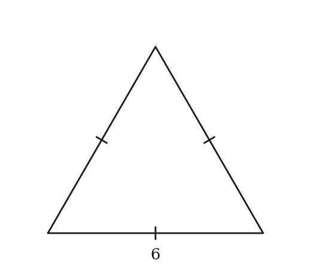

*Numeric entry — write the number.*

**Q3** · `GEO-IET-004` · MCQ · 50s

Triangle ABC has AB = AC = 10 and BC = 6. Which of the following must be true?

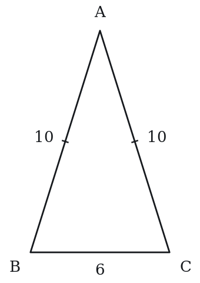

**(A)** Angle A > Angle B  
**(B)** Angle B = Angle C  
**(C)** Angle A = Angle B  
**(D)** AB = BC  
**(E)** The triangle is a right triangle

**Q4** · `GEO-IET-005` · MCQ · 45s

In isosceles triangle PQR, PQ = PR and angle Q = 55°. What is angle P?

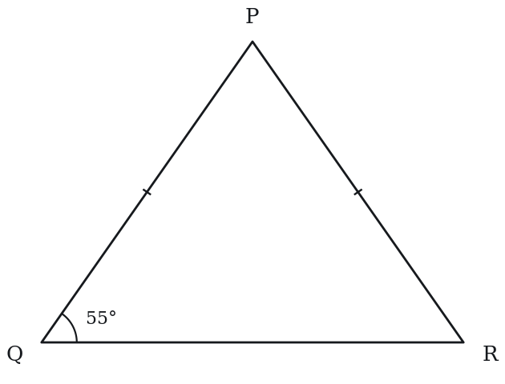

**(A)** 55°  
**(B)** 60°  
**(C)** 70°  
**(D)** 75°  
**(E)** 125°

**Q5** · `GEO-IET-006` · QC · 55s

Triangle XYZ is equilateral with side length 4.

> **Quantity A:**  The height of the triangle
> **Quantity B:**  2√3

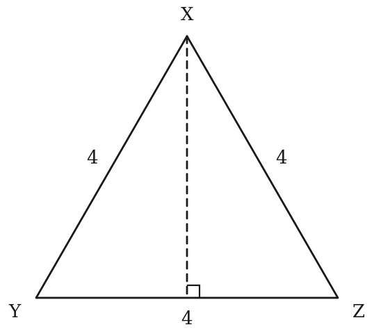

**Q6** · `GEO-IET-008` · Numeric Entry · 55s

In isosceles triangle ABC, AB = BC and the apex angle B = 120°. What is the measure, in degrees, of angle A?

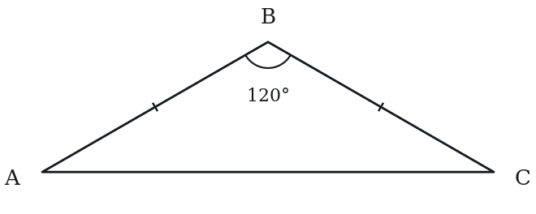

*Numeric entry — write the number.*

**Q7** · `GEO-IET-009` · MCQ · 40s

In isosceles triangle PQR, PQ = PR. The altitude from P meets QR at S, and QS = 4. What is the length of QR?

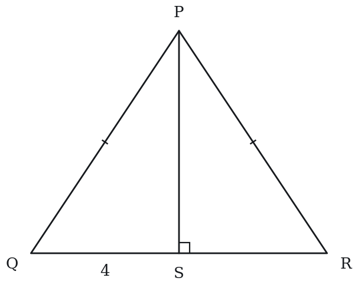

**(A)** 4  
**(B)** 6  
**(C)** 8  
**(D)** 12  
**(E)** 16

**Q8** · `GEO-IET-027` · MCQ · 85s

Triangle ABC is isosceles with AB = AC. Point D is the midpoint of BC. If BD = 5 and AD = 12, what is the area of triangle ABD?

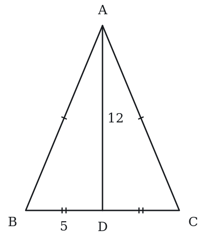

**(A)** 25  
**(B)** 30  
**(C)** 36  
**(D)** 60  
**(E)** 65

---

### Level 2 · Medium — 16 questions · ~22 min

*two or three steps, one planted trap each*

**Q9** · `GEO-IET-011` · MCQ · 80s

In isosceles triangle DEF, DE = DF and angle D = (4x)°, angle E = (3x + 10)°. What is the value of x?

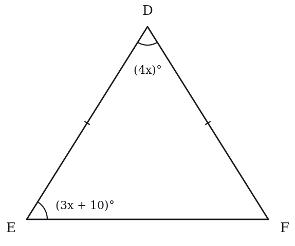

**(A)** 10  
**(B)** 16  
**(C)** 20  
**(D)** 24  
**(E)** 28

**Q10** · `GEO-IET-014` · QC · 85s

Isosceles triangle ABC has AB = AC = 13 and BC = 10.

> **Quantity A:**  The area of triangle ABC
> **Quantity B:**  60

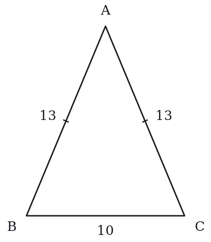

**Q11** · `GEO-IET-015` · Select all that apply · 80s

An isosceles triangle has a base angle of 75°.

Which of the following statements must be true?

Indicate all such statements.

**(A)** The apex angle is 30°  
**(B)** The other base angle is 75°  
**(C)** The triangle is equilateral  
**(D)** The apex angle is less than either base angle  
**(E)** The sum of the base angles exceeds 90°

**Q12** · `GEO-IET-016` · MCQ · 75s

An equilateral triangle and a square have equal perimeters. If the square has side length 12, what is the area of the equilateral triangle?

**(A)** 48√3  
**(B)** 64√3  
**(C)** 144  
**(D)** 192  
**(E)** 192√3

**Q13** · `GEO-IET-017` · QC · 90s

Triangle PQR is isosceles with PQ = PR = 5 and QR = 6. Triangle STU is isosceles with ST = SU = 5 and TU = 8.

> **Quantity A:**  Height of triangle PQR (from P to QR)
> **Quantity B:**  Height of triangle STU (from S to TU)

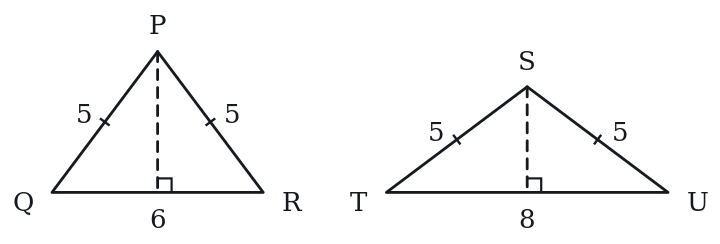

**Q14** · `GEO-IET-018` · Numeric Entry · 80s

An isosceles right triangle has a hypotenuse of length 10. What is the area of the triangle?

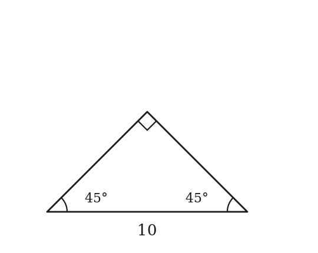

*Numeric entry — write the number.*

**Q15** · `GEO-IET-020` · QC · 90s

An equilateral triangle has area T. A square has the same perimeter as the equilateral triangle.

> **Quantity A:**  Area of the square
> **Quantity B:**  T

**Q16** · `GEO-IET-021` · Select all that apply · 85s

Triangle ABC is equilateral with side length s.

Which of the following expressions correctly represent the height of the triangle?

Indicate all such expressions.

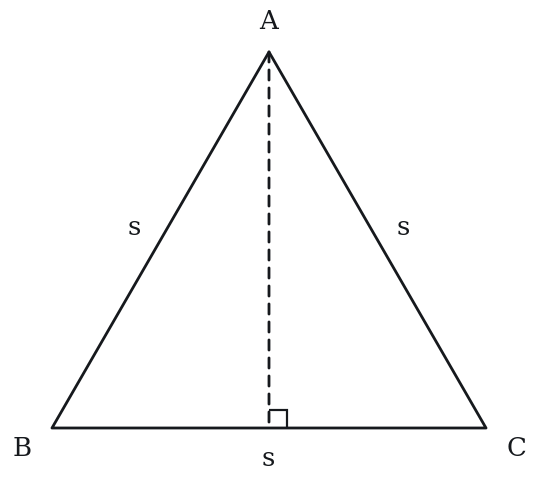

**(A)** s√3 / 2  
**(B)** s / √3  
**(C)** √(s² − s²/4)  
**(D)** s√2 / 2  
**(E)** (1/2)√(3s²)

**Q17** · `GEO-IET-022` · MCQ · 80s

Two sides of an isosceles triangle have lengths 7 and 13. Which of the following lists all possible values of the perimeter of the triangle?

**(A)** 27 only  
**(B)** 33 only  
**(C)** 21 or 33  
**(D)** 21 or 27  
**(E)** 27 or 33

**Q18** · `GEO-IET-024` · QC · 70s

Isosceles triangle MNP has MN = MP = 10 and angle M = 60°.

> **Quantity A:**  NP (the base of the triangle)
> **Quantity B:**  10

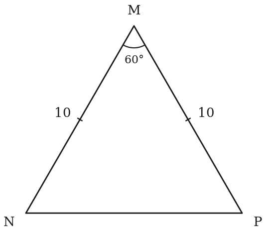

**Q19** · `GEO-IET-025` · MCQ · 75s

The area of an equilateral triangle is 36√3. What is the perimeter of the triangle?

**(A)** 12  
**(B)** 24  
**(C)** 36  
**(D)** 36√3  
**(E)** 72

**Q20** · `GEO-IET-029` · Numeric Entry · 95s

What is the radius of the circle inscribed in an equilateral triangle with side length 12? Round your answer to the nearest hundredth.

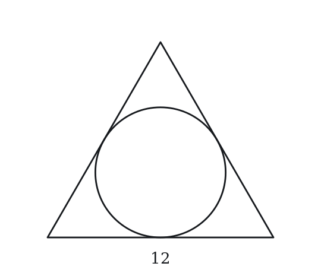

*Numeric entry — write the number.*

**Q21** · `GEO-IET-KMF-003` · QC · 60s

Triangle T is isosceles with perimeter 20, and one of its sides measures 8.

> **Quantity A:**  The length of the shortest side of T
> **Quantity B:**  4

**Q22** · `GEO-IET-KMF-004` · MCQ · 100s

A parallelogram is built from 8 identical equilateral triangles placed in a single row, alternately pointing up and down, with neighboring triangles sharing a full side. Its perimeter is 40 meters. What is its area, in square meters?

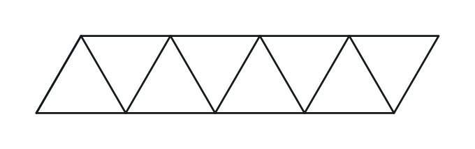

**(A)** 16*sqrt(3)  
**(B)** 32*sqrt(3)  
**(C)** 50*sqrt(3)  
**(D)** 64*sqrt(3)  
**(E)** 128*sqrt(3)

**Q23** · `GEO-IET-KMF2-001` · QC · 85s

Isosceles triangle A has two sides of length 8, and isosceles triangle B has two sides of length 10.

> **Quantity A:**  The area of triangle A
> **Quantity B:**  The area of triangle B

**Q24** · `SEC-PG-002` · MCQ · 85s

An equilateral triangle has an altitude of length 9. What is the perimeter of the triangle?

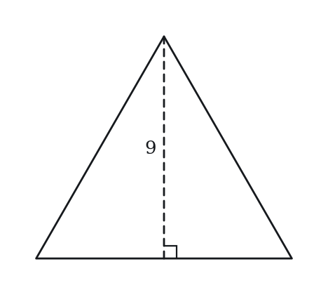

**(A)** 6*sqrt(3)  
**(B)** 18  
**(C)** 27  
**(D)** 18*sqrt(3)  
**(E)** 27*sqrt(3)

---

### Level 3 · Hard — 6 questions · ~11 min

*where 162+ is won or lost*

**Q25** · `GEO-IET-031` · QC · 105s

In isosceles triangle ABC, AB = AC and the apex angle A = 100°. Point D is on BC such that angle DAC = 30°.

> **Quantity A:**  Angle ABD
> **Quantity B:**  Angle ADB

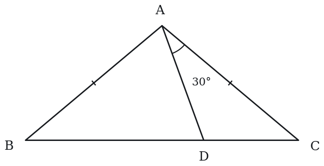

**Q26** · `GEO-IET-035` · QC · 100s

In isosceles triangle ABC, AB = AC. The perimeter is 50 and the base BC = 10.

> **Quantity A:**  The area of triangle ABC
> **Quantity B:**  100

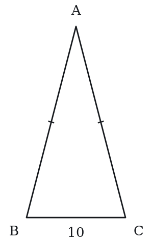

**Q27** · `GEO-IET-037` · MCQ · 115s

Isosceles triangle ABC has AB = AC = 10. Point D is on AB and point E is on AC such that DE is parallel to BC, and the area of trapezoid BCED equals twice the area of triangle ADE. What is the ratio DE : BC?

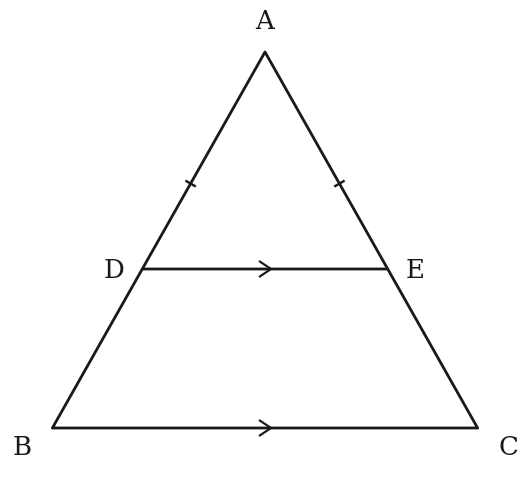

**(A)** 1 : 2  
**(B)** 1 : √3  
**(C)** 2 : 3  
**(D)** 1 : √2  
**(E)** √2 : √3

**Q28** · `GEO-IET-040` · Select all that apply · 95s

The measure of one angle of an isosceles triangle is 40 degrees. Which of the following could be the measure, in degrees, of another angle of the triangle?

Indicate all such measures.

**(A)** 40  
**(B)** 50  
**(C)** 70  
**(D)** 80  
**(E)** 100

**Q29** · `GEO-IET-KMF-001` · MCQ · 120s

In quadrilateral PQRS, side lengths satisfy PQ = QR and the diagonal QS has the same length as PQ. Angle PQR measures 64 degrees, and S lies on the opposite side of line PR from Q. What is the sum, in degrees, of angles QPS and QRS?

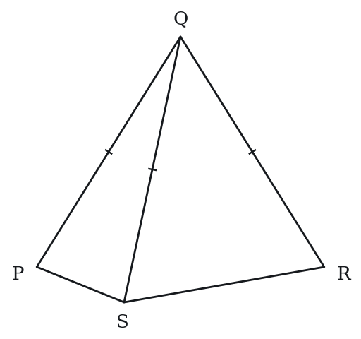

**(A)** 32  
**(B)** 116  
**(C)** 148  
**(D)** 212  
**(E)** 296

**Q30** · `GEO-IET-KMF-005` · QC · 100s

ABCD is a square. Point E lies outside the square, on the opposite side of line CD from A and B, with DE = DC and angle CDE = 40 degrees. Segment AE is drawn.

> **Quantity A:**  The measure, in degrees, of angle AED
> **Quantity B:**  30

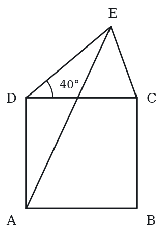

---

## Part B — Answer Key

| Q | ID | Level | Type | Answer |
|---|---|---|---|---|
| 1 | `GEO-IET-001` | easy | MCQ | **C** |
| 2 | `GEO-IET-003` | easy | Numeric Entry | **18** |
| 3 | `GEO-IET-004` | easy | MCQ | **B** |
| 4 | `GEO-IET-005` | easy | MCQ | **C** |
| 5 | `GEO-IET-006` | easy | QC | **C** |
| 6 | `GEO-IET-008` | easy | Numeric Entry | **30** |
| 7 | `GEO-IET-009` | easy | MCQ | **C** |
| 8 | `GEO-IET-027` | easy | MCQ | **B** |
| 9 | `GEO-IET-011` | medium | MCQ | **B** |
| 10 | `GEO-IET-014` | medium | QC | **C** |
| 11 | `GEO-IET-015` | medium | Select all that apply | **A, B, D, E** |
| 12 | `GEO-IET-016` | medium | MCQ | **B** |
| 13 | `GEO-IET-017` | medium | QC | **A** |
| 14 | `GEO-IET-018` | medium | Numeric Entry | **25** |
| 15 | `GEO-IET-020` | medium | QC | **A** |
| 16 | `GEO-IET-021` | medium | Select all that apply | **A, C, E** |
| 17 | `GEO-IET-022` | medium | MCQ | **E** |
| 18 | `GEO-IET-024` | medium | QC | **C** |
| 19 | `GEO-IET-025` | medium | MCQ | **C** |
| 20 | `GEO-IET-029` | medium | Numeric Entry | **3.46** |
| 21 | `GEO-IET-KMF-003` | medium | QC | **D** |
| 22 | `GEO-IET-KMF-004` | medium | MCQ | **B** |
| 23 | `GEO-IET-KMF2-001` | medium | QC | **D** |
| 24 | `SEC-PG-002` | medium | MCQ | **D** |
| 25 | `GEO-IET-031` | hard | QC | **B** |
| 26 | `GEO-IET-035` | hard | QC | **B** |
| 27 | `GEO-IET-037` | hard | MCQ | **B** |
| 28 | `GEO-IET-040` | hard | Select all that apply | **A, C, E** |
| 29 | `GEO-IET-KMF-001` | hard | MCQ | **C** |
| 30 | `GEO-IET-KMF-005` | hard | QC | **B** |

---

## Part C — Worked Solutions

### Q1 · `GEO-IET-001` — Answer: C

The sum of angles in any triangle is 180°. In an isosceles triangle the two base angles are equal. Let each base angle = b. Then: 40 + b + b = 180 → 2b = 140 → b = 70°.

**Trap.** Students subtract the apex angle from 180° to get 140° and choose E, forgetting to divide by 2 to share that remainder equally between the two base angles.

### Q2 · `GEO-IET-003` — Answer: 18

An equilateral triangle has all three sides equal. Perimeter = 3 × side = 3 × 6 = 18.

**Trap.** Students multiply by 4 (treating it as a square) or multiply by 2 (forgetting there are three sides, not two).

### Q3 · `GEO-IET-004` — Answer: B

AB = AC, so the triangle is isosceles with apex A, and the base angles at B and C (opposite the equal sides AC and AB) are equal. Angle B = Angle C is therefore always true. Angle A is opposite BC = 6, the shortest side, so it is the smallest angle, not larger than B (A fails). Angle A = Angle B would make all three angles equal, forcing BC = 10 (C fails). AB = 10 and BC = 6 (D fails). 6^2 + 10^2 = 136 and 10^2 + 10^2 = 200, neither equals the square of the third side, so no right angle (E fails).

**Trap.** Choice A: students assume the apex angle between the two equal sides must be the largest. Here the apex is opposite the shortest side, so it is the smallest. Choice C treats the apex as a base angle.

### Q4 · `GEO-IET-005` — Answer: C

Since PQ = PR, the base angles at Q and R are equal. So angle R = angle Q = 55°. Then angle P = 180° − 55° − 55° = 70°.

**Trap.** Students compute 180° − 55° = 125° and choose E, forgetting that both base angles are 55°, not just one.

### Q5 · `GEO-IET-006` — Answer: C

Height of an equilateral triangle with side s is h = (s√3)/2. With s = 4: h = (4√3)/2 = 2√3. Quantity A = 2√3 = Quantity B.

**Trap.** Students compute h = s√3 = 4√3 (forgetting the division by 2) and choose A.

### Q6 · `GEO-IET-008` — Answer: 30

AB = BC means the apex is at B (the vertex between the two equal sides). The base angles are at A and C. Angles A + C = 180° − 120° = 60°. Since the triangle is isosceles with the two equal sides meeting at B, angles A and C are equal. So angle A = 60°/2 = 30°.

**Trap.** Students identify the wrong apex: if AB = BC, the equal sides both touch vertex B, so B is the apex and A, C are the base angles — not B and C.

### Q7 · `GEO-IET-009` — Answer: C

The altitude to the base of an isosceles triangle bisects the base, so SR = QS = 4 and QR = 4 + 4 = 8.

**Trap.** Students stop at QS and choose 4 (A), or double twice and choose 16 (E).

### Q8 · `GEO-IET-027` — Answer: B

Since ABC is isosceles with AB = AC, the altitude from A bisects BC at its midpoint. D is the midpoint of BC, so AD ⊥ BC. In right triangle ABD: AB² = AD² + BD² = 144 + 25 = 169, so AB = 13. Area of triangle ABD = ½ × BD × AD = ½ × 5 × 12 = 30.

**Trap.** Students compute the area of the full triangle ABC (= ½ × BC × AD = ½ × 10 × 12 = 60, option D) instead of the half-triangle ABD. The question asks for ABD only.

### Q9 · `GEO-IET-011` — Answer: B

Since DE = DF, vertex D is the apex and the base angles at E and F are equal. So angle E = angle F = (3x + 10)°. Sum of all angles: angle D + angle E + angle F = 180° → 4x + (3x + 10) + (3x + 10) = 180 → 10x + 20 = 180 → 10x = 160 → x = 16. Check: angle D = 64°, angle E = angle F = 58°. Sum: 64 + 58 + 58 = 180 ✓.

**Trap.** Students set angle D = angle E (treating D as a base angle equal to E) and solve 4x = 3x + 10 → x = 10. This gives angle D = 40°, angle E = 40°, angle F = 100°. But then the equal angles are at D and E, meaning the equal sides would be EF and DF — not DE and DF as given.

### Q10 · `GEO-IET-014` — Answer: C

The altitude from A bisects BC, creating two right triangles with base = 5 and hypotenuse = 13. Height h = √(13² − 5²) = √(169 − 25) = √144 = 12. Area = ½ × base × height = ½ × 10 × 12 = 60. Quantity A = 60 = Quantity B.

**Trap.** Students forget to bisect the base and use the full base 10 inside the Pythagorean calculation: h = √(13² − 10²) = √(169 − 100) = √69 ≈ 8.3, giving area ≈ 41.5.

### Q11 · `GEO-IET-015` — Answer: A, B, D, E

Base angle = 75°. In an isosceles triangle, the two base angles are equal, so the other base angle = 75° (B is true). Apex = 180° − 75° − 75° = 30° (A is true). D: apex = 30° < 75° = base angle, so D is true. E: sum of base angles = 75° + 75° = 150° > 90°, so E is true. C: equilateral requires all angles = 60°; here angles are 30-75-75, so C is false.

**Trap.** Students include C because the two sides opposite the equal base angles are equal — but that makes it isosceles, not equilateral. All three sides must be equal for equilateral, requiring all 60° angles.

### Q12 · `GEO-IET-016` — Answer: B

Perimeter of square = 4 × 12 = 48. Equilateral triangle perimeter = 48, so side = 48/3 = 16. Area of equilateral triangle = (s²√3)/4 = (16²√3)/4 = (256√3)/4 = 64√3.

**Trap.** Students divide the perimeter by 4 instead of 3 to find the triangle's side (confusing with a square), getting side = 12 and area = (144√3)/4 = 36√3, which is not among the options — leading to a guess rather than identifying the error.

### Q13 · `GEO-IET-017` — Answer: A

Triangle PQR: altitude from P bisects QR into 3+3. Height = √(5²−3²) = √(25−9) = √16 = 4. Triangle STU: altitude from S bisects TU into 4+4. Height = √(5²−4²) = √(25−16) = √9 = 3. Quantity A = 4 > Quantity B = 3.

**Trap.** Students assume the triangle with the longer base has the greater height. Here the opposite is true — a wider base forces the apex closer to the base.

### Q14 · `GEO-IET-018` — Answer: 25

An isosceles right triangle (45-45-90) has legs equal. If leg = a and hypotenuse = 10: a² + a² = 100 → 2a² = 100 → a² = 50 → a = 5√2. Area = ½ × a × a = ½ × a² = ½ × 50 = 25.

**Trap.** Students compute leg = 10/√2 = 5√2 correctly but then use ½ × 10 × 5√2 = 25√2 (using the hypotenuse as the base with the leg as height). The height must be perpendicular; for a right triangle, the two legs are perpendicular, so area = ½ × leg × leg.

### Q15 · `GEO-IET-020` — Answer: A

Let equilateral triangle side = s. Perimeter = 3s. Area T = (s²√3)/4. Square side = 3s/4. Square area = (3s/4)² = 9s²/16. Compare: Square area / T = (9s²/16) / (s²√3/4) = (9/16) × (4/√3) = 9/(4√3) = 9√3/12 = 3√3/4 ≈ 3(1.732)/4 ≈ 1.299. Since ratio > 1, Square area > T. Quantity A is greater.

**Trap.** Students intuitively assume the equilateral triangle and square with the same perimeter have similar areas. The square actually encloses about 30% more area than the equilateral triangle with the same perimeter.

### Q16 · `GEO-IET-021` — Answer: A, C, E

Height h = (s√3)/2 — this is A. C: √(s² − s²/4) = √(3s²/4) = s√3/2 ✓. E: (1/2)√(3s²) = (1/2)(s√3) = s√3/2 ✓. B: s/√3 = s√3/3 ≠ s√3/2. D: s√2/2 is the hypotenuse formula for 45-45-90, not equilateral height.

**Trap.** Students choose D because they recall a formula with √2 and ÷2 from 45-45-90 triangles, not recognizing that applies only to the isosceles right triangle, not equilateral triangles.

### Q17 · `GEO-IET-022` — Answer: E

The third side equals one of the given sides. If it is 7, the sides are 7, 7, 13; 7 + 7 = 14 > 13, so this triangle exists and its perimeter is 27. If it is 13, the sides are 13, 13, 7; the triangle exists and its perimeter is 33. So the possible perimeters are 27 and 33.

**Trap.** A: students overlook the case with two sides of length 13. B: students reject 7, 7, 13, thinking 7 + 7 is too close to 13. C and D include 21, from treating all three sides as 7.

### Q18 · `GEO-IET-024` — Answer: C

Since MN = MP = 10 and angle M = 60°, the base angles are each (180° − 60°)/2 = 60°. All three angles equal 60°, meaning the triangle is equilateral. Therefore NP = MN = MP = 10. Quantity A = Quantity B.

**Trap.** Students see MN = MP = 10 and apex = 60° and compute the base separately or assume it differs from the equal sides, not recognizing that 60° apex in an isosceles triangle forces equilateral.

### Q19 · `GEO-IET-025` — Answer: C

Area = (s²√3)/4 = 36√3 → s² = 36√3 × 4/√3 = 144 → s = 12. Perimeter = 3s = 3 × 12 = 36.

**Trap.** Students solve for s² = 144 correctly but then compute s = √144 = 12 and stop, reporting 12 as the perimeter instead of multiplying by 3.

### Q20 · `GEO-IET-029` — Answer: 3.46

The height of the triangle is 6√3 (a 30-60-90 triangle with hypotenuse 12). The center of the inscribed circle is the intersection of the medians, which lies one-third of the way up from the base, so the radius is (1/3)(6√3) = 2√3 ≈ 3.46.

**Trap.** Students use the distance from the center to a vertex (two-thirds of the height, 4√3 ≈ 6.93) instead of the distance to a side.

### Q21 · `GEO-IET-KMF-003` — Answer: D

The side of length 8 is either one of the two equal sides or the odd side.
Case 1: 8 is a leg. The other leg is also 8, so the base is 20 - 16 = 4. Sides 8, 8, 4 satisfy the triangle inequality (8 + 4 > 8). Shortest side = 4, so A equals B.
Case 2: 8 is the base. The two equal legs share 20 - 8 = 12, so each is 6. Sides 6, 6, 8 satisfy the triangle inequality (6 + 6 > 8). Shortest side = 6, so A is greater than B.
Both cases are possible, and they give different relationships, so it cannot be determined.

**Trap.** Assuming the stated side of 8 must be one of the equal sides, giving a shortest side of 4 and answering that the quantities are equal (option C).

### Q22 · `GEO-IET-KMF-004` — Answer: B

Top edge = 4s, bottom edge = 4s, two slanted ends = s each, so perimeter = 10s.
10s = 40, so s = 4 meters.
Area of one equilateral triangle = (sqrt(3)/4)*s^2 = (sqrt(3)/4)*16 = 4*sqrt(3).
Total area = 8 * 4*sqrt(3) = 32*sqrt(3).
Check: the parallelogram has base 4s = 16 and height (sqrt(3)/2)*4 = 2*sqrt(3), so area = 16*2*sqrt(3) = 32*sqrt(3). Matches.

**Trap.** Reading the perimeter as 8 sides (one per triangle), so s = 5 and area = 8*(sqrt(3)/4)*25 = 50*sqrt(3), choice C.

### Q23 · `GEO-IET-KMF2-001` — Answer: D

Knowing the two equal sides of an isosceles triangle does not fix its area, because the angle between them is still free. As that angle opens from near 0 degrees to near 180 degrees, the area grows from near 0 up to a maximum and back down to near 0.
For triangle A the largest possible area comes when the two sides of length 8 are perpendicular:
(1/2)(8)(8) = 32. But the area can also be made as small as you like by closing the angle.
For triangle B the largest possible area is
(1/2)(10)(10) = 50, and it too can be made nearly 0.
So triangle A could have area 32 while triangle B has area 1, or triangle B could have area 50 while triangle A has area 1. Both orderings are possible, so the relationship cannot be determined.

**Trap.** Longer equal sides suggest a larger triangle, and triangle B does have the larger *maximum* area. But neither triangle's area is pinned down at all: the third side, and with it the angle between the two known sides, is unspecified in both. A pair of side lengths fixes a triangle's area only when the angle between them is also fixed.

### Q24 · `SEC-PG-002` — Answer: D

An altitude of an equilateral triangle splits it into two 30-60-90 triangles whose sides are in the ratio 1 : sqrt(3) : 2. The altitude is the sqrt(3) leg and the full side is the hypotenuse, so altitude = side * sqrt(3)/2. Setting side * sqrt(3)/2 = 9 gives side = 18/sqrt(3) = 6*sqrt(3). The perimeter is three times that: 18*sqrt(3).

**Trap.** Students treat the altitude as if it were a side and answer 27, or they correctly find the side 6*sqrt(3) and then forget to triple it, answering 6*sqrt(3). The altitude is always shorter than the side, so any answer at or below 9 per side is impossible.

### Q25 · `GEO-IET-031` — Answer: B

Apex angle A = 100°, so base angles B = C = (180−100)/2 = 40° each. In triangle ACD: angle C = 40°, angle DAC = 30°, so angle ADC = 180° − 40° − 30° = 110°. Angle ADB = 180° − 110° = 70° (supplementary). In triangle ABD: angle ABD = angle ABC = 40° (D is on BC so angle ABD is the same as angle ABC). Quantity A = 40°, Quantity B = 70°. Quantity B is greater.

**Trap.** Students confuse angle ADB with angle ADC, or forget that angle ABD = angle ABC = 40° since D lies on BC and the full angle at B in the triangle remains 40°.

### Q26 · `GEO-IET-035` — Answer: B

Perimeter = 50, BC = 10, so AB = AC = (50 − 10)/2 = 20. The altitude from A bisects BC into two halves of 5. Height h = √(20² − 5²) = √(400 − 25) = √375 = 5√15. Area = ½ × base × height = ½ × 10 × 5√15 = 25√15. Now √15 ≈ 3.873, so area ≈ 25 × 3.873 ≈ 96.8. Quantity A ≈ 96.8 < Quantity B = 100. Quantity B is greater.

**Trap.** Students estimate the height as approximately equal to the slant side (≈ 20) and compute area ≈ ½ × 10 × 20 = 100, concluding the two quantities are equal. The actual perpendicular height is 5√15 ≈ 19.36, which is notably less than 20, making the area ≈ 96.8 — less than 100.

### Q27 · `GEO-IET-037` — Answer: B

Let k = DE/BC = AD/AB (since DE ∥ BC, triangles ADE and ABC are similar with ratio k). Area of ADE = k² × Area of ABC. Area of trapezoid BCED = Area ABC − Area ADE = (1 − k²) × Area ABC. Given: Area of BCED = 2 × Area ADE → (1 − k²) = 2k² → 1 = 3k² → k² = 1/3 → k = 1/√3. So DE : BC = 1 : √3 = 1/√3 : 1.

**Trap.** Students set up the ratio of areas as k (not k²), writing (1−k) = 2k → k = 1/3, then DE:BC = 1:3. The ratio of areas of similar figures is the square of the ratio of corresponding lengths.

### Q28 · `GEO-IET-040` — Answer: A, C, E

An isosceles triangle has two equal angles. There are two cases.
Case 1: the 40-degree angle is one of the two equal angles. The angles are 40, 40 and 180 - 80 = 100.
Case 2: the 40-degree angle is the angle between the two equal sides. The other two angles are each (180 - 40)/2 = 70. The angles are 40, 70, 70.
Another angle of the triangle can be 40, 70 or 100.
50 and 80 occur in neither case.
Answer: A, C, E.

**Trap.** Treating the 40-degree angle only as the angle between the equal sides and selecting just 70, or selecting 80 by doubling 40. Both positions of the 40-degree angle must be considered, and in the first case the triangle has a second 40-degree angle.

### Q29 · `GEO-IET-KMF-001` — Answer: C

Triangle PQS has QP = QS, so angle QPS = angle QSP = a. Triangle RQS has QR = QS, so angle QRS = angle QSR = b.
In the quadrilateral, the angle at S is angle PSR = a + b.
Angles of PQRS: 64 + a + b + (a + b) = 360, so 2(a + b) = 296 and a + b = 148.
So angle QPS + angle QRS = a + b = 148.
Check: P, R and S lie on a circle centered at Q, so angle PSR is an inscribed angle on the minor arc PR and equals 180 - 64/2 = 148, matching a + b.

**Trap.** Using the angle on the far arc, 64/2 = 32, gives choice A; taking the supplement of the 64 degree angle gives 116 (choice B); forgetting to halve 360 - 64 gives 296 (choice E).

### Q30 · `GEO-IET-KMF-005` — Answer: B

DA = DC because ABCD is a square, and DE = DC is given, so DA = DE and triangle ADE is isosceles with its apex at D.
Angle ADE = angle ADC + angle CDE = 90 + 40 = 130 degrees (E is on the far side of DC from A, so the angles add).
The base angles are equal: angle AED = (180 - 130)/2 = 25 degrees.
Quantity A = 25 < 30 = Quantity B.
Check: angles of triangle ADE = 130 + 25 + 25 = 180.

**Trap.** Forgetting that DA = DE and using the full 180 - 130 = 50 for angle AED gives 50, which exceeds 30 (choice A).
