# Similar & Congruent Figures — Practice Set

**Bank code:** `GEO-SCF` · **Section:** Geometry · **30 questions** — Easy 7 · Medium 16 · Hard 7

**Lecture capsule:** [06-similar-congruent-figures.md](../../05-geometry/06-similar-congruent-figures.md)

> Similar figures scale lengths by k, areas by k^2 and volumes by k^3; equal angles make triangles similar, but only a side makes them congruent.

Every question below is live in the question bank under the ID shown — the sheet and the portal are the same questions. Attempt a level with the clock running, then check Part C.

---

## Part A — Questions

> **Quantitative Comparison — the four choices are always the same, so they are not reprinted:**
> **(A)** Quantity A is greater · **(B)** Quantity B is greater · **(C)** The two quantities are equal · **(D)** The relationship cannot be determined from the information given

### Level 1 · Easy — 7 questions · ~6 min

*warm-up — these must be automatic*

**Q1** · `GEO-SCF-002` · MCQ · 50s

Triangle ABC is similar to triangle DEF. If AB = 6, BC = 8, CA = 10, and DE = 9, what is the length of EF?

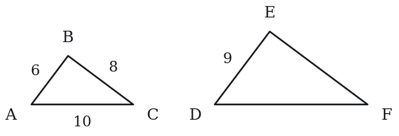

**(A)** 10  
**(B)** 11  
**(C)** 12  
**(D)** 13  
**(E)** 15

**Q2** · `GEO-SCF-003` · MCQ · 50s

Two similar rectangles have a scale factor of 4:1 (large to small). If the area of the larger rectangle is 80, what is the area of the smaller rectangle?

**(A)** 5  
**(B)** 10  
**(C)** 20  
**(D)** 40  
**(E)** 60

**Q3** · `GEO-SCF-004` · MCQ · 55s

Which of the following conditions guarantees that two triangles are congruent?

**(A)** Two pairs of equal angles  
**(B)** Two pairs of equal sides  
**(C)** Two pairs of equal sides and the equal angles between them  
**(D)** Three pairs of equal angles  
**(E)** Two pairs of equal sides and a pair of equal angles that are not between those sides

**Q4** · `GEO-SCF-005` · MCQ · 60s

A flagpole casts a shadow of 12 meters. At the same time, a 2-meter tall person casts a shadow of 3 meters. How tall is the flagpole?

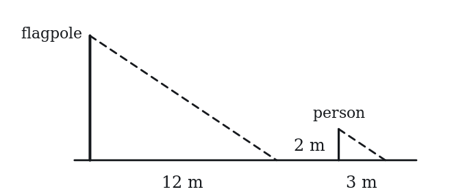

**(A)** 6 m  
**(B)** 7 m  
**(C)** 8 m  
**(D)** 9 m  
**(E)** 18 m

**Q5** · `GEO-SCF-006` · Numeric Entry · 40s

Two similar figures have sides in the ratio 2:7. If a side of the smaller figure is 6, what is the corresponding side of the larger figure?

*Numeric entry — write the number.*

**Q6** · `GEO-SCF-012` · MCQ · 55s

In triangle ABC, ∠A = 40° and ∠B = 70°. In triangle DEF, ∠D = 40° and ∠F = 70°. Which of the following must be true?

**(A)** Triangles ABC and DEF are congruent.  
**(B)** Triangles ABC and DEF are similar.  
**(C)** Triangles ABC and DEF have equal perimeters.  
**(D)** ∠E = 40°  
**(E)** ∠C = 40°

**Q7** · `GEO-SCF-013` · QC · 35s

Two congruent triangles, Triangle 1 and Triangle 2.

> **Quantity A:**  Area of Triangle 1
> **Quantity B:**  Area of Triangle 2

---

### Level 2 · Medium — 16 questions · ~21 min

*two or three steps, one planted trap each*

**Q8** · `GEO-SCF-014` · MCQ · 60s

Two similar triangles have areas in the ratio 16:49. What is the ratio of their corresponding sides?

**(A)** 4:49  
**(B)** 2:7  
**(C)** 16:49  
**(D)** 4:7  
**(E)** 49:16

**Q9** · `GEO-SCF-015` · Numeric Entry · 70s

Two similar triangles have corresponding sides of length 5 and 8. If the area of the smaller triangle is 50, what is the area of the larger triangle?

*Numeric entry — write the number.*

**Q10** · `GEO-SCF-018` · MCQ · 75s

In triangle ABC, DE is parallel to BC, with D on AB and E on AC. If AD = 4, DB = 6, and BC = 15, what is the length of DE?

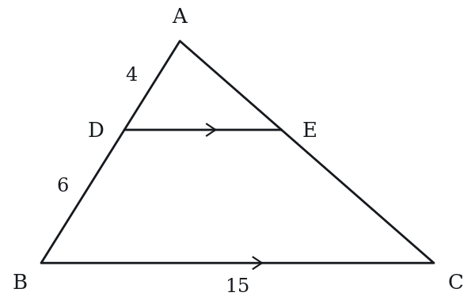

**(A)** 4  
**(B)** 6  
**(C)** 9  
**(D)** 10  
**(E)** 12

**Q11** · `GEO-SCF-019` · Select all that apply · 75s

Two similar triangles have corresponding sides in the ratio 3:1 (larger to smaller). Which of the following statements are true? Indicate all such statements.

**(A)** The perimeter of the larger triangle is 3 times the perimeter of the smaller triangle.  
**(B)** The area of the larger triangle is 6 times the area of the smaller triangle.  
**(C)** The area of the larger triangle is 9 times the area of the smaller triangle.  
**(D)** Corresponding angles of the two triangles are equal.  
**(E)** The two triangles are congruent.

**Q12** · `GEO-SCF-020` · Numeric Entry · 65s

Triangle ABC is similar to triangle PQR. AB = 10, BC = 14, AC = 8. If PQ = 15, what is the value of QR?

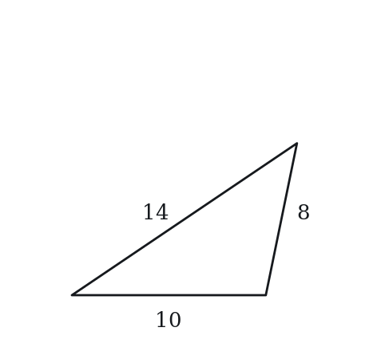

*Numeric entry — write the number.*

**Q13** · `GEO-SCF-021` · QC · 60s

Two similar triangles have corresponding sides of length x and 4x.

> **Quantity A:**  The ratio of their areas
> **Quantity B:**  1:16

**Q14** · `GEO-SCF-022` · MCQ · 80s

Two similar pyramids have surface areas in the ratio 4:9. What is the ratio of their volumes?

**(A)** 64:729  
**(B)** 16:81  
**(C)** 8:27  
**(D)** 4:9  
**(E)** 2:3

**Q15** · `GEO-SCF-025` · Select all that apply · 70s

Which of the following conditions guarantee that two triangles are congruent? Select all that apply.

**(A)** Three pairs of equal sides  
**(B)** Two pairs of equal sides and equal included angles  
**(C)** Two pairs of equal angles and equal included sides  
**(D)** Three pairs of equal angles  
**(E)** Two pairs of equal angles and a pair of equal non-included sides

**Q16** · `GEO-SCF-028` · QC · 70s

Two similar figures have a scale factor of k. k > 1.

> **Quantity A:**  The ratio of their areas (smaller to larger)
> **Quantity B:**  1/k

**Q17** · `GEO-SCF-030` · Select all that apply · 80s

Two similar figures have areas of 36 and 100. Select all true statements. Indicate all such statements.

**(A)** The scale factor (smaller to larger) is 3:5.  
**(B)** The ratio of their perimeters (smaller to larger) is 9:25.  
**(C)** The ratio of their areas is equivalent to (0.6)².  
**(D)** If the smaller figure is a square with area 36, its side length is 9.  
**(E)** The area ratio (smaller to larger) is 9:25.

**Q18** · `GEO-SCF-033` · MCQ · 80s

Two similar triangles have areas of 50 and 98. If a side of the smaller triangle is 10, what is the corresponding side of the larger triangle?

**(A)** 12  
**(B)** 13  
**(C)** 14  
**(D)** 15  
**(E)** 16

**Q19** · `GEO-SCF-041` · QC · 75s

Two similar triangles have perimeters of 30 and 42.

> **Quantity A:**  The ratio of their areas (smaller to larger)
> **Quantity B:**  25/49

**Q20** · `GEO-SCF-048` · QC · 120s

In triangle ABC, D is the midpoint of AB and E is the midpoint of AC. F is the midpoint of BC.

> **Quantity A:**  Area of triangle DEF
> **Quantity B:**  Area of triangle ABC / 4

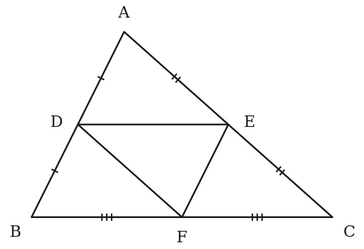

**Q21** · `GEO-SCF-KMF-003` · MCQ · 100s

In the figure, triangle KLM has a right angle at K. Point N lies on side KM and point P lies on side LM, with segment NP perpendicular to KM. The lengths satisfy KN : NM = 3 : 2, and triangle NPM has area 8 square units. What is the area, in square units, of quadrilateral KLPN?

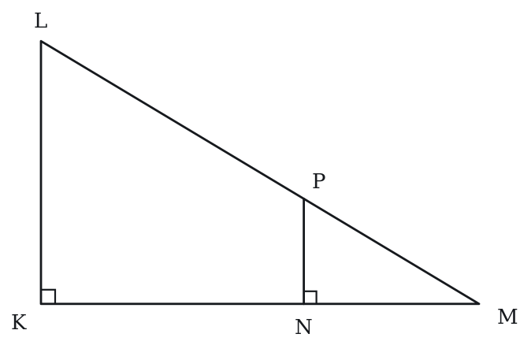

**(A)** 12  
**(B)** 18  
**(C)** 20  
**(D)** 42  
**(E)** 50

**Q22** · `GEO-SCF-KMF-007` · Numeric Entry · 90s

A surveyor wants the width AB of a lake. She picks points D and C on the shore so that segments AD and BC cross at a point R, with R between A and D and between B and C, and with DC parallel to AB. She measures RD = 20 meters, DC = 30 meters and RA = 90 meters. What is the width AB of the lake, in meters?

_____ meters

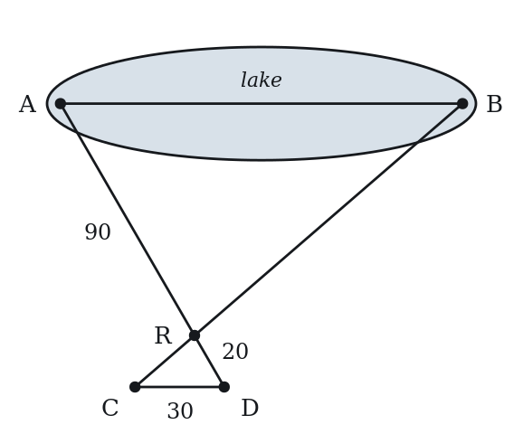

*Numeric entry — write the number.*

**Q23** · `GEO-SCF-KMF2-001` · Numeric Entry · 85s

In the figure above, QM and RN are both perpendicular to PN, and P, Q and R lie on one line. If PR = 24, QR = 9 and PM = 10, what is the length of MN?

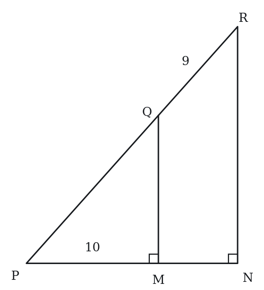

*Numeric entry — write the number.*

---

### Level 3 · Hard — 7 questions · ~13 min

*where 162+ is won or lost*

**Q24** · `GEO-SCF-034` · MCQ · 95s

In triangle ABC, DE is drawn parallel to BC with D on AB and E on AC. The area of triangle ADE is 36 and the area of trapezoid BCED is 64. What is the ratio AD:DB?

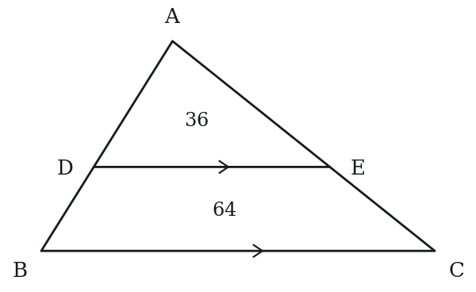

**(A)** 9:16  
**(B)** 3:5  
**(C)** 2:3  
**(D)** 3:4  
**(E)** 3:2

**Q25** · `GEO-SCF-036` · QC · 100s

Triangle ABC with AB = 15, BC = 20, CA = 25 (a right triangle, right angle at B). Point D is on AC such that BD ⊥ AC.

> **Quantity A:**  AD
> **Quantity B:**  9

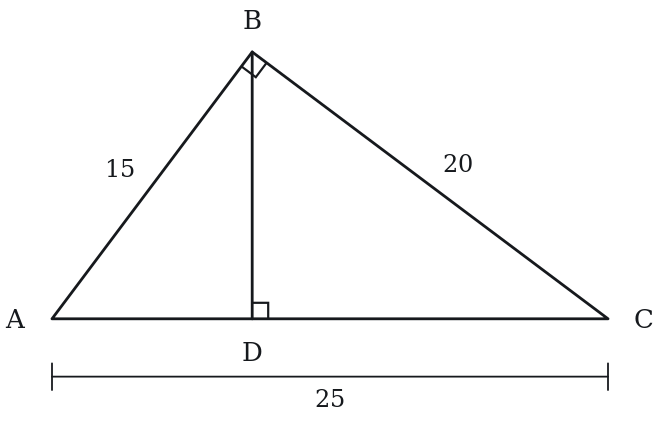

**Q26** · `GEO-SCF-038` · MCQ · 95s

In right triangle ABC (right angle at C), altitude CD is drawn to hypotenuse AB. If AD = 4 and DB = 9, what is the length of CD?

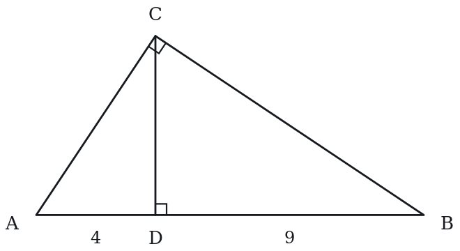

**(A)** √13  
**(B)** 5  
**(C)** 6  
**(D)** 6.5  
**(E)** 7

**Q27** · `GEO-SCF-045` · Select all that apply · 105s

Two similar rectangular prisms have volumes in the ratio 8:27. Which of the following statements are true? Select all that apply.

**(A)** The ratio of corresponding edge lengths (smaller to larger) is 2:3.  
**(B)** The ratio of their surface areas is 4:9.  
**(C)** The ratio of any pair of corresponding edges is 4:9.  
**(D)** If the smaller prism has surface area 88, the larger has surface area 198.  
**(E)** The ratio of their diagonals is 8:27.

**Q28** · `GEO-SCF-KMF-004` · Numeric Entry · 150s

The diagram shows a triangular pasture with a right angle at its lower right corner. Five straight fences are shown: the bottom fence, the sloping fence, and three parallel fences, each perpendicular to the bottom fence. The three parallel fences are spaced 240 meters apart, and the first of them is 240 meters from the left corner of the pasture. The bottom fence is 720 meters long and the right-hand parallel fence is 960 meters long. What is the combined length, in meters, of all five fences?

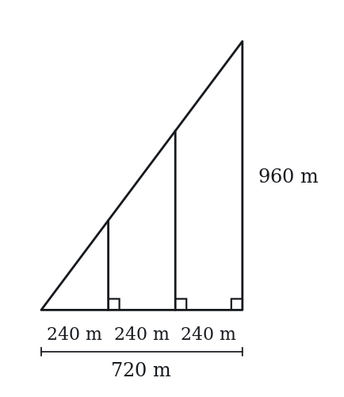

*Numeric entry — write the number.*

**Q29** · `SEC-PG-007` · QC · 125s

In the figure above, PQ = QR, point X lies on side PQ, point Y lies on side PR, and XY is perpendicular to PR. The area of triangle PXY is 1/8 the area of triangle PQR.

Note: Figure not drawn to scale.

> **Quantity A:**  The length of PY
> **Quantity B:**  (1/8)(PR)

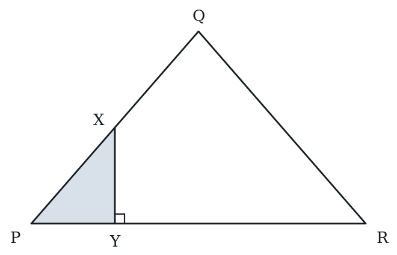

**Q30** · `SEC-PG-009` · Numeric Entry · 125s

The figure above shows a park bounded by a right triangle whose horizontal side is 1,200 meters and whose vertical side is 900 meters. Five straight paths run through the park: the three vertical segments shown, the horizontal side, and the slanted side. The three vertical paths are parallel to one another, and the points where they meet the horizontal path are equally spaced 400 meters apart. If paving costs $84 per meter of path, what is the total cost, in dollars, of paving all five paths?

Note: Figure not drawn to scale.

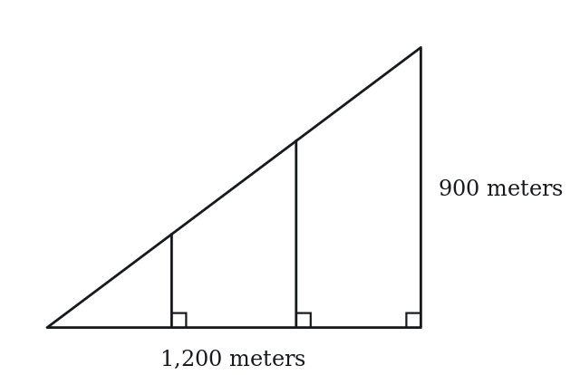

*Numeric entry — write the number.*

---

## Part B — Answer Key

| Q | ID | Level | Type | Answer |
|---|---|---|---|---|
| 1 | `GEO-SCF-002` | easy | MCQ | **C** |
| 2 | `GEO-SCF-003` | easy | MCQ | **A** |
| 3 | `GEO-SCF-004` | easy | MCQ | **C** |
| 4 | `GEO-SCF-005` | easy | MCQ | **C** |
| 5 | `GEO-SCF-006` | easy | Numeric Entry | **21** |
| 6 | `GEO-SCF-012` | easy | MCQ | **B** |
| 7 | `GEO-SCF-013` | easy | QC | **C** |
| 8 | `GEO-SCF-014` | medium | MCQ | **D** |
| 9 | `GEO-SCF-015` | medium | Numeric Entry | **128** |
| 10 | `GEO-SCF-018` | medium | MCQ | **B** |
| 11 | `GEO-SCF-019` | medium | Select all that apply | **A, C, D** |
| 12 | `GEO-SCF-020` | medium | Numeric Entry | **21** |
| 13 | `GEO-SCF-021` | medium | QC | **C** |
| 14 | `GEO-SCF-022` | medium | MCQ | **C** |
| 15 | `GEO-SCF-025` | medium | Select all that apply | **A, B, C, E** |
| 16 | `GEO-SCF-028` | medium | QC | **B** |
| 17 | `GEO-SCF-030` | medium | Select all that apply | **A, C, E** |
| 18 | `GEO-SCF-033` | medium | MCQ | **C** |
| 19 | `GEO-SCF-041` | medium | QC | **C** |
| 20 | `GEO-SCF-048` | medium | QC | **C** |
| 21 | `GEO-SCF-KMF-003` | medium | MCQ | **D** |
| 22 | `GEO-SCF-KMF-007` | medium | Numeric Entry | **135** |
| 23 | `GEO-SCF-KMF2-001` | medium | Numeric Entry | **6** |
| 24 | `GEO-SCF-034` | hard | MCQ | **E** |
| 25 | `GEO-SCF-036` | hard | QC | **C** |
| 26 | `GEO-SCF-038` | hard | MCQ | **C** |
| 27 | `GEO-SCF-045` | hard | Select all that apply | **A, B, D** |
| 28 | `GEO-SCF-KMF-004` | hard | Numeric Entry | **3840** |
| 29 | `SEC-PG-007` | hard | QC | **A** |
| 30 | `SEC-PG-009` | hard | Numeric Entry | **378000** |

---

## Part C — Worked Solutions

### Q1 · `GEO-SCF-002` — Answer: C

The scale factor from triangle ABC to DEF is DE/AB = 9/6 = 3/2. The side EF corresponds to BC, so EF = BC × (3/2) = 8 × (3/2) = 12.

**Trap.** Students may match sides incorrectly — the ordering of vertices tells you which sides correspond. AB↔DE, BC↔EF, CA↔FD.

### Q2 · `GEO-SCF-003` — Answer: A

When a scale factor of k applies to sides, areas scale by k². The scale factor (large to small) is 4, so area ratio is 4² = 16. Area of smaller = 80 ÷ 16 = 5.

**Trap.** Students divide by 4 (the linear scale factor) instead of 16 (the area scale factor), getting 20.

### Q3 · `GEO-SCF-004` — Answer: C

If two sides and the angle between them in one triangle equal the corresponding parts of another, the triangles are congruent. Equal angles alone (two or three pairs) give similar triangles of possibly different sizes. Two equal sides alone do not fix the triangle. Two sides and a non-included angle can fit two different triangles.

**Trap.** A and D confuse similarity (equal angles) with congruence. B omits the angle. E uses a non-included angle, which does not fix the triangle.

### Q4 · `GEO-SCF-005` — Answer: C

The person and flagpole are parallel (both vertical), and the sun's rays are parallel, creating similar triangles. The ratio of height to shadow length is constant: person's ratio = 2/3. Flagpole height/12 = 2/3. Flagpole height = 12 × (2/3) = 8 meters.

**Trap.** Students sometimes set up height/shadow = shadow/height (inverting one ratio), getting 12 × (3/2) = 18 instead of 8.

### Q5 · `GEO-SCF-006` — Answer: 21

Scale factor = 7/2. Larger side = 6 × (7/2) = 42/2 = 21.

**Trap.** Students may compute 6 × (2/7) = 12/7, setting up the ratio in the wrong direction (large/small instead of small/large).

### Q6 · `GEO-SCF-012` — Answer: B

The angles of ABC are 40°, 70° and 180 − 40 − 70 = 70°, and the angles of DEF are 40°, 70° (at F) and 70° (at E). Corresponding angles are equal, so the triangles are similar. Nothing is given about side lengths, so they need not be congruent or have equal perimeters. ∠E and ∠C are both 70°, so D and E are false.

**Trap.** Students choose A because the angle measures match, forgetting that equal angles fix only the shape, not the size.

### Q7 · `GEO-SCF-013` — Answer: C

Congruent figures have all corresponding sides and angles equal. Equal sides means equal base and equal height, so their areas are identical. Quantity A = Quantity B.

**Trap.** Students may think orientation or position affects area and choose D. Area depends only on measurements, not on how a shape is placed or reflected.

### Q8 · `GEO-SCF-014` — Answer: D

Area ratio = k², where k is the side ratio. If area ratio = 16:49, then k = √(16/49) = 4/7. The ratio of corresponding sides is 4:7.

**Trap.** Students take the area ratio directly as the side ratio (16:49) instead of taking the square root to get the side ratio (4:7).

### Q9 · `GEO-SCF-015` — Answer: 128

Scale factor k = 8/5. Area scales by k². Area of larger = 50 × (8/5)² = 50 × 64/25 = 50 × 2.56 = 128.

**Trap.** Students multiply 50 × (8/5) = 80, using the linear scale factor instead of squaring it for area.

### Q10 · `GEO-SCF-018` — Answer: B

Since DE ∥ BC, triangle ADE is similar to triangle ABC (AA: shared angle A, and corresponding angles from the parallel lines). The ratio AD/AB = 4/(4+6) = 4/10 = 2/5. Therefore DE/BC = 2/5. DE = 15 × (2/5) = 6.

**Trap.** Students use AD/DB = 4/6 as the scale factor, giving DE = 15 × (4/6) = 10, instead of AD/AB = 4/10.

### Q11 · `GEO-SCF-019` — Answer: A, C, D

With scale factor k = 3: Perimeter scales by k = 3 (A is true). Area scales by k² = 9 (C is true, B is false because 6 ≠ 9). Similar figures always have equal corresponding angles (D is true). Congruent requires scale factor = 1, but here k = 3, so they are not congruent (E is false).

**Trap.** Students choose B (×6) because they think area scales by 2k or k×2 instead of k². Also, students may forget that similar triangles always have equal angles.

### Q12 · `GEO-SCF-020` — Answer: 21

AB corresponds to PQ. Scale factor = PQ/AB = 15/10 = 3/2. QR corresponds to BC. QR = BC × (3/2) = 14 × (3/2) = 21.

**Trap.** Students use the ratio AB/PQ = 10/15 = 2/3 (small to large) instead of PQ/AB = 3/2, then compute QR = 14 × (2/3) ≈ 9.33.

### Q13 · `GEO-SCF-021` — Answer: C

Scale factor = x/(4x) = 1/4. Area ratio = (1/4)² = 1/16 = 1:16. Quantity A = 1:16 = Quantity B.

**Trap.** Students may think the x makes the relationship undetermined (choosing D), but x cancels in the ratio x/(4x) = 1/4, so the ratio is always 1:16 regardless of x.

### Q14 · `GEO-SCF-022` — Answer: C

Surface area scales by k². If area ratio = 4:9, then k = √(4/9) = 2/3. Volume scales by k³ = (2/3)³ = 8/27. Volume ratio = 8:27.

**Trap.** Students apply the area ratio directly to volume (4:9) or square the area ratio (16:81) instead of finding k first and then cubing.

### Q15 · `GEO-SCF-025` — Answer: A, B, C, E

SSS, SAS, ASA, and AAS are all valid triangle congruence conditions. AAA (three equal angles) proves similarity only — triangles with equal angles can be different sizes, so AAA does NOT guarantee congruence. Answer: A, B, C, E.

**Trap.** Students include AAA thinking equal angles implies equal sides. It does not — any scaled version of a triangle has the same angles but different sides.

### Q16 · `GEO-SCF-028` — Answer: B

Area ratio (smaller to larger) = 1/k². Since k > 1, we have k² > k, so 1/k² < 1/k. Quantity B (1/k) > Quantity A (1/k²). Quantity B is greater.

**Trap.** Students may think the area ratio equals 1/k (the same as the linear ratio), choosing C. Area scales by k², so the area ratio is 1/k², not 1/k.

### Q17 · `GEO-SCF-030` — Answer: A, C, E

The area ratio is 36:100 = 9:25, so the ratio of corresponding lengths is √(9/25) = 3/5.
A: The scale factor is 3:5. True.
B: Perimeter is a length, so it scales as 3:5, not 9:25. False.
C: (0.6)² = 0.36 = 36/100, which is the area ratio. True.
D: A square of area 36 has side √36 = 6, not 9. False.
E: 36:100 = 9:25. True.
Answer: A, C and E.

**Trap.** B is the classic slip of applying the area ratio to perimeters; lengths scale as 3:5 and only areas as 9:25. D comes from dividing 36 by 4 as though the 36 were a perimeter instead of taking the square root.

### Q18 · `GEO-SCF-033` — Answer: C

Area ratio = 50:98 = 25:49. Scale factor (sides) = √(25/49) = 5/7. Since the smaller triangle has a side of 10: 10 is the smaller, so the larger side = 10 × (7/5) = 14.

**Trap.** Students compute √(50/98) = √(25/49) = 5/7 but then multiply by 5/7 instead of 7/5 (applying small-to-large direction correctly), getting 10 × (5/7) ≈ 7.14.

### Q19 · `GEO-SCF-041` — Answer: C

Scale factor (smaller to larger) = 30/42 = 5/7. Area ratio = (5/7)² = 25/49. Quantity A = 25/49 = Quantity B.

**Trap.** Students compute the area ratio as 30/42 = 5/7 (forgetting to square), getting 5/7 ≠ 25/49 and choosing A.

### Q20 · `GEO-SCF-048` — Answer: C

The midpoint triangle (medial triangle) DEF is similar to triangle ABC with scale factor 1/2 (each side of DEF is a midsegment, equal to half the corresponding side of ABC). Area ratio = (1/2)² = 1/4. Area(DEF) = Area(ABC)/4. Quantity A = Quantity B. The medial triangle divides the original into 4 congruent triangles of equal area.

**Trap.** Students may not know the midsegment/medial triangle theorem and try to compute by coordinates. The key insight is DE = BC/2 (midsegment theorem), making the scale factor 1/2 and area ratio 1/4.

### Q21 · `GEO-SCF-KMF-003` — Answer: D

NP and KL are both perpendicular to KM, so they are parallel, and triangle NPM is similar to triangle KLM (they share the angle at M).
KN : NM = 3 : 2 means NM is 2 of the 5 equal parts of KM, so NM/KM = 2/5.
Areas of similar triangles scale with the square of the side ratio: area NPM / area KLM = (2/5)^2 = 4/25.
Area KLM = 8 * 25/4 = 50.
Quadrilateral KLPN = triangle KLM minus triangle NPM = 50 - 8 = 42.
Check: the quadrilateral to small-triangle area ratio is 42 : 8 = 21 : 4, which matches (25 - 4) : 4.

**Trap.** Applying the side ratio 3 : 2 directly to the areas gives 12 (choice A); finding the big triangle's area as 50 but forgetting to subtract the small triangle gives 50 (choice E); using (3/2)^2 * 8 = 18 treats the quadrilateral as similar to the small triangle (choice B).

### Q22 · `GEO-SCF-KMF-007` — Answer: 135

1. Since DC is parallel to AB, angle RDC equals angle RAB and angle RCD equals angle RBA (alternate angles), and the angles at R are vertical angles.
2. So triangle RDC is similar to triangle RAB, with D matching A and C matching B.
3. Corresponding sides are in proportion: AB/DC = RA/RD = 90/20 = 4.5.
4. AB = 4.5 * 30 = 135 meters.
Check: DC/AB = 30/135 = 2/9 and RD/RA = 20/90 = 2/9.

**Trap.** Matching the ratio the wrong way round, AB = DC * RD/RA, gives 30 * 20/90, about 6.67.

### Q23 · `GEO-SCF-KMF2-001` — Answer: 6

Triangles PQM and PRN share the angle at P, and each has a right angle, at M and at N respectively. Two pairs of equal angles make the triangles similar, so their corresponding sides are in the same ratio.
First find PQ. Since Q lies between P and R, PQ = PR - QR = 24 - 9 = 15.
The ratio of the two hypotenuses is PQ to PR, which is 15 to 24, or 5 to 8.
The bases are in that same ratio, so PM to PN is 5 to 8.
With PM = 10, this gives 10/PN = 5/8, so PN = 16.
Finally MN = PN - PM = 16 - 10 = 6.

**Trap.** Students use QR = 9 as though it were the hypotenuse of the small triangle and set up 9/24 instead of 15/24. The small triangle's hypotenuse is PQ, the part from P to Q, not the leftover piece QR.

### Q24 · `GEO-SCF-034` — Answer: E

Area of triangle ABC = area of ADE + area of trapezoid BCED = 36 + 64 = 100. Since DE ∥ BC, triangle ADE is similar to triangle ABC. Scale factor = √(Area(ADE)/Area(ABC)) = √(36/100) = 6/10 = 3/5. So AD/AB = 3/5 — meaning AD = 3 units and AB = 5 units. Therefore DB = AB − AD = 5 − 3 = 2 units. AD:DB = 3:2.
Answer: E.

**Trap.** Choice A takes the area ratio 36:64 = 9:16 as if it were a side ratio, skipping the square root. Choice D does take a square root but of the wrong pair — triangle ADE against the trapezoid, √(36/64) = 3/4, rather than against triangle ABC, which must be 36:100. Choice B is the near-miss: AD:AB = 3:5 is correct but the question asks for AD:DB, and DB = AB − AD = 2. Choice C reverses the two parts.

### Q25 · `GEO-SCF-036` — Answer: C

In a right triangle, the altitude from the right angle to the hypotenuse creates two smaller triangles similar to each other and to the original. By the geometric mean relation: AD/AB = AB/AC → AD = AB²/AC = 15²/25 = 225/25 = 9. Quantity A = 9 = Quantity B.

**Trap.** Students try to compute AD using direct proportion or Pythagorean theorem on triangle ABD without recognizing the similar triangle relationship. The key insight is AD/AB = AB/AC from similarity.

### Q26 · `GEO-SCF-038` — Answer: C

Using the geometric mean: CD² = AD × DB = 4 × 9 = 36. CD = √36 = 6. This comes from the similarity of triangles: triangle ACD ~ triangle ABC ~ triangle CBD, giving the geometric mean relation.

**Trap.** Students use CD = (AD + DB)/2 = 6.5 (arithmetic mean) instead of the geometric mean √(AD × DB) = 6.

### Q27 · `GEO-SCF-045` — Answer: A, B, D

Volume ratio = 8:27. k³ = 8/27 → k = 2/3 (A is true). Surface area scales by k² = (2/3)² = 4/9, so SA ratio = 4:9 (B is true). Edge ratio = k = 2:3, NOT 4:9 (C is false). SA of larger = 88 × (9/4) = 198 (D is true). Diagonal ratio = k = 2:3, not 8:27 (E is false — diagonals are linear measurements scaling by k, not k³).

**Trap.** Students may apply volume scaling (k³) to linear measurements like edges or diagonals, or confuse which measurements scale by k, k², and k³.

### Q28 · `GEO-SCF-KMF-004` — Answer: 3840

Step 1: Sloping fence by Pythagoras: sqrt(720^2 + 960^2) = sqrt(518400 + 921600) = sqrt(1440000) = 1200 m.
Step 2: Each shorter vertical fence forms a small right triangle similar to the big one, so its height is 960/720 = 4/3 times its distance from the left corner.
Step 3: At 240 m the height is 320 m; at 480 m the height is 640 m; at 720 m the height is 960 m (given).
Step 4: Total = 720 + 1200 + 320 + 640 + 960 = 3840 m.
Check: the three vertical heights 320, 640, 960 are equally spaced, as expected for equal spacing along the base.

**Trap.** Adding only the three sides of the pasture and forgetting the two interior fences gives 720 + 960 + 1200 = 2880; leaving out the bottom fence instead gives 3120.

### Q29 · `SEC-PG-007` — Answer: A

Let M be the midpoint of PR. Since PQ = QR, the segment QM is the altitude from Q, so triangle PQM is a right triangle with legs PM = PR/2 and QM. Triangle PXY is similar to triangle PQM, because both have a right angle on PR and share the angle at P. If PY = k(PM), then the areas scale by k squared: area PXY = k^2 * area PQM. And area PQM is exactly half of area PQR. So area PXY = (k^2)/2 * area PQR. Setting (k^2)/2 = 1/8 gives k^2 = 1/4, so k = 1/2 and PY = (1/2)(PR/2) = PR/4. Since PR/4 is larger than PR/8, Quantity A is greater.

**Trap.** Students assume the area fraction transfers straight to the base and conclude PY = PR/8, choosing 'equal'. Shrinking a similar triangle by a factor k cuts its area by k squared, so an area of one eighth corresponds to a length factor of one half, not one eighth.

### Q30 · `SEC-PG-009` — Answer: 378000

The bounding right triangle has legs 1,200 and 900, so its hypotenuse is sqrt(1,200^2 + 900^2) = sqrt(1,440,000 + 810,000) = 1,500. The two interior vertical paths cut off triangles similar to the whole one. The first stands 400 meters along the base, so its height is 900(400/1200) = 300; the second stands 800 meters along, so its height is 900(800/1200) = 600. The five paths therefore measure 1,200 + 900 + 1,500 + 300 + 600 = 4,500 meters. At $84 per meter the cost is 4,500 x 84 = $378,000.

**Trap.** Students forget the hypotenuse, or they guess the interior heights as 450 and 600 by halving rather than by similarity. Each interior vertical is to 900 as its distance from the left corner is to 1,200, which gives 300 and 600, and the slanted path is a full 1,500 meters of paving.
