# Quadrilaterals — Practice Set

**Bank code:** `GEO-QDL` · **Section:** Geometry · **30 questions** — Easy 7 · Medium 16 · Hard 7

**Lecture capsule:** [07-quadrilaterals.md](../../05-geometry/07-quadrilaterals.md)

> Interior angles total 360; for a fixed perimeter the square holds the most area, and a rectangle's diagonal is just the Pythagorean theorem again.

Every question below is live in the question bank under the ID shown — the sheet and the portal are the same questions. Attempt a level with the clock running, then check Part C.

---

## Part A — Questions

> **Quantitative Comparison — the four choices are always the same, so they are not reprinted:**
> **(A)** Quantity A is greater · **(B)** Quantity B is greater · **(C)** The two quantities are equal · **(D)** The relationship cannot be determined from the information given

### Level 1 · Easy — 7 questions · ~5 min

*warm-up — these must be automatic*

**Q1** · `GEO-QDL-002` · MCQ · 40s

A rectangle has length 9 and width 4. What is its perimeter?

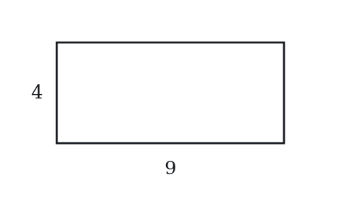

**(A)** 13  
**(B)** 26  
**(C)** 36  
**(D)** 52  
**(E)** 72

**Q2** · `GEO-QDL-005` · MCQ · 35s

What is the sum of the interior angles of any quadrilateral?

**(A)** 90°  
**(B)** 180°  
**(C)** 270°  
**(D)** 360°  
**(E)** 540°

**Q3** · `GEO-QDL-008` · QC · 45s

Square P has side length 4. Rectangle Q has length 6 and width 2.

> **Quantity A:**  Area of Square P
> **Quantity B:**  Area of Rectangle Q

**Q4** · `GEO-QDL-010` · Numeric Entry · 40s

A rectangle has area 48 and width 6. What is its length?

*Numeric entry — write the number.*

**Q5** · `GEO-QDL-013` · MCQ · 55s

A quadrilateral has three angles measuring 85°, 95°, and 110°. What is the measure of the fourth angle?

**(A)** 60°  
**(B)** 70°  
**(C)** 80°  
**(D)** 90°  
**(E)** 100°

**Q6** · `GEO-QDL-014` · MCQ · 50s

A square has side length 5. What is the length of its diagonal?

**(A)** 5  
**(B)** 5√2  
**(C)** 5√3  
**(D)** 10  
**(E)** 25

**Q7** · `GEO-QDL-015` · Numeric Entry · 55s

A rectangle has length 8 and width 6. What is the length of its diagonal?

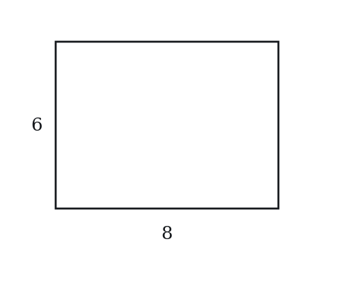

*Numeric entry — write the number.*

---

### Level 2 · Medium — 16 questions · ~22 min

*two or three steps, one planted trap each*

**Q8** · `GEO-QDL-016` · MCQ · 70s

A rectangle has a perimeter of 50 and a length of 15. What is its area?

**(A)** 75  
**(B)** 100  
**(C)** 150  
**(D)** 200  
**(E)** 225

**Q9** · `GEO-QDL-017` · QC · 75s

Square A has a diagonal of length 8.

> **Quantity A:**  The side length of Square A
> **Quantity B:**  4√2

**Q10** · `GEO-QDL-018` · MCQ · 85s

A square is inscribed in a circle of radius 6. What is the area of the square?

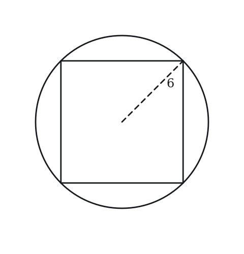

**(A)** 36  
**(B)** 48  
**(C)** 72  
**(D)** 108  
**(E)** 144

**Q11** · `GEO-QDL-021` · MCQ · 65s

A square has area 100. A second square has a side length twice that of the first. What is the area of the second square?

**(A)** 200  
**(B)** 250  
**(C)** 300  
**(D)** 400  
**(E)** 500

**Q12** · `GEO-QDL-022` · Select all that apply · 90s

A rectangle has integer dimensions and an area of 36. Which of the following could be its perimeter? Select all that apply.

**(A)** 24  
**(B)** 28  
**(C)** 30  
**(D)** 32  
**(E)** 74

**Q13** · `GEO-QDL-023` · QC · 75s

A rectangle has a diagonal of length 13 and one side of length 5.

> **Quantity A:**  The area of the rectangle
> **Quantity B:**  60

**Q14** · `GEO-QDL-030` · Numeric Entry · 75s

Three identical squares, each with area 25, are arranged in a row to form a rectangle. What is the perimeter of the resulting rectangle?

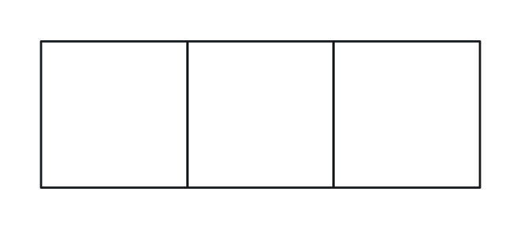

*Numeric entry — write the number.*

**Q15** · `GEO-QDL-035` · MCQ · 90s

A rectangle has length twice its width. Its diagonal is 10. What is the area of the rectangle?

**(A)** 20  
**(B)** 40  
**(C)** 80  
**(D)** 100  
**(E)** 200

**Q16** · `GEO-QDL-036` · Select all that apply · 85s

Which of the following are properties shared by all squares AND all non-square rectangles? Select all that apply.

**(A)** All four angles are 90°  
**(B)** All four sides are equal in length  
**(C)** The diagonals are equal in length  
**(D)** The diagonals are perpendicular to each other  
**(E)** Opposite sides are parallel and equal

**Q17** · `GEO-QDL-038` · QC · 80s

A square has perimeter 24. A rectangle has the same perimeter (24) and length 8.

> **Quantity A:**  Area of the square
> **Quantity B:**  Area of the rectangle

**Q18** · `GEO-QDL-040` · Numeric Entry · 85s

A square has area numerically equal to its perimeter. What is the side length of the square?

*Numeric entry — write the number.*

**Q19** · `GEO-QDL-044` · Numeric Entry · 100s

A square has side length equal to the diagonal of a smaller square. If the smaller square has area 18, what is the area of the larger square?

*Numeric entry — write the number.*

**Q20** · `GEO-QDL-045` · MCQ · 85s

A large square has side 12. Inside it, four identical smaller squares are placed in the four corners, each with side 3. What is the area of the region inside the large square but outside all four small squares?

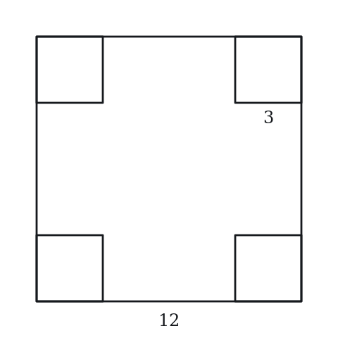

**(A)** 36  
**(B)** 72  
**(C)** 108  
**(D)** 135  
**(E)** 144

**Q21** · `GEO-QDL-059` · QC · 120s

A rectangle has area 120 and perimeter 46.

> **Quantity A:**  The length of the longer side
> **Quantity B:**  3 times the length of the shorter side

**Q22** · `GEO-QDL-KMF2-002` · Select all that apply · 85s

In the figure above, WXYZ is a square and WY is one of its diagonals. Which of the following must be true?

Indicate all such statements.

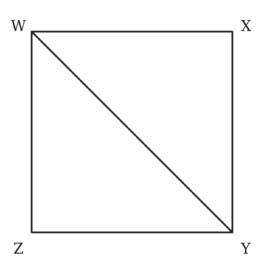

**(A)** WY = 2(XY)  
**(B)** WY/XY = sqrt(2)  
**(C)** (XY + YZ)/WY = 2  
**(D)** (XY + YZ)/WY = sqrt(2)  
**(E)** WY^2 = 2(XY)^2

**Q23** · `GEO-QDL-KMF2-003` · MCQ · 85s

The figure above shows parallelogram ABCD and a point E on side AD, where AE = 2(ED). If the area of ABCD is 60, what is the area of triangle ABE?

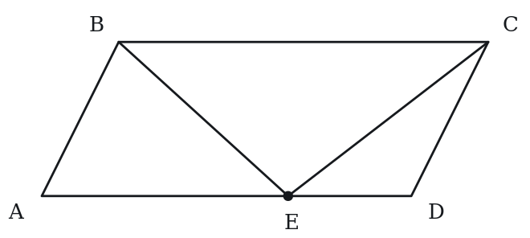

**(A)** 10  
**(B)** 12  
**(C)** 15  
**(D)** 20  
**(E)** 30

---

### Level 3 · Hard — 7 questions · ~13 min

*where 162+ is won or lost*

**Q24** · `GEO-QDL-041` · QC · 105s

Square S has area 144. A circle C has circumference equal to the perimeter of square S.

> **Quantity A:**  Area of Circle C
> **Quantity B:**  144

**Q25** · `GEO-QDL-043` · MCQ · 100s

A rectangle has perimeter 70 and diagonal 25. What is the area of the rectangle?

**(A)** 150  
**(B)** 200  
**(C)** 250  
**(D)** 300  
**(E)** 350

**Q26** · `GEO-QDL-052` · Select all that apply · 105s

A rectangle has integer side lengths and a diagonal of length √85. Which of the following could be the perimeter of this rectangle? Select all that apply.

**(A)** 18  
**(B)** 22  
**(C)** 26  
**(D)** 30  
**(E)** 40

**Q27** · `GEO-QDL-054` · MCQ · 120s

A square is inscribed in a right triangle with legs 6 and 8, with one vertex of the square at the right angle and one side of the square lying along the leg of length 6. What is the side length of the square?

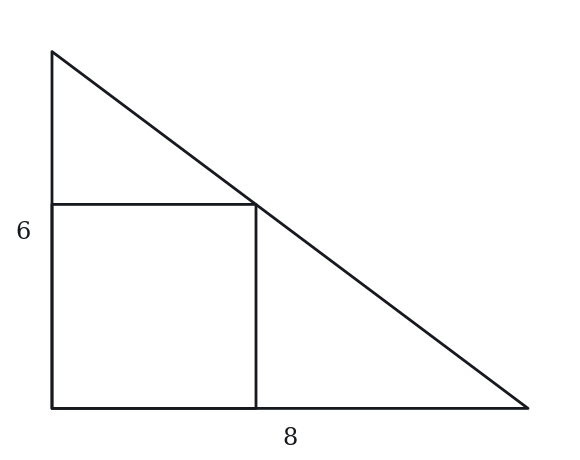

**(A)** 2  
**(B)** 3  
**(C)** 24/7  
**(D)** 4  
**(E)** 48/11

**Q28** · `SEC-PG-030` · QC · 120s

In the figure above, EFGH is a convex quadrilateral and EG and FH are its diagonals.

Note: Figure not drawn to scale.

> **Quantity A:**  The perimeter of EFGH
> **Quantity B:**  EG + FH

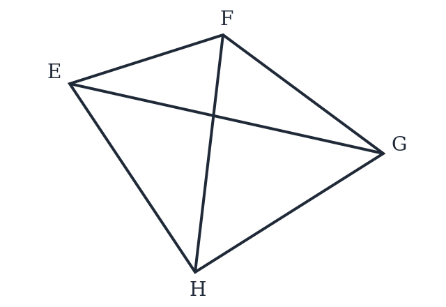

**Q29** · `SEC-PG-034` · Numeric Entry · 110s

The figure above shows a square tile 20 centimeters on a side. In the center of the tile is a square region 15 centimeters on a side, divided into nine congruent smaller squares. Five of those nine smaller squares are gray, as shown, and the rest of the tile is white. What fraction of the area of the tile is gray? Give your answer as a fraction.

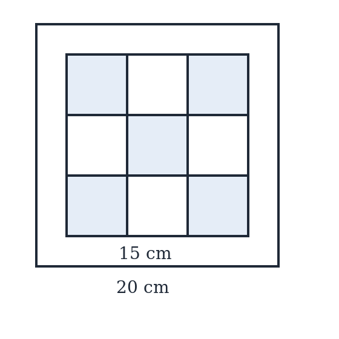

*Numeric entry — write the number.*

**Q30** · `SEC-PG-046` · Numeric Entry · 130s

In the figure above, ACEG is a square. Square ABIH shares vertex A with it, with B on side AC and H on side AG. Square JDEF shares vertex E with it, with D on side CE and F on side EG. Squares ABIH and JDEF have equal areas, and the area of square ACEG is 25 times the area of square ABIH. BJFI is a parallelogram. If the area of square ABIH is 20, what is the area of parallelogram BJFI?

Note: Figure not drawn to scale.

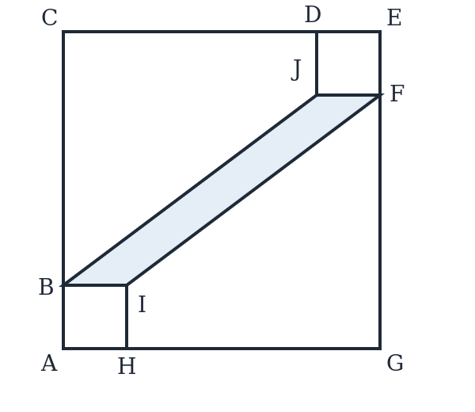

*Numeric entry — write the number.*

---

## Part B — Answer Key

| Q | ID | Level | Type | Answer |
|---|---|---|---|---|
| 1 | `GEO-QDL-002` | easy | MCQ | **B** |
| 2 | `GEO-QDL-005` | easy | MCQ | **D** |
| 3 | `GEO-QDL-008` | easy | QC | **A** |
| 4 | `GEO-QDL-010` | easy | Numeric Entry | **8** |
| 5 | `GEO-QDL-013` | easy | MCQ | **B** |
| 6 | `GEO-QDL-014` | easy | MCQ | **B** |
| 7 | `GEO-QDL-015` | easy | Numeric Entry | **10** |
| 8 | `GEO-QDL-016` | medium | MCQ | **C** |
| 9 | `GEO-QDL-017` | medium | QC | **C** |
| 10 | `GEO-QDL-018` | medium | MCQ | **C** |
| 11 | `GEO-QDL-021` | medium | MCQ | **D** |
| 12 | `GEO-QDL-022` | medium | Select all that apply | **A, C, E** |
| 13 | `GEO-QDL-023` | medium | QC | **C** |
| 14 | `GEO-QDL-030` | medium | Numeric Entry | **40** |
| 15 | `GEO-QDL-035` | medium | MCQ | **B** |
| 16 | `GEO-QDL-036` | medium | Select all that apply | **A, C, E** |
| 17 | `GEO-QDL-038` | medium | QC | **A** |
| 18 | `GEO-QDL-040` | medium | Numeric Entry | **4** |
| 19 | `GEO-QDL-044` | medium | Numeric Entry | **36** |
| 20 | `GEO-QDL-045` | medium | MCQ | **C** |
| 21 | `GEO-QDL-059` | medium | QC | **B** |
| 22 | `GEO-QDL-KMF2-002` | medium | Select all that apply | **B, D, E** |
| 23 | `GEO-QDL-KMF2-003` | medium | MCQ | **D** |
| 24 | `GEO-QDL-041` | hard | QC | **A** |
| 25 | `GEO-QDL-043` | hard | MCQ | **D** |
| 26 | `GEO-QDL-052` | hard | Select all that apply | **B, C** |
| 27 | `GEO-QDL-054` | hard | MCQ | **C** |
| 28 | `SEC-PG-030` | hard | QC | **A** |
| 29 | `SEC-PG-034` | hard | Numeric Entry | **5/16** |
| 30 | `SEC-PG-046` | hard | Numeric Entry | **60** |

---

## Part C — Worked Solutions

### Q1 · `GEO-QDL-002` — Answer: B

Perimeter of a rectangle = 2(l + w) = 2(9 + 4) = 2(13) = 26.

**Trap.** Students compute 9 + 4 = 13 and stop, forgetting to multiply by 2 for both pairs of sides.

### Q2 · `GEO-QDL-005` — Answer: D

Any quadrilateral can be divided into two triangles. Each triangle has an angle sum of 180°. So a quadrilateral's interior angles sum to 2 × 180° = 360°.

**Trap.** Students confuse this with the triangle angle sum of 180° and choose B.

### Q3 · `GEO-QDL-008` — Answer: A

Area of Square P = 4² = 16. Area of Rectangle Q = 6 × 2 = 12. Quantity A (16) > Quantity B (12).

**Trap.** Students add the rectangle's dimensions (6 + 2 = 8) instead of multiplying, getting area = 8 and incorrectly choosing Quantity B.

### Q4 · `GEO-QDL-010` — Answer: 8

Area = length × width. So 48 = length × 6, giving length = 48 ÷ 6 = 8.

**Trap.** Students subtract 6 from 48 (48 − 6 = 42) or add them (48 + 6 = 54), failing to use the area formula correctly.

### Q5 · `GEO-QDL-013` — Answer: B

The four interior angles of a quadrilateral sum to 360°. The known angles sum to 85 + 95 + 110 = 290°, so the fourth angle is 360 − 290 = 70°. The other choices would make the total 350°, 370°, 380° or 390°.

**Trap.** Using 180° (the triangle sum) instead of 360°, or assuming the missing angle is a right angle (D).

### Q6 · `GEO-QDL-014` — Answer: B

The diagonal of a square with side s is s√2. With s = 5, diagonal = 5√2. Derivation: diagonal² = s² + s² = 2s², so diagonal = s√2.

**Trap.** Students choose A (5), thinking the diagonal equals the side length. The diagonal of a square is always longer than its side by a factor of √2 ≈ 1.414.

### Q7 · `GEO-QDL-015` — Answer: 10

The diagonal of a rectangle is the hypotenuse of the right triangle formed by the two sides. Diagonal = √(l² + w²) = √(8² + 6²) = √(64 + 36) = √100 = 10. This is the classic 6-8-10 Pythagorean triple.

**Trap.** Students add the sides (8 + 6 = 14) instead of applying the Pythagorean theorem, or forget that the diagonal is the hypotenuse.

### Q8 · `GEO-QDL-016` — Answer: C

Perimeter = 2(l + w), so 50 = 2(15 + w), giving 25 = 15 + w, so w = 10. Area = l × w = 15 × 10 = 150.

**Trap.** Students compute area = 15 × (50 − 15) = 15 × 35 = 525, forgetting to halve the perimeter equation before subtracting the length to find width.

### Q9 · `GEO-QDL-017` — Answer: C

For a square with side s, diagonal = s√2. So s√2 = 8, giving s = 8/√2 = 8√2/2 = 4√2. Quantity A = 4√2 = Quantity B.

**Trap.** Students think the side is half the diagonal: 8/2 = 4, choosing Quantity B is greater. The side is diagonal/√2 = 4√2, not 4.

### Q10 · `GEO-QDL-018` — Answer: C

When a square is inscribed in a circle, the diameter of the circle equals the diagonal of the square. Diameter = 2r = 12. So diagonal of square = 12. For a square with diagonal d, side = d/√2 = 12/√2 = 6√2. Area = (6√2)² = 36 × 2 = 72.

**Trap.** Students use the radius as the side (area = 6² = 36, option A) or the diameter as the side (area = 12² = 144, option E), forgetting that the diameter equals the diagonal, not the side.

### Q11 · `GEO-QDL-021` — Answer: D

First square: area = 100, so side = 10. Second square: side = 2 × 10 = 20. Area = 20² = 400. When side doubles, area increases by a factor of 4.

**Trap.** Students double the area (100 × 2 = 200, option A) instead of squaring the doubled side. Doubling the side multiplies the area by 4, not 2.

### Q12 · `GEO-QDL-022` — Answer: A, C, E

The integer factor pairs of 36 are (1,36), (2,18), (3,12), (4,9), (6,6), with perimeters 74, 40, 30, 26, 24. So 24, 30 and 74 are possible. For 28 we would need length + width = 14 with product 36: the numbers would be 7 ± √13, not integers. For 32 we would need length + width = 16 with product 36: 8 ± √28, not integers. So 28 and 32 are not possible.

**Trap.** Picking 28 or 32 because they sit between the real perimeters and look plausible (for example 2(6+8) = 28 uses area 48, 2(4+12) = 32 also uses area 48). Also skipping the extreme 1 × 36 pair and rejecting 74.

### Q13 · `GEO-QDL-023` — Answer: C

Using the Pythagorean theorem: other side = √(13² − 5²) = √(169 − 25) = √144 = 12. Area = 5 × 12 = 60. This is the 5-12-13 Pythagorean triple. Quantity A = 60 = Quantity B.

**Trap.** Students use the diagonal as the other side length and compute area = 5 × 13 = 65, choosing Quantity A is greater.

### Q14 · `GEO-QDL-030` — Answer: 40

Each square has area 25, so side = 5. Three squares in a row form a rectangle with length 3 × 5 = 15 and width 5. Perimeter = 2(15 + 5) = 2(20) = 40.

**Trap.** Students compute 3 × perimeter of one square = 3 × 20 = 60, failing to account for the four internal sides (at the two joins) that disappear when the squares are merged.

### Q15 · `GEO-QDL-035` — Answer: B

Let width = w, length = 2w. Diagonal: √(w² + (2w)²) = √(5w²) = w√5 = 10. So w = 10/√5 = 2√5. Length = 4√5. Area = w × 2w = 2w² = 2(2√5)² = 2(20) = 40.

**Trap.** Students try to solve w + 2w = 10 (adding sides linearly instead of using the Pythagorean theorem), getting w = 10/3 and incorrect area.

### Q16 · `GEO-QDL-036` — Answer: A, C, E

A: Both squares and all rectangles have all four angles = 90° ✓. B: True only for squares, not non-square rectangles ✗. C: Both squares and rectangles have equal diagonals ✓. D: Diagonals are perpendicular in squares but NOT in general rectangles ✗. E: Both are parallelograms with opposite sides equal and parallel ✓. Correct: A, C, E.

**Trap.** Students include D, forgetting that perpendicular diagonals are a property of squares (and rhombuses) but not of general rectangles.

### Q17 · `GEO-QDL-038` — Answer: A

Square: perimeter 24, so side = 6. Area = 36. Rectangle: 2(8 + w) = 24, so w = 4. Area = 8 × 4 = 32. Quantity A (36) > Quantity B (32). Among all rectangles with the same perimeter, the square has the MAXIMUM area.

**Trap.** Students assume equal perimeters imply equal areas and choose C. This is a fundamental GRE insight: for a fixed perimeter, the square maximizes area.

### Q18 · `GEO-QDL-040` — Answer: 4

Let side = s. Area = s², Perimeter = 4s. Setting equal: s² = 4s. Since s ≠ 0, divide both sides by s: s = 4.

**Trap.** Students guess s = 4 by trial and error without algebra, or they divide incorrectly to get s = 4s/s² = 4/s and then solve incorrectly.

### Q19 · `GEO-QDL-044` — Answer: 36

Smaller square: area = 18, so side = √18 = 3√2. Its diagonal = 3√2 × √2 = 6. Larger square: side = 6. Area = 6² = 36. Alternatively, for any square with area A, its diagonal = √(2A), so diagonal² = 2A = 36. The larger square has area = 36.

**Trap.** Students compute larger square area = (3√2)² = 18 (using the smaller square's side as the larger square's side), or compute diagonal = √18 ≈ 4.24 and use that as the side.

### Q20 · `GEO-QDL-045` — Answer: C

Area of large square = 12² = 144. Each small square has area = 3² = 9. Four small squares have total area = 4 × 9 = 36. Remaining area = 144 − 36 = 108.

**Trap.** Students compute 144 − 9 = 135 (subtracting only one small square's area instead of all four), choosing D.

### Q21 · `GEO-QDL-059` — Answer: B

Let l > w. From perimeter: l + w = 23. From area: lw = 120. So l and w are roots of x² − 23x + 120 = 0. Discriminant = 529 − 480 = 49. Roots: (23 ± 7)/2 → l = 15, w = 8. Quantity A = 15. Quantity B = 3 × 8 = 24. Quantity B (24) > Quantity A (15).

**Trap.** Students guess dimensions like 12 × 10 (area = 120 ✓ but sum = 22 ≠ 23) and compute an incorrect comparison. Solving the quadratic correctly is required.

### Q22 · `GEO-QDL-KMF2-002` — Answer: B, D, E

Let each side of the square have length s, so XY = YZ = s.
The diagonal WY closes a right triangle whose two legs are sides of the square, so by the Pythagorean theorem WY^2 = s^2 + s^2 = 2s^2.
That settles statement E at once: WY^2 = 2(XY)^2 is true.
Taking the square root, WY = s*sqrt(2).
Statement B asks for WY/XY, which is s*sqrt(2)/s = sqrt(2). True.
Statement A claims WY = 2(XY) = 2s. Since sqrt(2) is about 1.41, not 2, this is false.
For the last two, XY + YZ = s + s = 2s, so (XY + YZ)/WY = 2s/(s*sqrt(2)) = 2/sqrt(2) = sqrt(2).
So statement D is true and statement C, which claims the ratio is 2, is false.

**Trap.** Students see two sides of length s on top and a single diagonal underneath and read the ratio as 2, choosing C. Dividing 2s by s*sqrt(2) leaves sqrt(2), about 1.41, because the diagonal is itself longer than a side.

### Q23 · `GEO-QDL-KMF2-003` — Answer: D

Let the length of AD be b and the height of the parallelogram be h, so that bh = 60.
AE = 2(ED) divides AD into three equal parts, with AE covering two of them, so AE = (2/3)b.
Triangle ABE has base AE and the same height h as the parallelogram, because B lies on the side opposite AD.
Its area is (1/2)(2/3)b(h) = (1/3)bh = (1/3)(60) = 20.

**Trap.** Option A, 10, comes from reading AE = 2(ED) as making AE one third of AD rather than two thirds. The ratio AE : ED is 2 : 1, so AD is cut into three parts and AE takes two of them.

### Q24 · `GEO-QDL-041` — Answer: A

Square S: area 144, side = 12, perimeter = 48. Circle C: circumference = 48, so 2πr = 48, r = 24/π. Area of C = π(24/π)² = π(576/π²) = 576/π ≈ 183.3. Since 183.3 > 144, Quantity A is greater. Key insight: among all shapes with the same perimeter, the circle encloses the maximum area.

**Trap.** Students assume equal perimeter means the circle and square have the same area, choosing C, or incorrectly believe the square encloses more area.

### Q25 · `GEO-QDL-043` — Answer: D

Let l and w be the dimensions. Perimeter: 2(l + w) = 70 → l + w = 35. Diagonal: l² + w² = 25² = 625. Use the identity (l + w)² = l² + 2lw + w²: 35² = 625 + 2lw → 1225 = 625 + 2lw → 2lw = 600 → lw = 300. Area = lw = 300.

**Trap.** Students attempt to find l and w individually by solving the quadratic x² − 35x + 300 = 0, making arithmetic errors, instead of recognizing that lw = area can be found directly using the algebraic identity.

### Q26 · `GEO-QDL-052` — Answer: B, C

We need integer l, w > 0 with l² + w² = 85. Testing: 2² + 9² = 4 + 81 = 85 ✓ → perimeter = 2(2+9) = 22 (option B). 6² + 7² = 36 + 49 = 85 ✓ → perimeter = 2(6+7) = 26 (option C). Other possibilities: 1² + w² = 85 → w² = 84, not a perfect square. 3² + w² = 85 → w² = 76, no. 4² + w² = 85 → w² = 69, no. 5² + w² = 85 → w² = 60, no. Only (2,9) and (6,7) work. Correct options: B and C.

**Trap.** Students try to factor 85 (= 5 × 17) and look for factor-pair perimeters instead of finding pairs of integers whose squares sum to 85, missing both valid pairs.

### Q27 · `GEO-QDL-054` — Answer: C

Place the right angle at the origin, leg 6 along the y-axis, leg 8 along the x-axis. The square sits with its base on the y-axis leg. Let the square have side s with one side along the y-axis from (0,0) to (0,s). The square occupies the region [0,s]×[0,s]. The hypotenuse goes from (8,0) to (0,6) with equation x/8 + y/6 = 1, or 3x + 4y = 24. The top-right corner of the square (s, s) must lie on the hypotenuse: 3s + 4s = 24 → 7s = 24 → s = 24/7.

**Trap.** Students use the formula s = ab/(a+b) where a and b are the two legs: s = 6×8/(6+8) = 48/14 = 24/7 — actually this gives the same answer! But students who misremember the formula use s = (6+8)/2 = 7 or other incorrect approaches.

### Q28 · `SEC-PG-030` — Answer: A

Each diagonal splits the quadrilateral into two triangles, and in every triangle the sum of two sides exceeds the third. Using diagonal EG: EF + FG > EG and GH + HE > EG. Using diagonal FH: EF + HE > FH and FG + GH > FH. Adding all four inequalities, the left side gives 2(EF + FG + GH + HE), which is twice the perimeter, and the right side gives 2(EG + FH). Dividing by 2 shows the perimeter is greater than EG + FH, for every convex quadrilateral.

**Trap.** Students test one square, find perimeter 4s against diagonals 2s*sqrt(2) which is about 2.83s, then worry that a long thin quadrilateral could reverse it and pick D. Stretching the shape stretches the sides at least as fast as the diagonals; the four triangle inequalities hold in every case, so the ordering never flips.

### Q29 · `SEC-PG-034` — Answer: 5/16

Work in two steps. First, the inner square compared with the whole tile: their sides are 15 and 20, and areas scale as the square of the side ratio, so the inner square is (15/20)^2 = (3/4)^2 = 9/16 of the tile. Second, the gray part of the inner square: 5 of the 9 congruent small squares are gray, so that is 5/9 of the inner square. The gray share of the whole tile is therefore (5/9)(9/16) = 5/16.

**Trap.** Students report 5/9, the gray fraction of the inner square only, or they scale by 15/20 instead of its square and get (5/9)(3/4) = 5/12. The inner square covers only 9/16 of the tile, not 3/4 of it, because the 3/4 applies to lengths.

### Q30 · `SEC-PG-046` — Answer: 60

Let each small square have side s, so its area is s^2 = 20. Since square ACEG has 25 times that area, its side is 5s. Put A at the origin with AG along one axis and AC along the other. Then B is s from A along AC and I is the far corner of the small square, so segment BI is horizontal with length s and sits s from side AG. The far small square at E puts J and F at a height of 5s - s = 4s, with JF horizontal of length s. So BJFI has base BI = s and its opposite side JF parallel to it at a height of 4s - s = 3s. Its area is base times height = s(3s) = 3s^2 = 3(20) = 60.

**Trap.** Students take the parallelogram's height to be the full 4s that separates the two small squares' far edges and answer 80, or they slide the slanted side BJ into the area formula and use it as a height. The height of a parallelogram is the perpendicular distance between the two parallel sides BI and JF, which is 3s, not 4s and not the slant.
