# Parallelograms & Trapezoids — Practice Set

**Bank code:** `GEO-PTZ` · **Section:** Geometry · **30 questions** — Easy 7 · Medium 16 · Hard 7

**Lecture capsule:** [08-parallelograms-trapezoids.md](../../05-geometry/08-parallelograms-trapezoids.md)

> Area uses the perpendicular height, never the slant side; a trapezoid averages its two bases, and a rhombus is half the product of its diagonals.

Every question below is live in the question bank under the ID shown — the sheet and the portal are the same questions. Attempt a level with the clock running, then check Part C.

---

## Part A — Questions

> **Quantitative Comparison — the four choices are always the same, so they are not reprinted:**
> **(A)** Quantity A is greater · **(B)** Quantity B is greater · **(C)** The two quantities are equal · **(D)** The relationship cannot be determined from the information given

### Level 1 · Easy — 7 questions · ~5 min

*warm-up — these must be automatic*

**Q1** · `GEO-PTZ-001` · MCQ · 40s

A parallelogram has a base of 12 and a perpendicular height of 7. What is its area?

**(A)** 38  
**(B)** 42  
**(C)** 76  
**(D)** 84  
**(E)** 168

**Q2** · `GEO-PTZ-002` · MCQ · 45s

In parallelogram ABCD, angle A = 65°. What is the measure of angle B?

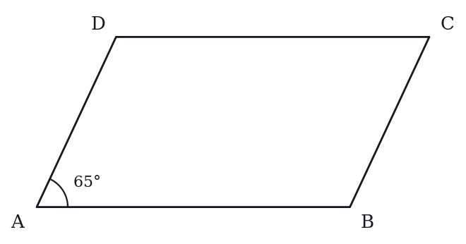

**(A)** 65°  
**(B)** 115°  
**(C)** 230°  
**(D)** 245°  
**(E)** 295°

**Q3** · `GEO-PTZ-003` · MCQ · 50s

A trapezoid has parallel bases of length 8 and 14, and a height of 6. What is its area?

**(A)** 48  
**(B)** 56  
**(C)** 66  
**(D)** 84  
**(E)** 132

**Q4** · `GEO-PTZ-004` · Numeric Entry · 45s

Parallelogram PQRS has PQ = 9 and QR = 5. What is the perimeter of the parallelogram?

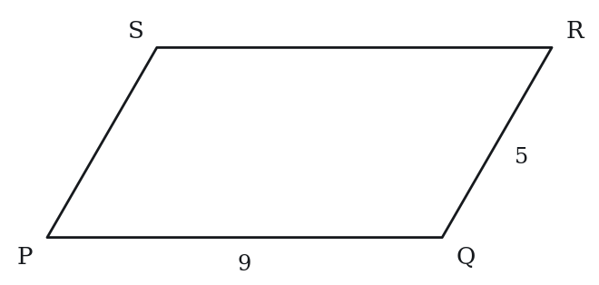

*Numeric entry — write the number.*

**Q5** · `GEO-PTZ-005` · MCQ · 50s

Which of the following statements about a rhombus is always true?

**(A)** All interior angles are 90°  
**(B)** The diagonals are equal in length  
**(C)** All four sides are equal  
**(D)** It is a rectangle  
**(E)** The diagonals are equal and bisect each other

**Q6** · `GEO-PTZ-006` · QC · 50s

A parallelogram has a base of 10 and a slant side of 8. The perpendicular height is 6.

> **Quantity A:**  Area of the parallelogram
> **Quantity B:**  80

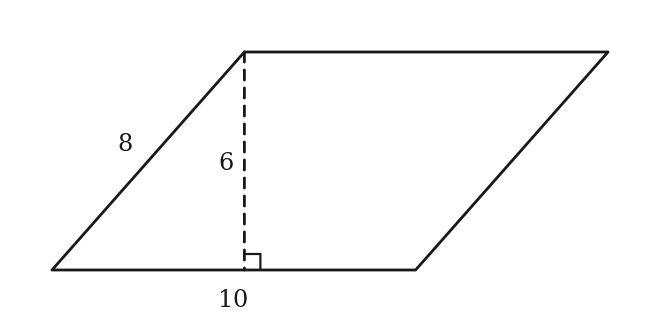

**Q7** · `GEO-PTZ-009` · Numeric Entry · 45s

A rhombus has diagonals of length 10 and 24. What is the area of the rhombus?

*Numeric entry — write the number.*

---

### Level 2 · Medium — 16 questions · ~22 min

*two or three steps, one planted trap each*

**Q8** · `GEO-PTZ-011` · MCQ · 70s

In a parallelogram, one side has length 15 and an adjacent side has length 10. The two sides meet at an angle of 30°. What is the area of the parallelogram?

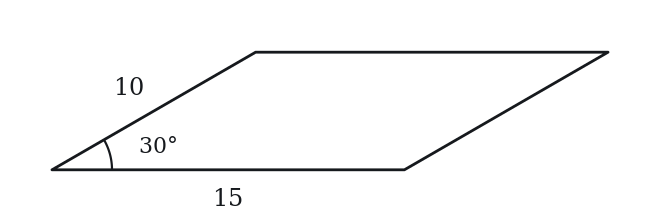

**(A)** 50  
**(B)** 75  
**(C)** 100  
**(D)** 129.9  
**(E)** 150

**Q9** · `GEO-PTZ-012` · Numeric Entry · 75s

A trapezoid has an area of 90, one base of length 12, and a height of 9. What is the length of the other base?

*Numeric entry — write the number.*

**Q10** · `GEO-PTZ-014` · MCQ · 75s

In parallelogram ABCD, angle A = 3x + 10 and angle B = 5x − 30. What is the value of x?

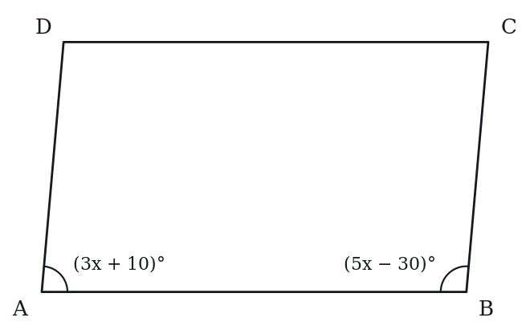

**(A)** 17.5  
**(B)** 20  
**(C)** 22.5  
**(D)** 25  
**(E)** 30

**Q11** · `GEO-PTZ-015` · Select all that apply · 80s

A rhombus has all sides of length 13. Which of the following statements must be true? Select all that apply.

**(A)** The diagonals bisect each other  
**(B)** All interior angles are equal  
**(C)** The diagonals are perpendicular to each other  
**(D)** The perimeter is 52  
**(E)** The diagonals are equal in length

**Q12** · `GEO-PTZ-016` · MCQ · 80s

A rhombus has diagonals of length 16 and 12. What is the side length of the rhombus?

**(A)** 8  
**(B)** 10  
**(C)** 14  
**(D)** 20  
**(E)** 28

**Q13** · `GEO-PTZ-018` · Numeric Entry · 85s

An isosceles trapezoid has parallel bases of 6 and 18, and legs (non-parallel sides) of length 10. What is the height of the trapezoid?

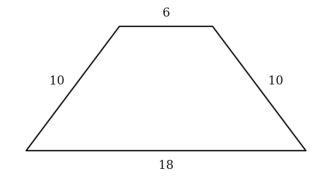

*Numeric entry — write the number.*

**Q14** · `GEO-PTZ-020` · QC · 70s

A parallelogram has base b and perpendicular height h (b > 0, h > 0). A trapezoid has parallel bases b and 3b, and the same height h.

> **Quantity A:**  Area of the parallelogram
> **Quantity B:**  Area of the trapezoid

**Q15** · `GEO-PTZ-021` · MCQ · 70s

Trapezoid ABCD has AB ∥ CD, AB = 10, height = 8, and area = 60. What is the length of CD?

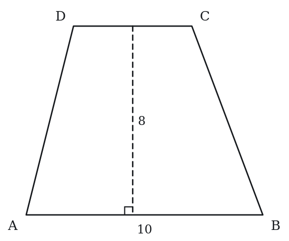

**(A)** 3  
**(B)** 5  
**(C)** 7  
**(D)** 10  
**(E)** 15

**Q16** · `GEO-PTZ-023` · Numeric Entry · 90s

A rhombus has a perimeter of 40 and one diagonal of length 12. What is the area of the rhombus?

*Numeric entry — write the number.*

**Q17** · `GEO-PTZ-026` · Select all that apply · 75s

In which of the following quadrilaterals do the diagonals always bisect each other? Select all that apply.

**(A)** Parallelogram  
**(B)** Trapezoid (one pair of parallel sides only)  
**(C)** Rhombus  
**(D)** Rectangle  
**(E)** General quadrilateral with no parallel sides

**Q18** · `GEO-PTZ-032` · QC · 90s

Parallelogram ABCD has angle A = 50°.

> **Quantity A:**  Angle B + Angle D
> **Quantity B:**  260°

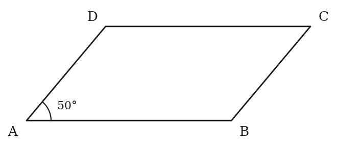

**Q19** · `GEO-PTZ-034` · MCQ · 95s

Rhombus ABCD has side length 5 and one diagonal AC of length 6. What is the area of the rhombus?

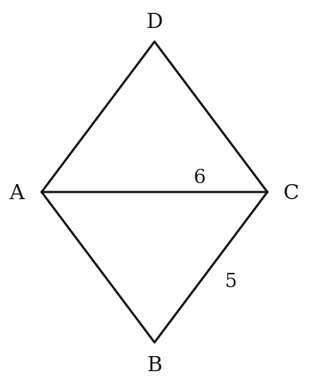

**(A)** 12  
**(B)** 20  
**(C)** 24  
**(D)** 30  
**(E)** 48

**Q20** · `GEO-PTZ-035` · QC · 100s

Trapezoid T has parallel bases of 5 and 11 and height 4. Parallelogram P has the same height and a base equal to the midsegment of the trapezoid.

> **Quantity A:**  Area of trapezoid T
> **Quantity B:**  Area of parallelogram P

**Q21** · `GEO-PTZ-038` · Numeric Entry · 125s

Parallelogram ABCD has AB = 12, BC = 5, and diagonal AC = 13. What is the area of the parallelogram?

*Numeric entry — write the number.*

**Q22** · `GEO-PTZ-KMF-003` · QC · 80s

In quadrilateral WXYZ, side ZY is parallel to side WX, angle XWZ is a right angle, WX = 9, ZY = 4 and WZ = 12.

> **Quantity A:**  The length of XY
> **Quantity B:**  13

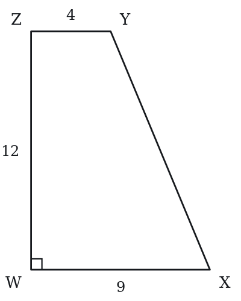

**Q23** · `GEO-PTZ-KMF-004` · MCQ · 90s

A square and a rhombus each have sides of length 6, and the rhombus has an angle of 60 degrees. By how much does the area of the square exceed the area of the rhombus?

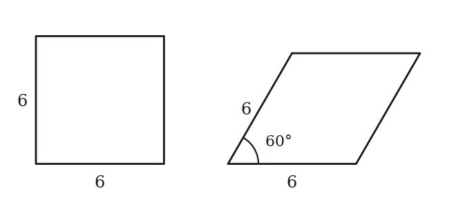

**(A)** 36 - 18*sqrt(3)  
**(B)** 36 - 18*sqrt(2)  
**(C)** 18  
**(D)** 36 - 9*sqrt(3)  
**(E)** 18*sqrt(3)

---

### Level 3 · Hard — 7 questions · ~14 min

*where 162+ is won or lost*

**Q24** · `GEO-PTZ-028` · Numeric Entry · 100s

Trapezoid ABCD has AB ∥ CD with AB = 20 and CD = 8. The diagonals intersect at point P. What is the ratio of the area of triangle APB to the area of triangle CPD?

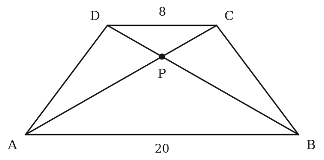

*Numeric entry — write the number.*

**Q25** · `GEO-PTZ-029` · QC · 110s

Rhombus R has side length 10. Parallelogram P has base 10 and perpendicular height 10.

> **Quantity A:**  Area of Rhombus R
> **Quantity B:**  Area of Parallelogram P

**Q26** · `GEO-PTZ-037` · MCQ · 105s

An isosceles trapezoid has parallel sides of lengths 10 and 22, and its area is 128. What is the perimeter of the trapezoid?

**(A)** 44  
**(B)** 48  
**(C)** 52  
**(D)** 60  
**(E)** 64

**Q27** · `GEO-PTZ-040` · Select all that apply · 130s

A parallelogram has integer side lengths and integer area. Its perimeter is 40. Which of the following values could be the area of this parallelogram? Select all that apply.

**(A)** 19  
**(B)** 75  
**(C)** 96  
**(D)** 100  
**(E)** 110

**Q28** · `SEC-PG-015` · MCQ · 125s

The parallel sides of trapezoid WXYZ have lengths XY = 5 and WZ = 13, and the nonparallel sides have lengths WX = 7 and YZ = 9, as shown above. Segment PQ (not shown) is parallel to the two parallel sides, with P on side WX and Q on side YZ. If PQ divides WXYZ into two trapezoids having equal perimeters, what is WP + QZ?

Note: Figure not drawn to scale.

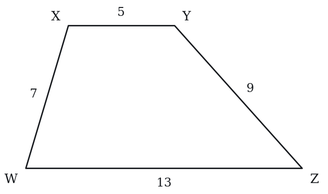

**(A)** 2  
**(B)** 3  
**(C)** 4  
**(D)** 5  
**(E)** 6

**Q29** · `SEC-PG-042` · QC · 115s

In quadrilateral KLMN above, side LM is parallel to side KN, LM is shorter than KN, and angle K is a right angle.

Note: Figure not drawn to scale.

> **Quantity A:**  The length of KL
> **Quantity B:**  The length of MN

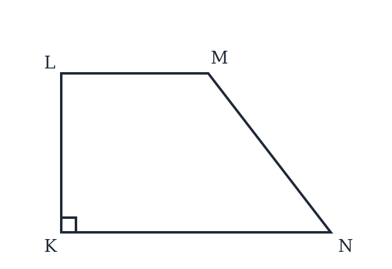

**Q30** · `SEC-PG-048` · Select all that apply · 130s

Square WXYZ and parallelogram WPQZ lie in the same plane and share the side WZ. Also, WP = WX, points P and X lie on the same side of line WZ, and P is not the same point as X. Which of the following must be true?

Indicate all such statements.

**(A)** The area of WXYZ is greater than the area of WPQZ  
**(B)** The perimeter of WXYZ is equal to the perimeter of WPQZ  
**(C)** PQ = XY  
**(D)** The area of WPQZ is greater than half the area of WXYZ  
**(E)** The area of WXYZ is more than twice the area of WPQZ  
F. WQ = WY

---

## Part B — Answer Key

| Q | ID | Level | Type | Answer |
|---|---|---|---|---|
| 1 | `GEO-PTZ-001` | easy | MCQ | **D** |
| 2 | `GEO-PTZ-002` | easy | MCQ | **B** |
| 3 | `GEO-PTZ-003` | easy | MCQ | **C** |
| 4 | `GEO-PTZ-004` | easy | Numeric Entry | **28** |
| 5 | `GEO-PTZ-005` | easy | MCQ | **C** |
| 6 | `GEO-PTZ-006` | easy | QC | **B** |
| 7 | `GEO-PTZ-009` | easy | Numeric Entry | **120** |
| 8 | `GEO-PTZ-011` | medium | MCQ | **B** |
| 9 | `GEO-PTZ-012` | medium | Numeric Entry | **8** |
| 10 | `GEO-PTZ-014` | medium | MCQ | **D** |
| 11 | `GEO-PTZ-015` | medium | Select all that apply | **A, C, D** |
| 12 | `GEO-PTZ-016` | medium | MCQ | **B** |
| 13 | `GEO-PTZ-018` | medium | Numeric Entry | **8** |
| 14 | `GEO-PTZ-020` | medium | QC | **B** |
| 15 | `GEO-PTZ-021` | medium | MCQ | **B** |
| 16 | `GEO-PTZ-023` | medium | Numeric Entry | **96** |
| 17 | `GEO-PTZ-026` | medium | Select all that apply | **A, C, D** |
| 18 | `GEO-PTZ-032` | medium | QC | **C** |
| 19 | `GEO-PTZ-034` | medium | MCQ | **C** |
| 20 | `GEO-PTZ-035` | medium | QC | **C** |
| 21 | `GEO-PTZ-038` | medium | Numeric Entry | **60** |
| 22 | `GEO-PTZ-KMF-003` | medium | QC | **C** |
| 23 | `GEO-PTZ-KMF-004` | medium | MCQ | **A** |
| 24 | `GEO-PTZ-028` | hard | Numeric Entry | **6.25** |
| 25 | `GEO-PTZ-029` | hard | QC | **D** |
| 26 | `GEO-PTZ-037` | hard | MCQ | **C** |
| 27 | `GEO-PTZ-040` | hard | Select all that apply | **A, B, C, D** |
| 28 | `SEC-PG-015` | hard | MCQ | **C** |
| 29 | `SEC-PG-042` | hard | QC | **B** |
| 30 | `SEC-PG-048` | hard | Select all that apply | **A, B, C** |

---

## Part C — Worked Solutions

### Q1 · `GEO-PTZ-001` — Answer: D

Area of a parallelogram = base × perpendicular height = 12 × 7 = 84.

**Trap.** Students who confuse the parallelogram area formula with a triangle's area compute ½ × 12 × 7 = 42, choosing B.

### Q2 · `GEO-PTZ-002` — Answer: B

In a parallelogram, consecutive angles are supplementary (they add to 180°). Angle B = 180° − 65° = 115°.

**Trap.** A (65°) takes consecutive angles as equal (uses the opposite-angle rule). C (230°) is the sum of angles B and D, 360° − 2(65°). D (245°) adds, 180° + 65°. E (295°) subtracts from 360°, 360° − 65°.

### Q3 · `GEO-PTZ-003` — Answer: C

Area of a trapezoid = ½ × (b1 + b2) × h = ½ × (8 + 14) × 6 = ½ × 22 × 6 = 66.

**Trap.** Students forget the 1/2 and compute (8 + 14) × 6 = 132 (E); or use only one base without averaging: 14 × 6 = 84 (D) or 8 × 6 = 48 (A).

### Q4 · `GEO-PTZ-004` — Answer: 28

In a parallelogram, opposite sides are equal: PQ = RS = 9 and QR = PS = 5. Perimeter = 2 × (9 + 5) = 2 × 14 = 28.

**Trap.** Students add only the two given sides: 9 + 5 = 14, forgetting that the perimeter includes all four sides.

### Q5 · `GEO-PTZ-005` — Answer: C

A rhombus is defined as a parallelogram in which all four sides are equal. The diagonals are NOT necessarily equal (equal diagonals in a parallelogram indicate a rectangle). All angles are 90° only in a square.

**Trap.** Students choose B or E, thinking the diagonals of a rhombus must be equal. Equal diagonals in a parallelogram indicate a rectangle — a rhombus has perpendicular diagonals, not necessarily equal ones.

### Q6 · `GEO-PTZ-006` — Answer: B

Area of a parallelogram = base × perpendicular height (NOT slant side). Area = 10 × 6 = 60. Quantity A = 60, Quantity B = 80. Quantity B is greater.

**Trap.** Students use the slant side as the height: 10 × 8 = 80, choosing C. The height must be the perpendicular distance between the parallel bases (6), not the slant side (8).

### Q7 · `GEO-PTZ-009` — Answer: 120

Area of a rhombus = (d1 × d2) / 2 = (10 × 24) / 2 = 240 / 2 = 120.

**Trap.** Students compute 10 × 24 = 240 and forget to divide by 2, entering 240.

### Q8 · `GEO-PTZ-011` — Answer: B

Take the side of length 15 as the base and drop a perpendicular to it from the far end of the side of length 10. That perpendicular is a leg of a right triangle whose hypotenuse is the side of length 10 and whose acute angle at the base is 30°. In a right triangle with angles of 30°, 60° and 90°, the leg opposite the 30° angle is half the hypotenuse, so the height is 5. Area = base × height = 15 × 5 = 75.

**Trap.** Students use the 10 as the height and compute 15 × 10 = 150 (choice E). The height is the perpendicular distance between the two sides of length 15, which is 5, not the slant side itself.

### Q9 · `GEO-PTZ-012` — Answer: 8

Area = ½ × (b1 + b2) × h. Substituting: 90 = ½ × (12 + b2) × 9. Multiply both sides by 2: 180 = (12 + b2) × 9. Divide both sides by 9: 20 = 12 + b2. Therefore b2 = 20 − 12 = 8.

**Trap.** Students set up 90 = ½ × b2 × 9 (using only one base), getting b2 = 20. The formula requires the average of both bases, so both must be included.

### Q10 · `GEO-PTZ-014` — Answer: D

Angles A and B are consecutive angles in a parallelogram, so they are supplementary: (3x + 10) + (5x − 30) = 180. Simplify: 8x − 20 = 180. Add 20 to both sides: 8x = 200. Divide by 8: x = 25.

**Trap.** Students set the angles equal (3x + 10 = 5x − 30), thinking consecutive angles are equal rather than supplementary. This gives x = 20 (choice B), which is the opposite-angle error.

### Q11 · `GEO-PTZ-015` — Answer: A, C, D

A: True — diagonals of any parallelogram (including a rhombus) bisect each other. B: False — angles in a rhombus are equal only in a square; a general rhombus has two pairs of equal opposite angles that need not be 90°. C: True — a defining property of a rhombus is that its diagonals are perpendicular bisectors of each other. D: True — perimeter = 4 × 13 = 52. E: False — equal diagonals in a parallelogram indicate a rectangle; a rhombus's diagonals are perpendicular but not necessarily equal.

**Trap.** Students include E, confusing 'diagonals bisect each other' (true for all parallelograms) with 'diagonals are equal in length' (true for rectangles). A rhombus has perpendicular diagonals, not equal ones.

### Q12 · `GEO-PTZ-016` — Answer: B

The diagonals of a rhombus bisect each other at right angles. Each half-diagonal has length 16/2 = 8 and 12/2 = 6. The side of the rhombus is the hypotenuse of the right triangle formed by the two half-diagonals: side = √(8² + 6²) = √(64 + 36) = √100 = 10.

**Trap.** Students use the full diagonals in the Pythagorean theorem: √(16² + 12²) = √400 = 20 (choice D). Must use HALF of each diagonal, since the diagonals bisect each other before forming the right triangle.

### Q13 · `GEO-PTZ-018` — Answer: 8

Drop a perpendicular from each end of the shorter base to the longer base. Each horizontal extension = (18 − 6)/2 = 6. The leg, the height, and the horizontal extension form a right triangle with the leg (10) as hypotenuse: 10² = h² + 6². So 100 = h² + 36, giving h² = 64 and h = 8.

**Trap.** Students use 10 directly as the height, treating the slant leg as if it were perpendicular. The horizontal extension is (18 − 6)/2 = 6, forming a 6-8-10 right triangle with the leg as hypotenuse.

### Q14 · `GEO-PTZ-020` — Answer: B

Area of parallelogram = b × h. Area of trapezoid = ½ × (b + 3b) × h = ½ × 4b × h = 2bh. Since b > 0 and h > 0, we have 2bh > bh. Quantity B is greater.

**Trap.** Students guess C thinking the same variables b and h mean equal areas. But the trapezoid averages both bases: ½(b + 3b) = 2b, giving area 2bh versus the parallelogram's bh.

### Q15 · `GEO-PTZ-021` — Answer: B

Area = ½ × (AB + CD) × h, so 60 = ½ × (10 + CD) × 8 = 4(10 + CD). Then 10 + CD = 15 and CD = 5. With the area, height and one base fixed, the other base is determined.

**Trap.** Forgetting the ½ (60 = 8(10 + CD) gives CD = -2.5, no choice), or reading 15 = 10 + CD as 'CD = 15' (E), or assuming the trapezoid is a parallelogram with CD = AB = 10 (D).

### Q16 · `GEO-PTZ-023` — Answer: 96

Step 1: Perimeter = 4 × side, so side = 40/4 = 10. Step 2: The diagonals of a rhombus bisect each other at right angles. Half of the given diagonal = 12/2 = 6. Step 3: Using the Pythagorean theorem with side = 10 and half-diagonal = 6: (half of d2)² = 10² − 6² = 100 − 36 = 64, so half of d2 = 8 and d2 = 16. Step 4: Area = (d1 × d2)/2 = (12 × 16)/2 = 192/2 = 96.

**Trap.** Students use the full diagonal (12) instead of half (6) in the Pythagorean theorem: (half d2)² = 10² − 12² = −44, which is impossible. Must use HALF of each diagonal since the diagonals bisect each other.

### Q17 · `GEO-PTZ-026` — Answer: A, C, D

The diagonals bisect each other in all parallelograms. A rhombus is a special parallelogram (all sides equal) — yes. A rectangle is a special parallelogram (all right angles) — yes. A trapezoid has only one pair of parallel sides; its diagonals do NOT bisect each other in general. A general quadrilateral with no parallel sides has no diagonal-bisection guarantee.

**Trap.** Students include B (trapezoid), thinking that having one pair of parallel sides is sufficient. The bisecting-diagonals property requires TWO pairs of parallel sides (i.e., a parallelogram).

### Q18 · `GEO-PTZ-032` — Answer: C

In a parallelogram, consecutive angles are supplementary: angle B = 180° − 50° = 130°. Opposite angles are equal: angle D = angle B = 130°. Therefore angle B + angle D = 130° + 130° = 260°. The two quantities are equal.

**Trap.** Students compute only one supplementary angle and assume Quantity B must be larger, or they find angle B = 130° but mistakenly set angle D = 50° (thinking D is opposite to B). In parallelogram ABCD, angles B and D are opposite to each other, both equal to 130°.

### Q19 · `GEO-PTZ-034` — Answer: C

The diagonals of a rhombus bisect each other at right angles. Half of AC = 6/2 = 3. Using the Pythagorean theorem with side = 5 and half-diagonal = 3: (half of BD)² = 5² − 3² = 25 − 9 = 16, so half of BD = 4, and BD = 8. Area = (AC × BD)/2 = (6 × 8)/2 = 48/2 = 24.

**Trap.** Students find BD = 8 correctly but forget to divide by 2 in the rhombus area formula, entering 6 × 8 = 48 (choice E). The formula is (d1 × d2)/2, always requiring division by 2.

### Q20 · `GEO-PTZ-035` — Answer: C

The midsegment of a trapezoid = (b1 + b2)/2 = (5 + 11)/2 = 8. Area of trapezoid = ½ × (5 + 11) × 4 = ½ × 16 × 4 = 32. Area of parallelogram = midsegment × height = 8 × 4 = 32. The areas are equal. This follows from the fact that the trapezoid area formula ½(b1 + b2) × h equals midsegment × h.

**Trap.** Students compute both areas separately and make an arithmetic error, or they do not recognize the connection and guess D. The key insight: trapezoid area = ½(b1+b2)h = [(b1+b2)/2] × h = midsegment × h, which is exactly the parallelogram's area formula.

### Q21 · `GEO-PTZ-038` — Answer: 60

Consider triangle ABC formed by sides AB = 12, BC = 5, and diagonal AC = 13. Check if it is a right triangle: AB² + BC² = 144 + 25 = 169 = 13² = AC². Yes — triangle ABC is a right triangle with the right angle at B. Area of triangle ABC = ½ × AB × BC = ½ × 12 × 5 = 30. The diagonal of a parallelogram divides it into two congruent triangles. Area of parallelogram ABCD = 2 × area of triangle ABC = 2 × 30 = 60.

**Trap.** Students attempt to apply base × height directly without recognizing the 5-12-13 right triangle embedded in the diagonal. The key insight is that AB² + BC² = AC², revealing a right angle at B, which makes the area computation straightforward.

### Q22 · `GEO-PTZ-KMF-003` — Answer: C

Drop a perpendicular from Y to WX, meeting it at P. Then YP = WZ = 12 and WP = ZY = 4, so PX = 9 - 4 = 5.
Triangle YPX is right-angled with legs 12 and 5, so XY = sqrt(12^2 + 5^2) = sqrt(144 + 25) = sqrt(169) = 13.
Quantity A = 13 = Quantity B.
Check coordinates: W(0,0), X(9,0), Z(0,12), Y(4,12); distance XY = sqrt(5^2 + 12^2) = 13.

**Trap.** Using the sloping side as WZ = 12 plus something, or taking the horizontal gap as 9 instead of 9 - 4 = 5: sqrt(12^2 + 9^2) = 15 would make Quantity A greater (choice A).

### Q23 · `GEO-PTZ-KMF-004` — Answer: A

1. Square area = 6*6 = 36.
2. Drop a perpendicular from one vertex of the rhombus to the opposite side. With a 60-degree angle this makes a 30-60-90 triangle with hypotenuse 6, so the height is 6*(sqrt(3)/2) = 3*sqrt(3).
3. Rhombus area = base * height = 6 * 3*sqrt(3) = 18*sqrt(3), about 31.2.
4. Difference = 36 - 18*sqrt(3), about 4.8.
Check: the rhombus is thinner than the square (height 5.2 against 6), so its area must be a little smaller than 36.

**Trap.** Treating the height as if it came from a 45-45-90 triangle (3*sqrt(2)) gives 36 - 18*sqrt(2) (choice B).

### Q24 · `GEO-PTZ-028` — Answer: 6.25

Triangles APB and CPD are similar (by AA: angle APB = angle CPD as vertical angles; angle PAB = angle PCD as alternate interior angles with AB ∥ CD). Their similarity ratio equals the ratio of the parallel sides: AB/CD = 20/8 = 5/2. Since areas of similar figures scale as the square of the linear ratio: Area(APB)/Area(CPD) = (5/2)² = 25/4 = 6.25.

**Trap.** Students use the linear ratio 5/2 = 2.5 instead of squaring it. For similar triangles, areas scale as the SQUARE of the ratio of corresponding sides: (5/2)² = 25/4 = 6.25.

### Q25 · `GEO-PTZ-029` — Answer: D

Parallelogram P has area = base × height = 10 × 10 = 100. A rhombus of side 10 has area = base × height = 10h, where h is the distance between a pair of opposite sides. Because each side is 10 long, h is at most 10, and h = 10 only when the rhombus is a square. So the rhombus area ranges over (0, 100], reaching 100 only for a square. Since a rhombus could be a square (area 100, equal) or not (area < 100, Quantity B greater), the relationship cannot be determined.

**Trap.** Students assume the rhombus must be a non-square and choose B (Quantity B greater). But a rhombus CAN be a square, in which case both areas equal 100. Since the rhombus could be a square (area 100) or non-square (area < 100), the relationship cannot be determined.

### Q26 · `GEO-PTZ-037` — Answer: C

Area = (1/2)(10 + 22) * height = 16 * height = 128, so the height is 8.
Drop perpendiculars from the ends of the shorter parallel side. They cut the longer side into 6, 10 and 6, since (22 - 10)/2 = 6.
Each non-parallel side is the hypotenuse of a right triangle with legs 6 and 8: sqrt(36 + 64) = 10.
Perimeter = 10 + 22 + 10 + 10 = 52.
Answer: C.

**Trap.** Using the height, 8, as the length of each non-parallel side: 10 + 22 + 8 + 8 = 48 (choice B). The non-parallel sides slant, so each is longer than the height; it is the hypotenuse of a 6-8-10 right triangle.

### Q27 · `GEO-PTZ-040` — Answer: A, B, C, D

Perimeter = 40 means 2(a + b) = 40, so a + b = 20. The integer side pairs (a, b) include: (1,19), (2,18), ..., (10,10). Area = base × perpendicular height, where the perpendicular height h ≤ b (the shorter side). The maximum area for a given pair (a, b) is a × b (achieved when the parallelogram is a rectangle). Check each option: A (19): Use pair (19, 1). Max area = 19 × 1 = 19 ✓. A rectangle with sides 19 and 1 has area 19. B (75): Use pair (15, 5). Max area = 15 × 5 = 75 ✓. A rectangle with sides 15 and 5 has area 75. C (96): Use pair (12, 8). Max area = 12 × 8 = 96 ✓. A rectangle with sides 12 and 8 has area 96. D (100): Use pair (10, 10). Max area = 10 × 10 = 100 ✓. A square with side 10 has area 100. E (110): The maximum possible area over all integer pairs is max(a × b) where a + b = 20. Because (a − b)² ≥ 0, 4ab ≤ (a+b)² = 400, so a × b ≤ 100. So no parallelogram with perimeter 40 can have area greater than 100. E = 110 is impossible.

**Trap.** Students exclude A (19), thinking a perimeter-40 shape must have a large area. But the pair (19, 1) gives a very flat rectangle with area exactly 19. Students also include E (110), not realizing that the maximum area is capped at 100, since (a − b)² ≥ 0 forces ab ≤ (a + b)²/4 = 100.

### Q28 · `SEC-PG-015` — Answer: C

Let WP + QZ = p. Since P is on WX and Q is on YZ, the remaining pieces satisfy PX + YQ = (7 + 9) - p = 16 - p. The lower trapezoid WPQZ has perimeter WP + PQ + QZ + WZ = p + PQ + 13, and the upper trapezoid PXYQ has perimeter PX + XY + YQ + PQ = (16 - p) + 5 + PQ. Setting these equal, the shared PQ cancels: p + 13 = 21 - p, so 2p = 8 and p = 4.

**Trap.** Students split the nonparallel sides evenly, taking WP + QZ to be half of 7 + 9 = 16, and answer 8, or they halve the difference and answer 2. The cut is not a midline; it is placed so that the two 13-and-5 bases are balanced out, which pushes PQ well below the middle.

### Q29 · `SEC-PG-042` — Answer: B

Because angle K is a right angle and LM is parallel to KN, side KL is perpendicular to both parallel lines, so KL is exactly the perpendicular distance between them. Now drop a perpendicular from M to line KN, meeting it at a point F. Then MF also equals that same distance, so MF = KL. Since LM is shorter than KN, the point F falls strictly between K and N, so FN is a positive length and triangle MFN is a genuine right triangle with legs MF and FN and hypotenuse MN. A hypotenuse always exceeds either leg, so MN is greater than MF = KL.

**Trap.** Students see no numbers and choose 'cannot be determined'. The perpendicular side KL is the shortest possible segment between the two parallel lines, and because LM is strictly shorter than KN the side MN must slant, which forces it to be strictly longer, whatever the actual measurements are.

### Q30 · `SEC-PG-048` — Answer: A, B, C

Let the shared side WZ have length a. The square has all four sides equal to a. Since WP = WX = a, the parallelogram has WP = a as well, and in a parallelogram opposite sides are equal, so PQ = WZ = a and ZQ = WP = a. That settles two statements at once: PQ = a = XY, so C is true, and both figures have perimeter 4a, so B is true. For areas, both figures sit on base WZ = a. The square's height is the full a, because WX is perpendicular to WZ. The parallelogram's height is the perpendicular distance from P to line WZ. Because P and X lie on the same side of line WZ with WP = WX = a, both P and X sit on the same semicircle of radius a centered at W, so P not equal to X forces angle PWZ to differ from angle XWZ = 90 degrees. That distance is at most a, and equals a only when WP is perpendicular to WZ, which would force P = X; since P is not X, the height is strictly less than a and the parallelogram's area is strictly less than a^2. So A is true. But nothing pins down how far the parallelogram leans: the angle could be near 90 degrees, making its area almost a^2, or very small, making its area nearly zero. So D and E can each fail, and the parallelogram's diagonal WQ likewise varies with the lean while WY is fixed at a*sqrt(2), so F can fail.

**Trap.** Students reject B, assuming a leaning shape must have a different perimeter from the square. Tilting the square into a rhombus keeps every side at length a, so the perimeter is untouched; it is the area, which depends on the height, that shrinks.
