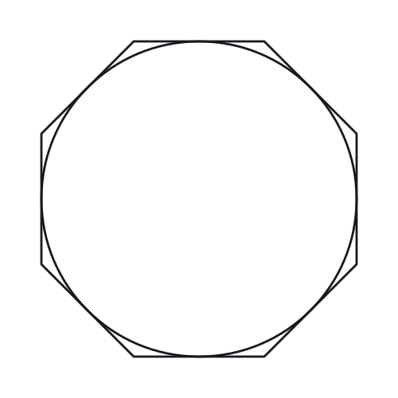

# Polygons — Practice Set

**Bank code:** `GEO-POL` · **Section:** Geometry · **30 questions** — Easy 7 · Medium 15 · Hard 8

**Lecture capsule:** [09-polygons.md](../../05-geometry/09-polygons.md)

> Interior angles sum to (n - 2)*180 while the exterior angles always total 360, whatever n is; diagonals come from n(n - 3)/2.

Every question below is live in the question bank under the ID shown — the sheet and the portal are the same questions. Attempt a level with the clock running, then check Part C.

---

## Part A — Questions

> **Quantitative Comparison — the four choices are always the same, so they are not reprinted:**
> **(A)** Quantity A is greater · **(B)** Quantity B is greater · **(C)** The two quantities are equal · **(D)** The relationship cannot be determined from the information given

### Level 1 · Easy — 7 questions · ~5 min

*warm-up — these must be automatic*

**Q1** · `GEO-POL-001` · MCQ · 40s

What is the sum of the interior angles of a hexagon?

**(A)** 540°  
**(B)** 630°  
**(C)** 720°  
**(D)** 900°  
**(E)** 1080°

**Q2** · `GEO-POL-002` · MCQ · 45s

Each interior angle of a regular pentagon measures how many degrees?

**(A)** 100°  
**(B)** 108°  
**(C)** 112°  
**(D)** 120°  
**(E)** 135°

**Q3** · `GEO-POL-003` · MCQ · 35s

What is the sum of the exterior angles of any convex polygon?

**(A)** 180°  
**(B)** 270°  
**(C)** 360°  
**(D)** 540°  
**(E)** 720°

**Q4** · `GEO-POL-004` · Numeric Entry · 50s

How many diagonals does a pentagon have?

*Numeric entry — write the number.*

**Q5** · `GEO-POL-005` · MCQ · 40s

Each exterior angle of a regular octagon measures how many degrees?

**(A)** 30°  
**(B)** 40°  
**(C)** 45°  
**(D)** 60°  
**(E)** 135°

**Q6** · `GEO-POL-007` · MCQ · 55s

The interior angle of a regular polygon measures 120°. How many sides does the polygon have?

**(A)** 4  
**(B)** 5  
**(C)** 6  
**(D)** 8  
**(E)** 10

**Q7** · `GEO-POL-010` · Numeric Entry · 40s

What is the sum of the interior angles of a decagon (10-sided polygon)?

*Numeric entry — write the number.*

---

### Level 2 · Medium — 15 questions · ~20 min

*two or three steps, one planted trap each*

**Q8** · `GEO-POL-012` · QC · 70s

> **Quantity A:**  Each interior angle of a regular octagon
> **Quantity B:**  Each interior angle of a regular nonagon

**Q9** · `GEO-POL-013` · MCQ · 65s

How many diagonals does an octagon have?

**(A)** 16  
**(B)** 20  
**(C)** 24  
**(D)** 28  
**(E)** 32

**Q10** · `GEO-POL-015` · Numeric Entry · 80s

A regular polygon has 35 diagonals. How many sides does it have?

*Numeric entry — write the number.*

**Q11** · `GEO-POL-016` · Select all that apply · 90s

Which of the following could be the measure of each interior angle of a regular polygon? Select all that apply.

**(A)** 108°  
**(B)** 130°  
**(C)** 150°  
**(D)** 155°  
**(E)** 170°

**Q12** · `GEO-POL-018` · QC · 85s

A regular polygon P has interior angles of 135°.

> **Quantity A:**  Number of diagonals of P
> **Quantity B:**  Number of sides of P squared

**Q13** · `GEO-POL-020` · Numeric Entry · 75s

A floor is tiled with regular hexagonal tiles, each with side length 4 centimeters. The area of one tile is k√3 square centimeters. What is the value of k?

*Numeric entry — write the number.*

**Q14** · `GEO-POL-021` · QC · 70s

> **Quantity A:**  Sum of interior angles of a heptagon
> **Quantity B:**  Sum of exterior angles of a heptagon × 3

**Q15** · `GEO-POL-022` · Select all that apply · 85s

A convex polygon has n sides. Which of the following statements must be true? Select all that apply.

**(A)** The sum of its exterior angles is 360°  
**(B)** The sum of its interior angles is n × 180°  
**(C)** Each interior angle measures less than 180°  
**(D)** Each exterior angle of the polygon equals 360°/n  
**(E)** The polygon has n(n-3)/2 diagonals

**Q16** · `GEO-POL-024` · Numeric Entry · 75s

A regular hexagon has a perimeter of 48. Its area is k√3. What is the value of k?

*Numeric entry — write the number.*

**Q17** · `GEO-POL-026` · QC · 80s

A regular polygon Q has 20 sides.

> **Quantity A:**  Sum of all interior angles of Q (in degrees)
> **Quantity B:**  10 times the sum of all exterior angles of Q

**Q18** · `GEO-POL-027` · MCQ · 85s

The ratio of an interior angle to its corresponding exterior angle in a regular polygon is 4:1. How many sides does the polygon have?

**(A)** 8  
**(B)** 9  
**(C)** 10  
**(D)** 12  
**(E)** 15

**Q19** · `GEO-POL-032` · Numeric Entry · 90s

The sum of the interior angles of a polygon exceeds the sum of its exterior angles by 1080°. How many sides does the polygon have?

*Numeric entry — write the number.*

**Q20** · `GEO-POL-KMF-005` · MCQ · 70s

The interior angle measures of convex polygon X add up to 540 degrees more than those of convex polygon Y. Polygon X has 12 sides. How many sides does polygon Y have?

**(A)** 3  
**(B)** 6  
**(C)** 9  
**(D)** 10  
**(E)** 15

**Q21** · `GEO-POL-KMF-006` · MCQ · 90s

For how many integers n >= 3 are the interior angles of a regular n-gon each between 135 and 150 degrees, with both of those values allowed?

**(A)** 3  
**(B)** 4  
**(C)** 5  
**(D)** 6  
**(E)** 12

**Q22** · `SEC-PG-029` · QC · 85s

A hexagon has six interior angles. Five of those angles each measure 128 degrees.

> **Quantity A:**  The measure, in degrees, of the sixth interior angle
> **Quantity B:**  128

---

### Level 3 · Hard — 8 questions · ~14 min

*where 162+ is won or lost*

**Q23** · `GEO-POL-028` · Numeric Entry · 95s

A polygon has twice as many diagonals as it has sides. How many sides does it have?

*Numeric entry — write the number.*

**Q24** · `GEO-POL-030` · Select all that apply · 110s

A polygon has n sides where n is a positive integer greater than 2. Which of the following are possible values for the number of diagonals of such a polygon? Select all that apply.

**(A)** 0  
**(B)** 2  
**(C)** 4  
**(D)** 9  
**(E)** 21

**Q25** · `GEO-POL-033` · QC · 100s

Polygon P is a regular polygon. Its interior angle sum equals 5 times its exterior angle sum.

> **Quantity A:**  Number of diagonals of P
> **Quantity B:**  5 times the number of sides of P

**Q26** · `GEO-POL-037` · Numeric Entry · 120s

A convex polygon has n sides. Its number of diagonals is 52 greater than its number of sides. What is n?

*Numeric entry — write the number.*

**Q27** · `GEO-POL-038` · MCQ · 95s

The measures, in degrees, of the six interior angles of a certain hexagon are six consecutive odd integers. What is the measure, in degrees, of the greatest of the six angles?

**(A)** 120  
**(B)** 121  
**(C)** 123  
**(D)** 125  
**(E)** 130

**Q28** · `GEO-POL-KMF2-001` · Select all that apply · 100s

Each interior angle of a regular polygon with n sides has degree measure between 140 and 160. Which of the following could be the value of n?

Indicate all such integers.

**(A)** 8  
**(B)** 9  
**(C)** 12  
**(D)** 17  
**(E)** 18

**Q29** · `GEO-POL-KMF2-009` · MCQ · 105s

The figure above shows a circle inscribed in a regular octagon. If the diameter of the circle is 4 + 4sqrt(2), what is the perimeter of the octagon?

**(A)** 16  
**(B)** 24  
**(C)** 32  
**(D)** 16 + 16sqrt(2)  
**(E)** 32 + 32sqrt(2)

**Q30** · `SEC-PG-006` · QC · 100s

Polygon J has k sides, where k is greater than 4. Polygon K has k + 3 sides.

> **Quantity A:**  The sum of the measures of the interior angles of polygon K, in degrees
> **Quantity B:**  The sum of the measures of the interior angles of polygon J, in degrees, plus 480

---

## Part B — Answer Key

| Q | ID | Level | Type | Answer |
|---|---|---|---|---|
| 1 | `GEO-POL-001` | easy | MCQ | **C** |
| 2 | `GEO-POL-002` | easy | MCQ | **B** |
| 3 | `GEO-POL-003` | easy | MCQ | **C** |
| 4 | `GEO-POL-004` | easy | Numeric Entry | **5** |
| 5 | `GEO-POL-005` | easy | MCQ | **C** |
| 6 | `GEO-POL-007` | easy | MCQ | **C** |
| 7 | `GEO-POL-010` | easy | Numeric Entry | **1440** |
| 8 | `GEO-POL-012` | medium | QC | **B** |
| 9 | `GEO-POL-013` | medium | MCQ | **B** |
| 10 | `GEO-POL-015` | medium | Numeric Entry | **10** |
| 11 | `GEO-POL-016` | medium | Select all that apply | **A, C, E** |
| 12 | `GEO-POL-018` | medium | QC | **B** |
| 13 | `GEO-POL-020` | medium | Numeric Entry | **24** |
| 14 | `GEO-POL-021` | medium | QC | **B** |
| 15 | `GEO-POL-022` | medium | Select all that apply | **A, C, E** |
| 16 | `GEO-POL-024` | medium | Numeric Entry | **96** |
| 17 | `GEO-POL-026` | medium | QC | **B** |
| 18 | `GEO-POL-027` | medium | MCQ | **C** |
| 19 | `GEO-POL-032` | medium | Numeric Entry | **10** |
| 20 | `GEO-POL-KMF-005` | medium | MCQ | **C** |
| 21 | `GEO-POL-KMF-006` | medium | MCQ | **C** |
| 22 | `SEC-PG-029` | medium | QC | **B** |
| 23 | `GEO-POL-028` | hard | Numeric Entry | **7** |
| 24 | `GEO-POL-030` | hard | Select all that apply | **A, B, D** |
| 25 | `GEO-POL-033` | hard | QC | **B** |
| 26 | `GEO-POL-037` | hard | Numeric Entry | **13** |
| 27 | `GEO-POL-038` | hard | MCQ | **D** |
| 28 | `GEO-POL-KMF2-001` | hard | Select all that apply | **C, D** |
| 29 | `GEO-POL-KMF2-009` | hard | MCQ | **C** |
| 30 | `SEC-PG-006` | hard | QC | **A** |

---

## Part C — Worked Solutions

### Q1 · `GEO-POL-001` — Answer: C

A hexagon has n = 6 sides. The sum of interior angles = (n - 2) × 180° = (6 - 2) × 180° = 4 × 180° = 720°.

**Trap.** Students often use (n - 1) × 180° or forget to subtract 2, computing 6 × 180° = 1080°, which is the answer for an octagon.

### Q2 · `GEO-POL-002` — Answer: B

A pentagon has n = 5 sides. Sum of interior angles = (5 - 2) × 180° = 540°. Each interior angle of a regular pentagon = 540° / 5 = 108°.

**Trap.** Students often answer 120° (the interior angle of a regular hexagon) or 100° (dividing 500° by 5 after incorrectly computing the angle sum as 500°).

### Q3 · `GEO-POL-003` — Answer: C

Walking once around any convex polygon, the turns at the vertices add up to one full rotation, 360°, whatever the number of sides.

**Trap.** Students recall interior-angle sums instead: 180° (triangle), 540° (pentagon) and 720° (hexagon) are interior sums that depend on the number of sides. Exterior angles always total 360°.

### Q4 · `GEO-POL-004` — Answer: 5

The number of diagonals in an n-gon = n(n - 3)/2. For a pentagon (n = 5): 5(5 - 3)/2 = 5 × 2 / 2 = 5. A pentagon has 5 diagonals.

**Trap.** Students often use n(n-1)/2, which counts all line segments between n points (including the sides themselves). That gives 10 for a pentagon — but 5 of those are sides, not diagonals.

### Q5 · `GEO-POL-005` — Answer: C

Each exterior angle of a regular n-gon = 360° / n. For a regular octagon (n = 8): 360° / 8 = 45°.

**Trap.** Students sometimes compute the interior angle instead (135°) or use (n-2)×180°/n for the exterior angle, getting the interior angle measure.

### Q6 · `GEO-POL-007` — Answer: C

Each interior angle of a regular n-gon = (n-2) × 180° / n. Setting this equal to 120°: (n-2) × 180 = 120n → 180n - 360 = 120n → 60n = 360 → n = 6. The polygon is a hexagon (6 sides).

**Trap.** Students may try to recall the interior angle value from memory and confuse the 120° of a hexagon with the 108° of a pentagon or 135° of an octagon.

### Q7 · `GEO-POL-010` — Answer: 1440

Sum of interior angles = (n - 2) × 180°. For a decagon (n = 10): (10 - 2) × 180° = 8 × 180° = 1440°.

**Trap.** Students sometimes use n × 180° = 10 × 180° = 1800° (forgetting to subtract 2), or (n - 1) × 180° = 9 × 180° = 1620° (subtracting only 1).

### Q8 · `GEO-POL-012` — Answer: B

Regular octagon (n=8): interior angle = (8-2)×180°/8 = 6×180°/8 = 1080°/8 = 135°. Regular nonagon (n=9): interior angle = (9-2)×180°/9 = 7×180°/9 = 1260°/9 = 140°. Quantity B (140°) > Quantity A (135°). As n increases, each interior angle increases (approaches 180°).

**Trap.** Students may intuitively think more sides means smaller angles (confusing with exterior angles, which do decrease as n increases). For interior angles, more sides means larger each interior angle.

### Q9 · `GEO-POL-013` — Answer: B

Number of diagonals = n(n-3)/2. For an octagon (n=8): 8(8-3)/2 = 8 × 5 / 2 = 40/2 = 20.

**Trap.** Students use n(n-1)/2 = 8 × 7/2 = 28, which counts all line segments between 8 points including the 8 sides of the octagon. Subtracting the 8 sides gives 28 - 8 = 20, confirming the correct formula.

### Q10 · `GEO-POL-015` — Answer: 10

Number of diagonals = n(n-3)/2 = 35. So n(n-3) = 70. Try n = 10: 10 × 7 = 70. ✓ The polygon has 10 sides (it is a decagon). Verification: 10(10-3)/2 = 70/2 = 35 ✓.

**Trap.** Students attempt to solve n² - 3n - 70 = 0 algebraically: (n-10)(n+7) = 0, giving n = 10 or n = -7. They may forget to discard n = -7, or they may plug trial values without a systematic approach and get lost.

### Q11 · `GEO-POL-016` — Answer: A, C, E

Each interior angle of a regular n-gon is (n−2)180°/n, so the exterior angle is 180° − angle and n = 360°/(180° − angle). The value is possible only when that n is an integer and n ≥ 3.
A: 360/72 = 5. Possible (regular pentagon).
B: 360/50 = 7.2, not an integer. Not possible.
C: 360/30 = 12. Possible (regular dodecagon).
D: 360/25 = 14.4, not an integer. Not possible.
E: 360/10 = 36. Possible (regular 36-gon).
Answer: A, C and E.

**Trap.** B and D round n to the nearest integer: a 7-gon's interior angle is 900/7 ≈ 128.57° and a 14-gon's is 2160/14 ≈ 154.29°, so 130° and 155° belong to no regular polygon. n must come out exactly.

### Q12 · `GEO-POL-018` — Answer: B

First find n: each interior angle = (n-2)×180°/n = 135°. So 180n - 360 = 135n → 45n = 360 → n = 8 (octagon). Quantity A: diagonals = n(n-3)/2 = 8×5/2 = 20. Quantity B: n² = 8² = 64. Quantity B (64) > Quantity A (20). Answer: B.

**Trap.** Students may stop after finding n = 8 and compare 8 with 20 (confusing n with n²), concluding Quantity A is greater. The question asks for n² = 64, which clearly exceeds 20.

### Q13 · `GEO-POL-020` — Answer: 24

Area of a regular hexagon = (3√3/2)s². With s = 4: Area = (3√3/2)(16) = 24√3. So k = 24.

**Trap.** Students forget the formula and instead compute 6 × (½ × 4 × 4) = 48, dropping the √3 factor. The correct area of each of the 6 equilateral triangles with side 4 is (√3/4)(4²) = 4√3, so total = 24√3.

### Q14 · `GEO-POL-021` — Answer: B

Quantity A: Sum of interior angles of a heptagon (7 sides) = (7-2)×180° = 5×180° = 900°. Quantity B: Sum of exterior angles of any convex polygon = 360°. Quantity B = 360° × 3 = 1080°. Since 1080 > 900, Quantity B is greater.

**Trap.** Students often assume the interior angle sum must exceed 3 × 360° = 1080° for any polygon, or they mistakenly compute the exterior angle sum as something larger than 360°. The exterior angle sum is always exactly 360° for any convex polygon — heptagon included.

### Q15 · `GEO-POL-022` — Answer: A, C, E

A: True — the sum of exterior angles of any convex polygon is always 360°. B: False — the sum of interior angles = (n-2)×180°, not n×180°. C: True — in a convex polygon, every interior angle is strictly less than 180° by definition. D: False — each exterior angle = 360°/n only for a REGULAR polygon; in an irregular convex polygon, exterior angles vary. E: True — the number of diagonals in any n-gon (regular or irregular) = n(n-3)/2.

**Trap.** Students often select D because they confuse the general formula for regular polygons with general polygons. Option D is only true for regular polygons. Option B is wrong because students confuse (n)×180° with (n-2)×180°.

### Q16 · `GEO-POL-024` — Answer: 96

Perimeter = 48, so each side s = 48/6 = 8. Area of regular hexagon = (3√3/2)s² = (3√3/2)(64) = 96√3. So k = 96.

**Trap.** Students who misremember the hexagon area formula as (√3/4)s² (the equilateral triangle formula) compute (√3/4)(64) = 16√3, failing to multiply by 6 for all 6 equilateral triangles. The correct approach: 6 × (√3/4)(8²) = 6 × 16√3 = 96√3.

### Q17 · `GEO-POL-026` — Answer: B

Quantity A: Sum of interior angles = (20-2)×180° = 18×180° = 3240°. Quantity B: Sum of exterior angles of any convex polygon = 360° always. Quantity B = 10 × 360° = 3600°. Since 3600 > 3240, Quantity B is greater.

**Trap.** Students may assume that a 20-sided polygon's interior angle sum must be astronomically large and immediately pick A. The interior sum of 3240° is actually less than 10 × 360° = 3600°. The break-even point is at n = 22: (22-2)×180 = 3600 = 10×360.

### Q18 · `GEO-POL-027` — Answer: C

Let interior angle = 4x and exterior angle = x. Since interior + exterior = 180°: 4x + x = 180° → 5x = 180° → x = 36°. The exterior angle = 36°. Number of sides = 360°/36° = 10. The polygon is a decagon.

**Trap.** Students who set up the ratio as interior/exterior = 4/1 correctly, but then solve for n using the interior angle (144°) without using the exterior angle shortcut, create a longer algebraic path: (n-2)×180/n = 144 → 180n-360=144n → 36n=360 → n=10. Either approach works, but students may make arithmetic errors in the longer method.

### Q19 · `GEO-POL-032` — Answer: 10

Sum of interior angles = (n-2)×180°. Sum of exterior angles = 360° (always, for any convex polygon). Set up: (n-2)×180° - 360° = 1080°. Solve: (n-2)×180° = 1440°. n-2 = 1440/180 = 8. n = 10. Verification: interior sum = (10-2)×180 = 1440°. 1440 - 360 = 1080 ✓.

**Trap.** Students correctly compute n-2 = 8 but forget to add 2 back, writing n = 8 (an octagon). The octagon check: (8-2)×180 = 1080°, and 1080 - 360 = 720 ≠ 1080, which proves n = 8 is wrong.

### Q20 · `GEO-POL-KMF-005` — Answer: C

Interior angle sum of an n-sided polygon = (n - 2) * 180.
For X: (12 - 2) * 180 = 1,800 degrees.
For Y: 1,800 - 540 = 1,260 degrees.
(n - 2) * 180 = 1,260 gives n - 2 = 7, so n = 9.
Check: each side lost removes 180 degrees; 540 / 180 = 3 sides fewer, and 12 - 3 = 9.

**Trap.** Taking 540/180 = 3 as the number of sides of Y instead of the number of fewer sides gives choice A; adding 3 to 12 gives 15 (choice E); dividing 540 by 90 and subtracting from 12 gives 6 (choice B).

### Q21 · `GEO-POL-KMF-006` — Answer: C

1. Each interior angle of a regular n-gon is 180 - 360/n degrees.
2. 180 - 360/n >= 135 means 360/n <= 45, so n >= 8.
3. 180 - 360/n <= 150 means 360/n >= 30, so n <= 12.
4. Both endpoints are allowed: n = 8 gives exactly 135 and n = 12 gives exactly 150.
5. The admissible values are 8, 9, 10, 11, 12, which is 5 integers.
6. Check the neighbors: n = 7 gives about 128.6 (too small) and n = 13 gives about 152.3 (too large).
Choice A drops both endpoints (9, 10, 11); B is 12 - 8 with no +1 for inclusive counting; D wrongly lets in a neighbor such as n = 13; E reports the largest admissible n instead of how many there are.

**Trap.** Counting 12 - 8 = 4 instead of 12 - 8 + 1 = 5, or throwing out the endpoints because the angles equal the limits, which leaves 9, 10 and 11 and gives choice A.

### Q22 · `SEC-PG-029` — Answer: B

The interior angles of an n-sided polygon sum to (n - 2)(180) degrees, so for a hexagon the total is (6 - 2)(180) = 720. The five given angles account for 5 x 128 = 640 degrees, leaving 720 - 640 = 80 degrees for the sixth. Since 80 is less than 128, Quantity B is greater.

**Trap.** Students recall that a regular hexagon has 120-degree angles, notice that 128 exceeds 120, and conclude the remaining angle must also be large, choosing A. Five angles pushed above the regular value force the sixth well below it, because the total is locked at 720.

### Q23 · `GEO-POL-028` — Answer: 7

Let the number of sides = n. Diagonals = n(n-3)/2. Setting diagonals = 2n: n(n-3)/2 = 2n → n-3 = 4 (dividing both sides by n, valid since n ≠ 0) → n = 7. A heptagon has 7 sides and 7(7-3)/2 = 7×4/2 = 14 = 2×7 diagonals. ✓

**Trap.** Students who use n(n-1)/2 for diagonals get n(n-1)/2 = 2n → n-1 = 4 → n = 5. A pentagon check: 5(5-3)/2 = 5 ≠ 10, so n = 5 is wrong. The correct diagonal formula is n(n-3)/2.

### Q24 · `GEO-POL-030` — Answer: A, B, D

A convex polygon with n sides has n(n−3)/2 diagonals. For n = 3, 4, 5, 6, 7, 8 the counts are 0, 2, 5, 9, 14, 20. A value k is possible only when n(n−3) = 2k has an integer solution with n ≥ 3.
A: k = 0 gives n = 3, a triangle. Possible.
B: k = 2 gives n(n−3) = 4, so n = 4. Possible.
C: k = 4 gives n(n−3) = 8, and n = 4 gives 4 while n = 5 gives 10. No integer n. Not possible.
D: k = 9 gives n(n−3) = 18, so n = 6. Possible.
E: k = 21 gives n(n−3) = 42, and n = 7 gives 28 while n = 8 gives 40. No integer n. Not possible.
Answer: A, B and D.

**Trap.** C is what a quadrilateral gives if the division by 2 is dropped: 4(4−3) = 4 counts each diagonal twice, once from each end. E is 7·6/2 = 21, the count of all segments joining the 7 vertices of a heptagon, which includes the 7 sides; subtracting them leaves 14.

### Q25 · `GEO-POL-033` — Answer: B

Interior angle sum = (n-2)×180°. Exterior angle sum = 360° always. Set interior = 5 × exterior: (n-2)×180 = 5×360 = 1800. n-2 = 10. n = 12 (dodecagon). Quantity A: Diagonals = 12(12-3)/2 = 12×9/2 = 54. Quantity B: 5 × 12 = 60. Since 54 < 60, Quantity B is greater.

**Trap.** Students may compute n = 12 correctly but then calculate diagonals as 12×12/2 = 72 (using n²/2 instead of n(n-3)/2), which would make Quantity A larger. The (-3) in the diagonal formula is the critical distinction.

### Q26 · `GEO-POL-037` — Answer: 13

Let d = diagonals = n(n-3)/2. We need d - n = 52. So n(n-3)/2 - n = 52. Multiply both sides by 2: n(n-3) - 2n = 104. Simplify: n² - 3n - 2n = 104 → n² - 5n - 104 = 0. Equivalently, n(n-5) = 104. Find two integers that multiply to 104 and differ by 5: 8 and 13 → 8×13 = 104 and 13 - 8 = 5 ✓. So n = 13. Verification: diagonals = 13×10/2 = 65. Sides = 13. Difference = 65 - 13 = 52 ✓.

**Trap.** Students who use the incorrect diagonal formula n(n-1)/2 set up n(n-1)/2 - n = 52, which simplifies to n(n-3) = 104 → n²-3n-104=0. This gives n = (3 + √(9+416))/2 = (3+√425)/2 — not an integer. The correct formula n(n-3)/2 leads to the clean factoring n(n-5)=104=8×13.

### Q27 · `GEO-POL-038` — Answer: D

The interior angles of a hexagon add to (6 - 2) * 180 = 720 degrees.
The mean angle is 720/6 = 120.
Six consecutive odd integers are spaced 2 apart and are balanced around their mean: 115, 117, 119, 121, 123, 125.
The greatest is 125.
Check: 115 + 117 + 119 + 121 + 123 + 125 = 720.
Answer: D.

**Trap.** Placing the angles 2 apart starting from the mean and stopping one term early, at 123 (choice C), or adding 5 * 2 = 10 to the mean to get 130 (choice E). With six terms, the mean 120 sits midway between the third and fourth, so the greatest is 120 + 5 = 125.

### Q28 · `GEO-POL-KMF2-001` — Answer: C, D

The interior angles of a polygon with n sides sum to 180(n - 2) degrees, and in a regular polygon all n angles are equal, so each one measures 180(n - 2)/n degrees, which simplifies to 180 - 360/n.
The condition is 140 < 180 - 360/n < 160.
Subtracting 180 throughout gives -40 < -360/n < -20.
Multiplying by -1 reverses the inequalities: 20 < 360/n < 40.
Taking reciprocals reverses them again: 1/40 < n/360 < 1/20, so 9 < n < 18.
The integers strictly between 9 and 18 are 10 through 17, so of the choices only 12 and 17 qualify.
Checking the two boundary cases confirms it: n = 9 gives exactly 140 and n = 18 gives exactly 160, and both bounds are excluded.

**Trap.** Students solve the inequality correctly but take the endpoints as allowed, including 9 and 18. The angle must lie strictly between 140 and 160, and those two values of n produce exactly 140 and exactly 160.

### Q29 · `GEO-POL-KMF2-009` — Answer: C

The circle touches the midpoint of each side, so its diameter is the distance between two opposite sides of the octagon.
A regular octagon is a square with its four corners cut off. Each cut corner is a 45-45-90 triangle whose hypotenuse is a side of the octagon, so if the side is s, each leg of a cut corner is s/sqrt(2).
Measuring straight across from one side to the opposite side passes through one full side and two of those legs:
s + 2(s/sqrt(2)) = s + s(sqrt(2)) = s(1 + sqrt(2)).
So s(1 + sqrt(2)) = 4 + 4sqrt(2) = 4(1 + sqrt(2)), giving s = 4.
The perimeter is 8s = 32.

**Trap.** Option E treats the distance across the octagon as a side length and multiplies it by 8. That distance is one side plus the two legs cut from the corners, so it is 1 + sqrt(2) times the side, not the side itself.

### Q30 · `SEC-PG-006` — Answer: A

The interior angles of an n-sided polygon sum to (n - 2)(180) degrees. Quantity A is therefore (k + 3 - 2)(180) = (k + 1)(180) = 180k + 180. Quantity B is (k - 2)(180) + 480 = 180k - 360 + 480 = 180k + 120. Subtracting, Quantity A minus Quantity B equals 60, a positive constant, so Quantity A is greater for every allowed k.

**Trap.** Students select 'cannot be determined' because k is unknown. The k terms cancel: adding three sides always adds exactly 3(180) = 540 degrees, and 540 is more than the 480 that Quantity B adds, so the gap is a fixed 60 degrees regardless of k.
