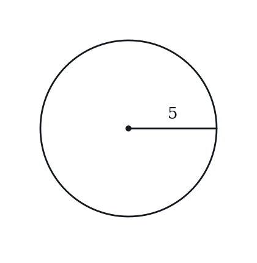
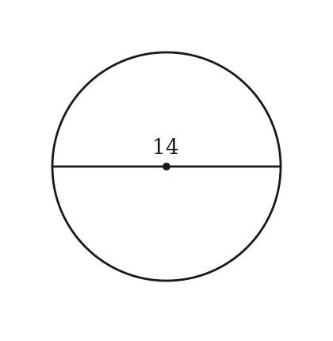
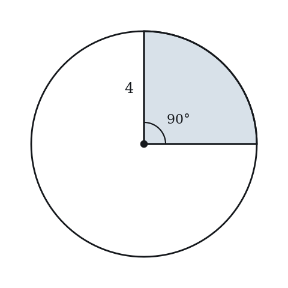
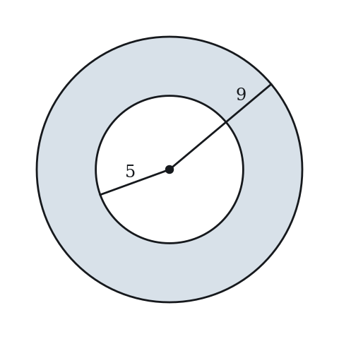
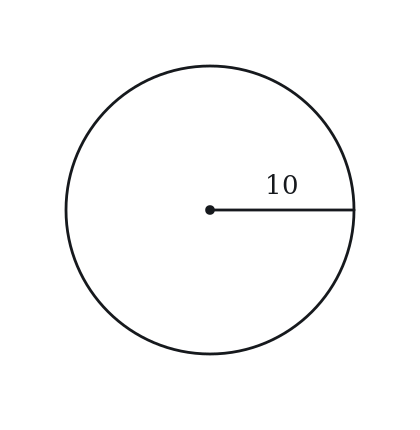
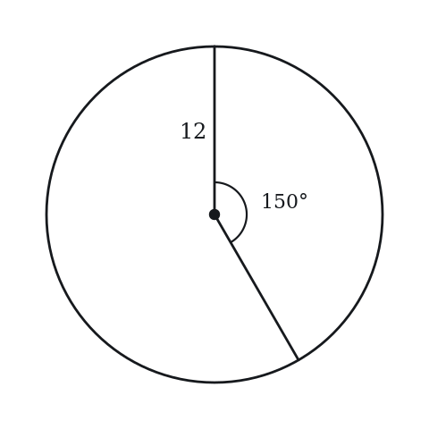
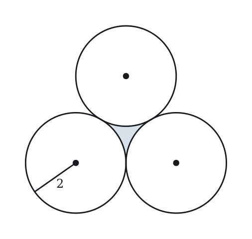
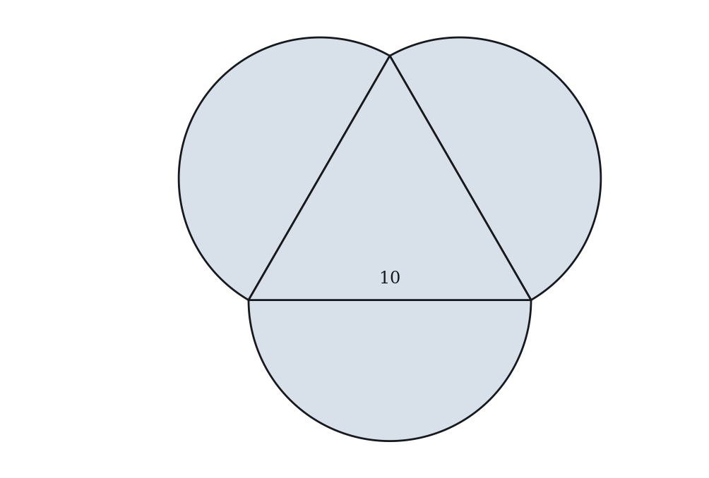
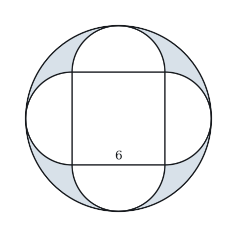
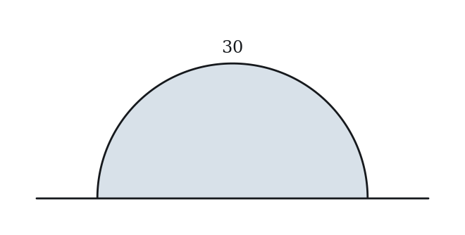

# Circles — Practice Set

**Bank code:** `GEO-CIR` · **Section:** Geometry · **30 questions** — Easy 7 · Medium 16 · Hard 7

**Lecture capsule:** [10-circles.md](../../05-geometry/10-circles.md)

> Every arc and sector is just a fraction of the whole circle, and that fraction is the central angle over 360; scaling the radius by k scales area by k squared.

Every question below is live in the question bank under the ID shown — the sheet and the portal are the same questions. Attempt a level with the clock running, then check Part C.

---

## Part A — Questions

> **Quantitative Comparison — the four choices are always the same, so they are not reprinted:**
> **(A)** Quantity A is greater · **(B)** Quantity B is greater · **(C)** The two quantities are equal · **(D)** The relationship cannot be determined from the information given

### Level 1 · Easy — 7 questions · ~5 min

*warm-up — these must be automatic*

**Q1** · `GEO-CIR-001` · MCQ · 35s

A circle has a radius of 5. What is its area?

**(A)** 10π  
**(B)** 20π  
**(C)** 25π  
**(D)** 50π  
**(E)** 100π

**Q2** · `GEO-CIR-002` · MCQ · 35s

What is the circumference of a circle with diameter 14?

**(A)** 7π  
**(B)** 14π  
**(C)** 28π  
**(D)** 49π  
**(E)** 196π

**Q3** · `GEO-CIR-003` · Numeric Entry · 40s

A circle has circumference 10π. What is its radius?

*Numeric entry — write the number.*

**Q4** · `GEO-CIR-005` · MCQ · 50s

What is the area of a sector with radius 4 and central angle 90°?

**(A)** 2π  
**(B)** 4π  
**(C)** 8π  
**(D)** 16π  
**(E)** 32π

**Q5** · `GEO-CIR-006` · QC · 55s

Circle A has radius 3. Circle B has radius 6.

> **Quantity A:**  Area of Circle A
> **Quantity B:**  One-fourth the area of Circle B

**Q6** · `GEO-CIR-009` · MCQ · 45s

A circle has radius r. If the radius is tripled, the new area is how many times the original area?

**(A)** 3  
**(B)** 6  
**(C)** 9  
**(D)** 12  
**(E)** 27

**Q7** · `GEO-CIR-012` · Numeric Entry · 50s

A circle has a circumference of 18π. The area of the circle is kπ. What is the value of k?

*Numeric entry — write the number.*

---

### Level 2 · Medium — 16 questions · ~20 min

*two or three steps, one planted trap each*

**Q8** · `GEO-CIR-020` · MCQ · 65s

The area of a sector is 12π and the radius of the circle is 6. What is the central angle of the sector?

**(A)** 60°  
**(B)** 90°  
**(C)** 120°  
**(D)** 150°  
**(E)** 180°

**Q9** · `GEO-CIR-021` · Numeric Entry · 60s

Two concentric circles have radii 5 and 9. The area of the region between the two circles is kπ. What is the value of k?

*Numeric entry — write the number.*

**Q10** · `GEO-CIR-025` · Select all that apply · 75s

A circle has radius 10. Which of the following could be the arc length of a sector of this circle, if a sector may be the entire circle? Select all that apply.

**(A)** 5π  
**(B)** 10π  
**(C)** 20π  
**(D)** 40π  
**(E)** 100π

**Q11** · `GEO-CIR-026` · MCQ · 65s

A circle has radius 12. What is the length of an arc that subtends a central angle of 150°?

**(A)** 5π  
**(B)** 10π  
**(C)** 15π  
**(D)** 20π  
**(E)** 24π

**Q12** · `GEO-CIR-027` · QC · 80s

Circle P has radius r. Circle Q has circumference equal to the area of Circle P.

> **Quantity A:**  Radius of Circle Q
> **Quantity B:**  r²/2

**Q13** · `GEO-CIR-031` · MCQ · 65s

A wheel of radius 2 feet rolls along a flat surface. How many complete rotations does it make to travel 40π feet?

**(A)** 5  
**(B)** 10  
**(C)** 20  
**(D)** 40  
**(E)** 80

**Q14** · `GEO-CIR-032` · QC · 75s

A semicircle has diameter 8.

> **Quantity A:**  Area of the semicircle
> **Quantity B:**  Area of a circle with circumference 4π

**Q15** · `GEO-CIR-033` · Numeric Entry · 70s

A circle has a sector with area 27π and central angle 120°. What is the radius of the circle?

*Numeric entry — write the number.*

**Q16** · `GEO-CIR-039` · MCQ · 75s

A circle has area 100π. What is the arc length of a sector with central angle 72°?

**(A)** 2π  
**(B)** 4π  
**(C)** 5π  
**(D)** 10π  
**(E)** 20π

**Q17** · `GEO-CIR-044` · QC · 80s

A circle has radius r > 0.

> **Quantity A:**  Area of a sector with central angle 120°
> **Quantity B:**  (1/3) × circumference of the same circle

**Q18** · `GEO-CIR-056` · Numeric Entry · 85s

A sector has radius 9 and arc length 6π. The area of the sector is kπ. What is the value of k?

*Numeric entry — write the number.*

**Q19** · `GEO-CIR-060` · Select all that apply · 80s

A circle has center (0, 0) and radius 5. Which of the following points lie strictly INSIDE the circle? Select all that apply.

**(A)** (3, 4)  
**(B)** (−4, 2)  
**(C)** (0, 5)  
**(D)** (2, −4)  
**(E)** (1, 4)

**Q20** · `GEO-CIR-068` · MCQ · 80s

A circular garden with a radius of 10 meters is surrounded by a path that is 2 meters wide. What is the area of the path, in square meters?

**(A)** 4π  
**(B)** 24π  
**(C)** 40π  
**(D)** 44π  
**(E)** 144π

**Q21** · `GEO-CIR-KMF-012` · QC · 60s

Arc PQ of a circle is 21 units long and makes up 35 percent of the circle's circumference.

> **Quantity A:**  The radius of the circle
> **Quantity B:**  10

**Q22** · `GEO-CIR-KMF-025` · MCQ · 90s

A sprinkler at the center of a circular lawn of radius 12 meters waters a sector-shaped part of the lawn. The watered area is 30pi square meters. What is the length, in meters, of the arc along the lawn's edge that bounds the watered region?

**(A)** 5pi/2  
**(B)** 5pi  
**(C)** 24pi  
**(D)** 30pi  
**(E)** 60pi

**Q23** · `SEC-CS-006` · Select all that apply · 100s

A circular jogging track of uniform width is to be laid around a circular lawn whose diameter is 80 meters. The outer edge of the track must have a length between 120*pi meters and 260*pi meters. Which of the following could be the width, in meters, of the track?

Indicate all such values.

**(A)** 10  
**(B)** 25  
**(C)** 40  
**(D)** 75  
**(E)** 95  
F. 120

---

### Level 3 · Hard — 7 questions · ~13 min

*where 162+ is won or lost*

**Q24** · `GEO-CIR-050` · MCQ · 105s

Three circles, each with radius 2, are mutually externally tangent to each other. What is the area of the region bounded between the three circles (the 'gap' in the middle)?

**(A)** 4√3 − 4π  
**(B)** 2√3 − π  
**(C)** 4√3 − 2π  
**(D)** 4√3 − 4π/3  
**(E)** 4√3 − π

**Q25** · `GEO-CIR-058` · QC · 95s

Circle C₁ has radius r₁ and circle C₂ has radius r₂, where r₁ + r₂ = 10.

> **Quantity A:**  Sum of the areas of C₁ and C₂
> **Quantity B:**  Area of a circle with radius 5

**Q26** · `GEO-CIR-KMF2-001` · QC · 105s

The figure above consists of an equilateral triangle with sides of length 10 and 3 semicircles, each having one side of the triangle as its diameter. All 4 regions are shaded.

> **Quantity A:**  The combined area of the 4 shaded regions
> **Quantity B:**  150

**Q27** · `SEC-CS-005` · MCQ · 125s

A square has sides of length 6. On each side of the square a semicircle is drawn outside the square, using that side as its diameter, and each semicircle touches the large circle shown at exactly one point. What is the total area of the four shaded regions?

**(A)** 9*pi - 18  
**(B)** 18*pi - 36  
**(C)** 18*pi - 18  
**(D)** 24*pi - 36  
**(E)** 36*pi - 36

**Q28** · `SEC-CS-010` · Select all that apply · 110s

The area of a circle with radius m is greater than the area of a square with sides of length t*m, where m and t are both positive. Which of the following could be the value of t?

Indicate all such values.

**(A)** 1/2  
**(B)** 5/4  
**(C)** 7/4  
**(D)** 9/5  
**(E)** 11/6  
F. 2

**Q29** · `SEC-CS-022` · Numeric Entry · 110s

A gardener builds a flower bed in the shape of a semicircle, using a straight stone wall as the flat edge and 30 feet of fencing along the curved edge. The area of the flower bed is k/pi square feet. What is the value of k?

*Numeric entry — write the number.*

**Q30** · `SEC-CS-036` · Select all that apply · 115s

Circle C and square S have the same perimeter. Which of the following statements must be true?

Indicate all such statements.

**(A)** The area enclosed by C is greater than the area enclosed by S.  
**(B)** The ratio of the area enclosed by C to the area enclosed by S is 4/pi.  
**(C)** The area enclosed by C is more than 25 percent greater than the area enclosed by S.  
**(D)** The area enclosed by C is exactly twice the area enclosed by S.  
**(E)** The two enclosed areas are equal.  
F. The ratio of the area enclosed by C to the area enclosed by S is pi/4.

---

## Part B — Answer Key

| Q | ID | Level | Type | Answer |
|---|---|---|---|---|
| 1 | `GEO-CIR-001` | easy | MCQ | **C** |
| 2 | `GEO-CIR-002` | easy | MCQ | **B** |
| 3 | `GEO-CIR-003` | easy | Numeric Entry | **5** |
| 4 | `GEO-CIR-005` | easy | MCQ | **B** |
| 5 | `GEO-CIR-006` | easy | QC | **C** |
| 6 | `GEO-CIR-009` | easy | MCQ | **C** |
| 7 | `GEO-CIR-012` | easy | Numeric Entry | **81** |
| 8 | `GEO-CIR-020` | medium | MCQ | **C** |
| 9 | `GEO-CIR-021` | medium | Numeric Entry | **56** |
| 10 | `GEO-CIR-025` | medium | Select all that apply | **A, B, C** |
| 11 | `GEO-CIR-026` | medium | MCQ | **B** |
| 12 | `GEO-CIR-027` | medium | QC | **C** |
| 13 | `GEO-CIR-031` | medium | MCQ | **B** |
| 14 | `GEO-CIR-032` | medium | QC | **A** |
| 15 | `GEO-CIR-033` | medium | Numeric Entry | **9** |
| 16 | `GEO-CIR-039` | medium | MCQ | **B** |
| 17 | `GEO-CIR-044` | medium | QC | **D** |
| 18 | `GEO-CIR-056` | medium | Numeric Entry | **27** |
| 19 | `GEO-CIR-060` | medium | Select all that apply | **B, D, E** |
| 20 | `GEO-CIR-068` | medium | MCQ | **D** |
| 21 | `GEO-CIR-KMF-012` | medium | QC | **B** |
| 22 | `GEO-CIR-KMF-025` | medium | MCQ | **B** |
| 23 | `SEC-CS-006` | medium | Select all that apply | **B, C, D** |
| 24 | `GEO-CIR-050` | hard | MCQ | **C** |
| 25 | `GEO-CIR-058` | hard | QC | **A** |
| 26 | `GEO-CIR-KMF2-001` | hard | QC | **A** |
| 27 | `SEC-CS-005` | hard | MCQ | **B** |
| 28 | `SEC-CS-010` | hard | Select all that apply | **A, B, C** |
| 29 | `SEC-CS-022` | hard | Numeric Entry | **450** |
| 30 | `SEC-CS-036` | hard | Select all that apply | **A, B, C** |

---

## Part C — Worked Solutions

### Q1 · `GEO-CIR-001` — Answer: C

Area of a circle = πr². With r = 5: Area = π(5²) = 25π.

**Trap.** Using diameter (10) instead of radius (5) in the formula gives π(10²) = 100π.

### Q2 · `GEO-CIR-002` — Answer: B

Circumference = 2πr = πd. With diameter = 14: C = π(14) = 14π.

**Trap.** Using r = 14 instead of r = 7 gives C = 2π(14) = 28π. Always check if the given value is radius or diameter.

### Q3 · `GEO-CIR-003` — Answer: 5

Circumference = 2πr. Set 2πr = 10π. Divide both sides by 2π: r = 10π / 2π = 5.

**Trap.** Forgetting to divide by 2 and concluding r = 10 because C = 10π.

### Q4 · `GEO-CIR-005` — Answer: B

Sector area = (θ/360) × πr² = (90/360) × π(4²) = (1/4) × 16π = 4π.

**Trap.** Computing arc length instead of sector area: (90/360) × 2π(4) = 2π. The sector area formula uses πr², not 2πr.

### Q5 · `GEO-CIR-006` — Answer: C

Circle A area = π(3²) = 9π. Circle B area = π(6²) = 36π, and one-fourth of that = 9π. Quantity A = 9π = Quantity B, so the quantities are equal.

**Trap.** Assuming that because radius doubles, one-fourth the area equals the smaller circle. Actually this is exactly true: if r₂ = 2r₁, then πr₂²/4 = π(2r₁)²/4 = 4πr₁²/4 = πr₁². The two are equal.

### Q6 · `GEO-CIR-009` — Answer: C

Original area = πr². New radius = 3r. New area = π(3r)² = 9πr². Ratio = 9πr²/πr² = 9.

**Trap.** Thinking area scales linearly with radius and answering 3. Area scales with the square of radius.

### Q7 · `GEO-CIR-012` — Answer: 81

C = 2πr = 18π → r = 9. Area = πr² = π(9²) = 81π. Coefficient is 81.

**Trap.** Forgetting to square r: computing area = π(9) = 9π instead of 81π.

### Q8 · `GEO-CIR-020` — Answer: C

Sector area = (θ/360) × πr². So 12π = (θ/360) × π(36) = (θ/360) × 36π. Dividing both sides by 36π: 12/36 = θ/360 → 1/3 = θ/360 → θ = 120°.

**Trap.** Setting up 12π = (θ/360) × 6π (using radius instead of r²) and getting θ = 720°, which is impossible.

### Q9 · `GEO-CIR-021` — Answer: 56

Area of ring = Area of large circle − Area of small circle = π(9²) − π(5²) = 81π − 25π = 56π. Coefficient = 56.

**Trap.** Subtracting radii first: π(9−5)² = π(4²) = 16π. You must subtract the areas, not compute π(r₂−r₁)².

### Q10 · `GEO-CIR-025` — Answer: A, B, C

The circumference is 2π(10) = 20π. The arc of a sector (the full circle allowed) can have any length greater than 0 and at most 20π. A: 5π ≤ 20π, true (a 90° sector). B: 10π ≤ 20π, true (a semicircle). C: 20π equals the circumference, true (the full circle). D: 40π is twice the circumference, false. E: 100π is the circle's area πr², not an arc length, false.

**Trap.** Treating the area πr² = 100π as an arc length (E), or doubling the circumference to 4πr = 40π (D). Some students also reject 20π because a full circle does not look like a sector.

### Q11 · `GEO-CIR-026` — Answer: B

Arc length = (θ/360) × 2πr = (150/360) × 2π(12) = (5/12) × 24π = 10π.

**Trap.** Using 150/360 = 5/12 correctly but then multiplying by πr (= 12π) instead of 2πr (= 24π): (5/12) × 12π = 5π.

### Q12 · `GEO-CIR-027` — Answer: C

Area of Circle P = πr². Circumference of Circle Q = πr². So 2πR = πr² where R is radius of Q. Solving: R = πr²/(2π) = r²/2. Quantity A = r²/2 = Quantity B. They are equal.

**Trap.** Setting area of P equal to area of Q (instead of circumference of Q) giving R = r, then concluding Quantity B = r²/2 < r for r > 2.

### Q13 · `GEO-CIR-031` — Answer: B

One complete rotation covers a distance equal to the circumference = 2π(2) = 4π feet. Number of rotations = 40π / 4π = 10.

**Trap.** Using the radius (2) directly: 40π/2 = 20π, then not dividing by π to get a number.

### Q14 · `GEO-CIR-032` — Answer: A

Quantity A: Semicircle with diameter 8 → r = 4. Area = πr²/2 = π(16)/2 = 8π. Quantity B: Circumference = 4π → 2πr = 4π → r = 2. Area = π(4) = 4π. Quantity A (8π) > Quantity B (4π).

**Trap.** For Quantity B, computing r = 4 from circumference 4π by skipping the factor of 2: 2πr = 4π so r = 4 (wrong) gives area = 16π.

### Q15 · `GEO-CIR-033` — Answer: 9

Sector area = (θ/360)πr². So 27π = (120/360)πr² = (1/3)πr². Then r² = 81 and r = 9.

**Trap.** Solving for r² = 81 and then reporting 81 instead of taking the square root to get r = 9.

### Q16 · `GEO-CIR-039` — Answer: B

Area = πr² = 100π → r² = 100 → r = 10. Arc length = (72/360) × 2π(10) = (1/5) × 20π = 4π.

**Trap.** Confusing sector area with arc length: (72/360) × 100π = 20π. That is a fraction of the total area, not arc length.

### Q17 · `GEO-CIR-044` — Answer: D

Quantity A: (120/360)πr² = (1/3)πr². Quantity B: (1/3)(2πr) = (2/3)πr. Comparing (1/3)πr² vs (2/3)πr. Divide both by (1/3)π: r² vs 2r → r vs 2. If r < 2, Quantity B > Quantity A. If r = 2, they're equal. If r > 2, Quantity A > Quantity B. The relationship cannot be determined without knowing r.

**Trap.** Thinking sector area and arc length are always comparable without considering r, and selecting C.

### Q18 · `GEO-CIR-056` — Answer: 27

First find the central angle. Arc length = (θ/360) × 2πr → 6π = (θ/360) × 2π(9) = (θ/360) × 18π. So θ/360 = 6π/18π = 1/3 → θ = 120°. Sector area = (θ/360) × πr² = (1/3) × π(81) = 27π. Coefficient = 27. Alternative: sector area = (1/2) × r × arc length = (1/2)(9)(6π) = 27π.

**Trap.** Forgetting the elegant formula: sector area = (1/2)r × arc length. Students who use the long route may make arithmetic errors.

### Q19 · `GEO-CIR-060` — Answer: B, D, E

A point (x, y) is strictly inside when x² + y² < 25. A: 9 + 16 = 25 (on the circle) ✗; B: 16 + 4 = 20 < 25 ✓; C: 0 + 25 = 25 (on the circle) ✗; D: 4 + 16 = 20 < 25 ✓; E: 1 + 16 = 17 < 25 ✓. So B, D, and E.

**Trap.** Confusing 'strictly inside' with 'on or inside': including points A and C which lie exactly on the circle.

### Q20 · `GEO-CIR-068` — Answer: D

The outer edge of the path is a circle of radius 10 + 2 = 12 meters.
Area inside the outer edge: π * 12^2 = 144π.
Area of the garden: π * 10^2 = 100π.
Area of the path: 144π - 100π = 44π.
Answer: D.

**Trap.** Squaring the width alone, π * 2^2 = 4π (choice A), or multiplying the garden's circumference by the width, 20π * 2 = 40π (choice C). The path is the region between circles of radius 12 and radius 10.

### Q21 · `GEO-CIR-KMF-012` — Answer: B

Circumference = 21 / 0.35 = 60.
Radius = circumference / (2 * pi) = 60/(2 pi) = 30/pi.
Since pi is greater than 3, 30/pi is less than 30/3 = 10. (30/3.14 is about 9.55.)
Quantity A is under 10, so Quantity B is greater.
Check: 2 * pi * 9.55 is about 60 and 35 percent of 60 is 21.

**Trap.** Rounding pi to 3, which makes the radius exactly 10 and suggests the quantities are equal (choice C).

### Q22 · `GEO-CIR-KMF-025` — Answer: B

1. The watered region is a sector. Its area is the fraction f of the whole lawn: f = 30pi / (pi * 12^2) = 30/144 = 5/24.
2. The arc is the same fraction of the circumference: 2 * pi * 12 = 24pi.
3. Arc length = (5/24) * 24pi = 5pi.
Check with the formula area = (1/2) * radius * arc length: (1/2) * 12 * 5pi = 30pi, as given.
Other choices: 24pi is the whole circumference; 30pi repeats the area; 60pi is 2 * area with no division by the radius.

**Trap.** Using area = radius * arc length and forgetting the factor of 1/2 gives arc = 30pi / 12 = 5pi/2, which is choice A.

### Q23 · `SEC-CS-006` — Answer: B, C, D

The lawn has diameter 80, so its radius, which is also the inner radius of the track, is 40. The outer edge is a circle of circumference 2*pi*R, so a circumference between 120*pi and 260*pi means 2R is between 120 and 260, giving an outer radius R between 60 and 130. The width of the track is R - 40, which therefore lies strictly between 20 and 90. Of the choices, 25, 40 and 75 fall in that range.

**Trap.** Students forget to subtract the inner radius and test the choices against 60 to 130 directly, which wrongly admits 75 and 95 and 120 while excluding 25 and 40. The width is the difference of the two radii, not the outer radius itself.

### Q24 · `GEO-CIR-050` — Answer: C

Joining the three centers gives an equilateral triangle of side 2 + 2 = 4, with area (√3/4)(4²) = 4√3. Inside it, each circle contributes a 60° sector of radius 2, totaling 3 × (60/360)π(2²) = 3 × (1/6)(4π) = 2π. The central gap = 4√3 − 2π.

**Trap.** Using r = 2 but computing sectors with r = 4 (the side length), or forgetting to multiply sector area by 3.

### Q25 · `GEO-CIR-058` — Answer: A

Quantity B = π(5²) = 25π. Quantity A = π(r₁²) + π(r₂²) = π(r₁² + r₂²). We need to compare r₁² + r₂² with 25 given r₁ + r₂ = 10. By the identity (r₁+r₂)² = r₁²+r₂²+2r₁r₂: 100 = r₁²+r₂²+2r₁r₂ → r₁²+r₂² = 100−2r₁r₂. Because (r₁ − r₂)² ≥ 0, 4r₁r₂ ≤ (r₁+r₂)² = 100, so r₁r₂ ≤ 25. So r₁²+r₂² = 100−2r₁r₂ ≥ 100−50 = 50 > 25. Equality only when r₁ = r₂ = 5, but then Quantity A = π(25+25) = 50π > 25π = Quantity B. Quantity A is always strictly greater (≥ 50π > 25π).

**Trap.** Thinking that since r₁ + r₂ = 10 = 2×5, the sum of areas equals the area of one circle with radius 5. Area is not linear in radius.

### Q26 · `GEO-CIR-KMF2-001` — Answer: A

The semicircles stick out from the triangle and meet only at its vertices, so the four regions do not overlap and their areas simply add.
The triangle is equilateral with side 10. Its area is (sqrt(3)/4)(10^2) = 25sqrt(3), which is about 25(1.732) = 43.3.
Each semicircle has the side of length 10 as its diameter, so its radius is 5 and its area is (1/2)pi(5^2) = 12.5pi.
Three of them give 37.5pi, which is about 37.5(3.14) = 117.8.
The total shaded area is about 43.3 + 117.8 = 161.1.
Since 161.1 is greater than 150, Quantity A is greater.

**Trap.** Students treat each shape as a full circle rather than a semicircle, or count only the three semicircles and leave the triangle out. Leaving the triangle out gives about 117.8, which would reverse the comparison.

### Q27 · `SEC-CS-005` — Answer: B

Each semicircle has diameter 6 and so radius 3, and it bulges 3 units beyond the side it sits on. The center of the square is 3 units from each side, so the farthest point of every semicircle is 3 + 3 = 6 units from the center; that is where it touches the large circle, so the large circle has radius 6 and area 36*pi. The square and the four semicircles together cover 36 + 4(1/2)(pi)(3^2) = 36 + 18*pi, and adjacent semicircles only meet at the corners of the square, so nothing is double counted. The shaded area is 36*pi - 36 - 18*pi = 18*pi - 36.

**Trap.** Students take the radius of the large circle to be half the diagonal of the square, 3*sqrt(2), instead of noticing that the semicircles reach farther out than the corners do. Others subtract only the semicircles and forget the square itself, arriving at 18*pi.

### Q28 · `SEC-CS-010` — Answer: A, B, C

The circle has area pi*m^2 and the square has area (t*m)^2 = t^2*m^2. Since m^2 is positive, the condition reduces to t^2 < pi, that is t < sqrt(pi), which is about 1.7725. Now test the choices: 1/2 and 5/4 are clearly below that; 7/4 = 1.75 and (7/4)^2 = 3.0625, which is less than pi, so it works; 9/5 = 1.8, 2, and 11/6 which is about 1.833 all exceed 1.7725 and fail.

**Trap.** Students compare t itself with pi rather than comparing t^2 with pi, which would wrongly admit every choice here since all are below 3.14. The squaring is what makes 7/4 and 9/5 land on opposite sides of the boundary despite being close together.

### Q29 · `SEC-CS-022` — Answer: 450

The curved edge of a semicircle of radius r has length pi*r, so pi*r = 30 and r = 30/pi. The area of a semicircle is half the area of the full circle, that is (1/2)pi*r^2. Substituting gives (1/2)*pi*(30/pi)^2 = (1/2)*pi*(900/pi^2) = 450/pi. So k = 450.

**Trap.** Students treat the 30 feet as the full circumference and set 2*pi*r = 30, halving the radius and cutting the area to a quarter of the correct value. Only the curved half of the boundary is fenced; the straight diameter is the wall and contributes no fencing.

### Q30 · `SEC-CS-036` — Answer: A, B, C

Call the common perimeter p. For the circle, 2*pi*r = p gives r = p/(2*pi), so its area is pi*r^2 = p^2/(4*pi). For the square, the side is p/4, so its area is p^2/16. Dividing, the ratio of circle area to square area is 16/(4*pi) = 4/pi, which is about 1.273. That makes B true and F false, since pi/4 is the reciprocal and is less than 1. A ratio above 1 makes A true, and 1.273 means the circle encloses about 27.3 percent more area, so C is true while D and E are false.

**Trap.** Students reach for pi/4, the familiar ratio of a circle's area to the area of the square that circumscribes it, and endorse F. That ratio applies when the square's side equals the circle's diameter, not when the two figures share a perimeter; with equal perimeters the circle is the larger region, so the ratio must exceed 1.
