# Chords, Tangents & Inscribed Angles — Practice Set

**Bank code:** `GEO-CTS` · **Section:** Geometry · **30 questions** — Easy 7 · Medium 15 · Hard 8

**Lecture capsule:** [11-chords-tangents-inscribed-angles.md](../../05-geometry/11-chords-tangents-inscribed-angles.md)

> A tangent meets the radius at a right angle, a perpendicular from the center bisects its chord, and an inscribed angle is half its central angle.

Every question below is live in the question bank under the ID shown — the sheet and the portal are the same questions. Attempt a level with the clock running, then check Part C.

---

## Part A — Questions

> **Quantitative Comparison — the four choices are always the same, so they are not reprinted:**
> **(A)** Quantity A is greater · **(B)** Quantity B is greater · **(C)** The two quantities are equal · **(D)** The relationship cannot be determined from the information given

### Level 1 · Easy — 7 questions · ~5 min

*warm-up — these must be automatic*

**Q1** · `GEO-CTS-001` · MCQ · 40s

A tangent is drawn from an external point P to a circle at point T, and the radius OT is drawn to the point of tangency. What is the measure of angle OTP?

**(A)** 30°  
**(B)** 45°  
**(C)** 60°  
**(D)** 90°  
**(E)** 180°

**Q2** · `GEO-CTS-002` · MCQ · 40s

Chord AB has a length of 10. The center of the circle is O, and the perpendicular from O meets AB at point M. What is the length of AM?

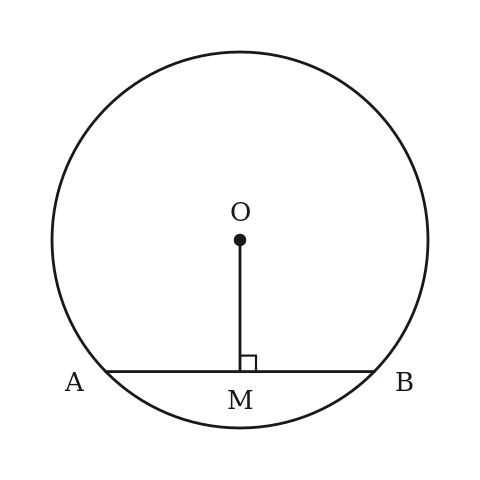

**(A)** 2.5  
**(B)** 5  
**(C)** 7.5  
**(D)** 10  
**(E)** 20

**Q3** · `GEO-CTS-003` · MCQ · 35s

Two tangents are drawn from external point P to a circle, touching it at points A and B. If PA = 7, what is PB?

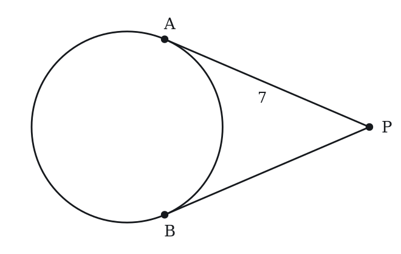

**(A)** sqrt(7)  
**(B)** 3.5  
**(C)** 7  
**(D)** 14  
**(E)** 49

**Q4** · `GEO-CTS-004` · Numeric Entry · 55s

A circle has radius 13. A chord is drawn such that the perpendicular distance from the center to the chord is 5. What is the length of the chord?

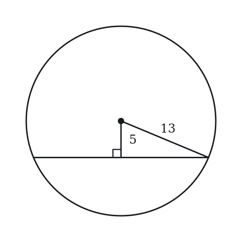

*Numeric entry — write the number.*

**Q5** · `GEO-CTS-006` · QC · 40s

A tangent PA and a radius OA are drawn to the same point A on a circle, where O is the center.

> **Quantity A:**  Angle OAP
> **Quantity B:**  90°

**Q6** · `GEO-CTS-008` · Select all that apply · 60s

Which of the following statements about a tangent to a circle are always true? Select all that apply.

**(A)** The tangent meets the circle at exactly one point.  
**(B)** The tangent is perpendicular to the radius at the point of tangency.  
**(C)** Two tangents from the same external point have equal length.  
**(D)** The tangent passes through the center of the circle.  
**(E)** The tangent is parallel to all chords of the circle.

**Q7** · `GEO-CTS-010` · MCQ · 40s

An inscribed angle intercepts an arc of 80°. What is the measure of the inscribed angle?

**(A)** 20°  
**(B)** 40°  
**(C)** 80°  
**(D)** 160°  
**(E)** 320°

---

### Level 2 · Medium — 15 questions · ~19 min

*two or three steps, one planted trap each*

**Q8** · `GEO-CTS-013` · MCQ · 70s

From external point P, a secant passes through the circle intersecting it at A then B (PA = 3, PB = 12). Another secant intersects the circle at C then D (PC = 4). What is PD?

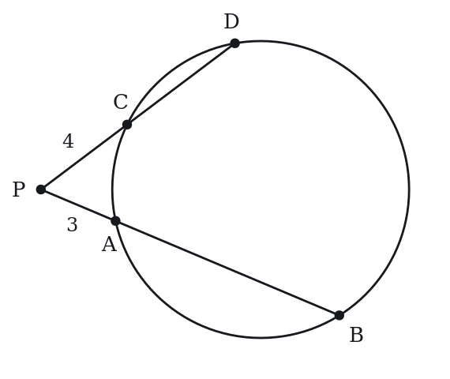

**(A)** 6  
**(B)** 7  
**(C)** 8  
**(D)** 9  
**(E)** 12

**Q9** · `GEO-CTS-014` · QC · 65s

From external point P, tangent PT touches the circle at T, and a secant through P meets the circle at A and B (in that order from P). PA = 2, PB = 8.

> **Quantity A:**  PT
> **Quantity B:**  4

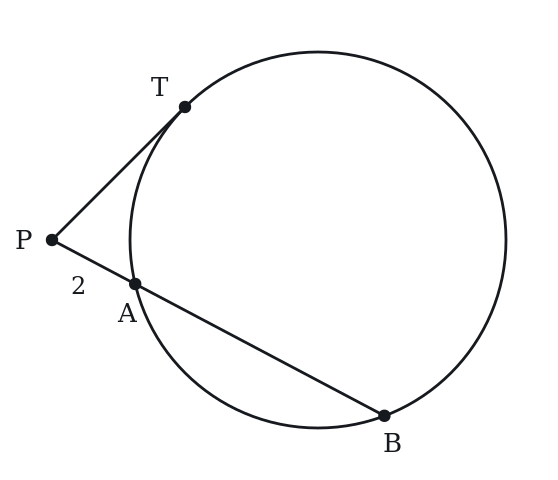

**Q10** · `GEO-CTS-015` · MCQ · 65s

A circle has center O and radius 5. Chord AB is 6 units long. What is the distance from the center O to chord AB?

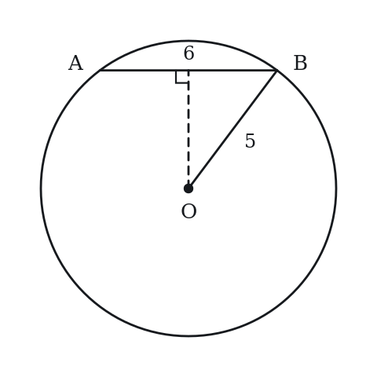

**(A)** 2  
**(B)** 3  
**(C)** 4  
**(D)** 5  
**(E)** 6

**Q11** · `GEO-CTS-016` · Numeric Entry · 60s

In a circle, two chords PQ and RS intersect at T. PT = 3, TQ = 12, and RT = 4. What is TS?

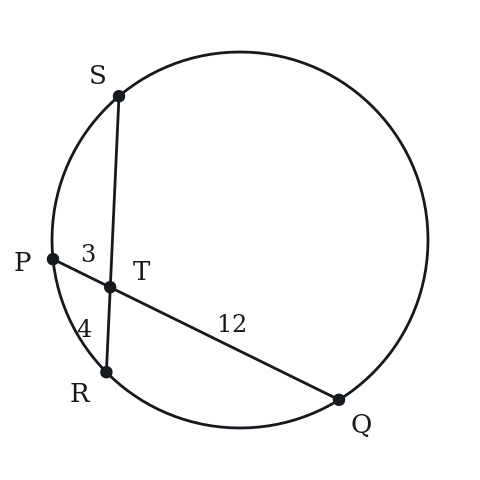

*Numeric entry — write the number.*

**Q12** · `GEO-CTS-017` · QC · 75s

Circle O has radius 10. Chord AB is 12 units long. Chord CD is at distance 8 from center O.

> **Quantity A:**  Distance from center O to chord AB
> **Quantity B:**  Distance from center O to chord CD

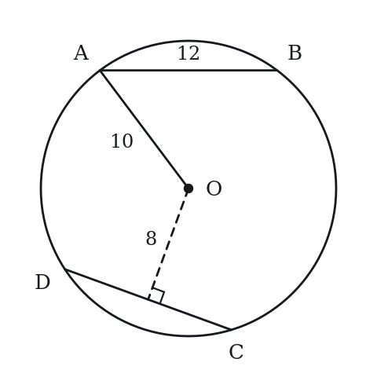

**Q13** · `GEO-CTS-018` · Select all that apply · 80s

From external point P, tangent PT and secant PAB are drawn to a circle, with A between P and B. Which of the following equations must be true? Select all that apply.

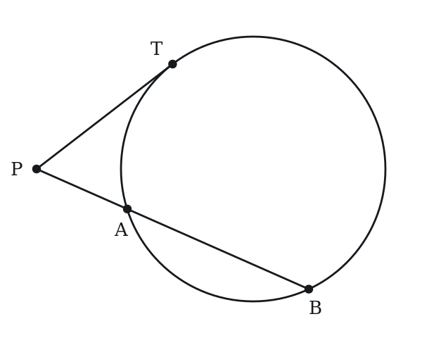

**(A)** PT² = PA × PB  
**(B)** PT = PA + PB  
**(C)** PT² = PA × AB  
**(D)** PT² = PA × (PA + AB)  
**(E)** PT² = (PB - PA) × PB

**Q14** · `GEO-CTS-021` · Numeric Entry · 80s

A circle with center O has radius 7. Point P is outside the circle, with PO = 25. Segments PA and PB are tangent to the circle at A and B. What is the area of quadrilateral OAPB?

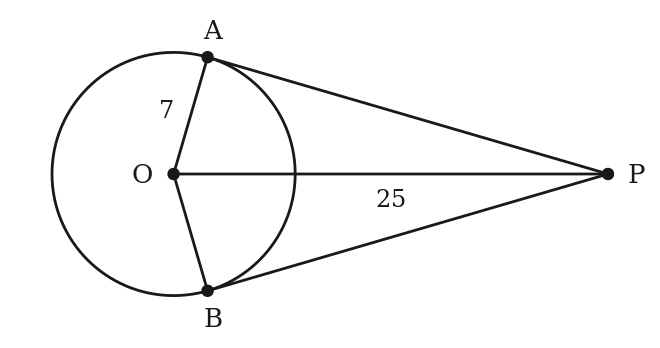

*Numeric entry — write the number.*

**Q15** · `GEO-CTS-022` · MCQ · 70s

Two chords AB and CD intersect at P inside a circle. AP = 6, PB = 4, and CP = 3. The full length of chord CD is:

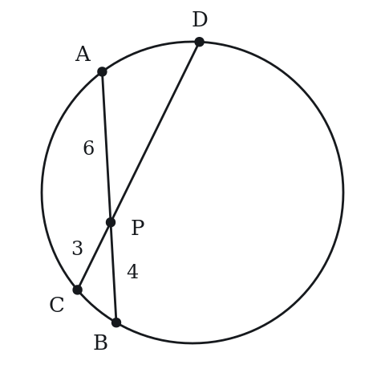

**(A)** 7  
**(B)** 8  
**(C)** 11  
**(D)** 13  
**(E)** 16

**Q16** · `GEO-CTS-023` · QC · 70s

A circle has radius r. Chord AB is at distance d from the center (d < r).

> **Quantity A:**  Length of chord AB
> **Quantity B:**  2√(r² - d²)

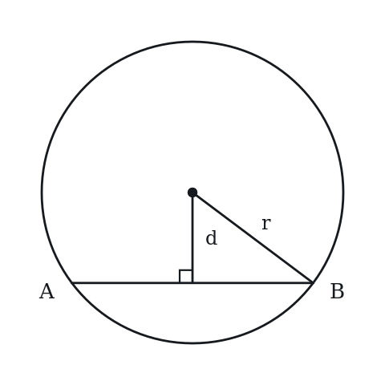

**Q17** · `GEO-CTS-024` · MCQ · 60s

From external point P, a tangent PT is drawn to a circle (T is point of tangency). A secant from P passes through the circle at A (nearer) and B (farther), with PA = 5 and PB = 20. What is PT?

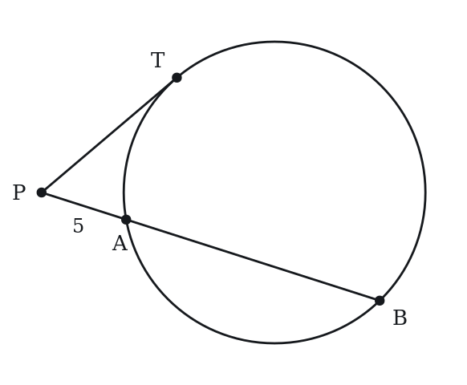

**(A)** 5  
**(B)** 8  
**(C)** 10  
**(D)** 12.5  
**(E)** 100

**Q18** · `GEO-CTS-025` · Select all that apply · 90s

A chord PQ of a circle passes through the center of the circle. Which of the following are necessarily true? Select all that apply.

**(A)** PQ is a diameter of the circle.  
**(B)** PQ is the longest chord of the circle.  
**(C)** The distance from the center to PQ is positive.  
**(D)** PQ subtends a semicircle on each side.  
**(E)** Any inscribed angle that intercepts PQ as its arc measures 90°.

**Q19** · `GEO-CTS-026` · QC · 80s

Circle has radius 5. Chord A is at distance 3 from the center. Chord B is at distance 4 from the center.

> **Quantity A:**  Length of Chord A
> **Quantity B:**  Length of Chord B

**Q20** · `GEO-CTS-027` · MCQ · 90s

In a circle with center O and radius 13, chord AB has length 24, and M is the midpoint of AB. The line through O and M intersects the circle at two points. What is the distance from M to the nearer of those two points?

**(A)** 5  
**(B)** 8  
**(C)** 12  
**(D)** 13  
**(E)** 18

**Q21** · `GEO-CTS-035` · MCQ · 90s

In a circle, chord PQ is perpendicular to diameter AB at point M. AM = 4 and MB = 9. What is the length of PM (half the chord PQ)?

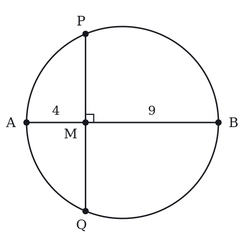

**(A)** 4  
**(B)** 5  
**(C)** 6  
**(D)** 7  
**(E)** 8

**Q22** · `GEO-CTS-KMF2-002` · Numeric Entry · 85s

In the figure above, O is the center of the circle, A and B lie on the circle, and T lies on ray AO beyond O. Segment TB is tangent to the circle at B. If the measure of angle AOB is 140 degrees, what is the measure, in degrees, of angle T?

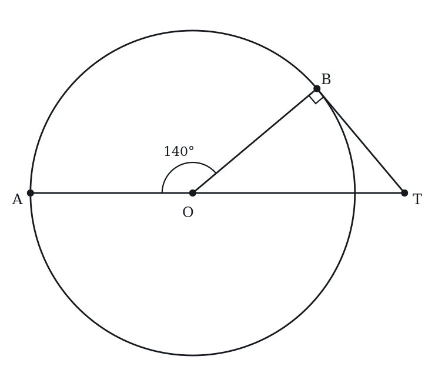

*Numeric entry — write the number.*

---

### Level 3 · Hard — 8 questions · ~13 min

*where 162+ is won or lost*

**Q23** · `GEO-CTS-028` · Numeric Entry · 90s

A circle has center O. The lines that are tangent to the circle at points A and B intersect at point P, and the measure of angle APB is 40 degrees. What is the measure, in degrees, of angle AOB?

*Numeric entry — write the number.*

**Q24** · `GEO-CTS-029` · MCQ · 95s

A circle has center O and radius r. From external point P, two tangents PA and PB are drawn (PA = PB = 15). The angle APB = 60°. What is the radius r?

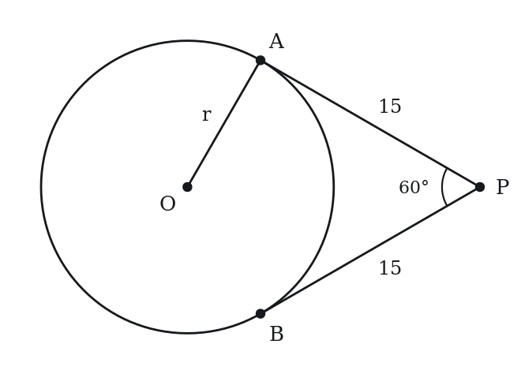

**(A)** 5  
**(B)** 5√3  
**(C)** 10  
**(D)** 15√3/2  
**(E)** 15

**Q25** · `GEO-CTS-031` · Select all that apply · 85s

AB is a chord of a circle with radius 6, and AB is not a diameter of the circle. Which of the following could be the length of AB?

Indicate all such lengths.

**(A)** 3  
**(B)** 6*sqrt(2)  
**(C)** 12  
**(D)** 12.5  
**(E)** 6π

**Q26** · `GEO-CTS-033` · MCQ · 85s

Points A, B and C lie on a circle with radius 5. If AB = 6, AC = 8 and BC = 10, what is the measure of angle BAC?

**(A)** 30 degrees  
**(B)** 45 degrees  
**(C)** 60 degrees  
**(D)** 90 degrees  
**(E)** 120 degrees

**Q27** · `GEO-CTS-036` · Numeric Entry · 105s

In a circle, chord AB has length 16. The perpendicular bisector of AB meets the minor arc AB at point C, and the distance from C to chord AB is 4. What is the radius of the circle?

*Numeric entry — write the number.*

**Q28** · `GEO-CTS-KMF-001` · MCQ · 120s

In the figure, lines PS and PT touch the circle with center O at S and T. Point R lies on the shorter arc ST. Angle PSR measures 24 degrees and angle PTR measures 31 degrees. What is the measure, in degrees, of angle SPT?

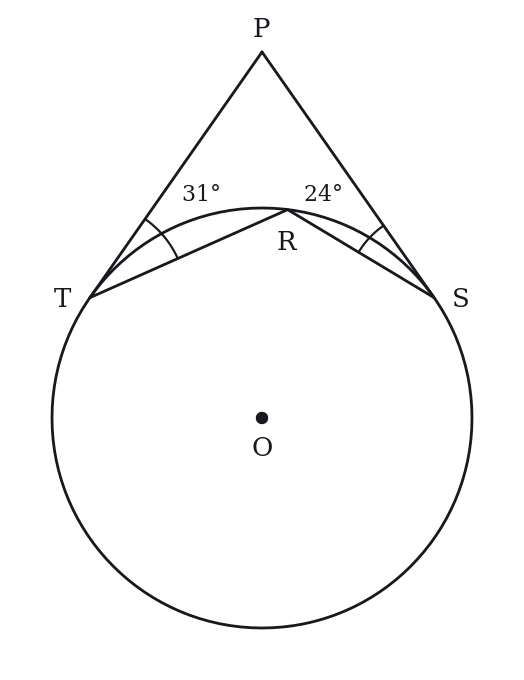

**(A)** 55  
**(B)** 70  
**(C)** 110  
**(D)** 125  
**(E)** 250

**Q29** · `GEO-CTS-KMF2-003` · MCQ · 100s

The figure above shows a circle with center O. Line MN is tangent to the circle at point P, and the measure of angle PON is 30 degrees. If PN = 5sqrt(3), what is the circumference of the circle?

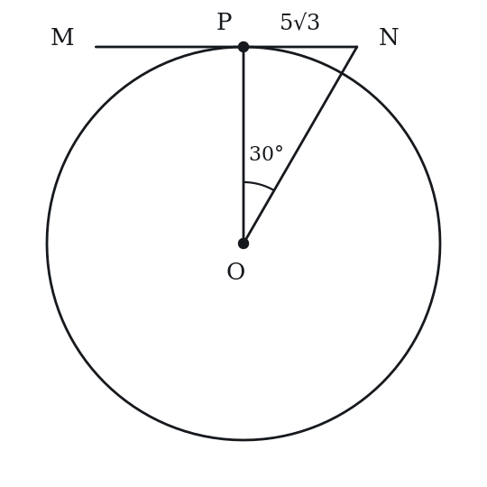

**(A)** 10pi  
**(B)** 15pi  
**(C)** 30pi  
**(D)** 45pi  
**(E)** 60pi

**Q30** · `SEC-CS-027` · QC · 105s

In the circle with center O and radius k, A and B are points on the circle and AB is not a diameter.

Note: Figure not drawn to scale.

> **Quantity A:**  the perimeter of triangle AOB
> **Quantity B:**  3.5k

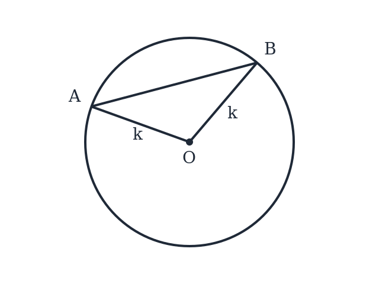

---

## Part B — Answer Key

| Q | ID | Level | Type | Answer |
|---|---|---|---|---|
| 1 | `GEO-CTS-001` | easy | MCQ | **D** |
| 2 | `GEO-CTS-002` | easy | MCQ | **B** |
| 3 | `GEO-CTS-003` | easy | MCQ | **C** |
| 4 | `GEO-CTS-004` | easy | Numeric Entry | **24** |
| 5 | `GEO-CTS-006` | easy | QC | **C** |
| 6 | `GEO-CTS-008` | easy | Select all that apply | **A, B, C** |
| 7 | `GEO-CTS-010` | easy | MCQ | **B** |
| 8 | `GEO-CTS-013` | medium | MCQ | **D** |
| 9 | `GEO-CTS-014` | medium | QC | **C** |
| 10 | `GEO-CTS-015` | medium | MCQ | **C** |
| 11 | `GEO-CTS-016` | medium | Numeric Entry | **9** |
| 12 | `GEO-CTS-017` | medium | QC | **C** |
| 13 | `GEO-CTS-018` | medium | Select all that apply | **A, D** |
| 14 | `GEO-CTS-021` | medium | Numeric Entry | **168** |
| 15 | `GEO-CTS-022` | medium | MCQ | **C** |
| 16 | `GEO-CTS-023` | medium | QC | **C** |
| 17 | `GEO-CTS-024` | medium | MCQ | **C** |
| 18 | `GEO-CTS-025` | medium | Select all that apply | **A, B, D, E** |
| 19 | `GEO-CTS-026` | medium | QC | **A** |
| 20 | `GEO-CTS-027` | medium | MCQ | **B** |
| 21 | `GEO-CTS-035` | medium | MCQ | **C** |
| 22 | `GEO-CTS-KMF2-002` | medium | Numeric Entry | **50** |
| 23 | `GEO-CTS-028` | hard | Numeric Entry | **140** |
| 24 | `GEO-CTS-029` | hard | MCQ | **B** |
| 25 | `GEO-CTS-031` | hard | Select all that apply | **A, B** |
| 26 | `GEO-CTS-033` | hard | MCQ | **D** |
| 27 | `GEO-CTS-036` | hard | Numeric Entry | **10** |
| 28 | `GEO-CTS-KMF-001` | hard | MCQ | **B** |
| 29 | `GEO-CTS-KMF2-003` | hard | MCQ | **C** |
| 30 | `SEC-CS-027` | hard | QC | **D** |

---

## Part C — Worked Solutions

### Q1 · `GEO-CTS-001` — Answer: D

A tangent line is perpendicular to the radius drawn to the point of tangency. OT is that radius and TP lies along the tangent, so angle OTP = 90° for every circle and every external point P.

**Trap.** Choices A and C come from assuming the triangle OTP is a 30-60-90 figure and reading off the wrong vertex; B from assuming OTP is isosceles with a 45° base angle. Choice E treats O, T and P as collinear, which would make the 'tangent' pass through the center - a secant, not a tangent. The tangent-radius angle does not depend on the radius or on how far P sits from the center.

### Q2 · `GEO-CTS-002` — Answer: B

The perpendicular from the center of a circle to a chord bisects that chord. So M is the midpoint of AB and AM = AB/2 = 10/2 = 5. The radius is not needed.

**Trap.** Choice A halves the chord twice (10/4), as if the perpendicular cut each half again. Choice D reports the whole chord instead of the half. Choice E multiplies by 2 where the bisection calls for dividing by 2. Choice C splits the chord in a 3:1 ratio, which no circle theorem supports.

### Q3 · `GEO-CTS-003` — Answer: C

Two tangent segments from the same external point to a circle are equal in length, so PB = PA = 7. The radius and the distance PO are irrelevant.

**Trap.** Choice E squares the given length, as if the power of the point (PA^2) were being asked for; choice A takes the square root of it, confusing PA with PA^2 in that same relation. Choice B halves the tangent length and choice D doubles it, both treating PA and PB as parts of one segment rather than as two equal tangents.

### Q4 · `GEO-CTS-004` — Answer: 24

The perpendicular from the center to the chord bisects it. Let half the chord length = x. Then x² + 5² = 13² (right triangle formed by radius, perpendicular, and half-chord). x² = 169 - 25 = 144. x = 12. Full chord = 2 × 12 = 24.

**Trap.** Students forget to double x at the end, giving 12 instead of 24. The perpendicular bisects the chord, so x is only half the chord.

### Q5 · `GEO-CTS-006` — Answer: C

By the tangent-radius theorem, a tangent to a circle is perpendicular to the radius at the point of tangency. Therefore angle OAP = 90° always. Quantity A = Quantity B.

**Trap.** Students may choose D thinking the angle varies with the position of P or the size of the circle, but this angle is always exactly 90°.

### Q6 · `GEO-CTS-008` — Answer: A, B, C

A: True by definition — a tangent touches the circle at exactly one point. B: True — tangent ⊥ radius is a fundamental theorem. C: True — two tangents from the same external point are always equal. D: False — a line through the center is a secant (or diameter), not a tangent. E: False — a tangent has a specific direction and is not parallel to all chords.

**Trap.** Students often forget option C (equal tangents from an external point) or incorrectly mark D as true, confusing a tangent with a line through the center.

### Q7 · `GEO-CTS-010` — Answer: B

The inscribed angle theorem states that an inscribed angle equals half the central angle that intercepts the same arc. Equivalently, an inscribed angle = ½ × (intercepted arc). Inscribed angle = 80°/2 = 40°.

**Trap.** Students confuse the inscribed angle with the central angle: they set inscribed angle = intercepted arc = 80° instead of dividing by 2.

### Q8 · `GEO-CTS-013` — Answer: D

By the two-secants form of Power of a Point: PA × PB = PC × PD. Substituting: 3 × 12 = 4 × PD. 36 = 4 × PD. PD = 9.

**Trap.** Students use (PB - PA) × PB = (PD - PC) × PD, confusing the chord lengths with the external segments. Always use the external distance × full distance for each secant.

### Q9 · `GEO-CTS-014` — Answer: C

Tangent-secant Power of a Point: PT² = PA × PB = 2 × 8 = 16. PT = √16 = 4. Quantity A = 4 = Quantity B.

**Trap.** Students compute PT = (PA + PB)/2 = (2 + 8)/2 = 5 (using the average), or PT = √(PA × AB) = √(2 × 6) ≈ 3.46, instead of PT² = PA × PB.

### Q10 · `GEO-CTS-015` — Answer: C

The perpendicular from the center bisects the chord. Half of chord AB = 6/2 = 3. Using the right triangle formed by radius, perpendicular d, and half-chord: d² + 3² = 5². d² = 25 - 9 = 16. d = 4.

**Trap.** Students use d² + 6² = 5², using the full chord length instead of half the chord. The perpendicular bisects the chord, so only half (3) goes into the equation.

### Q11 · `GEO-CTS-016` — Answer: 9

Intersecting chords theorem: PT × TQ = RT × TS. Substituting: 3 × 12 = 4 × TS. 36 = 4 × TS. TS = 9.

**Trap.** Students compute TS = TQ - PT = 12 - 3 = 9 by coincidence here, but the correct method is PT × TQ = RT × TS. Students should not rely on the subtraction shortcut.

### Q12 · `GEO-CTS-017` — Answer: C

For chord AB: perpendicular bisects it, so half-chord = 6. Distance to AB: d² + 6² = 10². d² = 100 - 36 = 64. d = 8. Quantity A = 8. Quantity B = 8 (given directly). They are equal.

**Trap.** Students may compute Quantity A incorrectly as 10 - 6 = 4 (subtracting instead of using the Pythagorean theorem), concluding Quantity B is greater.

### Q13 · `GEO-CTS-018` — Answer: A, D

For a tangent and a secant from the same external point, PT² = PA × PB. Since PB = PA + AB, this equals PA × (PA + AB), so A and D are true. B is false (PT is not a sum of the secant lengths). C is false because it uses the chord AB instead of PB. E is false because PB - PA = AB, giving PT² = AB × PB.

**Trap.** Students confuse the chord AB with the whole secant segment PB, choosing C or E.

### Q14 · `GEO-CTS-021` — Answer: 168

Step 1: Find PA using the right triangle OAP (right angle at A, since radius ⊥ tangent). PA² = PO² - OA² = 25² - 7² = 625 - 49 = 576. PA = 24. Step 2: By the equal-tangents theorem, PB = PA = 24. Step 3: Quadrilateral OAPB is made of two congruent right triangles OAP and OBP. Area of triangle OAP = (1/2) × OA × PA = (1/2) × 7 × 24 = 84. Total area of OAPB = 2 × 84 = 168.

**Trap.** Students may compute area = PO × OA = 25 × 7 = 175 (incorrectly treating OAPB as a rectangle with sides PO and OA). The figure is a kite, not a rectangle, and the area uses the right-angle legs OA and PA.

### Q15 · `GEO-CTS-022` — Answer: C

By the intersecting chords theorem: AP × PB = CP × PD. 6 × 4 = 3 × PD. 24 = 3 × PD. PD = 8. Full chord CD = CP + PD = 3 + 8 = 11.

**Trap.** Students forget to add CP back: they find PD = 8 and report 8 (option B) instead of CD = CP + PD = 3 + 8 = 11 (option C).

### Q16 · `GEO-CTS-023` — Answer: C

The perpendicular from the center bisects chord AB, creating a right triangle with hypotenuse r, one leg d (perpendicular distance), and the other leg = half the chord. Half the chord = √(r² - d²). Full chord = 2√(r² - d²). Quantity A = Quantity B.

**Trap.** Students who do not know the chord-distance formula may choose D. This is a conceptual test of the formula for chord length given its distance from the center.

### Q17 · `GEO-CTS-024` — Answer: C

Tangent-secant Power of a Point: PT² = PA × PB = 5 × 20 = 100. PT = √100 = 10.

**Trap.** Students compute PT = (PA + PB)/2 = 12.5 (averaging the two distances), or PT = PA × AB/PB. The correct formula is PT² = PA × PB.

### Q18 · `GEO-CTS-025` — Answer: A, B, D, E

A: True — a chord through the center is by definition a diameter. B: True — the diameter is the longest chord. C: False — the center lies on PQ, so its distance from PQ is 0. D: True — a diameter divides the circle into two equal semicircles. E: True — by Thales' theorem, any inscribed angle intercepting a semicircle (180° arc) = 90°.

**Trap.** Students often omit E, forgetting that any angle inscribed in a semicircle is a right angle. Some also pick C, assuming every chord is some positive distance from the center, when a chord through the center is at distance 0.

### Q19 · `GEO-CTS-026` — Answer: A

For Chord A (distance 3): half-chord = √(5² - 3²) = √(25-9) = √16 = 4. Chord A = 8. For Chord B (distance 4): half-chord = √(5² - 4²) = √(25-16) = √9 = 3. Chord B = 6. Quantity A (8) > Quantity B (6).

**Trap.** Students may reason that a greater distance from the center means a longer chord (backwards). In fact, chords closer to the center are longer — the chord at distance 3 is longer than the chord at distance 4.

### Q20 · `GEO-CTS-027` — Answer: B

The segment from the center to the midpoint of a chord is perpendicular to the chord.
Triangle OMA is a right triangle with hypotenuse OA = 13 and leg MA = 12, so OM = sqrt(169 - 144) = 5.
The line through O and M meets the circle at points 13 units from O, one on each side.
On the same side as M, the point is 13 - 5 = 8 from M. On the other side, it is 13 + 5 = 18 from M.
The nearer point is 8 units from M.
Answer: B.

**Trap.** Answering 5, the distance from the center to the chord (choice A). The question asks for the distance from M out to the circle, which is the radius minus 5.

### Q21 · `GEO-CTS-035` — Answer: C

When a chord is perpendicular to the diameter and meets it at M, the intersecting chords theorem applies: PM × MQ = AM × MB. Since PM = MQ (the diameter bisects a perpendicular chord), PM² = AM × MB = 4 × 9 = 36. PM = 6.

**Trap.** Students may use the Pythagorean theorem with the radius: radius = (4+9)/2 = 6.5, then PM² = 6.5² - 2.5² = 42.25 - 6.25 = 36, PM = 6. This gives the same answer, but the elegant method is the intersecting chords theorem: PM² = AM × MB.

### Q22 · `GEO-CTS-KMF2-002` — Answer: 50

Three facts combine here.
First, A, O and T lie on one line, so angles AOB and BOT together make a straight angle. That gives angle BOT = 180 - 140 = 40 degrees.
Second, a tangent meets the radius drawn to the point of tangency at a right angle, so angle OBT = 90 degrees.
Third, the angles of triangle OBT add to 180 degrees.
So angle T = 180 - 90 - 40 = 50 degrees.

**Trap.** Students use the given 140 degrees directly as an angle of triangle OBT and compute 180 - 90 - 140, which is negative. The angle inside the triangle at O is the supplement of 140, because T lies on the far side of O from A.

### Q23 · `GEO-CTS-028` — Answer: 140

A radius drawn to a point of tangency is perpendicular to the tangent line, so angles OAP and OBP each measure 90 degrees.
OAPB is a quadrilateral, and the angles of a quadrilateral add to 360 degrees.
Angle AOB = 360 - 90 - 90 - 40 = 140 degrees.

**Trap.** Assuming angle AOB equals angle APB and entering 40, or doubling it to 80 as though APB were an inscribed angle. The two right angles at A and B leave 180 degrees for the other two angles, so angle AOB = 180 - 40.

### Q24 · `GEO-CTS-029` — Answer: B

Tangent segments from P are equal, and OP bisects angle APB, so angle APO = 30°. A radius to a point of tangency is perpendicular to the tangent, so angle OAP = 90°. Triangle OAP is therefore a 30-60-90 triangle with the 30° angle at P.
PA = 15 is opposite the 60° angle at O, so it is the long leg. The short leg OA = r is opposite the 30° angle, so 15 = r√3 and r = 15/√3 = 5√3.

**Trap.** Students who find the altitude of the equilateral triangle APB, 15√3/2, instead of the radius choose D; those who think r = AB = 15 choose E.

### Q25 · `GEO-CTS-031` — Answer: A, B

The longest chord of a circle is a diameter, which here has length 12.
A chord that is not a diameter can have any positive length less than 12.
A: 3 is less than 12. Possible.
B: 6*sqrt(2) is about 8.5, less than 12. Possible.
C: 12 is the length of a diameter, which is excluded. Not possible.
D: 12.5 is longer than a diameter. Not possible.
E: 6π is about 18.8, half the circumference, not a chord length. Not possible.
Answer: A, B.

**Trap.** Selecting 12 because it is the largest value that fits inside the circle. A chord of length 12 is a diameter, and the stem says AB is not one. Selecting 6π confuses the length of an arc with the length of a chord.

### Q26 · `GEO-CTS-033` — Answer: D

The diameter of the circle is 10, so chord BC, which has length 10, is a diameter.
An angle inscribed in a semicircle is a right angle, so angle BAC, which is opposite BC, measures 90 degrees.
Check with the side lengths: 6^2 + 8^2 = 36 + 64 = 100 = 10^2, so the triangle is a right triangle with its right angle at A.
Answer: D.

**Trap.** Looking for a special angle from the ratio 6 : 8 : 10 and choosing 60 degrees. A 6-8-10 triangle is a 3-4-5 right triangle; the angle opposite the longest side is the right angle.

### Q27 · `GEO-CTS-036` — Answer: 10

Let M be the midpoint of AB and r the radius. The perpendicular bisector of a chord passes through the center O.
C is on the minor arc, so M lies between O and C, and OM = r - 4.
Triangle OMA is a right triangle with legs OM = r - 4 and MA = 8 and hypotenuse r.
(r - 4)^2 + 8^2 = r^2, so r^2 - 8r + 16 + 64 = r^2, 8r = 80 and r = 10.
Check: OM = 6, and 6^2 + 8^2 = 100 = 10^2.

**Trap.** Using the 4 as the distance from the center to the chord: r^2 = 4^2 + 8^2 = 80. The 4 is measured from the arc, so the center is r - 4 from the chord.

### Q28 · `GEO-CTS-KMF-001` — Answer: B

An angle between a tangent and a chord equals half the arc it cuts off.
Angle PSR = 24 degrees, so arc SR = 48 degrees. Angle PTR = 31 degrees, so arc RT = 62 degrees.
The shorter arc ST = 48 + 62 = 110 degrees, so the central angle SOT = 110 degrees.
Radii OS and OT are perpendicular to the tangents, so in quadrilateral PSOT: angle SPT = 360 - 90 - 90 - 110 = 70 degrees.
Check with the tangent-tangent rule: angle SPT = 180 - (shorter arc) = 180 - 110 = 70.

**Trap.** Adding the two tangent-chord angles, 24 + 31 = 55, without doubling them to arcs (option A); or giving the angle SRT = 180 - 55 = 125 (option D).

### Q29 · `GEO-CTS-KMF2-003` — Answer: C

A tangent line is perpendicular to the radius drawn to the point of tangency, so angle OPN is a right angle and triangle OPN is a 30-60-90 triangle: 30 degrees at O, 90 at P, and 60 at N.
In a 30-60-90 triangle the side opposite the 30-degree angle is the shortest, and the side opposite the 60-degree angle is sqrt(3) times as long. Here PN is opposite the 30-degree angle at O, and OP is opposite the 60-degree angle at N, so
OP = PN times sqrt(3) = 5sqrt(3) times sqrt(3) = 15.
OP is a radius, so the circumference is 2(pi)(15) = 30pi.

**Trap.** Option A, 10pi, comes from dividing by sqrt(3) rather than multiplying: 5sqrt(3)/sqrt(3) = 5. PN sits opposite the smaller angle, so it is the shorter of the two legs and the radius has to come out larger, not smaller.

### Q30 · `SEC-CS-027` — Answer: D

Two sides of triangle AOB are radii, so OA = OB = k and the perimeter is 2k + AB. The chord AB can be made as short as we like by bringing A and B close together, and it can be pushed up toward but never reaching the diameter 2k, so AB ranges over everything strictly between 0 and 2k. The perimeter therefore ranges over everything strictly between 2k and 4k, and 3.5k lies inside that interval. Depending on where A and B sit, the perimeter can be less than, equal to, or greater than 3.5k.

**Trap.** Students picture a roughly symmetric chord, estimate AB at about 1.5k, get a perimeter near 3.5k, and choose C. Nothing in the problem pins down the central angle, so the chord length is free and the comparison stays open.
