# Inscribed & Circumscribed Figures — Practice Set

**Bank code:** `GEO-INS` · **Section:** Geometry · **30 questions** — Easy 7 · Medium 15 · Hard 7 · Extreme 1

**Lecture capsule:** [12-inscribed-circumscribed-figures.md](../../05-geometry/12-inscribed-circumscribed-figures.md)

> A square inscribed in a circle hands you the diagonal as the diameter; a circle inscribed in a square hands you the side as the diameter. Decide which one you have first.

Every question below is live in the question bank under the ID shown — the sheet and the portal are the same questions. Attempt a level with the clock running, then check Part C.

---

## Part A — Questions

> **Quantitative Comparison — the four choices are always the same, so they are not reprinted:**
> **(A)** Quantity A is greater · **(B)** Quantity B is greater · **(C)** The two quantities are equal · **(D)** The relationship cannot be determined from the information given

### Level 1 · Easy — 7 questions · ~5 min

*warm-up — these must be automatic*

**Q1** · `GEO-INS-001` · MCQ · 40s

A circle is inscribed in a square with side length 10. What is the radius of the circle?

**(A)** 5  
**(B)** 5√2  
**(C)** 10  
**(D)** 10√2  
**(E)** 20

**Q2** · `GEO-INS-003` · MCQ · 45s

A square is inscribed in a circle of radius 5. What is the length of the diagonal of the square?

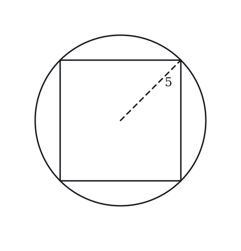

**(A)** 5  
**(B)** 5√2  
**(C)** 10  
**(D)** 10√2  
**(E)** 25

**Q3** · `GEO-INS-005` · MCQ · 35s

Triangle ABC is inscribed in a circle. AB is a diameter of the circle. What is the measure of angle ACB?

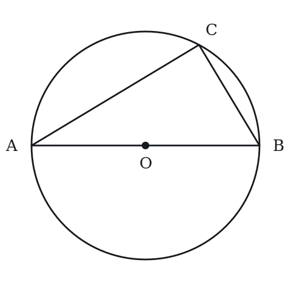

**(A)** 45°  
**(B)** 60°  
**(C)** 90°  
**(D)** 120°  
**(E)** 180°

**Q4** · `GEO-INS-007` · MCQ · 35s

A central angle of a circle measures 100°. What is the measure of an inscribed angle that intercepts the same arc?

**(A)** 25°  
**(B)** 50°  
**(C)** 100°  
**(D)** 200°  
**(E)** 400°

**Q5** · `GEO-INS-008` · QC · 50s

A circle of radius 4 is inscribed in a square.

> **Quantity A:**  Area of the square
> **Quantity B:**  Area of the circle

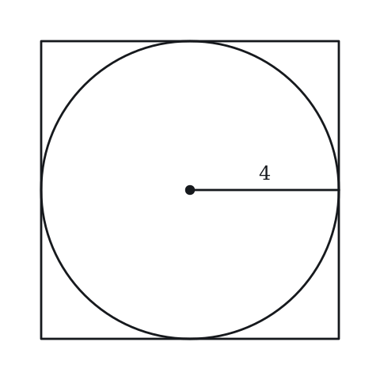

**Q6** · `GEO-INS-012` · Numeric Entry · 40s

An inscribed angle in a circle measures 35°. What is the degree measure of the central angle that subtends the same arc?

*Numeric entry — write the number.*

**Q7** · `GEO-INS-022` · MCQ · 60s

A regular hexagon is inscribed in a circle of radius 8. What is the side length of the hexagon?

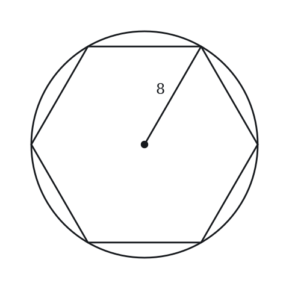

**(A)** 4  
**(B)** 4√3  
**(C)** 8  
**(D)** 8√2  
**(E)** 8√3

---

### Level 2 · Medium — 15 questions · ~20 min

*two or three steps, one planted trap each*

**Q8** · `GEO-INS-015` · MCQ · 80s

A circle is inscribed in a triangle with sides 5, 12, and 13. What is the radius of the inscribed circle?

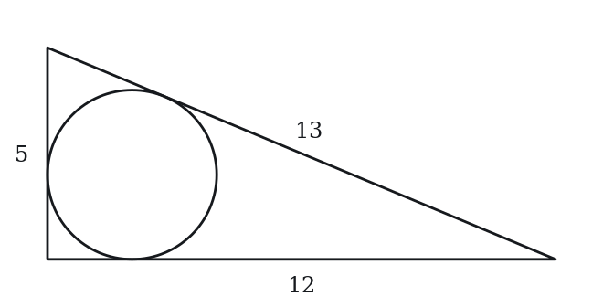

**(A)** 1  
**(B)** 2  
**(C)** 3  
**(D)** 4  
**(E)** 6

**Q9** · `GEO-INS-017` · MCQ · 65s

A circle is inscribed in a square with side length 10. What is the area of the region inside the square but outside the circle?

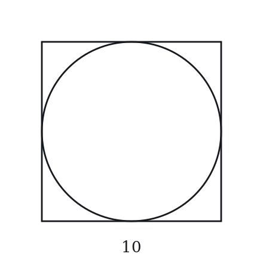

**(A)** 100 − 25π  
**(B)** 100 − 10π  
**(C)** 25π  
**(D)** 100 − 5π  
**(E)** 100

**Q10** · `GEO-INS-019` · Select all that apply · 80s

A triangle is inscribed in a circle such that one side of the triangle is a diameter of the circle. Which of the following must be true? Select all that apply.

**(A)** The triangle is a right triangle  
**(B)** The triangle is isosceles  
**(C)** The angle opposite the diameter is 90°  
**(D)** The triangle is equilateral  
**(E)** The two angles that are not opposite the diameter sum to 90°

**Q11** · `GEO-INS-020` · MCQ · 50s

Two angles inscribed in the same circle intercept the same arc. If one angle measures 35°, what does the other angle measure?

**(A)** 17.5°  
**(B)** 35°  
**(C)** 55°  
**(D)** 70°  
**(E)** 140°

**Q12** · `GEO-INS-021` · Numeric Entry · 85s

A circle is inscribed in a right triangle with legs 9 and 12. What is the radius of the inscribed circle?

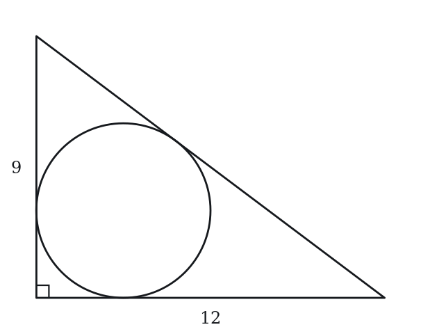

*Numeric entry — write the number.*

**Q13** · `GEO-INS-024` · MCQ · 70s

A rectangle with dimensions 6 × 8 is inscribed in a circle. What is the circumference of the circle?

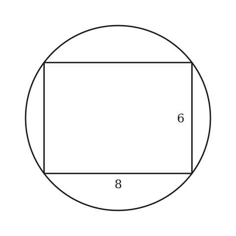

**(A)** 5π  
**(B)** 10π  
**(C)** 14π  
**(D)** 20π  
**(E)** 28π

**Q14** · `GEO-INS-025` · Select all that apply · 80s

A circle of radius r is inscribed in a square of side s. Which of the following relationships are true? Select all that apply.

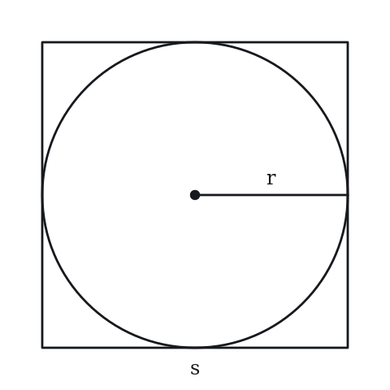

**(A)** s = 2r  
**(B)** s = r√2  
**(C)** The area of the region inside the square and outside the circle is (4 − π)r²  
**(D)** Area of square = 4r²  
**(E)** Perimeter of square = 8r

**Q15** · `GEO-INS-026` · Numeric Entry · 85s

A square is inscribed in a circle. The area of the circle is 50π. What is the area of the square?

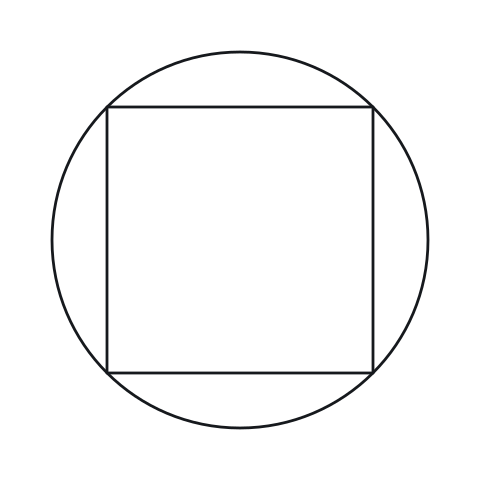

*Numeric entry — write the number.*

**Q16** · `GEO-INS-027` · QC · 90s

A circle is inscribed in a square of side 10. Another circle is circumscribed about the same square.

> **Quantity A:**  Area of the inscribed circle
> **Quantity B:**  Area of the circumscribed circle divided by 2

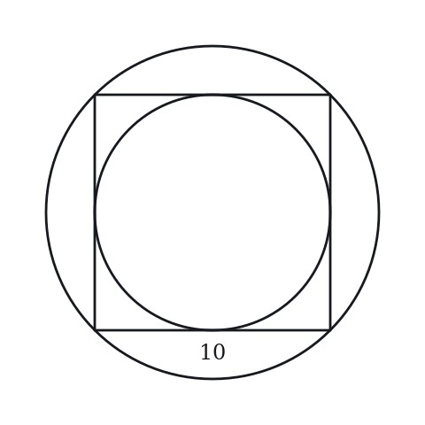

**Q17** · `GEO-INS-029` · MCQ · 80s

A circle with radius 3 is inscribed in an equilateral triangle. What is the side length of the triangle?

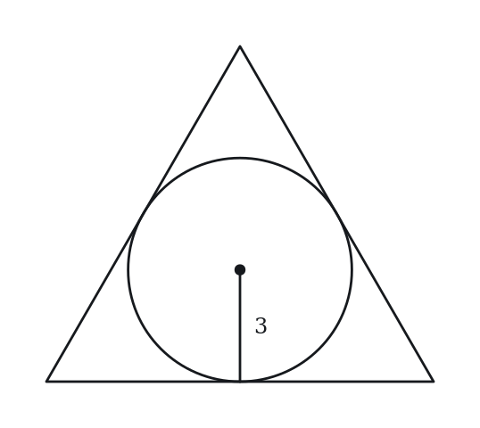

**(A)** 3  
**(B)** 3√3  
**(C)** 6  
**(D)** 9  
**(E)** 6√3

**Q18** · `GEO-INS-031` · Select all that apply · 85s

Points A, B, C, and D lie on a circle. AC is a diameter. Which of the following angles must equal 90°? Select all that apply.

**(A)** Angle ABC  
**(B)** Angle ADC  
**(C)** Angle BAC  
**(D)** Angle ACD  
**(E)** Angle BDC

**Q19** · `GEO-INS-036` · QC · 80s

Circle O has radius 6. Inscribed angle APB subtends arc AB (minor arc). The minor arc AB measures 160°.

> **Quantity A:**  Angle APB
> **Quantity B:**  Angle between two radii OA and OB (reflex angle excluded)

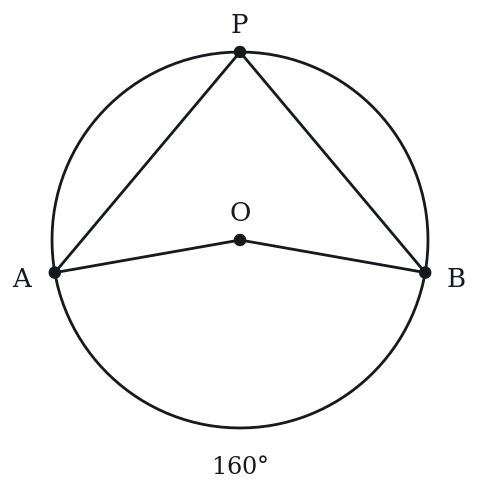

**Q20** · `GEO-INS-037` · MCQ · 105s

A square is inscribed in a circle, and another circle is inscribed in the square. If the outer circle has area 8π, what is the area of the inner circle?

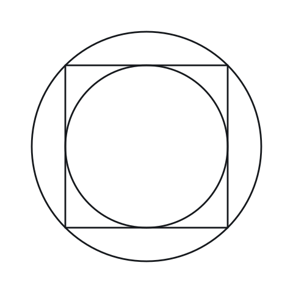

**(A)** π  
**(B)** 2π  
**(C)** 4π  
**(D)** 4π√2  
**(E)** 8π

**Q21** · `GEO-INS-043` · Numeric Entry · 100s

In circle O, arc ABC (the major arc from A to C passing through B) measures 260°. Inscribed angle ADC is formed by point D on the minor arc. What is the measure of angle ADC in degrees?

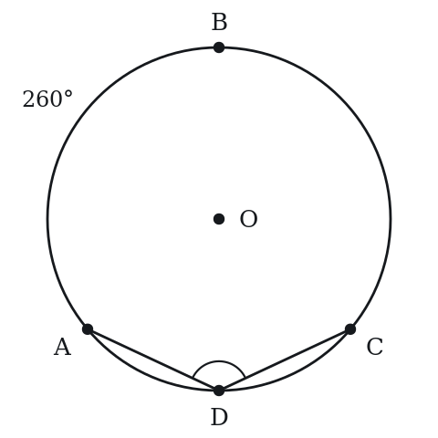

*Numeric entry — write the number.*

**Q22** · `SEC-CS-002` · MCQ · 85s

Quadrilateral WXYZ is inscribed in a circle. The measure of angle Y is 24 degrees less than three times the measure of angle W. What is the measure of angle W, in degrees?

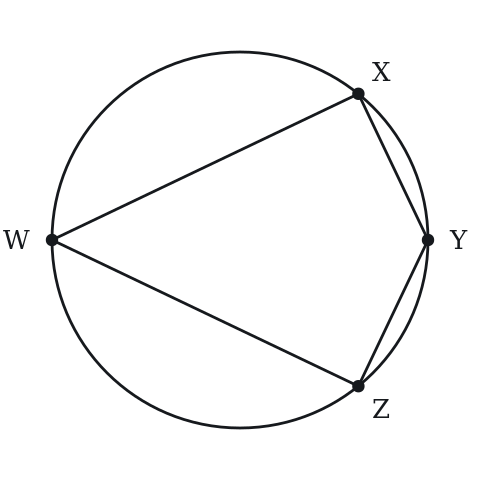

**(A)** 36  
**(B)** 39  
**(C)** 45  
**(D)** 51  
**(E)** 63

---

### Level 3 · Hard — 7 questions · ~12 min

*where 162+ is won or lost*

**Q23** · `GEO-INS-034` · MCQ · 100s

A circle is inscribed in a right triangle. The two legs are 5 and 12. A second circle is circumscribed about the same triangle. What is the ratio of the area of the inscribed circle to the area of the circumscribed circle?

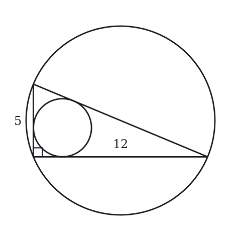

**(A)** 4/169  
**(B)** 16/169  
**(C)** 2/13  
**(D)** 16π/169  
**(E)** 4/13

**Q24** · `GEO-INS-035` · Numeric Entry · 100s

A rectangle with length 2w and width w is inscribed in a circle. The area of the circle is 20π. What is the area of the rectangle?

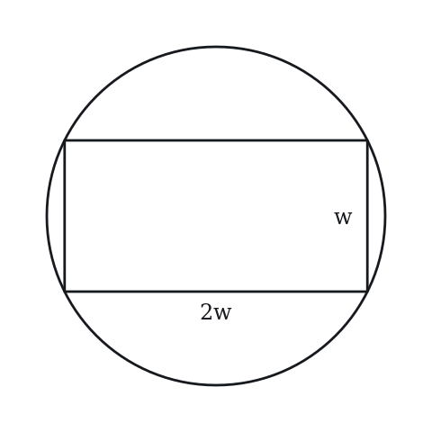

*Numeric entry — write the number.*

**Q25** · `GEO-INS-039` · Select all that apply · 105s

A rectangle is inscribed in a circle with radius 5. Which of the following could be the area of the rectangle?

Indicate all such areas.

**(A)** 12  
**(B)** 48  
**(C)** 50  
**(D)** 60  
**(E)** 78

**Q26** · `GEO-INS-041` · QC · 110s

A right triangle with legs a and b (a < b) is inscribed in a circle such that the hypotenuse is the diameter.

> **Quantity A:**  Radius of the circumscribed circle
> **Quantity B:**  (a + b) / 2

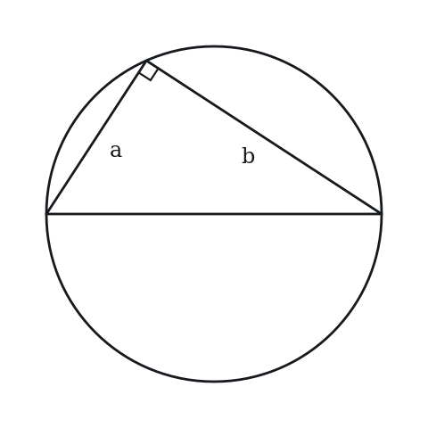

**Q27** · `GEO-INS-046` · MCQ · 105s

A circle is inscribed in a square, and a smaller square is inscribed in the circle. The area of the region that is inside the larger square but outside the smaller square is 50. What is the radius of the circle?

**(A)** 5*sqrt(2)/2  
**(B)** 5  
**(C)** 5*sqrt(2)  
**(D)** 10  
**(E)** 25

**Q28** · `GEO-INS-048` · QC · 95s

An equilateral triangle and a square are each inscribed in the same circle.

> **Quantity A:**  The length of a side of the triangle
> **Quantity B:**  The length of a side of the square

**Q29** · `SEC-CS-028` · MCQ · 110s

Equilateral triangle PQR is inscribed in a circle whose area is 36*pi. What is the length of an altitude of triangle PQR?

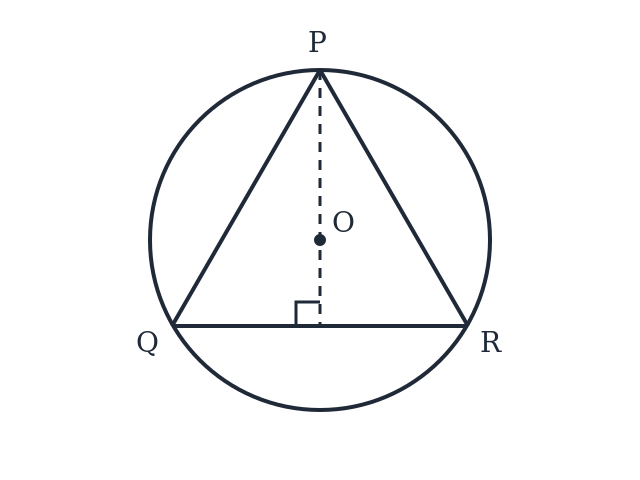

**(A)** 6  
**(B)** 9  
**(C)** 6*sqrt(3)  
**(D)** 12  
**(E)** 18

---

### Level 4 · Extreme — 1 questions · ~2 min

*the top of a real hard section — expect to need the insight, not the grind*

**Q30** · `GEO-INS-KMF-001` · QC · 150s

Two line segments, each 10 units long, bisect each other.

> **Quantity A:**  the number of distinct circles that can be drawn through at least three of the four endpoints of the two segments
> **Quantity B:**  2

---

## Part B — Answer Key

| Q | ID | Level | Type | Answer |
|---|---|---|---|---|
| 1 | `GEO-INS-001` | easy | MCQ | **A** |
| 2 | `GEO-INS-003` | easy | MCQ | **C** |
| 3 | `GEO-INS-005` | easy | MCQ | **C** |
| 4 | `GEO-INS-007` | easy | MCQ | **B** |
| 5 | `GEO-INS-008` | easy | QC | **A** |
| 6 | `GEO-INS-012` | easy | Numeric Entry | **70** |
| 7 | `GEO-INS-022` | easy | MCQ | **C** |
| 8 | `GEO-INS-015` | medium | MCQ | **B** |
| 9 | `GEO-INS-017` | medium | MCQ | **A** |
| 10 | `GEO-INS-019` | medium | Select all that apply | **A, C, E** |
| 11 | `GEO-INS-020` | medium | MCQ | **B** |
| 12 | `GEO-INS-021` | medium | Numeric Entry | **3** |
| 13 | `GEO-INS-024` | medium | MCQ | **B** |
| 14 | `GEO-INS-025` | medium | Select all that apply | **A, C, D, E** |
| 15 | `GEO-INS-026` | medium | Numeric Entry | **100** |
| 16 | `GEO-INS-027` | medium | QC | **C** |
| 17 | `GEO-INS-029` | medium | MCQ | **E** |
| 18 | `GEO-INS-031` | medium | Select all that apply | **A, B** |
| 19 | `GEO-INS-036` | medium | QC | **B** |
| 20 | `GEO-INS-037` | medium | MCQ | **C** |
| 21 | `GEO-INS-043` | medium | Numeric Entry | **130** |
| 22 | `SEC-CS-002` | medium | MCQ | **D** |
| 23 | `GEO-INS-034` | hard | MCQ | **B** |
| 24 | `GEO-INS-035` | hard | Numeric Entry | **32** |
| 25 | `GEO-INS-039` | hard | Select all that apply | **A, B, C** |
| 26 | `GEO-INS-041` | hard | QC | **B** |
| 27 | `GEO-INS-046` | hard | MCQ | **B** |
| 28 | `GEO-INS-048` | hard | QC | **A** |
| 29 | `SEC-CS-028` | hard | MCQ | **B** |
| 30 | `GEO-INS-KMF-001` | extreme hard | QC | **B** |

---

## Part C — Worked Solutions

### Q1 · `GEO-INS-001` — Answer: A

When a circle is inscribed in a square, the circle is tangent to all four sides. The diameter of the circle equals the side of the square. So diameter = 10, and radius = diameter / 2 = 10 / 2 = 5.

**Trap.** Students set radius = side = 10 instead of diameter = side. The circle touches each side at one point, so the full width of the circle (diameter) equals the side length.

### Q2 · `GEO-INS-003` — Answer: C

When a square is inscribed in a circle, the diagonal of the square equals the diameter of the circle. Diameter = 2r = 2(5) = 10. So the diagonal = 10.

**Trap.** Students confuse radius with diameter and answer 5, or confuse diagonal with side and try to apply extra calculations. The key fact: diagonal of inscribed square = diameter of circle.

### Q3 · `GEO-INS-005` — Answer: C

By Thales' theorem (a special case of the inscribed angle theorem), any angle inscribed in a semicircle — where the two endpoints of the angle lie on the diameter — is a right angle. Since AB is a diameter, angle ACB = 90°.

**Trap.** Students forget Thales' theorem entirely and try to calculate from missing information. The key fact: any angle inscribed in a semicircle is exactly 90°.

### Q4 · `GEO-INS-007` — Answer: B

The inscribed angle equals half the central angle subtending the same arc. Inscribed angle = 100° / 2 = 50°.

**Trap.** Students set the inscribed angle equal to the central angle (100°). The fundamental theorem: inscribed angle = (1/2) × central angle.

### Q5 · `GEO-INS-008` — Answer: A

Radius = 4, so diameter = 8. The inscribed circle has diameter = side of square, so side = 8. Area of square = 8² = 64. Area of circle = π(4²) = 16π ≈ 50.3. Since 64 > 50.3, Quantity A is greater.

**Trap.** Students may compute the circle area as π(8²) = 64π using the side as the radius, which would make the circle's area much larger. The radius is 4, not 8.

### Q6 · `GEO-INS-012` — Answer: 70

The central angle is twice the inscribed angle subtending the same arc. Central angle = 2 × 35° = 70°.

**Trap.** Students divide instead of multiply, getting 35°/2 = 17.5°. The central angle is TWICE the inscribed angle, not half.

### Q7 · `GEO-INS-022` — Answer: C

A regular hexagon inscribed in a circle has a side length equal to the radius of the circle. This is because each vertex of the hexagon is on the circle, and each triangle formed by two adjacent vertices and the center is equilateral. So side = radius = 8.

**Trap.** Students apply the square's relationship (diagonal = diameter) to the hexagon. For a regular hexagon, the side equals the radius, not the diameter.

### Q8 · `GEO-INS-015` — Answer: B

For a circle inscribed in a triangle: r = Area / s, where s is the semi-perimeter. First, check if 5-12-13 is a right triangle: 5² + 12² = 25 + 144 = 169 = 13². Yes, it's a right triangle. Area = (1/2)(5)(12) = 30. Semi-perimeter s = (5 + 12 + 13)/2 = 30/2 = 15. r = 30/15 = 2.

**Trap.** Students compute the area correctly but use the full perimeter (30) instead of the semi-perimeter (15) in the formula, giving r = 30/30 = 1.

### Q9 · `GEO-INS-017` — Answer: A

Area of square = 10² = 100. Inscribed circle: diameter = 10, radius = 5. Area of circle = π(5²) = 25π. Shaded area (corners) = Area of square − Area of circle = 100 − 25π.

**Trap.** B subtracts the circumference 10π as if it were the area. C gives the area of the circle itself, the region inside. D subtracts πr (5π) instead of πr². E gives the whole square and subtracts nothing.

### Q10 · `GEO-INS-019` — Answer: A, C, E

By Thales' theorem, any triangle inscribed in a circle with one side as the diameter has the angle opposite the diameter equal to 90°. So: A is true (it's a right triangle), C is true (the angle = 90°), E is true (the other two angles must sum to 90° since all three sum to 180°). B is not necessarily true — the triangle can be scalene (e.g., 30-60-90). D is false — an equilateral triangle cannot have a 90° angle.

**Trap.** Students select B (isosceles) because they visualize a symmetric-looking triangle. A triangle inscribed in a semicircle is a right triangle, but the two legs can have any ratio — it need not be isosceles.

### Q11 · `GEO-INS-020` — Answer: B

By the inscribed angle theorem every inscribed angle is half the arc it intercepts. Both angles intercept the same arc, so both are half of the same measure and therefore equal: the second angle is also 35°.

**Trap.** Choice D doubles 35°, confusing the second inscribed angle with the central angle (or with the intercepted arc, 70°). Choice A halves it again. Choice C takes the complement, 90° − 35°. Choice E, 140°, doubles twice or treats the angle as supplementary to the 40° remainder. Both angles are inscribed, so both are half the same arc.

### Q12 · `GEO-INS-021` — Answer: 3

Hypotenuse = √(9² + 12²) = √(81 + 144) = √225 = 15. Area of triangle = (1/2)(9)(12) = 54. Semi-perimeter = (9 + 12 + 15)/2 = 36/2 = 18. Inscribed radius r = Area / semi-perimeter = 54 / 18 = 3.

**Trap.** Students use the full perimeter (36) instead of the semi-perimeter (18), getting r = 54/36 = 1.5. The formula is r = Area / s where s = semi-perimeter (half the perimeter).

### Q13 · `GEO-INS-024` — Answer: B

A rectangle inscribed in a circle has its diagonal equal to the diameter of the circle. Diagonal = √(6² + 8²) = √(36 + 64) = √100 = 10. Diameter = 10, so radius = 5. Circumference = 2π(5) = 10π.

**Trap.** Students add the dimensions: 6 + 8 = 14 and use 14 as the diameter, giving circumference = 14π. The diagonal (not the sum of sides) equals the diameter.

### Q14 · `GEO-INS-025` — Answer: A, C, D, E

A circle inscribed in a square touches all four sides, so its diameter equals the side: s = 2r. A is true. B is false: for a square inscribed in a circle of radius r, the diagonal is 2r so s = r√2, but here the circle is inside the square. C: the square has area (2r)² = 4r² and the circle πr², so the area between them is (4 − π)r², true. D: s² = 4r², true. E: 4s = 8r, true.

**Trap.** Students select B, confusing the two configurations: s = r√2 is the relationship when a square is inscribed IN a circle (where r is the circumscribed circle's radius), not when a circle is inscribed in a square.

### Q15 · `GEO-INS-026` — Answer: 100

Area of circle = πr² = 50π, so r² = 50, r = 5√2. Diameter = 2r = 10√2. The diagonal of the inscribed square = diameter = 10√2. For a square with diagonal d: side = d/√2 = 10√2/√2 = 10. Area = 10² = 100.

**Trap.** Students compute side = r = 5√2 and area = (5√2)² = 50. The side of the inscribed square equals diameter/√2 = 2r/√2 = r√2, so area = (r√2)² = 2r² = 2(50) = 100.

### Q16 · `GEO-INS-027` — Answer: C

Inscribed circle: diameter = 10, radius 5, area = 25π. Circumscribed circle: diameter = diagonal = 10√2, radius 5√2, area = 50π; half of that = 25π. Quantity A = 25π = Quantity B, so the quantities are equal.

**Trap.** Students rush and assume the circumscribed circle is much larger, not computing carefully. Inscribed area = 25π. Circumscribed area = 50π, so half = 25π. The two columns are equal.

### Q17 · `GEO-INS-029` — Answer: E

For an equilateral triangle with side s, the inradius r = s/(2√3) = s√3/6. Setting r = 3: 3 = s√3/6, so s = 18/√3 = 18√3/3 = 6√3.

**Trap.** Students use r = s/2, giving s = 6. The formula for the inradius of an equilateral triangle is r = s√3/6, not s/2.

### Q18 · `GEO-INS-031` — Answer: A, B

By Thales' theorem, any inscribed angle that subtends a diameter is 90°. Angle ABC subtends diameter AC (B is on the circle, not on AC), so angle ABC = 90°. Similarly, angle ADC subtends diameter AC (D is on the circle), so angle ADC = 90°. Angles BAC, ACD, and BDC do not subtend the diameter AC and need not be 90°.

**Trap.** Students also select C (angle BAC) or D (angle ACD) thinking all angles in the figure equal 90°. Only the angles that are inscribed and subtend the full diameter equal 90°.

### Q19 · `GEO-INS-036` — Answer: B

Arc AB (minor) = 160°. Central angle AOB = arc = 160°. Inscribed angle APB = arc/2 = 160°/2 = 80°. Quantity A = 80°, Quantity B = 160°. Quantity B is greater.

**Trap.** Students confuse the inscribed angle with the central angle and set both to 160°. The central angle equals the arc (160°), but the inscribed angle is half the arc (80°).

### Q20 · `GEO-INS-037` — Answer: C

Outer circle area = 8π, so r_outer² = 8, r_outer = 2√2. The square is inscribed in the outer circle: diagonal = diameter = 2r_outer = 4√2. Side of square = diagonal/√2 = 4√2/√2 = 4. Inner circle is inscribed in the square: diameter = side = 4, r_inner = 2. Area of inner circle = π(2)² = 4π.

**Trap.** Students halve the outer circle's area and choose 4π without working through the geometry, or they use r_inner = r_outer/√2 = 2√2/√2 = 2 (which is correct by coincidence in this case but via incorrect reasoning — the ratio of radii is 1/√2, giving area ratio 1/2).

### Q21 · `GEO-INS-043` — Answer: 130

Major arc ABC = 260°. Minor arc AC = 360° − 260° = 100°. Inscribed angle ADC, with D on the minor arc, intercepts the major arc (the arc not containing D). Inscribed angle = (1/2) × intercepted arc = (1/2)(260°) = 130°.

**Trap.** Students compute (1/2)(100°) = 50°, using the minor arc. When D is on the minor arc, the inscribed angle ADC intercepts the major arc (260°), giving angle = 130°. The inscribed angle always intercepts the arc on the opposite side from the vertex.

### Q22 · `SEC-CS-002` — Answer: D

In a quadrilateral inscribed in a circle, opposite angles are supplementary, and W and Y are opposite, so W + Y = 180. The second condition gives Y = 3W - 24. Substituting, W + 3W - 24 = 180, so 4W = 204 and W = 51. As a check, Y = 3(51) - 24 = 129, and 51 + 129 = 180.

**Trap.** Students who treat W and Y as adjacent angles, or who solve for Y instead of W, land on 129 or on the value 63 that comes from misreading 'three times' as 'three more than'. Only opposite angles of a cyclic quadrilateral are supplementary, and W and Y are the opposite pair here.

### Q23 · `GEO-INS-034` — Answer: B

Step 1: Hypotenuse = √(5² + 12²) = √169 = 13. Step 2: Inscribed circle — Area of triangle = (1/2)(5)(12) = 30. Semi-perimeter = (5 + 12 + 13)/2 = 15. r_inscribed = Area/s = 30/15 = 2. Step 3: Circumscribed circle — By Thales' theorem, the hypotenuse of a right triangle is the diameter of the circumscribed circle. Diameter = 13, r_circumscribed = 13/2. Step 4: Ratio of areas = π(r_in)² / π(r_out)² = (2)² / (13/2)² = 4 / (169/4) = 16/169.

**Trap.** A (4/169) takes the circumradius as 13 (the hypotenuse) rather than 13/2. C (2/13) and E (4/13) are ratios of lengths, not areas: radii 2 : 13 and 2 : 13/2. D (16π/169) leaves π in the numerator only.

### Q24 · `GEO-INS-035` — Answer: 32

The diagonal of the rectangle = diameter of the circle. Area of circle = πr² = 20π, so r² = 20, r = 2√5. Diameter = 4√5. The rectangle has sides w and 2w, so its diagonal = √(w² + (2w)²) = √(w² + 4w²) = √(5w²) = w√5. Set w√5 = 4√5: w = 4. Length = 2w = 8. Area = 4 × 8 = 32.

**Trap.** Students set w = r = 2√5 and compute area = 2w × w = 2(2√5)² = 40. The diagonal (not the side) equals the diameter. Setting w√5 = 4√5 gives w = 4.

### Q25 · `GEO-INS-039` — Answer: A, B, C

Each diagonal of an inscribed rectangle is a diameter, so the diagonal is 10.
If the sides are x and y, then x^2 + y^2 = 100.
Since (x - y)^2 >= 0, 2xy <= x^2 + y^2 = 100, so the area xy is at most 50, reached when the rectangle is a square.
A very thin rectangle has an area close to 0, so every area greater than 0 and at most 50 is possible.
A: 12. Possible.  B: 48. Possible (sides 6 and 8).  C: 50. Possible (a square).  D: 60 and E: 78 exceed 50. Not possible.
Answer: A, B, C.

**Trap.** Selecting 60 or 78 because they are less than the area of the circle, 25π, which is about 78.5. A rectangle inside the circle cannot fill it; the largest inscribed rectangle is the square, with area 50.

### Q26 · `GEO-INS-041` — Answer: B

Radius of circumscribed circle = hypotenuse/2 = √(a² + b²)/2. Quantity B = (a + b)/2. Compare √(a² + b²) vs (a + b): Square both: a² + b² vs (a + b)² = a² + 2ab + b². Since 2ab > 0 for positive a, b: a² + b² < a² + 2ab + b². So √(a² + b²) < a + b, meaning Quantity A < Quantity B. Quantity B is always greater.

**Trap.** Students test a = 3, b = 4: radius = 2.5, (a+b)/2 = 3.5. Quantity B > Quantity A here. Then they test if there's any case where Quantity A ≥ Quantity B — there is not, because √(a²+b²) < a+b always holds for positive a, b. The answer is B, not D.

### Q27 · `GEO-INS-046` — Answer: B

Let the radius be r.
The larger square has side 2r (the circle touches all four sides), so its area is 4r^2.
The smaller square has diagonal 2r (its corners are on the circle), so its area is (2r)^2 / 2 = 2r^2.
Difference: 4r^2 - 2r^2 = 2r^2 = 50, so r^2 = 25 and r = 5.
Check: larger square 10 by 10 = 100; smaller square has diagonal 10 and area 50; 100 - 50 = 50.
Answer: B.

**Trap.** Setting the area of the larger square alone equal to 50: 4r^2 = 50 gives r = 5*sqrt(2)/2 (choice A). Setting r^2 = 50 gives 5*sqrt(2) (choice C). The 50 is the difference of the two square areas, 2r^2.

### Q28 · `GEO-INS-048` — Answer: A

Let the radius be r.
A side of the inscribed square is a chord that subtends a central angle of 360/4 = 90 degrees. Two radii and the side form a 45-45-90 triangle, so the side is r*sqrt(2), about 1.41r.
A side of the inscribed equilateral triangle subtends a central angle of 360/3 = 120 degrees. Dropping a perpendicular from the center gives two 30-60-90 triangles, so the side is 2 * (r*sqrt(3)/2) = r*sqrt(3), about 1.73r.
A chord that subtends a larger central angle is longer.
Answer: A.

**Trap.** Reasoning that the square has more sides and so 'more' perimeter per side, and choosing B. Fewer sides around the same circle means each side spans a larger arc and is longer.

### Q29 · `SEC-CS-028` — Answer: B

From area 36*pi we get pi*r^2 = 36*pi, so the radius is 6. For an equilateral triangle the center of the circumscribed circle is also the centroid, and the centroid divides each altitude in a 2 to 1 ratio measured from the vertex. The longer piece is the circumradius, so 6 is two thirds of the altitude. That makes the altitude 6 x (3/2) = 9.

**Trap.** Students take the altitude to be the diameter, 12, imagining it stretching from the top of the circle to the bottom. The altitude ends at the midpoint of the opposite side, which is inside the circle, not at the circle itself, so it falls short of the diameter by the one-third piece below the center.

### Q30 · `GEO-INS-KMF-001` — Answer: B

Two equal-length segments that bisect each other form the diagonals of a rectangle, so the four endpoints are the vertices of a rectangle.
A rectangle's four vertices always lie on a single common circle (its circumscribed circle), since opposite angles are supplementary (in fact right angles), making it a cyclic quadrilateral.
Any three of those four points also lie on that same one circle -- there is no second, different circle through a different set of three.
So exactly 1 circle passes through at least three of the four endpoints.
Quantity A = 1, Quantity B = 2, so Quantity B is greater.

**Trap.** Students count 4 (one circle per set of 3 chosen points) or reason that since there are 4 ways to choose 3 of the 4 points, there must be 4 different circles, forgetting that all four points already lie on one common circle so every 3-point subset lies on that same circle.
