# Perimeter, Area & Composite Figures — Practice Set

**Bank code:** `GEO-PNA` · **Section:** Geometry · **30 questions** — Easy 7 · Medium 16 · Hard 7

**Lecture capsule:** [13-perimeter-area-composite.md](../../05-geometry/13-perimeter-area-composite.md)

> Split a composite figure into shapes you know, or subtract the hole from the whole; scaling a length by k scales every area by k squared, never by k.

Every question below is live in the question bank under the ID shown — the sheet and the portal are the same questions. Attempt a level with the clock running, then check Part C.

---

## Part A — Questions

> **Quantitative Comparison — the four choices are always the same, so they are not reprinted:**
> **(A)** Quantity A is greater · **(B)** Quantity B is greater · **(C)** The two quantities are equal · **(D)** The relationship cannot be determined from the information given

### Level 1 · Easy — 7 questions · ~6 min

*warm-up — these must be automatic*

**Q1** · `GEO-PNA-003` · Numeric Entry · 40s

The area of a circle with radius 5 is kπ. What is the value of k?

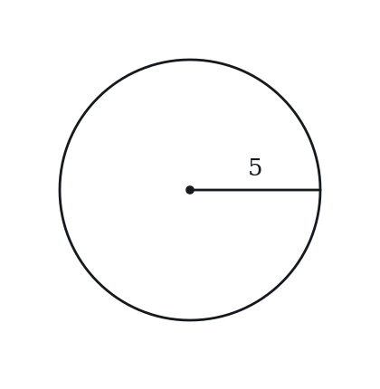

*Numeric entry — write the number.*

**Q2** · `GEO-PNA-005` · MCQ · 45s

A rectangle has perimeter 30 and length 9. What is its width?

**(A)** 3  
**(B)** 6  
**(C)** 12  
**(D)** 15  
**(E)** 21

**Q3** · `GEO-PNA-010` · MCQ · 50s

A trapezoid has parallel sides of length 5 and 9, and a height of 4. What is its area?

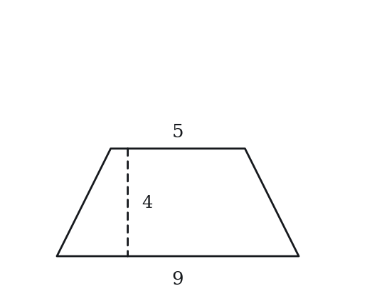

**(A)** 14  
**(B)** 18  
**(C)** 28  
**(D)** 36  
**(E)** 56

**Q4** · `GEO-PNA-012` · MCQ · 50s

What is the area of an equilateral triangle with side length 2?

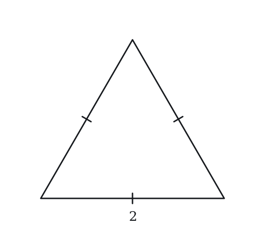

**(A)** √3  
**(B)** 2  
**(C)** 2√3  
**(D)** 4  
**(E)** 3√3

**Q5** · `GEO-PNA-017` · Numeric Entry · 60s

A right triangle has legs of length 6 and 8. What is the area of the triangle?

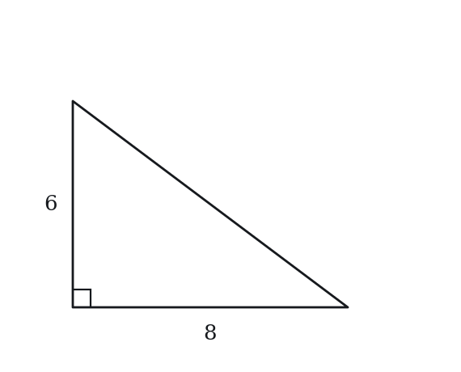

*Numeric entry — write the number.*

**Q6** · `GEO-PNA-022` · QC · 70s

Both rectangles below have area 36.

> **Quantity A:**  Perimeter of the rectangle with dimensions 9 × 4
> **Quantity B:**  Perimeter of the rectangle with dimensions 6 × 6

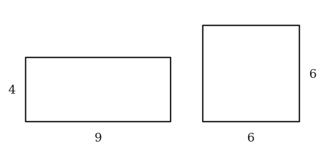

**Q7** · `GEO-PNA-033` · QC · 65s

Triangle A has base 12 and height 5. Triangle B has base 10 and height 7.

> **Quantity A:**  Area of Triangle A
> **Quantity B:**  Area of Triangle B

---

### Level 2 · Medium — 16 questions · ~23 min

*two or three steps, one planted trap each*

**Q8** · `GEO-PNA-018` · MCQ · 65s

A square of side 4 is cut from the interior of a square of side 10. What is the area of the remaining (shaded) region?

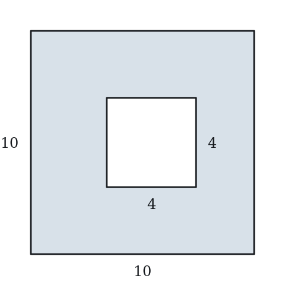

**(A)** 36  
**(B)** 64  
**(C)** 84  
**(D)** 96  
**(E)** 100

**Q9** · `GEO-PNA-020` · MCQ · 75s

A circle is inscribed in a square with side 8, tangent to all four sides. What is the area of the region inside the square but outside the circle? (Leave in terms of π.)

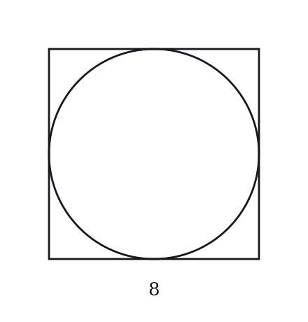

**(A)** 64 − 64π  
**(B)** 16π − 64  
**(C)** 64 − 16π  
**(D)** 64 − 4π  
**(E)** 64 + 16π

**Q10** · `GEO-PNA-024` · Select all that apply · 80s

A rectangle has length 10 and width 6.

Which of the following statements are true?

Indicate all such statements.

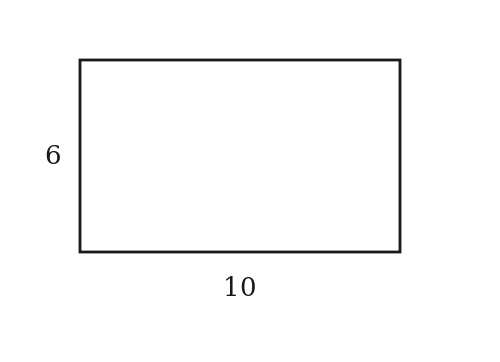

**(A)** Its area is 60  
**(B)** Its perimeter is 32  
**(C)** The diagonal of the rectangle is 8  
**(D)** If both dimensions are doubled, the new area is 120  
**(E)** If both dimensions are doubled, the new perimeter is 64

**Q11** · `GEO-PNA-026` · Numeric Entry · 75s

The side of a square is increased by 50%. By what percent does the area of the square increase?

*Numeric entry — write the number.*

**Q12** · `GEO-PNA-027` · MCQ · 80s

A rectangular garden is 8 m long and 5 m wide. A uniform path 1 m wide surrounds it on all sides. What is the area of the path alone, in square meters?

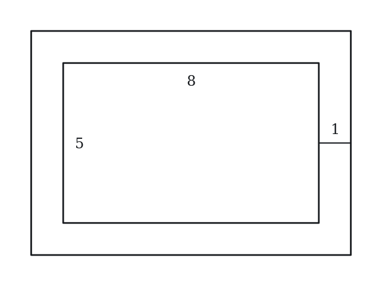

**(A)** 14  
**(B)** 28  
**(C)** 30  
**(D)** 40  
**(E)** 70

**Q13** · `GEO-PNA-036` · MCQ · 75s

A composite figure consists of a 10 × 4 rectangle with a semicircle of diameter 4 attached to one of its shorter ends. What is the total area of the figure? (Leave in terms of π.)

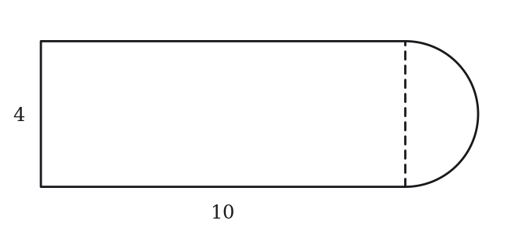

**(A)** 40 + π  
**(B)** 40 + 2π  
**(C)** 44 + 2π  
**(D)** 40 + 4π  
**(E)** 40 + 8π

**Q14** · `GEO-PNA-037` · QC · 70s

A square has side s. Its side is increased by 20%.

> **Quantity A:**  The percent increase in the area of the square
> **Quantity B:**  44%

**Q15** · `GEO-PNA-040` · Numeric Entry · 90s

A square lawn of side 20 m has a uniform strip removed from all four sides. The area of the remaining lawn is 256 m². What is the width, in meters, of the strip removed?

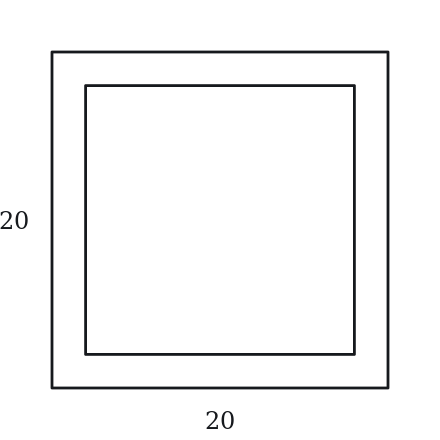

*Numeric entry — write the number.*

**Q16** · `GEO-PNA-041` · QC · 95s

x > 0

> **Quantity A:**  Area of a circle with circumference 4πx
> **Quantity B:**  Area of a square with perimeter 4x

**Q17** · `GEO-PNA-042` · Numeric Entry · 95s

A large circle has radius R and a smaller circle of radius r is removed from its center, forming an annular ring (donut shape). The area of the ring is 48π. If R = 2r, what is the value of r?

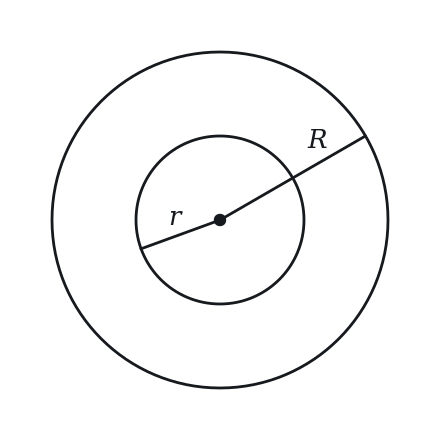

*Numeric entry — write the number.*

**Q18** · `GEO-PNA-046` · Select all that apply · 90s

A circle has radius r, area A, and circumference C.

Which of the following statements must be true?

Indicate all such statements.

**(A)** A = C²/(4π)  
**(B)** If C = 2π, then A = π  
**(C)** A/C = r/2  
**(D)** C = 2A/r  
**(E)** A > C whenever r > 1

**Q19** · `GEO-PNA-048` · MCQ · 90s

A rectangle has vertices at (0,0), (8,0), (8,5), and (0,5). A triangle is drawn with vertices at (0,0), (8,0), and (4,5). What fraction of the rectangle's area does the triangle occupy?

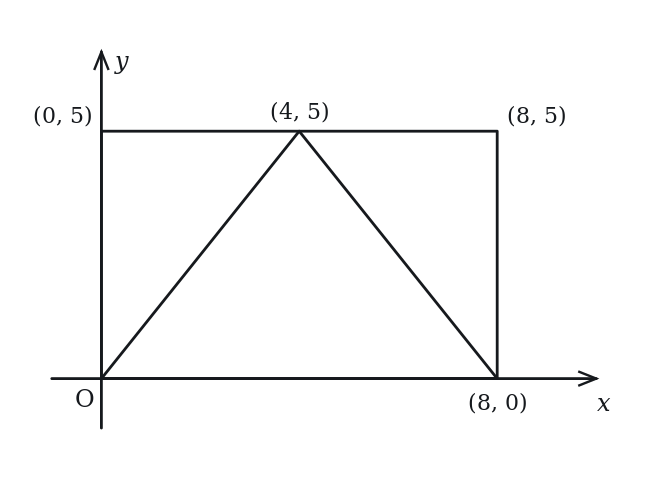

**(A)** 1/4  
**(B)** 1/3  
**(C)** 1/2  
**(D)** 2/3  
**(E)** 3/4

**Q20** · `GEO-PNA-052` · Select all that apply · 90s

The side of a square is multiplied by a factor of k, where k > 0. Which of the following statements must be true? Indicate all such statements.

**(A)** The perimeter is multiplied by k  
**(B)** The area is multiplied by k  
**(C)** The area is multiplied by k²  
**(D)** If k = 3, the area increases by 800%  
**(E)** If k = 1/2, the new area is 1/4 of the original

**Q21** · `GEO-PNA-057` · MCQ · 120s

An 8 × 8 square has four quarter-circles, each centered at a corner of the square with radius 4. What is the area of the square NOT covered by any of the four quarter-circles?

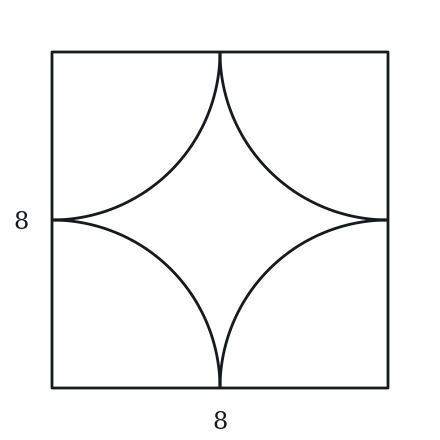

**(A)** 16π − 64  
**(B)** 32 − 8π  
**(C)** 64 − 16π  
**(D)** 64 − 4π  
**(E)** 64 + 4π

**Q22** · `GEO-PNA-060` · QC · 90s

A rectangle's length is increased by p% and its width is decreased by p%, where 0 < p < 100.

> **Quantity A:**  The new area of the rectangle
> **Quantity B:**  The original area of the rectangle

**Q23** · `GEO-PNA-KMF-012` · Numeric Entry · 90s

The figure shows a pentagon in the xy-plane with vertices (-2, -1), (4, -1), (4, 3), (1, 5) and (-2, 3). A triangular hole with vertices (-1, 0), (3, 0) and (1, 2) has been cut out of it. The pentagon minus the hole is shaded. How many square units of the figure are shaded?

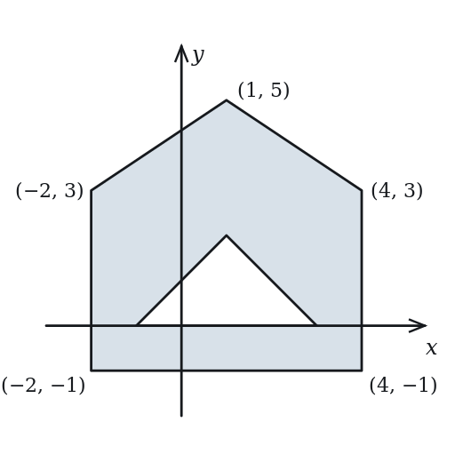

*Numeric entry — write the number.*

---

### Level 3 · Hard — 7 questions · ~14 min

*where 162+ is won or lost*

**Q24** · `GEO-PNA-053` · QC · 105s

A triangle has sides 5, 12, and 13. A rectangle has a perimeter equal to the triangle's perimeter.

> **Quantity A:**  The maximum possible area of such a rectangle
> **Quantity B:**  The area of the triangle

**Q25** · `GEO-PNA-055` · Numeric Entry · 115s

A 1-foot-wide border of grass surrounds a rectangular garden on all sides. The outer perimeter (including the border) is 56 feet. The ratio of the garden's length to its width is 2:1. What is the area of the garden alone, in square feet?

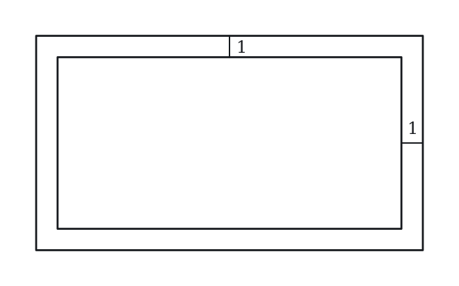

*Numeric entry — write the number.*

**Q26** · `GEO-PNA-KMF-001` · QC · 120s

JKLM is a rectangle. Point N lies on side KL (between K and L).

> **Quantity A:**  The sum of the areas of triangular regions JKN and NLM
> **Quantity B:**  The area of triangular region JNM

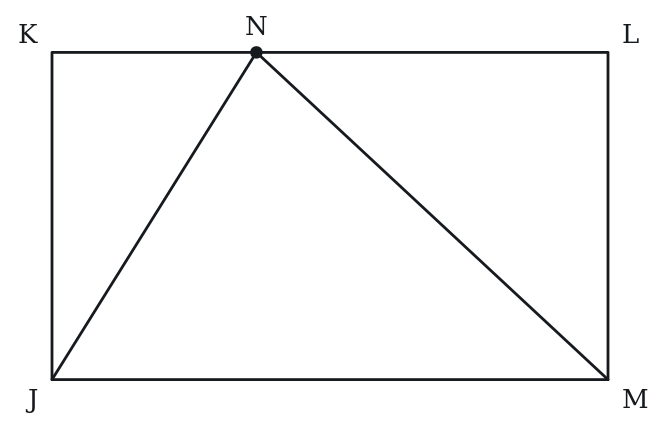

**Q27** · `GEO-PNA-KMF-004` · MCQ · 120s

A rectangular sheet measures 3s by 2s. A quarter-circle of radius s is cut away at the bottom-left corner and another quarter-circle of radius s is cut away at the top-right corner; in each case the center of the quarter-circle is that corner of the rectangle and its two straight radii lie along the two sides that meet there. What is the perimeter of the shaded piece that remains?

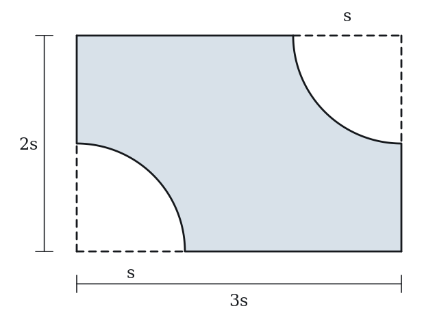

**(A)** (6 + pi/2)s  
**(B)** (6 + pi)s  
**(C)** (8 + pi)s  
**(D)** (6 + 2pi)s  
**(E)** (10 + pi)s

**Q28** · `GEO-PNA-KMF-017` · MCQ · 150s

Square ABCD has side length 15. Points P, Q, R and S lie on sides BC, CD, DA and AB respectively, with BP = CQ = DR = AS = 5. The segments AP, BQ, CR and DS are drawn, and they enclose a small square in the middle of ABCD. What is the area of that small square?

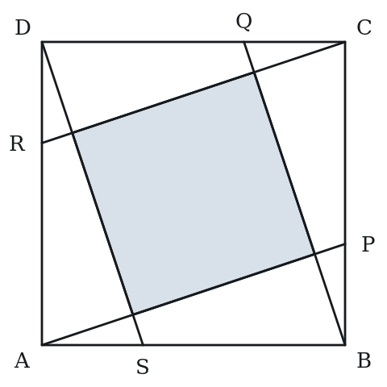

**(A)** 25  
**(B)** 45  
**(C)** 90  
**(D)** 100  
**(E)** 125

**Q29** · `SEC-PG-010` · Numeric Entry · 100s

A rectangular garden has a perimeter of 84 meters, and its length and width are both integer numbers of meters. What is the difference between the greatest possible area and the least possible area, in square meters, of the garden?

*Numeric entry — write the number.*

**Q30** · `SEC-PG-028` · MCQ · 115s

The figure above is a scale drawing of the floor of a workshop in which all the walls meet at right angles. The measurements shown on the drawing, including the two sides of length x, are in centimeters, and the drawing uses a scale of 1 centimeter to 2 meters. If the perimeter of the drawing is 45.2 centimeters, approximately what is the area, in square meters, of the workshop floor?

Note: Figure not drawn to scale.

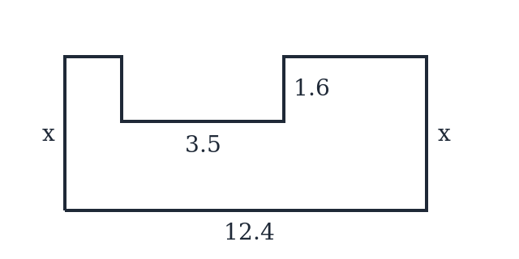

**(A)** 202  
**(B)** 303  
**(C)** 404  
**(D)** 427  
**(E)** 808

---

## Part B — Answer Key

| Q | ID | Level | Type | Answer |
|---|---|---|---|---|
| 1 | `GEO-PNA-003` | easy | Numeric Entry | **25** |
| 2 | `GEO-PNA-005` | easy | MCQ | **B** |
| 3 | `GEO-PNA-010` | easy | MCQ | **C** |
| 4 | `GEO-PNA-012` | easy | MCQ | **A** |
| 5 | `GEO-PNA-017` | easy | Numeric Entry | **24** |
| 6 | `GEO-PNA-022` | easy | QC | **A** |
| 7 | `GEO-PNA-033` | easy | QC | **B** |
| 8 | `GEO-PNA-018` | medium | MCQ | **C** |
| 9 | `GEO-PNA-020` | medium | MCQ | **C** |
| 10 | `GEO-PNA-024` | medium | Select all that apply | **A, B, E** |
| 11 | `GEO-PNA-026` | medium | Numeric Entry | **125** |
| 12 | `GEO-PNA-027` | medium | MCQ | **C** |
| 13 | `GEO-PNA-036` | medium | MCQ | **B** |
| 14 | `GEO-PNA-037` | medium | QC | **C** |
| 15 | `GEO-PNA-040` | medium | Numeric Entry | **2** |
| 16 | `GEO-PNA-041` | medium | QC | **A** |
| 17 | `GEO-PNA-042` | medium | Numeric Entry | **4** |
| 18 | `GEO-PNA-046` | medium | Select all that apply | **A, B, C, D** |
| 19 | `GEO-PNA-048` | medium | MCQ | **C** |
| 20 | `GEO-PNA-052` | medium | Select all that apply | **A, C, D, E** |
| 21 | `GEO-PNA-057` | medium | MCQ | **C** |
| 22 | `GEO-PNA-060` | medium | QC | **B** |
| 23 | `GEO-PNA-KMF-012` | medium | Numeric Entry | **26** |
| 24 | `GEO-PNA-053` | hard | QC | **A** |
| 25 | `GEO-PNA-055` | hard | Numeric Entry | **128** |
| 26 | `GEO-PNA-KMF-001` | hard | QC | **C** |
| 27 | `GEO-PNA-KMF-004` | hard | MCQ | **B** |
| 28 | `GEO-PNA-KMF-017` | hard | MCQ | **C** |
| 29 | `SEC-PG-010` | hard | Numeric Entry | **400** |
| 30 | `SEC-PG-028` | hard | MCQ | **C** |

---

## Part C — Worked Solutions

### Q1 · `GEO-PNA-003` — Answer: 25

Area of a circle = πr² = π(5²) = 25π. The coefficient is 25.

**Trap.** Students use diameter (10) instead of radius (5), computing π(10²) = 100π and entering 100.

### Q2 · `GEO-PNA-005` — Answer: B

Perimeter = 2(length + width). So 30 = 2(9 + width) → 15 = 9 + width → width = 6.

**Trap.** Students subtract: 30 − 9 = 21 and choose D, forgetting the factor of 2 and that both lengths and both widths must be counted.

### Q3 · `GEO-PNA-010` — Answer: C

Area of trapezoid = ½(b₁ + b₂) × h = ½(5 + 9) × 4 = ½ × 14 × 4 = 28.

**Trap.** Students forget the ½ and compute (5 + 9) × 4 = 56, choosing C.

### Q4 · `GEO-PNA-012` — Answer: A

Area = (√3/4) × s² = (√3/4) × (2²) = (√3/4) × 4 = √3.

**Trap.** Choice D (4) is the side squared, with the √3/4 factor left out. Choice C (2√3) is base times height, 2 × √3, with the factor of 1/2 left out. Choice B (2) treats the height as 2.

### Q5 · `GEO-PNA-017` — Answer: 24

For a right triangle, the two legs serve as base and height (they are perpendicular). Area = ½ × 6 × 8 = 24.

**Trap.** Students first find the hypotenuse (√(36+64) = 10) and then mistakenly use it as one dimension: ½ × 10 × 8 = 40 or ½ × 10 × 6 = 30.

### Q6 · `GEO-PNA-022` — Answer: A

Quantity A: Perimeter = 2(9 + 4) = 26. Quantity B: Perimeter = 2(6 + 6) = 24. Quantity A (26) > Quantity B (24). Among all rectangles with a fixed area, the square minimizes the perimeter.

**Trap.** Students assume the square (6 × 6) gives a larger perimeter because it seems 'more compact,' choosing B. In fact, a square minimizes perimeter for a fixed area.

### Q7 · `GEO-PNA-033` — Answer: B

Area of A = ½ × 12 × 5 = 30. Area of B = ½ × 10 × 7 = 35. Quantity B (35) > Quantity A (30).

**Trap.** Students compare base and height pairwise: A has a longer base (12 > 10) and shorter height (5 < 7), and assume the result is ambiguous, choosing D without computing.

### Q8 · `GEO-PNA-018` — Answer: C

Area of large square = 10² = 100. Area of cut-out = 4² = 16. Remaining area = 100 − 16 = 84.

**Trap.** Students compute (10 − 4)² = 6² = 36, choosing C, subtracting dimensions before squaring rather than subtracting areas.

### Q9 · `GEO-PNA-020` — Answer: C

The inscribed circle has diameter = 8 (equals the side), so radius = 4. Area of square = 8² = 64. Area of circle = π(4²) = 16π. Shaded region = 64 − 16π.

**Trap.** Students use diameter (8) instead of radius (4) in the area formula, computing π(8²) = 64π, leading to 64 − 64π (which is negative — a sure sign of an error).

### Q10 · `GEO-PNA-024` — Answer: A, B, E

A: Area = 10 × 6 = 60 ✓. B: Perimeter = 2(10 + 6) = 32 ✓. C: Diagonal = √(10² + 6²) = √(100 + 36) = √136 ≈ 11.66, not 8 ✗. D: Doubled dimensions are 20 × 12, new area = 240 (area scales by k² = 4, not k = 2) ✗. E: New perimeter = 2(20 + 12) = 64 ✓ (perimeter scales by k = 2). Answers: A, B, E.

**Trap.** Students select D because they think doubling both dimensions doubles the area. Doubling both linear dimensions multiplies area by 2² = 4 (new area = 240, not 120).

### Q11 · `GEO-PNA-026` — Answer: 125

Original area = s². New side = 1.5s. New area = (1.5s)² = 2.25s². Increase = 2.25s² − s² = 1.25s². Percent increase = (1.25s²/s²) × 100 = 125%.

**Trap.** Students assume area also increases by 50%, entering 50. Area scales by k² = (1.5)² = 2.25, meaning the area is 225% of the original — a 125% increase, not 50%.

### Q12 · `GEO-PNA-027` — Answer: C

The path adds 1 m on each side, so outer dimensions are (8 + 2) × (5 + 2) = 10 × 7. Outer area = 70. Inner (garden) area = 8 × 5 = 40. Path area = 70 − 40 = 30.

**Trap.** Students add 1 (not 2) to each dimension, making outer = 9 × 6 = 54, and compute 54 − 40 = 14 (choosing A), forgetting the path adds 1 m on both sides of each dimension.

### Q13 · `GEO-PNA-036` — Answer: B

Rectangle area = 10 × 4 = 40. The semicircle has diameter = 4, so radius = 2. Area of full circle = π(2²) = 4π. Area of semicircle = 4π/2 = 2π. Total = 40 + 2π.

**Trap.** Students use diameter (4) instead of radius (2) in the area formula: ½π(4²) = 8π, choosing E.

### Q14 · `GEO-PNA-037` — Answer: C

New side = 1.2s. New area = (1.2s)² = 1.44s². Percent increase = (1.44 − 1) × 100% = 44%. Quantity A = 44% = Quantity B.

**Trap.** Students double the linear percentage to estimate area increase: 2 × 20% = 40%, choosing B (40% < 44%). Area scales by k² = 1.2² = 1.44, not by 2k.

### Q15 · `GEO-PNA-040` — Answer: 2

Let the strip width = x. After removal, the remaining square has side = 20 − 2x (strip is removed from both sides). Area = (20 − 2x)² = 256 → 20 − 2x = 16 → 2x = 4 → x = 2.

**Trap.** Students set up (20 − x)² = 256, getting 20 − x = 16 → x = 4, forgetting that the strip is removed from both sides of each dimension, so each dimension shrinks by 2x.

### Q16 · `GEO-PNA-041` — Answer: A

Circle: circumference = 2πr = 4πx → r = 2x. Area = π(2x)² = 4πx². Square: perimeter = 4s = 4x → s = x. Area = x². Compare 4πx² vs x²: since 4π ≈ 12.57, we have 4πx² ≈ 12.57x² > x² for all x > 0. Quantity A is greater.

**Trap.** Students see '4πx' for the circle and '4x' for the square and assume the circle's perimeter is π times larger, somehow concluding the areas are equal, choosing C.

### Q17 · `GEO-PNA-042` — Answer: 4

Annulus area = πR² − πr² = π(R² − r²) = 48π → R² − r² = 48. With R = 2r: (2r)² − r² = 4r² − r² = 3r² = 48 → r² = 16 → r = 4.

**Trap.** Students substitute R = 2r into the area formula but compute πR² − πr² = π(2r)² − πr² = 4πr² − πr² = 3πr² = 48π correctly to get r² = 16 → r = 4. A common error is computing π(2r − r)² = π(r²) = 48π → r² = 48 → r = 4√3 (treating the annulus as a circle with radius R−r).

### Q18 · `GEO-PNA-046` — Answer: A, B, C, D

A: C = 2πr → r = C/(2π). A = π[C/(2π)]² = C²/(4π) ✓. B: C = 2π → r = 1. A = π(1²) = π ✓. C: A/C = πr²/(2πr) = r/2 ✓. D: 2A/r = 2πr²/r = 2πr = C ✓. E: A = πr², C = 2πr. A > C → πr² > 2πr → r > 2. For r = 1.5 (which is > 1): A = 2.25π ≈ 7.07 and C = 3π ≈ 9.42, so A < C. Statement E is false for 1 < r ≤ 2. Answers: A, B, C, D.

**Trap.** Students include E because they think larger radius means area 'grows faster' and so A > C for all r > 1. But A > C only when r > 2.

### Q19 · `GEO-PNA-048` — Answer: C

Rectangle area = 8 × 5 = 40. Triangle: base = 8 (from (0,0) to (8,0)), height = 5 (perpendicular distance from the base to the apex at (4,5), which is the y-coordinate). Triangle area = ½ × 8 × 5 = 20. Fraction = 20/40 = 1/2.

**Trap.** Students see the triangle's apex at (4,5) — the midpoint of the top edge — and guess it fills 1/4 of the rectangle (choosing A). A triangle always occupies exactly half the area of its bounding rectangle when base and height are shared.

### Q20 · `GEO-PNA-052` — Answer: A, C, D, E

A: Original perimeter = 4s. New = 4(ks) = 4ks = k × (4s). Multiplied by k ✓. B: Area = (ks)² = k²s², multiplied by k², not k ✗. C: As shown above ✓. D: k=3 → area multiplied by 3² = 9. Increase = (9−1)/1 × 100% = 800% ✓. E: k=1/2 → area multiplied by (1/2)² = 1/4 ✓. Answers: A, C, D, E.

**Trap.** Students choose B, thinking area scales by k like perimeter; and some reject D because they read 9 times the area as a 900% (or 300%) increase instead of 800%.

### Q21 · `GEO-PNA-057` — Answer: C

Each quarter-circle has radius 4 and area = ¼π(4²) = 4π. Four quarter-circles total area = 4 × 4π = 16π. Since each quarter-circle sits in its own corner and the radius (4) equals exactly half the side length (8), adjacent quarter-circles meet at the midpoints of sides with zero overlap. Total covered area = 16π. Uncovered area = 64 − 16π.

**Trap.** Students compute one full circle (π × 4² = 16π) and subtract correctly — arriving at 64−16π by coincidence but for the wrong reason. A common error is computing only one quarter-circle's area (4π) and subtracting: 64−4π (choosing D).

### Q22 · `GEO-PNA-060` — Answer: B

Let original area = l × w. New area = l(1 + p/100) × w(1 − p/100) = lw(1 − p²/10000). Since 0 < p < 100, we have p² > 0, so (1 − p²/10000) < 1. New area < original area for all valid values of p. Quantity B is always greater.

**Trap.** Students reason that a p% increase and a p% decrease cancel out, choosing C. This is the successive-percent trap: the net effect is always a multiplicative loss of p²/10000, so the area strictly decreases. For example, p=10: new area = lw(1−100/10000) = 0.99lw < lw.

### Q23 · `GEO-PNA-KMF-012` — Answer: 26

Split the pentagon into a rectangle and a triangle on top.
Rectangle: x from -2 to 4 (width 6), y from -1 to 3 (height 4), area 6 * 4 = 24.
Top triangle: base from (-2,3) to (4,3) has length 6; apex (1,5) is 2 above the base; area = (1/2) * 6 * 2 = 6.
Pentagon area = 24 + 6 = 30.
Hole: base from (-1,0) to (3,0) has length 4, apex (1,2) is 2 above it; area = (1/2) * 4 * 2 = 4.
Shaded area = 30 - 4 = 26.
Check: the shoelace formula on the pentagon gives 60/2 = 30, matching.

**Trap.** Reporting the whole pentagon, 30, without removing the hole; or adding the hole instead of subtracting it, getting 34.

### Q24 · `GEO-PNA-053` — Answer: A

Triangle perimeter = 5 + 12 + 13 = 30. Note: 5² + 12² = 25 + 144 = 169 = 13², so this is a right triangle. Triangle area = ½ × 5 × 12 = 30. Rectangle with perimeter 30: maximum area occurs when it is a square, side = 30/4 = 7.5. Max rectangle area = 7.5² = 56.25. Quantity A (56.25) > Quantity B (30). Quantity A is greater.

**Trap.** Students skip maximizing the rectangle and assume some default rectangle (e.g., 10×5 with area 50, or 8×7 with area 56), and may still get a value > 30 but without certainty. The key insight is that the square (7.5 × 7.5) gives the maximum, and 56.25 > 30.

### Q25 · `GEO-PNA-055` — Answer: 128

Let garden width = w, length = 2w (ratio 2:1). The border adds 1 ft on each side, so outer dimensions are (w+2) by (2w+2). Outer perimeter = 2[(w+2) + (2w+2)] = 2(3w+4) = 6w+8 = 56 → 6w = 48 → w = 8. Garden: 8 ft wide, 16 ft long. Area = 8 × 16 = 128 sq ft.

**Trap.** Students add 1 (not 2) to each dimension: outer = (w+1) by (2w+1), perimeter = 2(3w+2) = 6w+4 = 56 → 6w = 52 → w ≈ 8.67 (non-integer), which signals an error. The border adds 1 foot to EACH side, so each dimension gains 2 feet in total.

### Q26 · `GEO-PNA-KMF-001` — Answer: C

Place J = (0,0), K = (0,h), L = (w,h), M = (w,0), so JKLM is a rectangle with width w and height h.
Let N = (c,h) be any point on side KL, where 0 <= c <= w.
Area of triangle JKN (vertices (0,0),(0,h),(c,h)) = (1/2)*c*h.
Area of triangle NLM (vertices (c,h),(w,h),(w,0)) = (1/2)*h*(w-c).
Sum = (1/2)*c*h + (1/2)*h*(w-c) = (1/2)*h*w, which is exactly half the rectangle's area, no matter where N sits on KL.
Area of triangle JNM (vertices (0,0),(c,h),(w,0)) = (1/2)*w*h as well (base JM = w, height = h).
Both quantities equal (1/2)*w*h, so they are always equal.

**Trap.** Students assume the split depends on exactly where N sits on KL and, without doing the algebra, guess the relationship cannot be determined (option D).

### Q27 · `GEO-PNA-KMF-004` — Answer: B

Start from the full rectangle: perimeter = 2 * (3s + 2s) = 10s.
Now account for one corner cut-out. Removing the quarter-disc deletes a length s of the bottom edge and a length s of the left edge from the boundary, a total of 2s of straight edge, and puts a quarter-circle arc in their place.
Arc length of a quarter-circle of radius s = (1/4) * 2 * pi * s = (pi * s) / 2.
So each cut-out changes the perimeter by -2s + (pi/2)s.
There are two such cut-outs, at the bottom-left and top-right corners, so the total change is -4s + pi * s.
Perimeter of the remaining piece = 10s - 4s + pi * s = (6 + pi)s.
Check the cut-outs fit and do not overlap: the radius s is at most the 2s height and at most the 3s width, and the two centers are 3s apart horizontally, well more than the 2s that would be needed for the arcs to meet.
Check with a number: let s = 1. The boundary is then 6 straight units plus two quarter-arcs of radius 1, total 6 + 2 * (pi/2) = 6 + pi, about 9.14.

**Trap.** Adding the two arcs to the full rectangle perimeter without deleting the straight edges they replace, giving 10s + pi * s, which produces option E.

### Q28 · `GEO-PNA-KMF-017` — Answer: C

1. Place A at (0, 0), B at (15, 0), C at (15, 15), D at (0, 15). Then P = (15, 5), Q = (10, 15), R = (0, 10), S = (5, 0).
2. Line AP: y = x/3. Line DS: through (0, 15) and (5, 0), so y = 15 - 3x. Line BQ: through (15, 0) and (10, 15), so y = 45 - 3x.
3. AP meets DS where x/3 = 15 - 3x, so x = 4.5 and y = 1.5. AP meets BQ where x/3 = 45 - 3x, so x = 13.5 and y = 4.5.
4. These are adjacent corners of the small square, so its side squared is (13.5 - 4.5)^2 + (4.5 - 1.5)^2 = 81 + 9 = 90.
5. The area of a square equals its side squared, so the area is 90.
Check: 90 / 225 = 2/5 of the big square, matching the general result (15 - 5)^2 / (15^2 + 5^2) = 100 / 250 = 2/5.
Other choices: 25 uses side 15 - 2*5; 45 applies the midpoint-case fraction 1/5; 100 uses side 15 - 5; 125 is 225 - 100.

**Trap.** Using the fraction 1/5 that holds when the points are midpoints (so area 225/5 = 45) ignores that here the points are only one third of the way along each side, which gives choice B.

### Q29 · `SEC-PG-010` — Answer: 400

A perimeter of 84 means the length and width sum to 42. For a fixed sum, the product is largest when the two numbers are as close together as possible and smallest when they are as far apart as possible. The closest integer pair is 21 and 21, giving an area of 441. The farthest apart is 1 and 41, giving an area of 41. The difference is 441 - 41 = 400.

**Trap.** Students report 441 as the answer, stopping at the maximum, or they allow a side of 0 and claim a minimum area of 0, giving 441. A garden must have positive integer sides, so the thinnest allowed rectangle is 1 by 41, not 0 by 42.

### Q30 · `SEC-PG-028` — Answer: C

Trace the perimeter. The bottom is 12.4 and the two vertical sides are each x. Along the top, the two flat pieces plus the notch's own floor still add up to 12.4 horizontally, and the notch contributes two extra vertical pieces of 1.6 each. So the perimeter is 12.4 + 2x + 12.4 + 2(1.6) = 28 + 2x. Setting 28 + 2x = 45.2 gives x = 8.6. The area on the drawing is the full rectangle minus the notch: 12.4 x 8.6 - 3.5 x 1.6 = 106.64 - 5.6 = 101.04 square centimeters. Since 1 centimeter represents 2 meters, 1 square centimeter represents 4 square meters, so the floor is 101.04 x 4 = 404.16, or about 404 square meters.

**Trap.** Students scale the area by 2 instead of by 4 and answer 202, or they forget to subtract the notch and answer about 427. A linear scale factor of 2 becomes a factor of 2 squared when areas are converted, and the notch really is missing from the floor.
