# Solids — Surface Area & Volume — Practice Set

**Bank code:** `GEO-SAV` · **Section:** Geometry · **30 questions** — Easy 7 · Medium 16 · Hard 7

**Lecture capsule:** [14-solids-surface-area-volume.md](../../05-geometry/14-solids-surface-area-volume.md)

> Volume scales with the cube of a length and surface area with the square; a cone is a third of its cylinder, and a space diagonal is Pythagoras used twice.

Every question below is live in the question bank under the ID shown — the sheet and the portal are the same questions. Attempt a level with the clock running, then check Part C.

---

## Part A — Questions

> **Quantitative Comparison — the four choices are always the same, so they are not reprinted:**
> **(A)** Quantity A is greater · **(B)** Quantity B is greater · **(C)** The two quantities are equal · **(D)** The relationship cannot be determined from the information given

### Level 1 · Easy — 7 questions · ~6 min

*warm-up — these must be automatic*

**Q1** · `GEO-3DG-001` · MCQ · 40s

A cube has a side length of 4. What is the volume of the cube?

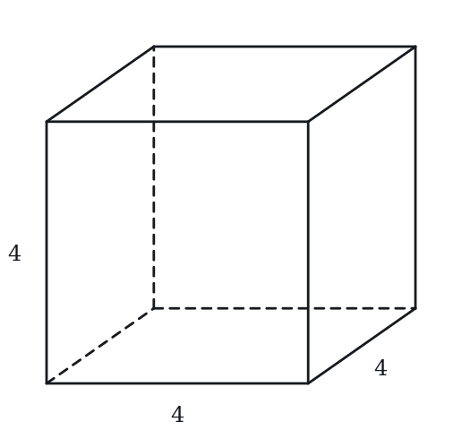

**(A)** 16  
**(B)** 48  
**(C)** 64  
**(D)** 96  
**(E)** 192

**Q2** · `GEO-3DG-006` · MCQ · 50s

A cube has side length 5. What is the length of a face diagonal (the diagonal across one square face of the cube)?

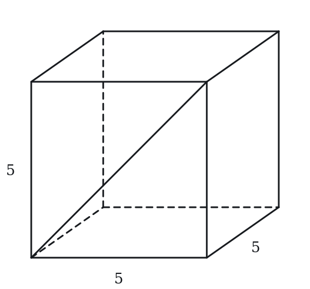

**(A)** 5  
**(B)** 5√2  
**(C)** 5√3  
**(D)** 10  
**(E)** 25

**Q3** · `GEO-CSH-001` · MCQ · 45s

A sphere has a radius of 3. What is its volume?

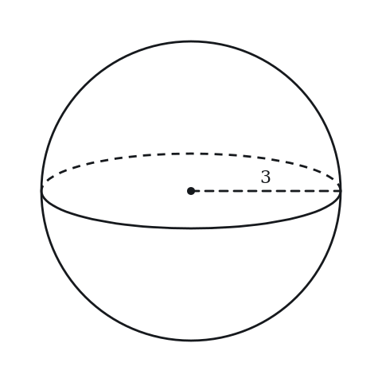

**(A)** 12π  
**(B)** 27π  
**(C)** 36π  
**(D)** 48π  
**(E)** 108π

**Q4** · `GEO-CSH-003` · MCQ · 45s

A cone has base radius 3 and vertical height 4. What is its slant height?

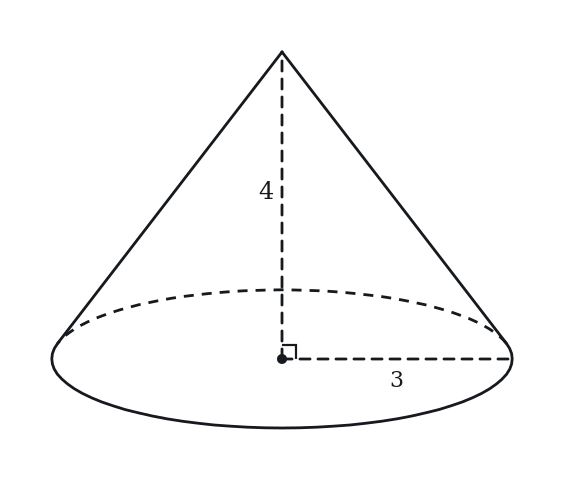

**(A)** 3  
**(B)** 4  
**(C)** 5  
**(D)** 7  
**(E)** 12

**Q5** · `GEO-SAV-007` · Numeric Entry · 60s

A rectangular prism has length 6 cm, width 4 cm, and height 3 cm. What is its total surface area in cm²?

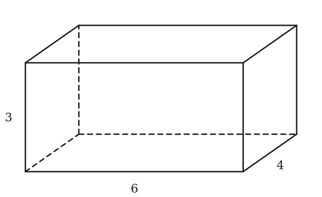

*Numeric entry — write the number.*

**Q6** · `GEO-SAV-008` · QC · 55s

A cube has side length 5.

> **Quantity A:**  Volume of the cube
> **Quantity B:**  Surface area of the cube

**Q7** · `GEO-SAV-015` · MCQ · 70s

A cylinder has a radius of 4 cm and a height of 6 cm. What is its total surface area? (Leave answer in terms of π.)

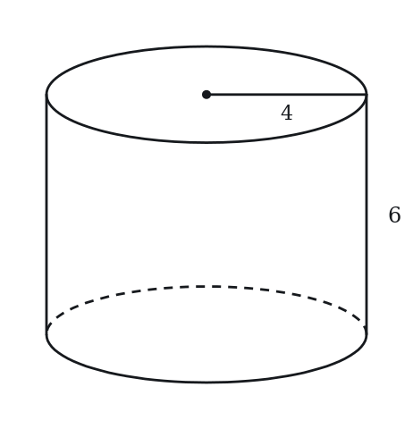

**(A)** 24π cm²  
**(B)** 48π cm²  
**(C)** 64π cm²  
**(D)** 80π cm²  
**(E)** 160π cm²

---

### Level 2 · Medium — 16 questions · ~21 min

*two or three steps, one planted trap each*

**Q8** · `GEO-3DG-019` · MCQ · 80s

A rectangular sheet of paper measures 10 cm × 6 cm. The sheet is rolled so that the two 6 cm edges meet, forming a cylinder. What is the radius of the resulting cylinder?

**(A)** 3/π  
**(B)** 5/π  
**(C)** 6/π  
**(D)** 3  
**(E)** 10/π

**Q9** · `GEO-3DG-024` · QC · 70s

Cylinder A has radius 3 and height 4. Cylinder B has radius 4 and height 3.

> **Quantity A:**  Volume of Cylinder A
> **Quantity B:**  Volume of Cylinder B

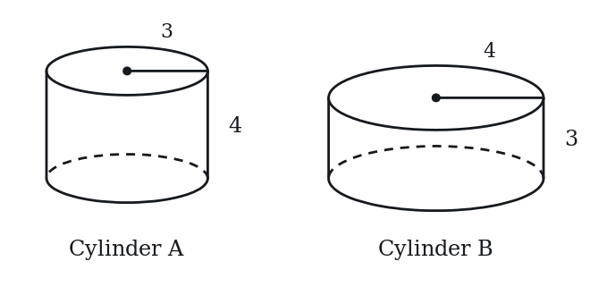

**Q10** · `GEO-3DG-025` · Numeric Entry · 75s

How many small boxes of dimensions 2 × 3 × 4 can fit in a large box of dimensions 6 × 9 × 8? (Assume small boxes are aligned with the large box; no rotation allowed.)

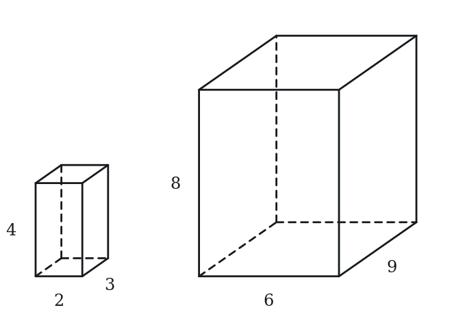

*Numeric entry — write the number.*

**Q11** · `GEO-3DG-031` · MCQ · 85s

A cube has a space diagonal of length 12. What is the total surface area of the cube?

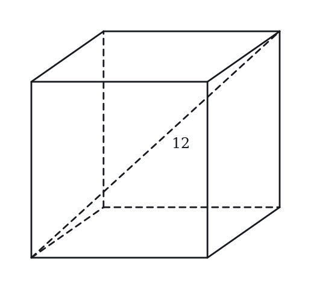

**(A)** 48  
**(B)** 144  
**(C)** 216  
**(D)** 288  
**(E)** 432

**Q12** · `GEO-3DG-037` · QC · 90s

Cylinder X has radius r and height h. Cylinder Y has radius 2r and height h/4.

> **Quantity A:**  Volume of Cylinder X
> **Quantity B:**  Volume of Cylinder Y

**Q13** · `GEO-3DG-045` · Select all that apply · 90s

A cylinder has radius 4 and height 9. Which of the following are greater than the volume of the cylinder? Use π ≈ 3.14. Indicate all such values.

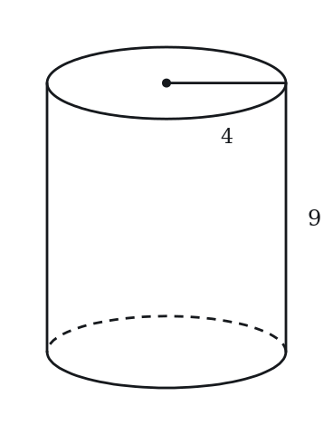

**(A)** 400  
**(B)** 420  
**(C)** 430  
**(D)** 460  
**(E)** 500

**Q14** · `GEO-CSH-017` · Numeric Entry · 75s

A cone has a total surface area of 96π and a base radius of 6. What is the slant height of the cone?

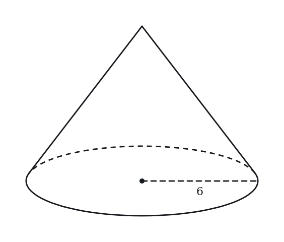

*Numeric entry — write the number.*

**Q15** · `GEO-CSH-020` · QC · 80s

Sphere S has radius 6. Cylinder C has radius 6 and height 8.

> **Quantity A:**  Volume of sphere S
> **Quantity B:**  Volume of cylinder C

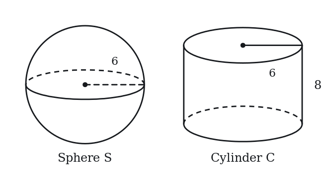

**Q16** · `GEO-CSH-023` · MCQ · 70s

A sphere is inscribed in a cube of side length 10 (the sphere touches all six faces of the cube). What is the volume of the sphere?

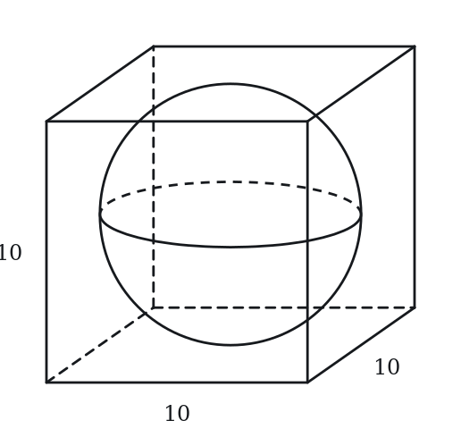

**(A)** (250/3)π  
**(B)** 100π  
**(C)** (500/3)π  
**(D)** 500π  
**(E)** (4000/3)π

**Q17** · `GEO-CSH-025` · Select all that apply · 90s

A cone has base radius 6, height 8, and slant height 10. Select all true statements.

Select all that apply.

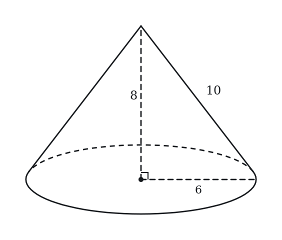

**(A)** The lateral surface area of the cone is 60π  
**(B)** The total surface area of the cone is 96π  
**(C)** The volume of the cone is 96π  
**(D)** The slant height satisfies l = √(r² + h²)  
**(E)** The lateral surface area equals the volume (as multiples of π)

**Q18** · `GEO-SAV-017` · MCQ · 70s

A cone has a radius of 5 cm, a height of 12 cm, and a slant height of 13 cm. What is its total surface area? (Leave answer in terms of π.)

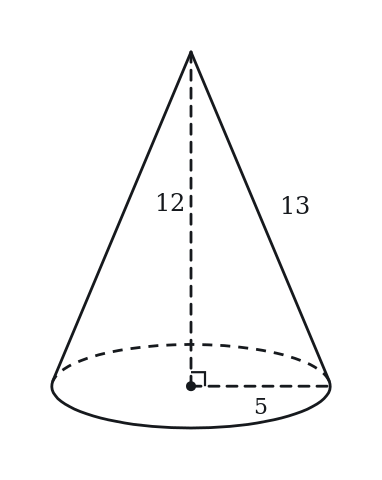

**(A)** 25π cm²  
**(B)** 65π cm²  
**(C)** 78π cm²  
**(D)** 90π cm²  
**(E)** 195π cm²

**Q19** · `GEO-SAV-018` · QC · 65s

A cylinder and a cone share the same base radius of 6 cm and the same height of 8 cm.

> **Quantity A:**  Volume of the cylinder
> **Quantity B:**  3 times the volume of the cone

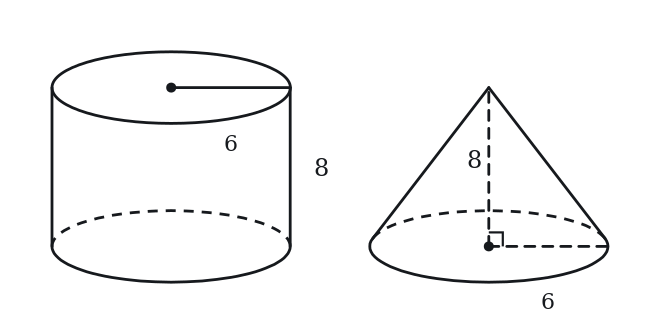

**Q20** · `GEO-SAV-019` · Numeric Entry · 80s

A spherical ball has a volume of 288π cm³. What is the radius of the ball in cm?

*Numeric entry — write the number.*

**Q21** · `GEO-SAV-022` · MCQ · 60s

A rectangular tank with a square base of side 6 m is filled with water to a depth of 4 m. How many cubic meters of water does the tank contain?

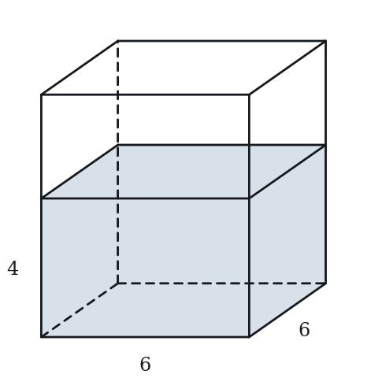

**(A)** 24 m³  
**(B)** 72 m³  
**(C)** 96 m³  
**(D)** 144 m³  
**(E)** 216 m³

**Q22** · `GEO-SAV-026` · Select all that apply · 90s

A cube has side length s.

Which of the following statements are true?

Indicate all such statements.

**(A)** If s doubles, the volume increases by a factor of 8  
**(B)** If s doubles, the surface area increases by a factor of 4  
**(C)** If s doubles, the surface area increases by a factor of 8  
**(D)** The numerical value of the volume always exceeds the numerical value of the surface area  
**(E)** When s = 6, the volume and surface area are numerically equal

**Q23** · `GEO-SAV-043` · MCQ · 95s

A square pyramid has a base side of 6 cm and a height of 4 cm. The slant height of each triangular face is 5 cm. What is the total surface area of the pyramid?

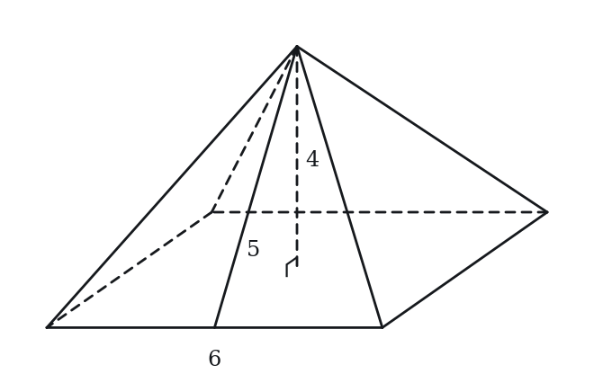

**(A)** 36 cm²  
**(B)** 60 cm²  
**(C)** 84 cm²  
**(D)** 96 cm²  
**(E)** 120 cm²

---

### Level 3 · Hard — 7 questions · ~12 min

*where 162+ is won or lost*

**Q24** · `GEO-3DG-042` · MCQ · 100s

A 4 × 4 × 4 cube is painted red on all six faces and then cut into 64 unit cubes (each 1 × 1 × 1). How many unit cubes have exactly 2 red faces?

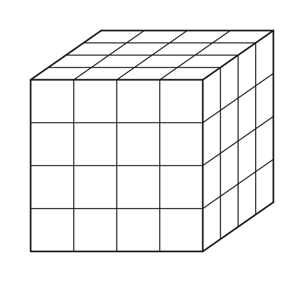

**(A)** 8  
**(B)** 16  
**(C)** 24  
**(D)** 32  
**(E)** 48

**Q25** · `GEO-3DG-049` · MCQ · 95s

Three faces of a rectangular solid that meet at one corner have areas 12, 15 and 20. What is the volume of the solid?

**(A)** 30  
**(B)** 47  
**(C)** 60  
**(D)** 120  
**(E)** 3,600

**Q26** · `GEO-SAV-039` · QC · 90s

> **Quantity A:**  The surface area of a cube with volume 64
> **Quantity B:**  The surface area of a rectangular solid with dimensions 2 by 4 by 8

**Q27** · `GEO-SAV-047` · Numeric Entry · 110s

A cone is carved out of a solid cylinder, where the cone shares the same circular base and height as the cylinder. The cylinder has radius 6 cm and height 12 cm. The remaining solid (after removing the cone) is melted and recast into a sphere. What is the radius of the sphere in cm?

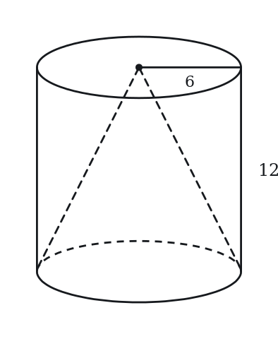

*Numeric entry — write the number.*

**Q28** · `GEO-SAV-KMF-013` · Select all that apply · 100s

A rectangular solid has volume 36. One of its faces has area 9, and all three edge lengths are positive integers. Which of the following could be the total surface area of the solid? Select all that apply.

**(A)** 33  
**(B)** 49  
**(C)** 58  
**(D)** 66  
**(E)** 98

**Q29** · `SEC-CS-009` · QC · 125s

A rectangular solid has a volume of 84, and one of its faces has an area of 14.

> **Quantity A:**  the surface area of the solid
> **Quantity B:**  120

**Q30** · `SEC-CS-011` · MCQ · 120s

A monument is a right pyramid with a square base. Every edge of the monument, both the four base edges and the four lateral edges, has length 12 meters. How many meters above the ground is the tip of the monument?

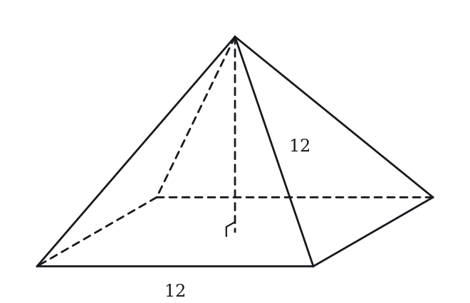

**(A)** 6  
**(B)** 6*sqrt(2)  
**(C)** 6*sqrt(3)  
**(D)** 12  
**(E)** 12*sqrt(2)

---

## Part B — Answer Key

| Q | ID | Level | Type | Answer |
|---|---|---|---|---|
| 1 | `GEO-3DG-001` | easy | MCQ | **C** |
| 2 | `GEO-3DG-006` | easy | MCQ | **B** |
| 3 | `GEO-CSH-001` | easy | MCQ | **C** |
| 4 | `GEO-CSH-003` | easy | MCQ | **C** |
| 5 | `GEO-SAV-007` | easy | Numeric Entry | **108** |
| 6 | `GEO-SAV-008` | easy | QC | **B** |
| 7 | `GEO-SAV-015` | easy | MCQ | **D** |
| 8 | `GEO-3DG-019` | medium | MCQ | **B** |
| 9 | `GEO-3DG-024` | medium | QC | **B** |
| 10 | `GEO-3DG-025` | medium | Numeric Entry | **18** |
| 11 | `GEO-3DG-031` | medium | MCQ | **D** |
| 12 | `GEO-3DG-037` | medium | QC | **C** |
| 13 | `GEO-3DG-045` | medium | Select all that apply | **D, E** |
| 14 | `GEO-CSH-017` | medium | Numeric Entry | **10** |
| 15 | `GEO-CSH-020` | medium | QC | **C** |
| 16 | `GEO-CSH-023` | medium | MCQ | **C** |
| 17 | `GEO-CSH-025` | medium | Select all that apply | **A, B, C, D** |
| 18 | `GEO-SAV-017` | medium | MCQ | **D** |
| 19 | `GEO-SAV-018` | medium | QC | **C** |
| 20 | `GEO-SAV-019` | medium | Numeric Entry | **6** |
| 21 | `GEO-SAV-022` | medium | MCQ | **D** |
| 22 | `GEO-SAV-026` | medium | Select all that apply | **A, B, E** |
| 23 | `GEO-SAV-043` | medium | MCQ | **D** |
| 24 | `GEO-3DG-042` | hard | MCQ | **C** |
| 25 | `GEO-3DG-049` | hard | MCQ | **C** |
| 26 | `GEO-SAV-039` | hard | QC | **B** |
| 27 | `GEO-SAV-047` | hard | Numeric Entry | **6** |
| 28 | `GEO-SAV-KMF-013` | hard | Select all that apply | **D, E** |
| 29 | `SEC-CS-009` | hard | QC | **D** |
| 30 | `SEC-CS-011` | hard | MCQ | **B** |

---

## Part C — Worked Solutions

### Q1 · `GEO-3DG-001` — Answer: C

Volume of a cube = s³ = 4³ = 4 × 4 × 4 = 64.

**Trap.** Students compute s² = 16 (area of one face) or 6s² = 96 (surface area) instead of s³.

### Q2 · `GEO-3DG-006` — Answer: B

Each face of the cube is a square with side 5. By the Pythagorean theorem, the diagonal of a square with side s is s√2. Face diagonal = 5√2.

**Trap.** Students confuse the face diagonal (s√2) with the space diagonal (s√3). The space diagonal passes through the interior of the cube; the face diagonal lies on a single face.

### Q3 · `GEO-CSH-001` — Answer: C

Volume of a sphere = (4/3)πr³. With r = 3: V = (4/3)π(3)³ = (4/3)π(27) = (4 × 27/3)π = 36π.

**Trap.** Students swap the volume and surface area formulas. SA = 4πr² = 36π when r = 3 as well, which creates a coincidental match — but only at r = 3. The volume formula is (4/3)πr³ and the SA formula is 4πr².

### Q4 · `GEO-CSH-003` — Answer: C

Slant height l = √(r² + h²) = √(3² + 4²) = √(9 + 16) = √25 = 5. This is a classic 3-4-5 right triangle.

**Trap.** Students confuse slant height with vertical height, writing l = 4 (option B). The slant height is the distance along the lateral surface from the apex to the base edge — always longer than the vertical height.

### Q5 · `GEO-SAV-007` — Answer: 108

SA = 2(lw + lh + wh) = 2(6×4 + 6×3 + 4×3) = 2(24 + 18 + 12) = 2(54) = 108 cm².

**Trap.** Students compute only one set of three faces — lw + lh + wh = 54 — and forget to multiply by 2. A rectangular prism has 3 pairs of identical opposite faces, so total SA = 2 × (sum of three distinct face areas).

### Q6 · `GEO-SAV-008` — Answer: B

Volume = s³ = 5³ = 125. Surface area = 6s² = 6 × 25 = 150. Quantity B (150) > Quantity A (125). Surface area exceeds volume for this cube.

**Trap.** Students assume volume is always numerically larger than surface area and choose A without computing. For s = 5: V = 125 and SA = 150, so surface area is actually larger. The crossover happens at s = 6 where both equal 216.

### Q7 · `GEO-SAV-015` — Answer: D

Total SA = 2πr² + 2πrh = 2π(4²) + 2π(4)(6) = 2π(16) + 2π(24) = 32π + 48π = 80π cm².

**Trap.** Students compute only the lateral surface area 2πrh = 48π and forget the two circular bases 2πr² = 32π. The total surface area of a closed cylinder requires including both circular ends.

### Q8 · `GEO-3DG-019` — Answer: B

When the 6 cm edges are joined, the 10 cm dimension wraps around and becomes the circumference of the circular base. So 2πr = 10 → r = 10/(2π) = 5/π. The height of the cylinder is 6 cm.

**Trap.** Students confuse which dimension becomes the circumference. If the 6 cm edges are joined, the 10 cm length wraps around (circumference = 10), and height = 6. Students often swap these, getting r = 3/π.

### Q9 · `GEO-3DG-024` — Answer: B

V(A) = π(3²)(4) = 36π. V(B) = π(4²)(3) = 48π. Since 48π > 36π, Quantity B is greater. The radius is squared in the volume formula, so increasing the radius has a larger impact than increasing the height by the same amount.

**Trap.** Students think the volumes are equal because the dimensions are just swapped (3 and 4 appear in both). They forget that radius is squared, giving it more leverage: a larger radius matters more than a larger height of the same amount.

### Q10 · `GEO-3DG-025` — Answer: 18

Fit along 6: 6/2 = 3. Fit along 9: 9/3 = 3. Fit along 8: 8/4 = 2. Total = 3 × 3 × 2 = 18. All dimensions divide evenly.

**Trap.** Students compute volume ratio: (6×9×8)/(2×3×4) = 432/24 = 18. This matches here because all dimensions divide evenly, but volume-ratio method fails when remainders exist. The safe method always divides each dimension separately.

### Q11 · `GEO-3DG-031` — Answer: D

Space diagonal = s√3 = 12 → s = 12/√3 = 12√3/3 = 4√3. Surface area = 6s² = 6(4√3)² = 6 × 16 × 3 = 6 × 48 = 288.

**Trap.** Students compute s = 4√3 but then square it as (4√3)² = 4² = 16, forgetting the √3 factor: (4√3)² = 16 × 3 = 48. Then 6 × 48 = 288.

### Q12 · `GEO-3DG-037` — Answer: C

V(X) = πr²h. V(Y) = π(2r)²(h/4) = π(4r²)(h/4) = πr²h. Both volumes equal πr²h, so they are equal.

**Trap.** Students think doubling r and halving h would cancel (ratio 2 × 0.5 = 1). But r is squared: doubling r multiplies volume by 4. Then multiplying by h/4 divides by 4. Net effect: 4 × (1/4) = 1, so volumes are equal. Students who skip the squaring conclude V(Y) = 2r × h/4 × π... and get the wrong ratio.

### Q13 · `GEO-3DG-045` — Answer: D, E

The volume is π(4²)(9) = 144π, which is about 144 x 3.14 = 452.2. The values greater than 452.2 are 460 and 500 (C and D); 400, 430 and 420 are less.

**Trap.** Students who round 144π to about 450 and treat 430 or 460 as close to it mis-sort; students who use the diameter 8 instead of the radius 4 find 576π and select everything.

### Q14 · `GEO-CSH-017` — Answer: 10

Total SA = πrl + πr² = 96π. Substitute r = 6: π(6)l + π(36) = 96π → 6l + 36 = 96 → 6l = 60 → l = 10.

**Trap.** Students plug into the lateral SA formula alone: πrl = 96π → 6l = 96 → l = 16. They forget to subtract the base area πr² = 36π first. The total SA includes both the lateral surface and the circular base.

### Q15 · `GEO-CSH-020` — Answer: C

V_sphere = (4/3)π(6³) = (4/3)π(216) = 288π. V_cylinder = π(6²)(8) = π(36)(8) = 288π. Both equal 288π. The two quantities are equal.

**Trap.** Students assume a sphere must have less volume than a cylinder with the same radius and choose B. Here the specific numbers (r=6, h=8) produce exactly equal volumes. Always compute before comparing.

### Q16 · `GEO-CSH-023` — Answer: C

A sphere inscribed in a cube with side s has radius r = s/2 = 10/2 = 5 (the sphere touches each face, so its diameter equals the side length). Volume = (4/3)π(5³) = (4/3)π(125) = 500π/3.

**Trap.** Students use the space diagonal of the cube (s√3 = 10√3) as the sphere's diameter, giving r = 5√3. The space diagonal applies to a sphere circumscribed around (outside) the cube. For an inscribed sphere (inside, touching faces), the diameter equals the side length.

### Q17 · `GEO-CSH-025` — Answer: A, B, C, D

A: Lateral SA = πrl = π(6)(10) = 60π. True. B: Total SA = πrl + πr² = 60π + π(36) = 60π + 36π = 96π. True. C: Volume = (1/3)πr²h = (1/3)π(36)(8) = 96π. True. D: √(6² + 8²) = √(36 + 64) = √100 = 10. True. E: Lateral SA = 60π and Volume = 96π — 60 ≠ 96, so this is false. Correct answers: A, B, C, D.

**Trap.** Students often confuse lateral SA (60π) with total SA (96π) for option B. For option E, students may notice total SA = volume = 96π and mark E true — but the question specifies lateral SA (60π), which does not equal the volume (96π).

### Q18 · `GEO-SAV-017` — Answer: D

Total SA of a cone = πr² + πrl = π(5²) + π(5)(13) = 25π + 65π = 90π cm².

**Trap.** Students compute only the lateral surface area πrl = 65π and forget to add the circular base πr² = 25π. The word 'total' means the base must be included.

### Q19 · `GEO-SAV-018` — Answer: C

Volume of cylinder = πr²h = π(36)(8) = 288π. Volume of cone = (1/3)πr²h = (1/3)(288π) = 96π. Three times the cone's volume = 3 × 96π = 288π. The two quantities are equal. This is always true: for any cone and cylinder with the same r and h, V_cylinder = 3 × V_cone.

**Trap.** Students may compute both quantities numerically and make an arithmetic error. The elegant insight is that V_cone = (1/3) × V_cylinder always, so 3 × V_cone = V_cylinder exactly — no computation needed.

### Q20 · `GEO-SAV-019` — Answer: 6

V = (4/3)πr³ = 288π. Divide both sides by π: (4/3)r³ = 288. Multiply both sides by 3/4: r³ = 288 × (3/4) = 216. Therefore r = ∛216 = 6 cm. Verify: (4/3)π(216) = 288π ✓.

**Trap.** Students multiply both sides by 4/3 instead of 3/4, computing r³ = 288 × (4/3) = 384. Must multiply by the reciprocal 3/4 to isolate r³.

### Q21 · `GEO-SAV-022` — Answer: D

The base is a 6 m × 6 m square. Volume of water = base area × depth = 6 × 6 × 4 = 144 m³.

**Trap.** Students compute 6 × 4 = 24 using only one side of the square base, forgetting the base is 6 m × 6 m, not 6 m wide. The square base contributes 6 × 6 = 36 m², giving 36 × 4 = 144 m³.

### Q22 · `GEO-SAV-026` — Answer: A, B, E

A: V = s³; doubling s gives (2s)³ = 8s³, a factor of 8 increase ✓. B: SA = 6s²; doubling s gives 6(2s)² = 24s², a factor of 4 increase ✓. C: SA scales by k² = 4, not 8 (volume scales by k³ = 8) ✗. D: For s = 1: V = 1, SA = 6. SA > V, so this is false ✗. E: V = 6³ = 216; SA = 6(6²) = 216. Equal ✓.

**Trap.** Students often confuse volume scaling (k³) with surface area scaling (k²) and choose C instead of B. Statement D is false — for small s, surface area numerically exceeds volume.

### Q23 · `GEO-SAV-043` — Answer: D

Total SA = Base area + 4 × (area of one triangular face). Base = 6 × 6 = 36 cm². Each triangular face has base 6 and height = slant height = 5. Area of one face = (1/2)(6)(5) = 15 cm². Four faces = 4 × 15 = 60 cm². Total SA = 36 + 60 = 96 cm².

**Trap.** Students use the pyramid's vertical height (4 cm) as the triangle's height, computing each face as (1/2)(6)(4) = 12 cm², giving 4×12 + 36 = 84 cm². The height of a triangular face is the slant height (5), not the vertical height of the pyramid (4).

### Q24 · `GEO-3DG-042` — Answer: C

Unit cubes with exactly 2 red faces lie along the edges of the original cube (but not at the corners). Each edge of a 4×4×4 cube has 4 unit cubes total; 2 are corner cubes (3 painted faces), leaving 2 edge cubes per edge with exactly 2 painted faces. A cube has 12 edges, so: 12 × 2 = 24 unit cubes with exactly 2 painted faces.

**Trap.** Students count corner cubes (which have 3 red faces = 8 cubes) and confuse them with edge cubes. The four categories: 8 corner cubes (3 faces), 24 edge cubes (2 faces), 24 face-center cubes (1 face), 8 interior cubes (0 faces). Total = 8+24+24+8 = 64 ✓.

### Q25 · `GEO-3DG-049` — Answer: C

Let the edge lengths be a, b and c, with ab = 12, ac = 15 and bc = 20.
Multiply the three equations: (ab)(ac)(bc) = (abc)^2 = 12 * 15 * 20 = 3,600.
abc = 60, and abc is the volume.
Check: the edges are 3, 4 and 5; 3 * 4 = 12, 3 * 5 = 15, 4 * 5 = 20.
Answer: C.

**Trap.** Multiplying the three areas and stopping at 3,600 (choice E). That product is the square of the volume, because each edge length appears twice. Adding the areas gives 47 (choice B), which is half the surface area.

### Q26 · `GEO-SAV-039` — Answer: B

Cube: the edge is 4, since 4^3 = 64. Surface area = 6 * 4^2 = 96.
Rectangular solid: surface area = 2(2*4 + 2*8 + 4*8) = 2(8 + 16 + 32) = 112.
112 > 96.
Both solids have volume 64; among rectangular solids with a given volume, the cube has the least surface area.
Answer: B.

**Trap.** Noticing that 2 * 4 * 8 = 64 and concluding that equal volumes mean equal surface areas (choice C). Solids with the same volume can have different surface areas.

### Q27 · `GEO-SAV-047` — Answer: 6

Volume of cylinder = π(6²)(12) = 432π cm³. Volume of cone = (1/3)π(6²)(12) = 144π cm³. Volume of remaining solid = 432π − 144π = 288π cm³. Set equal to sphere: (4/3)πr³ = 288π → r³ = 288 × (3/4) = 216 → r = ∛216 = 6 cm.

**Trap.** Students equate the remaining volume 288π to the sphere formula but multiply by 4/3 instead of 3/4 when solving, getting r³ = 288 × (4/3) = 384, which has no clean cube root. Must multiply both sides of (4/3)πr³ = 288π by 3/4 to isolate r³.

### Q28 · `GEO-SAV-KMF-013` — Answer: D, E

1. Let the face of area 9 have edges a and b, with a * b = 9, and let the third edge be c. Then c = 36 / 9 = 4.
2. Integer pairs with a * b = 9: (1, 9), (3, 3) and (9, 1).
3. Surface area = 2(ab + bc + ca). For (3, 3, 4): 2(9 + 12 + 12) = 66. For (1, 9, 4) or (9, 1, 4): 2(9 + 36 + 4) = 98.
4. D (66) and E (98) are possible. A (33) and B (49) are exactly half of those, from forgetting the factor 2. C (58) = 2 * 9 + 36 + 4 doubles only one face pair.
Check: the volumes are 3 * 3 * 4 = 36 and 1 * 9 * 4 = 36, and both have a face of area 9.

**Trap.** Forgetting to double the sum of the three face areas gives 33 or 49, options A and B.

### Q29 · `SEC-CS-009` — Answer: D

Call the face with area 14 the one with sides a and b, so ab = 14, and let c be the third edge. Then abc = 84 gives c = 6. The surface area is 2(ab + bc + ca) = 2(14 + 6(a + b)) = 28 + 12(a + b). Since ab is fixed at 14, a + b can be as small as 2*sqrt(14), about 7.48, when the face is a square, and can grow without bound as the face is made long and thin. So the surface area starts near 28 + 12(7.48) = 117.8 and rises without limit, which puts 120 squarely inside the possible range. The relationship cannot be determined.

**Trap.** Students find c = 6, choose the comfortable dimensions 2, 7 and 6, compute a surface area of 136, and answer A. Fixing the product ab does not fix the sum a + b, so a single convenient set of dimensions proves nothing here.

### Q30 · `SEC-CS-011` — Answer: B

The height runs from the tip straight down to the center of the square base. That height, half of a base diagonal, and one lateral edge form a right triangle with the lateral edge as hypotenuse. The base is a square of side 12, so its diagonal is 12*sqrt(2) and half the diagonal is 6*sqrt(2). Then height^2 = 12^2 - (6*sqrt(2))^2 = 144 - 72 = 72, so the height is sqrt(72) = 6*sqrt(2).

**Trap.** Students drop the perpendicular to the midpoint of a base edge instead of to the center of the base. That distance is 6, and it produces sqrt(144 - 36) = 6*sqrt(3), which is the slant height of a triangular face rather than the height of the pyramid.
