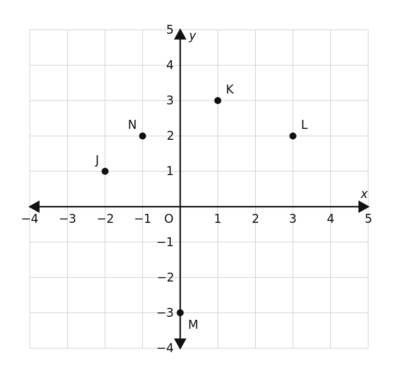
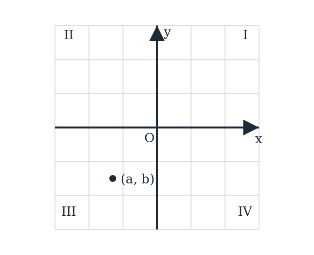
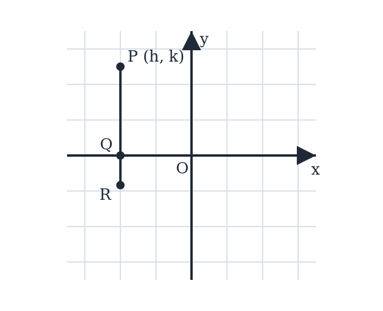
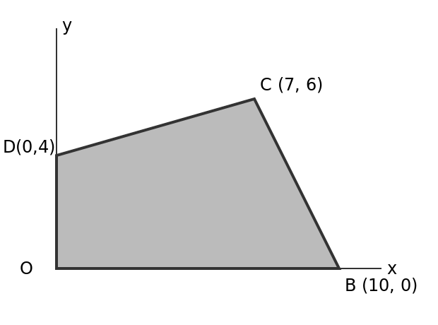
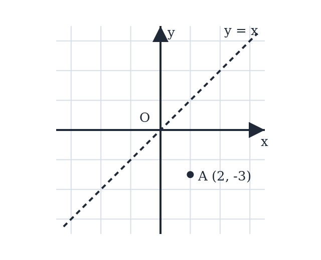

# The Coordinate Plane — Practice Set

**Bank code:** `COG-PLT` · **Section:** Coordinate Geometry · **30 questions** — Easy 11 · Medium 16 · Hard 3

**Lecture capsule:** [01-coordinate-plane.md](../../06-coordinate-geometry/01-coordinate-plane.md)

> Signs fix the quadrant; the axis you reflect across is the one that stays fixed; distance from an axis is an absolute value.

Every question below is live in the question bank under the ID shown — the sheet and the portal are the same questions. Attempt a level with the clock running, then check Part C.

---

## Part A — Questions

> **Quantitative Comparison — the four choices are always the same, so they are not reprinted:**
> **(A)** Quantity A is greater · **(B)** Quantity B is greater · **(C)** The two quantities are equal · **(D)** The relationship cannot be determined from the information given

### Level 1 · Easy — 11 questions · ~11 min

*warm-up — these must be automatic*

**Q1** · `COG-PLT-001` · MCQ · 40s

In which quadrant does the point (3, -5) lie?

**(A)** Quadrant I  
**(B)** Quadrant II  
**(C)** Quadrant III  
**(D)** Quadrant IV  
**(E)** On an axis

**Q2** · `COG-PLT-002` · MCQ · 45s

In the xy-plane, which of the following points lies on the y-axis?

**(A)** (3, 0)  
**(B)** (0, -7)  
**(C)** (-2, 5)  
**(D)** (1, 1)  
**(E)** (-4, 0)

**Q3** · `COG-PLT-003` · MCQ · 45s

Point P has coordinates (-4, 6). What is the distance of point P from the y-axis?

**(A)** 2  
**(B)** 4  
**(C)** 6  
**(D)** √52  
**(E)** 10

**Q4** · `COG-PLT-004` · Numeric Entry · 50s

Point Q lies 5 units to the left of the y-axis and 3 units above the x-axis. What is the x-coordinate of point Q?

*Numeric entry — write the number.*

**Q5** · `COG-PLT-006` · QC · 55s

Point A = (0, 5) and Point B = (5, 0).

> **Quantity A:**  The distance of point A from the x-axis
> **Quantity B:**  The distance of point B from the y-axis

**Q6** · `COG-PLT-007` · MCQ · 45s

A point P = (a, b) lies in Quadrant II. Which of the following must be true?

**(A)** a > 0 and b > 0  
**(B)** a < 0 and b < 0  
**(C)** a < 0 and b > 0  
**(D)** a > 0 and b < 0  
**(E)** a = 0 and b > 0

**Q7** · `COG-PLT-009` · MCQ · 60s

Point P = (3, 7) is reflected across the x-axis. What are the coordinates of the reflected point P'?

**(A)** (-3, 7)  
**(B)** (3, -7)  
**(C)** (-3, -7)  
**(D)** (7, 3)  
**(E)** (-7, -3)

**Q8** · `COG-PLT-011` · QC · 70s

Point P = (a, b) lies in Quadrant III.

> **Quantity A:**  a + b
> **Quantity B:**  0

**Q9** · `COG-PLT-013` · MCQ · 65s

Point R = (4, -3) is reflected across the origin. What are the coordinates of the reflected point R'?

**(A)** (4, 3)  
**(B)** (-4, -3)  
**(C)** (-4, 3)  
**(D)** (3, -4)  
**(E)** (-3, 4)

**Q10** · `COG-PLT-029` · QC · 110s

Points P = (a, b) and Q = (c, d) are both in Quadrant II, with a < c.

> **Quantity A:**  The distance of P from the y-axis
> **Quantity B:**  The distance of Q from the y-axis

**Q11** · `COG-PLT-KMF-007` · QC · 60s

In the xy-plane, the point (m, n) lies in the second quadrant and n = -4m.

> **Quantity A:**  m + n
> **Quantity B:**  mn

---

### Level 2 · Medium — 16 questions · ~22 min

*two or three steps, one planted trap each*

**Q12** · `COG-PLT-010` · MCQ · 65s

Point A = (-5, 2) is reflected across the y-axis to produce point B. In which quadrant does point B lie?

**(A)** Quadrant I  
**(B)** Quadrant II  
**(C)** Quadrant III  
**(D)** Quadrant IV  
**(E)** On an axis

**Q13** · `COG-PLT-012` · Select all that apply · 85s

Point P = (x, y) is in Quadrant II.

Which of the following statements must be true?

Indicate all such statements.

**(A)** xy < 0  
**(B)** x − y < 0  
**(C)** x² > 0  
**(D)** y/x < 0  
**(E)** |x| > |y|

**Q14** · `COG-PLT-014` · Numeric Entry · 75s

Point A = (-6, 4) and point B is the reflection of A across the y-axis. What is the distance between A and B?

*Numeric entry — write the number.*

**Q15** · `COG-PLT-015` · QC · 75s

Point P = (a, b) lies in Quadrant IV.

> **Quantity A:**  |a|
> **Quantity B:**  |b|

**Q16** · `COG-PLT-016` · MCQ · 70s

Two points P = (3, k) and Q = (3, -k) are symmetric about which of the following?

**(A)** The y-axis  
**(B)** The x-axis  
**(C)** The origin  
**(D)** The line y = x  
**(E)** The line y = 3

**Q17** · `COG-PLT-017` · Numeric Entry · 70s

A point P lies in Quadrant II. When P is reflected across the x-axis, the resulting point P' has coordinates (−4, −7). What is the y-coordinate of the original point P?

*Numeric entry — write the number.*

**Q18** · `COG-PLT-018` · Select all that apply · 80s

Which of the following points lie in a quadrant where the product of the coordinates (x × y) is negative? Select all that apply.

**(A)** (2, 5)  
**(B)** (-3, 7)  
**(C)** (-1, -8)  
**(D)** (4, -6)  
**(E)** (-9, -2)

**Q19** · `COG-PLT-023` · Numeric Entry · 90s

Point A = (−3, 5) is reflected across the x-axis to get point B. Point B is then reflected across the y-axis to get point C. What is the sum of the coordinates of point C?

*Numeric entry — write the number.*

**Q20** · `COG-PLT-026` · Numeric Entry · 90s

Points A = (2, 5) and B = (−2, 5) are both reflected across the origin to produce points A' and B' respectively. What is the distance between A' and B'?

*Numeric entry — write the number.*

**Q21** · `COG-PLT-027` · MCQ · 100s

Point P = (m, n) is in Quadrant II. After reflecting P across the y-axis, then reflecting the result across the x-axis, the final point P'' is in which quadrant?

**(A)** Quadrant I  
**(B)** Quadrant II  
**(C)** Quadrant III  
**(D)** Quadrant IV  
**(E)** On an axis

**Q22** · `COG-PLT-KMF-005` · MCQ · 75s

The point (p + 2, q - 3) lies in Quadrant II of the xy-plane. (A point on an axis belongs to no quadrant.) Which pair of conditions describes every possible choice of p and q?

**(A)** p < -2 and q > 3  
**(B)** p < 2 and q > -3  
**(C)** p < -2 and q > -3  
**(D)** p < -3 and q > 2  
**(E)** p > -2 and q < 3

**Q23** · `COG-PLT-KMF2-001` · MCQ · 80s

The figure above shows five points in the xy-plane. How many of them lie below the line y = 2x - 1?

**(A)** One  
**(B)** Two  
**(C)** Three  
**(D)** Four  
**(E)** Five

**Q24** · `COG-PLT-KMF2-002` · Select all that apply · 90s

A triangular plot of land is represented in the xy-plane by the set of points for which x > 0, y > 0, and 5x + 2y < 40. Which of the following points represent locations inside the plot?

Indicate all such points.

**(A)** (1, 18)  
**(B)** (2, 14)  
**(C)** (4, 9)  
**(D)** (6, 5)  
**(E)** (7, 3)

**Q25** · `SEC-CG-004` · Select all that apply · 100s

In the xy-plane, the point (a, b) lies in Quadrant III, as shown.

Which of the following points must lie in Quadrant I?

Indicate all such points.

**(A)** (-a, -b)  
**(B)** (a, -b)  
**(C)** (-b, -a)  
**(D)** (b, a)  
**(E)** (ab, -a)  
F. (-a, b)

**Q26** · `SEC-CG-015` · QC · 85s

In the xy-plane, the point (c, d) lies below the x-axis and to the left of the y-axis, and c = 3d.

> **Quantity A:**  c
> **Quantity B:**  d

**Q27** · `SEC-CG-037` · MCQ · 95s

The figure shows segment PR in the xy-plane. PR is parallel to the y-axis and crosses the x-axis at point Q. Point P is (h, k), where h < 0 and k > 0. If the length of QR is one third the length of PQ, what are the coordinates of R in terms of h and k?

Note: Figure not drawn to scale.

**(A)** (h, -k/3)  
**(B)** (-h, k/3)  
**(C)** (h/3, -k)  
**(D)** (h, k/3)  
**(E)** (-h/3, -k)

---

### Level 3 · Hard — 3 questions · ~5 min

*where 162+ is won or lost*

**Q28** · `COG-PLT-022` · Select all that apply · 100s

Point P = (a, b) satisfies the condition ab > 0. Point Q = (-a, b).

Which of the following statements must be true?

Indicate all such statements.

**(A)** Point Q is in the quadrant diagonally opposite to point P  
**(B)** P and Q are symmetric about the y-axis  
**(C)** The product of Q's coordinates is negative  
**(D)** Q cannot lie on any axis  
**(E)** P and Q have the same distance from the x-axis

**Q29** · `COG-PLT-KMF-006` · MCQ · 110s

In the xy-plane, quadrilateral OBCD has vertices O(0, 0), B(10, 0), C(7, 6) and D(0, 4). How many square units does the region enclosed by OBCD cover?

**(A)** 30  
**(B)** 44  
**(C)** 51  
**(D)** 53  
**(E)** 60

**Q30** · `SEC-CG-008` · Numeric Entry · 115s

In the xy-plane, point A is (2, -3), as shown. A is first reflected across the line y = x, and the resulting point is then translated 5 units to the right and 4 units up. How many units apart are A and the final image?

*Numeric entry — write the number.*

---

## Part B — Answer Key

| Q | ID | Level | Type | Answer |
|---|---|---|---|---|
| 1 | `COG-PLT-001` | easy | MCQ | **D** |
| 2 | `COG-PLT-002` | easy | MCQ | **B** |
| 3 | `COG-PLT-003` | easy | MCQ | **B** |
| 4 | `COG-PLT-004` | easy | Numeric Entry | **-5** |
| 5 | `COG-PLT-006` | easy | QC | **C** |
| 6 | `COG-PLT-007` | easy | MCQ | **C** |
| 7 | `COG-PLT-009` | easy | MCQ | **B** |
| 8 | `COG-PLT-011` | easy | QC | **B** |
| 9 | `COG-PLT-013` | easy | MCQ | **C** |
| 10 | `COG-PLT-029` | easy | QC | **A** |
| 11 | `COG-PLT-KMF-007` | easy | QC | **A** |
| 12 | `COG-PLT-010` | medium | MCQ | **A** |
| 13 | `COG-PLT-012` | medium | Select all that apply | **A, B, C, D** |
| 14 | `COG-PLT-014` | medium | Numeric Entry | **12** |
| 15 | `COG-PLT-015` | medium | QC | **D** |
| 16 | `COG-PLT-016` | medium | MCQ | **B** |
| 17 | `COG-PLT-017` | medium | Numeric Entry | **7** |
| 18 | `COG-PLT-018` | medium | Select all that apply | **B, D** |
| 19 | `COG-PLT-023` | medium | Numeric Entry | **-2** |
| 20 | `COG-PLT-026` | medium | Numeric Entry | **4** |
| 21 | `COG-PLT-027` | medium | MCQ | **D** |
| 22 | `COG-PLT-KMF-005` | medium | MCQ | **A** |
| 23 | `COG-PLT-KMF2-001` | medium | MCQ | **B** |
| 24 | `COG-PLT-KMF2-002` | medium | Select all that apply | **B, C** |
| 25 | `SEC-CG-004` | medium | Select all that apply | **A, C, E** |
| 26 | `SEC-CG-015` | medium | QC | **B** |
| 27 | `SEC-CG-037` | medium | MCQ | **A** |
| 28 | `COG-PLT-022` | hard | Select all that apply | **B, C, D, E** |
| 29 | `COG-PLT-KMF-006` | hard | MCQ | **B** |
| 30 | `SEC-CG-008` | hard | Numeric Entry | **9** |

---

## Part C — Worked Solutions

### Q1 · `COG-PLT-001` — Answer: D

A point (x, y) lies in Quadrant IV when x > 0 and y < 0. Here x = 3 > 0 and y = -5 < 0, so the point is in Quadrant IV.

**Trap.** Students confuse which sign combination goes with which quadrant. Q4 is (+, -) — positive x, negative y. Students may incorrectly choose Q3 thinking any negative value means Q3.

### Q2 · `COG-PLT-002` — Answer: B

A point lies on the y-axis when its x-coordinate is 0. Only (0, -7) has x = 0, so it lies on the y-axis. (3, 0) and (-4, 0) both have y = 0, placing them on the x-axis instead.

**Trap.** Students confuse the axes: a point is on the y-axis when x = 0 (not y = 0). Choices A and E have y = 0, placing them on the x-axis — a very common reversal error.

### Q3 · `COG-PLT-003` — Answer: B

The distance from a point to the y-axis equals the absolute value of its x-coordinate: |x| = |-4| = 4.

**Trap.** Students use |y| = 6 instead of |x| = 4, confusing which coordinate gives the distance to each axis. Distance to the y-axis = |x|; distance to the x-axis = |y|.

### Q4 · `COG-PLT-004` — Answer: -5

'5 units to the left of the y-axis' means x = -5 (moving left from the y-axis gives a negative x-value). '3 units above the x-axis' means y = 3. So Q = (-5, 3) and the x-coordinate is -5.

**Trap.** Students write x = 5 (positive) forgetting that leftward movement gives a negative x-coordinate. 'Left of the y-axis' always means x < 0.

### Q5 · `COG-PLT-006` — Answer: C

Distance of A from the x-axis = |y-coordinate of A| = |5| = 5. Distance of B from the y-axis = |x-coordinate of B| = |5| = 5. Both quantities equal 5.

**Trap.** Students mix up the rules: distance from x-axis uses the y-coordinate, and distance from y-axis uses the x-coordinate. Students who swap these rules would compute distance of A from x-axis as |0| = 0 and declare Quantity B greater.

### Q6 · `COG-PLT-007` — Answer: C

Quadrant II is defined as the region where x < 0 and y > 0 (upper-left region). Therefore a < 0 and b > 0.

**Trap.** Students often confuse Q2 with Q3. Q3 has both coordinates negative (a < 0, b < 0). Q2 has negative x but positive y. A helpful mnemonic: going counterclockwise from Q1 (+,+), Q2 is (-,+), Q3 is (-,-), Q4 is (+,-).

### Q7 · `COG-PLT-009` — Answer: B

Reflecting a point across the x-axis negates the y-coordinate while leaving x unchanged. P = (3, 7) → P' = (3, -7).

**Trap.** Students negate the x-coordinate instead of the y-coordinate. Reflection across the x-axis changes y (the vertical component) because the x-axis is the horizontal mirror. The rule: (x, y) → (x, -y).

### Q8 · `COG-PLT-011` — Answer: B

In Quadrant III, both a < 0 and b < 0. The sum of two negative numbers is always negative, so a + b < 0. Quantity B (= 0) is always greater than a + b.

**Trap.** Students may think the answer is D because they do not know the specific values of a and b. However, the constraint 'Quadrant III' fixes both signs: both a and b are negative, guaranteeing their sum is negative.

### Q9 · `COG-PLT-013` — Answer: C

Reflecting across the origin negates both coordinates: (x, y) → (-x, -y). So R = (4, -3) → R' = (-4, 3).

**Trap.** Students only negate one coordinate. Reflecting across the origin is equivalent to reflecting across both axes sequentially. Neither a reflection across the x-axis (which gives (4, 3)) nor across the y-axis alone (which gives (-4, -3)) is correct — both must be negated.

### Q10 · `COG-PLT-029` — Answer: A

Both a and c are negative with a < c, so a is farther from 0: |a| > |c|. Distance from the y-axis is |a| for P and |c| for Q. Example: a = -5, c = -2 gives 5 > 2. Quantity A is greater.

**Trap.** Students read a < c as 'a is smaller' and conclude P is closer to the y-axis, choosing B; or choose D because the y-coordinates are unknown.

### Q11 · `COG-PLT-KMF-007` — Answer: A

1. The second quadrant has m < 0 and n > 0, which is consistent with n = -4m.
2. Quantity A: m + n = m - 4m = -3m, which is positive because m < 0.
3. Quantity B: mn = m(-4m) = -4m^2, which is negative because m is not zero.
4. A positive number exceeds a negative one, so Quantity A is greater for every allowed m.
Check with (m, n) = (-1, 4): m + n = 3 and mn = -4.

**Trap.** Ignoring signs and comparing sizes (4m^2 against 3m, for example 4 against 3 at m = -1) makes Quantity B look larger, choice B.

### Q12 · `COG-PLT-010` — Answer: A

Reflecting across the y-axis negates the x-coordinate: A = (-5, 2) → B = (5, 2). Since x = 5 > 0 and y = 2 > 0, point B lies in Quadrant I.

**Trap.** Students negate the y-coordinate instead of the x-coordinate (confusing reflection across y-axis with reflection across x-axis). Reflection across the y-axis: (x, y) → (-x, y). This gives B = (5, 2) in Q1, not (-5, -2) in Q3.

### Q13 · `COG-PLT-012` — Answer: A, B, C, D

In Quadrant II, x < 0 and y > 0.
A. xy = (negative)(positive) < 0. True.
B. x − y = (negative) − (positive) = (negative) + (negative) < 0. True.
C. x² > 0 for any nonzero x, and x ≠ 0 in Quadrant II. True.
D. y/x = (positive)/(negative) < 0. True.
E. |x| > |y| is not necessarily true: x = −1, y = 10 gives |x| = 1 < 10 = |y|. False.

**Trap.** Students often select E, thinking that being in Quadrant II constrains the magnitudes of x and y. It does not. Some also reject B, confusing x − y with x + y, whose sign depends on which of x and y is larger in magnitude.

### Q14 · `COG-PLT-014` — Answer: 12

Reflecting A = (-6, 4) across the y-axis gives B = (6, 4). Since both points have the same y-coordinate, the distance is simply the difference in x-coordinates: |6 - (-6)| = |12| = 12.

**Trap.** Students may try to apply the full distance formula and make arithmetic errors, or may compute the distance as |6 - (-6)|/2 = 6 (the distance from each point to the y-axis, not the distance between the two points). The full distance between A and B is 12, not 6.

### Q15 · `COG-PLT-015` — Answer: D

In Q4: a > 0 and b < 0. We know |a| > 0 and |b| > 0, but their relative sizes are unconstrained. Example 1: P = (3, -5) → |a| = 3 < 5 = |b|, so Quantity B is greater. Example 2: P = (5, -3) → |a| = 5 > 3 = |b|, so Quantity A is greater. The relationship cannot be determined.

**Trap.** Students may assume that because the point is in Q4, the x-coordinate must be larger in magnitude than the y-coordinate. This is false — Q4 only constrains the signs, not the magnitudes.

### Q16 · `COG-PLT-016` — Answer: B

P = (3, k) and Q = (3, -k) share the same x-coordinate (x = 3) and have y-coordinates that are negatives of each other. This means they are mirror images across the x-axis, which is the line y = 0. Reflecting (3, k) across the x-axis gives (3, -k) = Q.

**Trap.** Students may confuse this with symmetry about the y-axis (which would require x-coordinates to be negated, giving (-3, k)) or the origin (which would give (-3, -k)). The key signal is: same x, negated y → symmetric about x-axis.

### Q17 · `COG-PLT-017` — Answer: 7

Reflection across the x-axis transforms (x, y) → (x, -y). So if P' = (-4, -7), then P must have been (-4, 7). The y-coordinate of P is 7. Verification: P = (-4, 7) is in Q2 (x < 0, y > 0). ✓

**Trap.** Students may directly use the y-coordinate of P' as the answer (-7) without reversing the reflection. To find the original point, you must reverse the transformation: if P' = (x, -y), then P = (x, y), so the original y is the negation of P's y-coordinate.

### Q18 · `COG-PLT-018` — Answer: B, D

The product x × y is negative when x and y have opposite signs (one positive, one negative). This occurs in Q2 and Q4.
A. (2, 5): both positive → product = 10 > 0. No.
B. (-3, 7): Q2, opposite signs → product = -21 < 0. Yes.
C. (-1, -8): Q3, both negative → product = 8 > 0. No.
D. (4, -6): Q4, opposite signs → product = -24 < 0. Yes.
E. (-9, -2): Q3, both negative → product = 18 > 0. No.

**Trap.** Students may include Q3 points like C and E, reasoning that 'negative coordinates' mean the product is negative. But negative × negative = positive. Only points in Q2 and Q4 give a negative product.

### Q19 · `COG-PLT-023` — Answer: -2

Step 1: Reflect A = (-3, 5) across the x-axis → negate y: B = (-3, -5).
Step 2: Reflect B = (-3, -5) across the y-axis → negate x: C = (3, -5).
Step 3: Sum of C's coordinates = 3 + (-5) = -2.

**Trap.** Students commonly mix up which coordinate is negated in each reflection. Reflection across x-axis negates y (not x); reflection across y-axis negates x (not y). A student who reverses these rules would compute B = (3, 5) and C = (-3, 5), giving sum = 2 (the wrong-sign version of the answer).

### Q20 · `COG-PLT-026` — Answer: 4

Reflecting across the origin: (x, y) → (-x, -y).
A = (2, 5) → A' = (-2, -5).
B = (-2, 5) → B' = (2, -5).
Distance between A' = (-2, -5) and B' = (2, -5):
Since both have y = -5, distance = |2 - (-2)| = |4| = 4.

**Trap.** Students may compute the distance between the original points A and B (which is also 4, making it a plausible decoy that happens to be correct here — but students should verify). A more dangerous trap: students compute the distance between A and A' or B and B' instead of between A' and B'. Also, some students apply only one coordinate negation in the reflection.

### Q21 · `COG-PLT-027` — Answer: D

P is in Q2: m < 0, n > 0.
Step 1 — Reflect across y-axis (negate x): (m, n) → (-m, n). Since m < 0, -m > 0 and n > 0. Intermediate point (-m, n) is in Q1.
Step 2 — Reflect across x-axis (negate y): (-m, n) → (-m, -n). Since -m > 0 and -n < 0, P'' is in Q4.
Verification: P = (-3, 5) → after y-axis reflection: (3, 5) in Q1 → after x-axis reflection: (3, -5) in Q4. ✓

**Trap.** Students may confuse the two-step reflection with a single reflection across the origin (which goes from Q2 to Q4 — same result here! But the process differs). The dangerous error is mixing up which coordinate is negated at each step: reflecting across the y-axis negates x, and reflecting across the x-axis negates y — not the other way around.

### Q22 · `COG-PLT-KMF-005` — Answer: A

Quadrant II means the x-coordinate is negative and the y-coordinate is positive (strictly).
x-coordinate: p + 2 < 0, so p < -2.
y-coordinate: q - 3 > 0, so q > 3.
So the condition is p < -2 and q > 3.
Check: p = -3, q = 4 gives (-1, 1), which is in Quadrant II; p = -2 gives x = 0, on the axis, so it is excluded.

**Trap.** Moving each coordinate the wrong way (p < 2 and q > -3) is option B; confusing the quadrant with Quadrant IV gives option E.

### Q23 · `COG-PLT-KMF2-001` — Answer: B

Read each point off the grid and substitute into y < 2x - 1.
J(-2, 1): is 1 < 2(-2) - 1 = -5? No.
K(1, 3): is 3 < 2(1) - 1 = 1? No.
L(3, 2): is 2 < 2(3) - 1 = 5? Yes.
M(0, -3): is -3 < 2(0) - 1 = -1? Yes.
N(-1, 2): is 2 < 2(-1) - 1 = -3? No.
Two of the five points satisfy the inequality.

**Trap.** M(0, -3) is the point most often missed. It sits below the x-axis, where both sides of the inequality are negative, and -3 < -1 is true even though the point looks far from the line.

### Q24 · `COG-PLT-KMF2-002` — Answer: B, C

A point is inside the plot when all three conditions hold strictly: x > 0, y > 0, and 5x + 2y < 40. Every listed point has positive coordinates, so only the third condition has to be checked.
A. 5(1) + 2(18) = 41, which is more than 40. Outside.
B. 5(2) + 2(14) = 38, less than 40. Inside.
C. 5(4) + 2(9) = 38, less than 40. Inside.
D. 5(6) + 2(5) = 40, exactly 40. On the boundary, not inside.
E. 5(7) + 2(3) = 41, more than 40. Outside.

**Trap.** Point (6, 5) gives exactly 40, so it lies on the line 5x + 2y = 40 itself. That line is the edge of the plot, and the condition is 5x + 2y < 40, not 5x + 2y is at most 40, so a point on the edge is not inside.

### Q25 · `SEC-CG-004` — Answer: A, C, E

Quadrant III means a < 0 and b < 0, and Quadrant I requires both coordinates positive. Option A, (-a, -b), negates two negatives and gives a positive pair, so it qualifies. Option C, (-b, -a), does the same with the order swapped, so it qualifies too. Option E, (ab, -a), has ab positive because it is the product of two negatives, and -a positive because a is negative, so it qualifies. Option B, (a, -b), is (negative, positive), which is Quadrant II; option D, (b, a), is still (negative, negative), Quadrant III; and option F, (-a, b), is (positive, negative), Quadrant IV.

**Trap.** Option D tempts students because swapping the coordinates of a point often moves it somewhere new. Swapping cannot change either sign, so a Quadrant III point stays in Quadrant III no matter which coordinate is written first.

### Q26 · `SEC-CG-015` — Answer: B

Lying below the x-axis makes d negative, and lying left of the y-axis makes c negative. Since c = 3d and d is negative, tripling d pushes it further from zero in the negative direction: if d = -2 then c = -6, and if d = -0.5 then c = -1.5. In every case c is more negative than d, so d is the greater of the two and Quantity B wins.

**Trap.** Students see the multiplier 3 and conclude c must be the larger, choosing A. Multiplying by 3 enlarges a positive number but shrinks a negative one, because it moves the value further left on the number line.

### Q27 · `SEC-CG-037` — Answer: A

Since PR is parallel to the y-axis, every point on it shares P's x-coordinate h, and Q, being on the x-axis, is (h, 0). The length PQ is the vertical gap from k down to 0, which is k. So QR = k/3. Point R lies on the far side of the x-axis from P, which is below it, so R sits k/3 units below the axis at (h, -k/3).

**Trap.** Students compute the length k/3 correctly but write R as (h, k/3), option D, forgetting the sign. R is below the x-axis, so its y-coordinate must be negative.

### Q28 · `COG-PLT-022` — Answer: B, C, D, E

Since ab > 0, P is in Q1 (a>0, b>0) or Q3 (a<0, b<0). Q = (-a, b).
A. 'Diagonally opposite' means reflection across the origin, which would be (-a, -b). Q = (-a, b) ≠ (-a, -b), so A is false.
B. P = (a, b) and Q = (-a, b) differ only in the sign of x, so they are reflections across the y-axis. True.
C. Product of Q's coordinates = (-a)(b) = -ab. Since ab > 0, -ab < 0. True.
D. Since ab > 0, both a ≠ 0 and b ≠ 0. So Q = (-a, b) also has -a ≠ 0 and b ≠ 0, meaning Q is not on any axis. True.
E. Distance from x-axis = |y-coordinate|. For P: |b|. For Q: |b|. Same. True.

**Trap.** Students often select A, thinking 'opposite quadrant' means reflection across the y-axis. The diagonally opposite quadrant requires negating both coordinates (origin reflection), not just x. Also, students may miss that ab > 0 guarantees both a and b are nonzero, which is needed for D.

### Q29 · `COG-PLT-KMF-006` — Answer: B

Split along diagonal OC into triangle OBC and triangle OCD.
Triangle OBC: base OB = 10 on the x-axis, height = y-coordinate of C = 6, area = (1/2)*10*6 = 30.
Triangle OCD: base OD = 4 on the y-axis, height = x-coordinate of C = 7, area = (1/2)*4*7 = 14.
Total = 30 + 14 = 44.
Check with the shoelace sum: (0*0 - 10*0) + (10*6 - 7*0) + (7*4 - 0*6) + (0*0 - 0*4) = 0 + 60 + 28 + 0 = 88, and 88/2 = 44.

**Trap.** Subtracting only the right-hand corner triangle (area 9) from the 10-by-6 bounding box gives 51 (choice C); counting only triangle OBC gives 30 (choice A).

### Q30 · `SEC-CG-008` — Answer: 9

Reflecting a point across the line y = x swaps its coordinates, so (2, -3) becomes (-3, 2). Translating 5 right and 4 up adds 5 to the x-coordinate and 4 to the y-coordinate, giving (-3 + 5, 2 + 4) = (2, 6). The original point (2, -3) and the image (2, 6) share the same x-coordinate, so the distance between them is just the vertical gap, 6 - (-3) = 9.

**Trap.** Students reflect across y = x by negating both coordinates, getting (-2, 3), then (3, 7), and report sqrt(101). Reflection in y = x swaps x and y; it is a 180-degree rotation about the origin that negates them.
