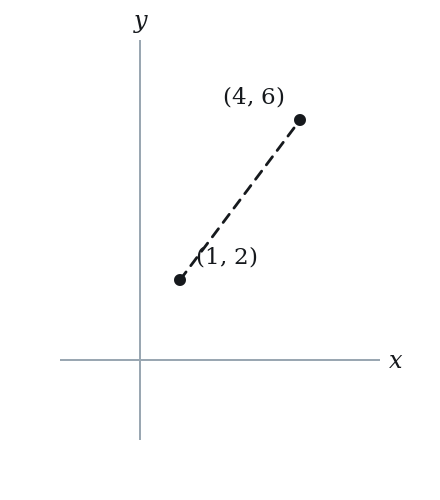
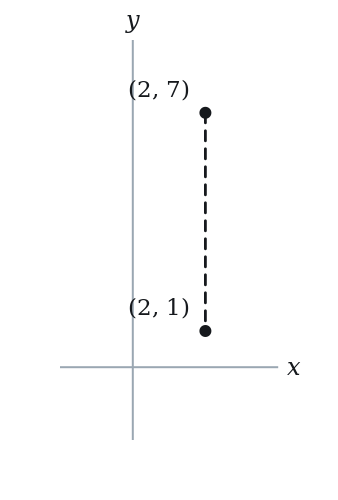
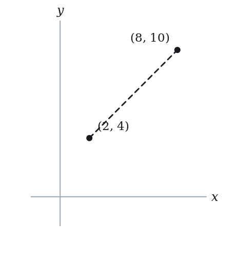
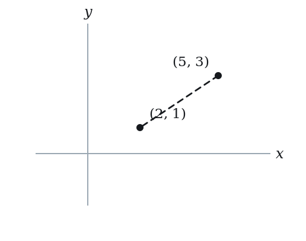
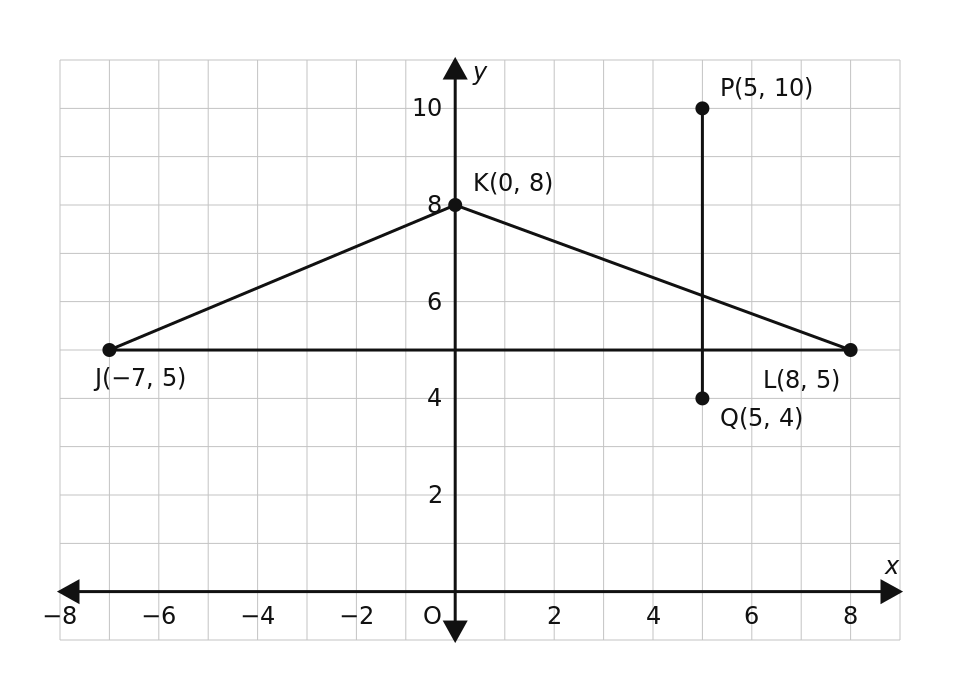
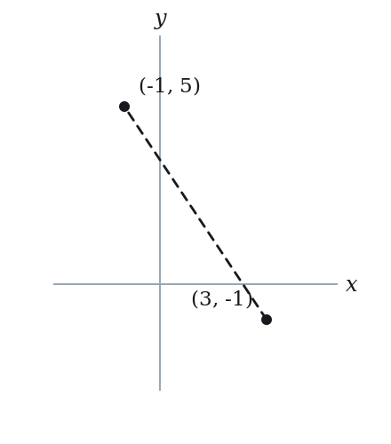
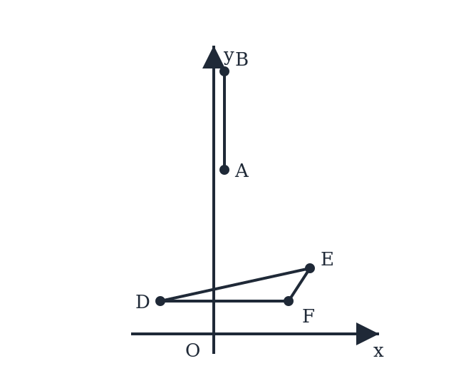
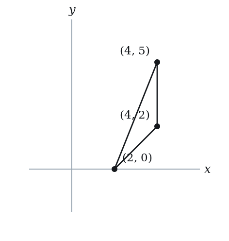

# Distance & Midpoint — Practice Set

**Bank code:** `COG-DST` · **Section:** Coordinate Geometry · **30 questions** — Easy 9 · Medium 14 · Hard 7

**Lecture capsule:** [02-distance-midpoint.md](../../06-coordinate-geometry/02-distance-midpoint.md)

> Distance is the Pythagorean theorem in disguise; the midpoint is the average of the coordinates, so a midpoint plus one endpoint pins the other.

Every question below is live in the question bank under the ID shown — the sheet and the portal are the same questions. Attempt a level with the clock running, then check Part C.

---

## Part A — Questions

> **Quantitative Comparison — the four choices are always the same, so they are not reprinted:**
> **(A)** Quantity A is greater · **(B)** Quantity B is greater · **(C)** The two quantities are equal · **(D)** The relationship cannot be determined from the information given

### Level 1 · Easy — 9 questions · ~7 min

*warm-up — these must be automatic*

**Q1** · `COG-DST-001` · MCQ · 45s

What is the distance between points (1, 2) and (4, 6)?

**(A)** 3  
**(B)** 4  
**(C)** 5  
**(D)** 7  
**(E)** 25

**Q2** · `COG-DST-003` · MCQ · 40s

What is the distance from the point (6, 8) to the origin (0, 0)?

**(A)** 7  
**(B)** 10  
**(C)** 12  
**(D)** 14  
**(E)** 100

**Q3** · `COG-DST-005` · MCQ · 35s

What is the distance between points (2, 7) and (2, 1)?

**(A)** 0  
**(B)** 3  
**(C)** 5  
**(D)** 6  
**(E)** 8

**Q4** · `COG-DST-006` · QC · 45s

Point A is at (0, 0) and point B is at (5, 12).

> **Quantity A:**  The distance from A to B
> **Quantity B:**  13

**Q5** · `COG-MID-001` · MCQ · 45s

What is the midpoint of the segment with endpoints (2, 4) and (8, 10)?

**(A)** (3, 5)  
**(B)** (4, 6)  
**(C)** (5, 7)  
**(D)** (6, 7)  
**(E)** (10, 14)

**Q6** · `COG-MID-004` · MCQ · 55s

The midpoint of a segment is (5, 3). One endpoint is (2, 1). What is the other endpoint?

**(A)** (3, 2)  
**(B)** (7, 4)  
**(C)** (7, 5)  
**(D)** (8, 5)  
**(E)** (12, 7)

**Q7** · `COG-MID-005` · QC · 40s

The endpoints of a segment are A = (1, 2) and B = (7, 2).

> **Quantity A:**  The x-coordinate of the midpoint of AB
> **Quantity B:**  4

**Q8** · `COG-MID-008` · Select all that apply · 75s

Which of the following pairs of endpoints produce a midpoint of (2, 6)? Select all that apply.

**(A)** (0, 4) and (4, 8)  
**(B)** (-2, 2) and (6, 10)  
**(C)** (1, 5) and (3, 7)  
**(D)** (2, 6) and (4, 8)  
**(E)** (0, 0) and (4, 12)

**Q9** · `COG-MID-019` · Numeric Entry · 65s

The midpoint of segment PQ is (0, 0). If P = (a, -6) and Q = (4, b), what is the value of a?

*Numeric entry — write the number.*

---

### Level 2 · Medium — 14 questions · ~19 min

*two or three steps, one planted trap each*

**Q10** · `COG-DST-011` · MCQ · 75s

Point A is at (2, 3) and point B is at (x, 7). If the distance AB = 5, which of the following could be a value of x?

**(A)** −1  
**(B)** 2  
**(C)** 3  
**(D)** 6  
**(E)** 7

**Q11** · `COG-DST-013` · QC · 65s

Point A is at (0, 0), point B is at (3, 4), and point C is at (6, 0).

> **Quantity A:**  The distance from A to B
> **Quantity B:**  The distance from B to C

**Q12** · `COG-DST-015` · Select all that apply · 85s

Which of the following points are exactly 10 units from the origin? Select all that apply.

**(A)** (6, 8)  
**(B)** (5, 5)  
**(C)** (−8, 6)  
**(D)** (10, 0)  
**(E)** (1, 9)

**Q13** · `COG-DST-016` · Numeric Entry · 75s

The distance between points (k, 3) and (1, 7) is 5. If k > 1, what is the value of k?

*Numeric entry — write the number.*

**Q14** · `COG-DST-024` · MCQ · 80s

A circle is centered at the origin with radius 10. Which of the following points does NOT lie on the circle?

**(A)** (6, 8)  
**(B)** (−10, 0)  
**(C)** (7, 7)  
**(D)** (0, −10)  
**(E)** (−8, −6)

**Q15** · `COG-DST-KMF2-002` · Numeric Entry · 90s

The figure above shows line segment PQ and triangle JKL in the xy-plane. Of the six segments that join an endpoint of PQ to a vertex of triangle JKL, what is the length of the longest?

*Numeric entry — write the number.*

**Q16** · `COG-MID-011` · MCQ · 80s

The midpoint of segment AB is M = (3, -1). If A = (-1, 5), what is the distance from M to B?

**(A)** 2√5  
**(B)** √40  
**(C)** 3√5  
**(D)** √52  
**(E)** 4√5

**Q17** · `COG-MID-013` · QC · 60s

Points A = (-3, 5) and B = (7, -1).

> **Quantity A:**  The x-coordinate of the midpoint of AB
> **Quantity B:**  The y-coordinate of the midpoint of AB

**Q18** · `COG-MID-017` · Select all that apply · 90s

The midpoint of segment AB is M = (2, 3). Which of the following could be the coordinates of A and B? Select all that apply.

**(A)** A = (0, 0) and B = (4, 6)  
**(B)** A = (1, 1) and B = (3, 5)  
**(C)** A = (-2, 4) and B = (6, 2)  
**(D)** A = (2, 3) and B = (4, 5)  
**(E)** A = (5, 0) and B = (-1, 6)

**Q19** · `COG-MID-018` · MCQ · 85s

M = (5, 4) is the midpoint of segment AB, where A = (2k, k) and B = (4, k + 2). What is the value of k?

**(A)** 2  
**(B)** 3  
**(C)** 4  
**(D)** 5  
**(E)** 6

**Q20** · `COG-MID-KMF-001` · MCQ · 75s

Parallelogram PQRS has consecutive vertices P at (-2, 3), Q at (4, -1), and R at (10, 5). What is the sum of the x-coordinate and y-coordinate of the fourth vertex S?

**(A)** -11  
**(B)** 4  
**(C)** 8  
**(D)** 13  
**(E)** 17

**Q21** · `SEC-CG-003` · Numeric Entry · 80s

In the xy-plane, M(1, -4) is the midpoint of segment PQ. If P is the point (-5, 2), what is the sum of the coordinates of Q?

*Numeric entry — write the number.*

**Q22** · `SEC-CG-029` · MCQ · 95s

In the xy-plane, circle C is centered at (0, 5) and passes through the point (3, 1). What is the area of circle C?

**(A)** 5 pi  
**(B)** 9 pi  
**(C)** 16 pi  
**(D)** 25 pi  
**(E)** 34 pi

**Q23** · `SEC-CG-034` · Select all that apply · 110s

The figure shows segment AB in the xy-plane, with A(1, 10) and B(1, 16), together with triangle DEF, whose vertices are D(-5, 2), E(9, 4) and F(7, 2).

Which of the following segments have length 10?

Indicate all such segments.

Note: Figure not drawn to scale.

**(A)** AD  
**(B)** AE  
**(C)** AF  
**(D)** BD  
**(E)** BE  
F. BF

---

### Level 3 · Hard — 7 questions · ~13 min

*where 162+ is won or lost*

**Q24** · `COG-DST-035` · QC · 110s

In the xy-plane, B = (4, 3) and C is a point on the y-axis such that BC = 5.

> **Quantity A:**  The y-coordinate of C
> **Quantity B:**  7

**Q25** · `COG-DST-036` · Select all that apply · 120s

Which of the following sets of three points form a right triangle? Select all that apply.

**(A)** (0,0), (3,4), (4,3)  
**(B)** (0,0), (5,0), (0,12)  
**(C)** (1,1), (4,5), (8,2)  
**(D)** (0,0), (6,0), (0,8)  
**(E)** (2,2), (5,6), (9,3)

**Q26** · `COG-DST-039` · QC · 125s

Point P = (a, b) is in the first quadrant (a > 0, b > 0) and satisfies a + b = 10.

> **Quantity A:**  The distance from P to the origin
> **Quantity B:**  5√2

**Q27** · `COG-DST-KMF2-003` · QC · 100s

In the xy-plane, the point (x, y) lies above the line x + y = 1.

> **Quantity A:**  x^2 + y^2
> **Quantity B:**  1

**Q28** · `COG-MID-034` · MCQ · 100s

The midpoint of AB is M = (3, 4). The distance from A to B is 10, and A lies on the x-axis. What is the y-coordinate of B?

**(A)** 6  
**(B)** 7  
**(C)** 8  
**(D)** 9  
**(E)** 10

**Q29** · `COG-MID-035` · Numeric Entry · 110s

Points E, F, G, H are the midpoints of sides AB, BC, CD, and DA respectively of rectangle ABCD, where A = (0, 0), B = (8, 0), C = (8, 6), and D = (0, 6). What is the perimeter of quadrilateral EFGH?

*Numeric entry — write the number.*

**Q30** · `COG-MID-040` · Select all that apply · 130s

In the xy-plane, D = (4, 2), E = (4, 5) and F = (2, 0) are the midpoints of sides BC, AC and AB, respectively, of triangle ABC. Which of the following are the coordinates of a vertex of triangle ABC? Select all that apply.

**(A)** A = (2, 3)  
**(B)** B = (0, -1)  
**(C)** B = (2, -3)  
**(D)** C = (6, 7)  
**(E)** A = (6, 7)

---

## Part B — Answer Key

| Q | ID | Level | Type | Answer |
|---|---|---|---|---|
| 1 | `COG-DST-001` | easy | MCQ | **C** |
| 2 | `COG-DST-003` | easy | MCQ | **B** |
| 3 | `COG-DST-005` | easy | MCQ | **D** |
| 4 | `COG-DST-006` | easy | QC | **C** |
| 5 | `COG-MID-001` | easy | MCQ | **C** |
| 6 | `COG-MID-004` | easy | MCQ | **D** |
| 7 | `COG-MID-005` | easy | QC | **C** |
| 8 | `COG-MID-008` | easy | Select all that apply | **A, B, C, E** |
| 9 | `COG-MID-019` | easy | Numeric Entry | **-4** |
| 10 | `COG-DST-011` | medium | MCQ | **A** |
| 11 | `COG-DST-013` | medium | QC | **C** |
| 12 | `COG-DST-015` | medium | Select all that apply | **A, C, D** |
| 13 | `COG-DST-016` | medium | Numeric Entry | **4** |
| 14 | `COG-DST-024` | medium | MCQ | **C** |
| 15 | `COG-DST-KMF2-002` | medium | Numeric Entry | **13** |
| 16 | `COG-MID-011` | medium | MCQ | **D** |
| 17 | `COG-MID-013` | medium | QC | **C** |
| 18 | `COG-MID-017` | medium | Select all that apply | **A, B, C, E** |
| 19 | `COG-MID-018` | medium | MCQ | **B** |
| 20 | `COG-MID-KMF-001` | medium | MCQ | **D** |
| 21 | `SEC-CG-003` | medium | Numeric Entry | **-3** |
| 22 | `SEC-CG-029` | medium | MCQ | **D** |
| 23 | `SEC-CG-034` | medium | Select all that apply | **A, B, C** |
| 24 | `COG-DST-035` | hard | QC | **B** |
| 25 | `COG-DST-036` | hard | Select all that apply | **B, C, D, E** |
| 26 | `COG-DST-039` | hard | QC | **D** |
| 27 | `COG-DST-KMF2-003` | hard | QC | **D** |
| 28 | `COG-MID-034` | hard | MCQ | **C** |
| 29 | `COG-MID-035` | hard | Numeric Entry | **20** |
| 30 | `COG-MID-040` | hard | Select all that apply | **A, C, D** |

---

## Part C — Worked Solutions

### Q1 · `COG-DST-001` — Answer: C

Use the distance formula: d = √((x2−x1)² + (y2−y1)²). Substitute: d = √((4−1)² + (6−2)²) = √(3² + 4²) = √(9 + 16) = √25 = 5.

**Trap.** Students add the differences without squaring: |4−1| + |6−2| = 3 + 4 = 7 (Manhattan distance, not Euclidean). The correct formula requires squaring each difference first.

### Q2 · `COG-DST-003` — Answer: B

Distance from origin = √(x² + y²) = √(6² + 8²) = √(36 + 64) = √100 = 10. This is a 6-8-10 right triangle (a scaled 3-4-5 triple).

**Trap.** Students add instead of using the formula: 6 + 8 = 14. The distance formula requires squaring both coordinates, adding, then taking the square root.

### Q3 · `COG-DST-005` — Answer: D

Both points have the same x-coordinate (x = 2), so this is a vertical distance. The distance is |y2 − y1| = |1 − 7| = 6.

**Trap.** Students add the y-coordinates (7 + 1 = 8) instead of subtracting them. When x-coordinates match, the distance is simply |y2 − y1|.

### Q4 · `COG-DST-006` — Answer: C

Distance from A to B = √(5² + 12²) = √(25 + 144) = √169 = 13. Quantity A = 13 = Quantity B. The 5-12-13 Pythagorean triple makes this equal.

**Trap.** Students who do not recognize the 5-12-13 triple will begin computing from scratch and risk arithmetic errors. Knowing common Pythagorean triples avoids unnecessary computation.

### Q5 · `COG-MID-001` — Answer: C

Apply the midpoint formula: M = ((x1+x2)/2, (y1+y2)/2).
x-coordinate: (2+8)/2 = 10/2 = 5.
y-coordinate: (4+10)/2 = 14/2 = 7.
Midpoint = (5, 7).

**Trap.** Students who choose E compute (2+8, 4+10) = (10, 14) — they add coordinates but forget to divide by 2.

### Q6 · `COG-MID-004` — Answer: D

If the midpoint is M = (5, 3) and one endpoint is A = (2, 1), then B = (2*Mx - x1, 2*My - y1).
x2 = 2(5) - 2 = 10 - 2 = 8.
y2 = 2(3) - 1 = 6 - 1 = 5.
The other endpoint is (8, 5).

**Trap.** Students compute x2 = 2(5) + 2 = 12 and y2 = 2(3) + 1 = 7, adding instead of subtracting the known endpoint. This gives (12, 7), option E.

### Q7 · `COG-MID-005` — Answer: C

Midpoint x-coordinate = (1 + 7)/2 = 8/2 = 4.
Quantity A = 4, Quantity B = 4. They are equal.

**Trap.** Students who rush may compute (7 - 1)/2 = 3, using subtraction instead of averaging the coordinates.

### Q8 · `COG-MID-008` — Answer: A, B, C, E

Check each by computing midpoint:
A: ((0+4)/2, (4+8)/2) = (2, 6). Valid.
B: ((-2+6)/2, (2+10)/2) = (4/2, 12/2) = (2, 6). Valid.
C: ((1+3)/2, (5+7)/2) = (2, 6). Valid.
D: ((2+4)/2, (6+8)/2) = (3, 7) ≠ (2, 6). Invalid.
E: ((0+4)/2, (0+12)/2) = (2, 6). Valid.
Answers: A, B, C, E.

**Trap.** Students may overlook D — the first coordinate (2) appears in the midpoint, making D look superficially plausible. Checking: (2+4)/2 = 3 ≠ 2.

### Q9 · `COG-MID-019` — Answer: -4

The midpoint of PQ is (0, 0), so:
x: (a + 4)/2 = 0 → a + 4 = 0 → a = -4.
y: (-6 + b)/2 = 0 → -6 + b = 0 → b = 6.
Therefore a = -4.

**Trap.** Students may think 'midpoint x is 0, one x is 4, so the other must also be 4' (or 0), writing a = 4 or a = 0. The correct logic: a + 4 = 2(0) = 0, so a = -4.

### Q10 · `COG-DST-011` — Answer: A

Set up the distance equation: √((x−2)² + (7−3)²) = 5. Square both sides: (x−2)² + 16 = 25. So (x−2)² = 9, giving x−2 = ±3. Thus x = 5 or x = −1. From the options, x = −1 appears as choice A. (x = 5 is not an option here.) Verify: √((−1−2)² + (7−3)²) = √(9+16) = √25 = 5. ✓

**Trap.** Students find only the positive solution x = 5 and, not seeing it in the options, become confused. When solving (x−2)² = 9, both x = 5 and x = −1 are valid — always consider both square root solutions.

### Q11 · `COG-DST-013` — Answer: C

AB = √((3−0)² + (4−0)²) = √(9+16) = √25 = 5. BC = √((6−3)² + (0−4)²) = √(9+16) = √25 = 5. Both distances equal 5. The two quantities are equal.

**Trap.** Students may compute BC as √((6−3)² + 4²) = √25 = 5 correctly, but some write (0−4)² as −16 instead of 16. The square of any real number is non-negative: (−4)² = 16.

### Q12 · `COG-DST-015` — Answer: A, C, D

Check each point using distance = √(x² + y²). A: √(36+64) = √100 = 10 ✓. B: √(25+25) = √50 ≈ 7.07 ✗. C: √(64+36) = √100 = 10 ✓. D: √(100+0) = 10 ✓. E: √(1+81) = √82 ≈ 9.06 ✗. Correct answers: A, C, D.

**Trap.** Students assume (5, 5) works because 5+5 = 10. But the distance is √(25+25) = √50 ≈ 7.07, not 10. Distance uses the Pythagorean formula, not simple coordinate addition.

### Q13 · `COG-DST-016` — Answer: 4

Set up: √((1−k)² + (7−3)²) = 5. Square both sides: (1−k)² + 16 = 25. So (1−k)² = 9, meaning 1−k = ±3. Case 1: 1−k = 3 → k = −2. Case 2: 1−k = −3 → k = 4. Since k > 1, the answer is k = 4.

**Trap.** Students find k = −2 (the first solution) and stop, not applying the constraint k > 1 which rules out −2 and requires k = 4.

### Q14 · `COG-DST-024` — Answer: C

A point lies on the circle if its distance from the origin equals 10. A: √(36+64) = 10 ✓. B: √(100+0) = 10 ✓. C: √(49+49) = √98 ≈ 9.9 ≠ 10 ✗. D: √(0+100) = 10 ✓. E: √(64+36) = 10 ✓. Answer: C.

**Trap.** Students see (7, 7) and think 7+7 = 14 > 10, placing it outside the circle. But the actual distance is √98 ≈ 9.9, which is just inside. Coordinate sums do not determine position relative to a circle.

### Q15 · `COG-DST-KMF2-002` — Answer: 13

There are two endpoints and three vertices, so six distances. Each one is the hypotenuse of a right triangle whose legs are the differences of the coordinates.
From P(5, 10): to J(-7, 5) is sqrt(12^2 + 5^2) = sqrt(169) = 13; to K(0, 8) is sqrt(5^2 + 2^2) = sqrt(29); to L(8, 5) is sqrt(3^2 + 5^2) = sqrt(34).
From Q(5, 4): to J(-7, 5) is sqrt(12^2 + 1^2) = sqrt(145); to K(0, 8) is sqrt(5^2 + 4^2) = sqrt(41); to L(8, 5) is sqrt(3^2 + 1^2) = sqrt(10).
The largest is 13, from P to J.

**Trap.** Q and J sit at opposite corners of the picture, so that pair looks the furthest apart. The distance QJ is sqrt(145), about 12.04, just short of 13. The pair has to be found by computing, not by looking.

### Q16 · `COG-MID-011` — Answer: D

Step 1: Find B using the reverse midpoint formula.
M = (3, -1), A = (-1, 5).
Bx = 2(3) - (-1) = 6 + 1 = 7.
By = 2(-1) - 5 = -2 - 5 = -7.
B = (7, -7).
Step 2: Distance from M = (3, -1) to B = (7, -7).
d = sqrt((7-3)^2 + (-7-(-1))^2) = sqrt(4^2 + (-6)^2) = sqrt(16 + 36) = sqrt(52) = 2*sqrt(13).

**Trap.** Students may find B correctly but then compute the distance from A to B (the full segment length) instead of from M to B, getting sqrt(208) = 4*sqrt(13), which is double the correct answer.

### Q17 · `COG-MID-013` — Answer: C

x-coordinate of midpoint: (-3 + 7)/2 = 4/2 = 2.
y-coordinate of midpoint: (5 + (-1))/2 = 4/2 = 2.
Quantity A = 2 = Quantity B = 2. The two quantities are equal.

**Trap.** Students may handle the negative incorrectly, computing -3 + 7 as -(3+7) = -10, giving x = -5. This makes them choose B. The correct sum is -3 + 7 = +4.

### Q18 · `COG-MID-017` — Answer: A, B, C, E

Check each pair by computing midpoint:
A: ((0+4)/2, (0+6)/2) = (2, 3). Correct.
B: ((1+3)/2, (1+5)/2) = (2, 3). Correct.
C: ((-2+6)/2, (4+2)/2) = (2, 3). Correct.
D: ((2+4)/2, (3+5)/2) = (3, 4) ≠ (2, 3). Incorrect.
E: ((5+(-1))/2, (0+6)/2) = (2, 3). Correct.
Answers: A, B, C, E.

**Trap.** Students may include D because A = (2,3) matches the given midpoint, but the midpoint of D's pair is (3, 4), not (2, 3).

### Q19 · `COG-MID-018` — Answer: B

Midpoint x-coordinate: (2k + 4)/2 = 5 → 2k + 4 = 10 → k = 3. Check with y: (k + (k + 2))/2 = (6 + 2)/2 = 4 ✓. So k = 3.

**Trap.** Students may set 2k = 5 (equating A's x-coordinate to M's x-coordinate directly), getting k = 2.5, a non-integer. The correct approach is to use B = 2M - A and recognize that k is the y-coordinate of A.

### Q20 · `COG-MID-KMF-001` — Answer: D

Diagonals of a parallelogram bisect each other. The diagonals are PR and QS.
Midpoint of PR = ((-2 + 10)/2, (3 + 5)/2) = (4, 4).
Let S = (a, b). Midpoint of QS = ((4 + a)/2, (-1 + b)/2) = (4, 4).
So a = 4 and b = 9, giving S = (4, 9).
Sum = 4 + 9 = 13.
Check: S - R = (-6, 4) and P - Q = (-6, 4), so QR is parallel and equal to SP.

**Trap.** Using the wrong vertex as the pivot: Q + R - P = (16, 1) gives 17 (E); P + Q - R = (-8, -3) gives -11 (A); taking the midpoint (4, 4) itself gives 8 (C).

### Q21 · `SEC-CG-003` — Answer: -3

The midpoint is the average of the endpoints, so 1 = (-5 + x)/2 gives -5 + x = 2 and x = 7, while -4 = (2 + y)/2 gives 2 + y = -8 and y = -10. So Q is (7, -10) and its coordinates sum to 7 + (-10) = -3.

**Trap.** Students subtract P from M instead of doubling M and then subtracting P, landing on Q = (6, -6) and a sum of 0. Because M is the average, the correct relation is Q = 2M - P.

### Q22 · `SEC-CG-029` — Answer: D

The radius is the distance from the center to the given point. The horizontal gap is 3 - 0 = 3 and the vertical gap is 1 - 5 = -4, so r^2 = 3^2 + (-4)^2 = 9 + 16 = 25 and r = 5. The area is pi times r^2, which is 25 pi. Note that r^2 is all the area formula needs, so the square root step can be skipped entirely.

**Trap.** Students square the center's y-coordinate instead of the vertical gap, computing 3^2 + 5^2 = 34 and answering 34 pi. The radius depends on the difference between the coordinates, 1 - 5 = -4, not on the coordinate 5 itself.

### Q23 · `SEC-CG-034` — Answer: A, B, C

Work out each distance from its horizontal and vertical gaps. From A(1, 10) to D(-5, 2) the gaps are -6 and -8, giving sqrt(36 + 64) = 10. From A to E(9, 4) the gaps are 8 and -6, giving sqrt(64 + 36) = 10 again. From A to F(7, 2) the gaps are 6 and -8, giving 10 once more, so A is exactly 10 units from all three vertices. From B(1, 16) the picture is different: to D the gaps are -6 and -14, giving sqrt(232); to E they are 8 and -12, giving sqrt(208); to F they are 6 and -14, giving sqrt(232). None of those is 10.

**Trap.** Students judge by eye from the figure and mark BD or BF because those look comparable to AD. Every one of the six distances has to be computed; B sits 6 units above A, which pushes all three of its distances past 14.

### Q24 · `COG-DST-035` — Answer: B

C is on the y-axis, so C = (0, c). Distance BC = √((0−4)²+(c−3)²) = √(16+(c−3)²) = 5. Squaring: 16+(c−3)² = 25 → (c−3)² = 9 → c = 6 or c = 0. In both cases, the y-coordinate of C is less than 7. Quantity B (= 7) is greater for either valid position of C.

**Trap.** Students find only one solution (c = 6) and may incorrectly choose D, thinking there might be a solution greater than 7. Both solutions (6 and 0) are less than 7, so Quantity B is always greater.

### Q25 · `COG-DST-036` — Answer: B, C, D, E

Compute all pairwise distances for each set and test a²+b²=c² (where c is the longest side). A: sides 5, 5, √2. 5²+(√2)²=27≠25=5². Not a right triangle. B: sides 5, 12, 13. 5²+12²=169=13². Right triangle ✓. C: sides AB=5, BC=5, AC=√50. 5²+5²=50=(√50)². Right triangle ✓ (right angle at B). D: sides 6, 8, 10. 6²+8²=100=10². Right triangle ✓. E: sides (2,2)→(5,6)=5, (5,6)→(9,3)=5, (2,2)→(9,3)=√50. 5²+5²=50=(√50)². Right triangle ✓. Answers: B, C, D, E.

**Trap.** Students may identify set A as a right triangle because it contains two sides of length 5 (familiar from the 3-4-5 triple). But the third side is √2, and 5²+5² = 50 ≠ 2 and 5²+(√2)² = 27 ≠ 25. Set A is isoceles, not right.

### Q26 · `COG-DST-039` — Answer: D

Distance from P to origin = √(a²+b²). Given a+b=10: (a+b)² = 100 → a²+2ab+b² = 100 → a²+b² = 100−2ab. Distance = √(100−2ab). With a > 0, b > 0, and a+b=10, the product ab ranges over (0, 25]. When a=b=5: ab=25, distance = √(100−50) = √50 = 5√2 (Quantity A = Quantity B). When a=1, b=9: ab=9, distance = √(100−18) = √82 > √50 (Quantity A > Quantity B). Since the comparison changes depending on the values of a and b, the answer is D.

**Trap.** Students see that 5√2 is the minimum possible distance (achieved when a=b=5) and select C, thinking the minimum is always the value. In fact, for most valid (a, b) pairs, Quantity A exceeds 5√2, so the relationship is not fixed.

### Q27 · `COG-DST-KMF2-003` — Answer: D

The value x^2 + y^2 is the square of the distance from the origin to the point (x, y), so the question is whether every point above the line x + y = 1 is at least 1 unit from the origin.
It is not. The line passes close to the origin, so a point can sit just above it and still be nearer than 1:
(0.6, 0.6) has 0.6 + 0.6 = 1.2, which is greater than 1, and x^2 + y^2 = 0.36 + 0.36 = 0.72, which is less than 1.
Points far out along the same side give the opposite:
(2, 0) has 2 + 0 = 2, which is greater than 1, and x^2 + y^2 = 4, which is greater than 1.
Both points lie above the line, so the relationship cannot be determined.

**Trap.** The condition x + y > 1 looks as though squaring must preserve it. Squaring a number between 0 and 1 makes it smaller, and the point (0.6, 0.6) satisfies the condition while giving x^2 + y^2 = 0.72.

### Q28 · `COG-MID-034` — Answer: C

Let A = (a, 0) since A is on the x-axis.
From the midpoint y-component: (0 + By)/2 = 4 → By = 8.
Verification that this is consistent with distance 10:
From the midpoint x-component: (a + Bx)/2 = 3 → a + Bx = 6.
Distance AB = 10: (Bx - a)^2 + (8 - 0)^2 = 100 → (Bx - a)^2 = 100 - 64 = 36 → Bx - a = 6.
With a + Bx = 6 and Bx - a = 6: Bx = 6, a = 0. Check: A=(0,0), B=(6,8), midpoint=(3,4), distance=sqrt(36+64)=10. Consistent.
The y-coordinate of B is 8.

**Trap.** Students may use By = 4/2 = 2 (dividing M's y-coordinate by 2 instead of recognizing By = 2*4 - 0 = 8). Or they may try to use the distance condition first and get bogged down without extracting By directly from the midpoint.

### Q29 · `COG-MID-035` — Answer: 20

Find the four midpoints:
E = midpoint of AB = ((0+8)/2, 0) = (4, 0).
F = midpoint of BC = (8, (0+6)/2) = (8, 3).
G = midpoint of CD = ((8+0)/2, 6) = (4, 6).
H = midpoint of DA = (0, (6+0)/2) = (0, 3).
Find side lengths of EFGH:
EF = sqrt((8-4)^2 + (3-0)^2) = sqrt(16+9) = sqrt(25) = 5.
FG = sqrt((4-8)^2 + (6-3)^2) = sqrt(16+9) = 5.
GH = sqrt((0-4)^2 + (3-6)^2) = sqrt(16+9) = 5.
HE = sqrt((4-0)^2 + (0-3)^2) = sqrt(16+9) = 5.
Perimeter = 5 + 5 + 5 + 5 = 20.

**Trap.** Students may assume EFGH has the same perimeter as ABCD (which is 2(8+6) = 28) rather than computing the new quadrilateral's sides from the midpoints.

### Q30 · `COG-MID-040` — Answer: A, C, D

Let A=(ax,ay), B=(bx,by), C=(cx,cy). From the three given midpoints:
F = midpoint of AB: ax+bx=4, ay+by=0.
D = midpoint of BC: bx+cx=8, by+cy=4.
E = midpoint of AC: ax+cx=8, ay+cy=10.
Solving x-coordinates:
Add all three equations: 2(ax+bx+cx) = 20 → ax+bx+cx = 10.
ax = 10 - (bx+cx) = 10 - 8 = 2.
bx = 10 - (ax+cx) = 10 - 8 = 2.
cx = 10 - (ax+bx) = 10 - 4 = 6.
Solving y-coordinates:
Add all three: 2(ay+by+cy) = 14 → ay+by+cy = 7.
ay = 7 - (by+cy) = 7 - 4 = 3.
by = 7 - (ay+cy) = 7 - 10 = -3.
cy = 7 - (ay+by) = 7 - 0 = 7.
Vertices: A=(2,3), B=(2,-3), C=(6,7).
Correct options: A (A=(2,3)), C (B=(2,-3)), D (C=(6,7)).

**Trap.** Students may confuse which midpoint corresponds to which side and set up the system incorrectly, or try to guess vertices by inspection of the midpoints without solving the linear system.
