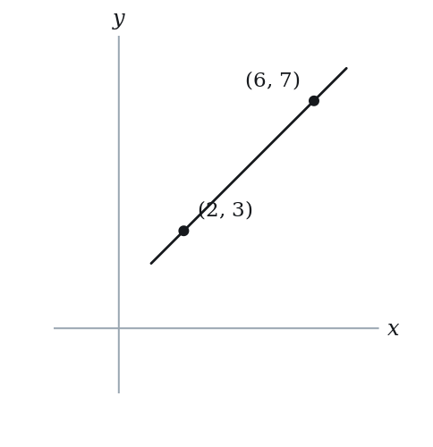
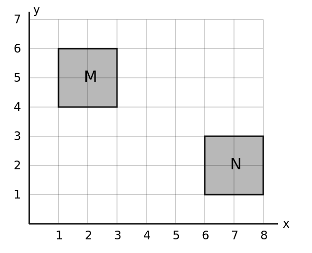
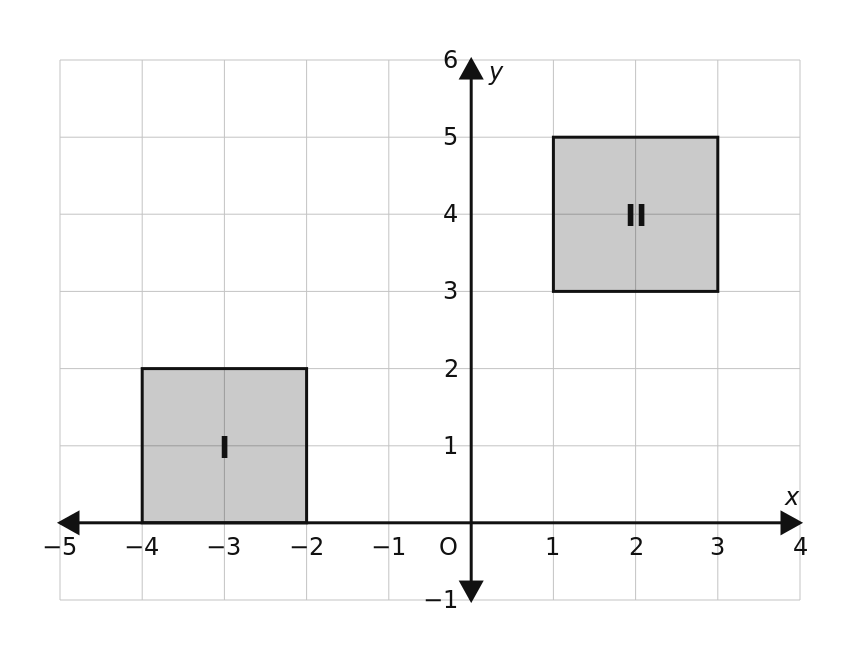

# Slope & Intercepts — Practice Set

**Bank code:** `COG-SLO` · **Section:** Coordinate Geometry · **30 questions** — Easy 7 · Medium 15 · Hard 7 · Extreme 1

**Lecture capsule:** [03-slope.md](../../06-coordinate-geometry/03-slope.md)

> Rise over run with y on top; a horizontal line has slope 0 and a vertical line has none; rearrange to y = mx + b before reading anything off.

Every question below is live in the question bank under the ID shown — the sheet and the portal are the same questions. Attempt a level with the clock running, then check Part C.

---

## Part A — Questions

> **Quantitative Comparison — the four choices are always the same, so they are not reprinted:**
> **(A)** Quantity A is greater · **(B)** Quantity B is greater · **(C)** The two quantities are equal · **(D)** The relationship cannot be determined from the information given

### Level 1 · Easy — 7 questions · ~5 min

*warm-up — these must be automatic*

**Q1** · `COG-SLO-001` · MCQ · 45s

A line in the xy-plane passes through the points (2, 3) and (6, 7). What is the slope of the line?

**(A)** -1  
**(B)** 1/2  
**(C)** 1  
**(D)** 2  
**(E)** 4

**Q2** · `COG-SLO-003` · MCQ · 40s

A horizontal line passes through the point (4, -2). What is its slope?

**(A)** -2  
**(B)** 0  
**(C)** 1/2  
**(D)** 4  
**(E)** Undefined

**Q3** · `COG-SLO-004` · MCQ · 40s

A vertical line passes through the point (3, 7). What is its slope?

**(A)** 0  
**(B)** 3/7  
**(C)** 7/3  
**(D)** 3  
**(E)** Undefined

**Q4** · `COG-SLO-007` · Numeric Entry · 45s

What is the y-intercept of the line 2x + y = 8?

*Numeric entry — write the number.*

**Q5** · `COG-SLO-011` · QC · 45s

Line A has equation y = 3x + 7. Line B has equation y = 3x - 2.

> **Quantity A:**  The slope of Line A
> **Quantity B:**  The slope of Line B

**Q6** · `COG-SLO-012` · MCQ · 45s

The line y = mx + b passes through the origin. Which of the following must be true?

**(A)** m = 0  
**(B)** b = 0  
**(C)** m = b  
**(D)** m = 1  
**(E)** b = 1

**Q7** · `COG-SLO-013` · Numeric Entry · 55s

What is the x-intercept of the line 3x + 6 = y + 6?

*Numeric entry — write the number.*

---

### Level 2 · Medium — 15 questions · ~20 min

*two or three steps, one planted trap each*

**Q8** · `COG-SLO-014` · MCQ · 60s

What is the slope of the line with equation 4x - 2y = 10?

**(A)** -5  
**(B)** -2  
**(C)** 2  
**(D)** 4  
**(E)** 5

**Q9** · `COG-SLO-016` · Numeric Entry · 75s

The line through points (k, 3) and (2, 7) has slope 2. What is the value of k?

*Numeric entry — write the number.*

**Q10** · `COG-SLO-018` · MCQ · 65s

Which line is steeper?

**(A)** y = 2x + 5  
**(B)** y = -3x + 1  
**(C)** y = (1/2)x - 4  
**(D)** y = x + 10  
**(E)** All have the same steepness

**Q11** · `COG-SLO-019` · Numeric Entry · 70s

A line has x-intercept 5 and y-intercept -3. What is the slope of the line?

*Numeric entry — write the number.*

**Q12** · `COG-SLO-020` · Select all that apply · 85s

Which of the following lines have a negative slope? Select all that apply.

**(A)** y = -2x + 5  
**(B)** 3x - y = 7  
**(C)** y = 4 - x  
**(D)** x + 2y = 8  
**(E)** y = 3

**Q13** · `COG-SLO-022` · QC · 75s

Line P passes through (0, 6) and (3, 0). Line Q has equation y = -2x + 5.

> **Quantity A:**  The slope of Line P
> **Quantity B:**  The slope of Line Q

**Q14** · `COG-SLO-026` · QC · 75s

Line M: 2x - 3y = 12. Line N: slope = 2/3.

> **Quantity A:**  The slope of Line M
> **Quantity B:**  The slope of Line N

**Q15** · `COG-SLO-027` · MCQ · 70s

A car travels at a constant speed. At time t = 0, it is at mile marker 20. At t = 3 hours, it is at mile marker 110. What is the rate of change (slope) of distance with respect to time?

**(A)** 20 mph  
**(B)** 30 mph  
**(C)** 30 miles  
**(D)** 90 mph  
**(E)** 110 mph

**Q16** · `COG-SLO-041` · MCQ · 90s

The line y = mx + b is reflected over the y-axis. What is the slope of the reflected line?

**(A)** m  
**(B)** -m  
**(C)** 1/m  
**(D)** -1/m  
**(E)** b

**Q17** · `COG-SLO-043` · MCQ · 85s

In the xy-plane, line L passes through the points (t, 2t) and (3t, 8t), where t ≠ 0. What is the slope of line L?

**(A)** 2  
**(B)** 3  
**(C)** 4  
**(D)** 6  
**(E)** The slope depends on the value of t

**Q18** · `COG-SLO-KMF-002` · Select all that apply · 85s

Line p, drawn in the xy-plane, rises from left to right and goes through the point where the line y = 2x - 3 meets the vertical line x = 4.

Which of the following numbers are possible x-coordinates for the point where p crosses the x-axis?

Indicate all such numbers.

**(A)** -6  
**(B)** -1  
**(C)** 3  
**(D)** 4  
**(E)** 5  
F. 8

**Q19** · `COG-SLO-KMF-007` · MCQ · 75s

Six points are marked on the line 3x + 5y = 45. The x-coordinates of the marked points have a range of 15. By how much do the largest and smallest y-coordinates among these points differ?

**(A)** -9  
**(B)** 3  
**(C)** 9  
**(D)** 15  
**(E)** 25

**Q20** · `COG-SLO-KMF-008` · Select all that apply · 90s

A straight-line relationship links p and q: each time p rises by 2, q falls by 6.

Which of the following equations could describe this relationship?

Indicate all such equations.

**(A)** q = 3p - 6  
**(B)** q = -6p + 2  
**(C)** q = 3(2 - p)  
**(D)** 6p + 2q = 11  
**(E)** q = 4 - p/3  
F. q - 5 = -3(p + 4)

**Q21** · `COG-SLO-KMF2-002` · Numeric Entry · 75s

In the xy-plane, the points (1, 4), (5, p) and (9, 16) lie on the same line. What is the value of p?

*Numeric entry — write the number.*

**Q22** · `SEC-CG-026` · Numeric Entry · 100s

In the xy-plane, the graph of y = f(x) is a line. If f(3) = 5/2, f(7) = 1/2 and f(11) = -3/2, what is the value of f(1)? Give your answer as a fraction.

*Numeric entry — write the number.*

---

### Level 3 · Hard — 7 questions · ~13 min

*where 162+ is won or lost*

**Q23** · `COG-SLO-045` · Select all that apply · 105s

Line L has slope m where m < -1. Which of the following are always true? Select all that apply.

**(A)** The line is steeper than y = −x  
**(B)** The x-intercept is greater than the y-intercept  
**(C)** The line intersects the line y = −x in exactly one point  
**(D)** The slope of the line is less than the slope of y = −x  
**(E)** For each increase of 1 in x, the value of y decreases by more than 1

**Q24** · `COG-SLO-046` · MCQ · 120s

In the xy-plane, points (a, b) and (c, d) both lie on the line y = 3x - 2, with a > c. The points also satisfy a + c = 6 and b + d = 14, and the distance between them is 2√10. What is the value of a - c?

**(A)** -2  
**(B)** 0  
**(C)** 2  
**(D)** 4  
**(E)** 2√10

**Q25** · `COG-SLO-KMF-006` · MCQ · 120s

In the xy-plane, shaded square M (edges included) has corners (1, 4), (3, 4), (3, 6) and (1, 6). Shaded square N (edges included) has corners (6, 1), (8, 1), (8, 3) and (6, 3). Point P is chosen anywhere in M and point Q anywhere in N. What is the greatest possible slope of line segment PQ?

**(A)** -5/3  
**(B)** -3/5  
**(C)** -1/3  
**(D)** -1/7  
**(E)** 1/7

**Q26** · `COG-SLO-KMF2-001` · QC · 105s

In the xy-plane above, squares I and II are shaded, and each square includes its edges. Set P consists of the slopes of all segments that join a point of square I to a point of square II.

> **Quantity A:**  The least member of set P
> **Quantity B:**  1/5

**Q27** · `COG-SLO-KMF2-004` · Select all that apply · 105s

In the xy-plane, a line passes through the points (a, b) and (b, a), where a is not equal to b. Which of the following must be true?

Indicate all such statements.

**(A)** The slope of the line is -1.  
**(B)** The line is perpendicular to the line y = x.  
**(C)** The line passes through the origin.  
**(D)** The midpoint of the segment joining the two points lies on the line y = x.  
**(E)** The y-intercept of the line is positive.

**Q28** · `SEC-CG-010` · QC · 110s

In the xy-plane, line k passes through the points (-2, 5) and (4, -7). Line m has equation 2y + 4x = 9.

> **Quantity A:**  the x-coordinate of the point where line k crosses the x-axis
> **Quantity B:**  the x-coordinate of the point where line m crosses the x-axis

**Q29** · `SEC-CG-022` · QC · 115s

In the xy-plane, the line y = mx + b, where m and b are constants with mb not equal to 0, has an x-intercept that is three times its y-intercept.

> **Quantity A:**  m
> **Quantity B:**  1/3

---

### Level 4 · Extreme — 1 questions · ~2 min

*the top of a real hard section — expect to need the insight, not the grind*

**Q30** · `COG-SLO-KMF2-003` · QC · 120s

In the xy-plane, line l has slope p and y-intercept f, and line n has slope q and y-intercept j.

0 < p < q and j < f < 0

> **Quantity A:**  The x-intercept of line l
> **Quantity B:**  The x-intercept of line n

---

## Part B — Answer Key

| Q | ID | Level | Type | Answer |
|---|---|---|---|---|
| 1 | `COG-SLO-001` | easy | MCQ | **C** |
| 2 | `COG-SLO-003` | easy | MCQ | **B** |
| 3 | `COG-SLO-004` | easy | MCQ | **E** |
| 4 | `COG-SLO-007` | easy | Numeric Entry | **8** |
| 5 | `COG-SLO-011` | easy | QC | **C** |
| 6 | `COG-SLO-012` | easy | MCQ | **B** |
| 7 | `COG-SLO-013` | easy | Numeric Entry | **0** |
| 8 | `COG-SLO-014` | medium | MCQ | **C** |
| 9 | `COG-SLO-016` | medium | Numeric Entry | **0** |
| 10 | `COG-SLO-018` | medium | MCQ | **B** |
| 11 | `COG-SLO-019` | medium | Numeric Entry | **0.6** |
| 12 | `COG-SLO-020` | medium | Select all that apply | **A, C, D** |
| 13 | `COG-SLO-022` | medium | QC | **C** |
| 14 | `COG-SLO-026` | medium | QC | **C** |
| 15 | `COG-SLO-027` | medium | MCQ | **B** |
| 16 | `COG-SLO-041` | medium | MCQ | **B** |
| 17 | `COG-SLO-043` | medium | MCQ | **B** |
| 18 | `COG-SLO-KMF-002` | medium | Select all that apply | **A, B, C** |
| 19 | `COG-SLO-KMF-007` | medium | MCQ | **C** |
| 20 | `COG-SLO-KMF-008` | medium | Select all that apply | **C, D, F** |
| 21 | `COG-SLO-KMF2-002` | medium | Numeric Entry | **10** |
| 22 | `SEC-CG-026` | medium | Numeric Entry | **7/2** |
| 23 | `COG-SLO-045` | hard | Select all that apply | **A, C, D, E** |
| 24 | `COG-SLO-046` | hard | MCQ | **C** |
| 25 | `COG-SLO-KMF-006` | hard | MCQ | **D** |
| 26 | `COG-SLO-KMF2-001` | hard | QC | **B** |
| 27 | `COG-SLO-KMF2-004` | hard | Select all that apply | **A, B, D** |
| 28 | `SEC-CG-010` | hard | QC | **B** |
| 29 | `SEC-CG-022` | hard | QC | **B** |
| 30 | `COG-SLO-KMF2-003` | extreme hard | QC | **D** |

---

## Part C — Worked Solutions

### Q1 · `COG-SLO-001` — Answer: C

Slope = (y2 - y1) / (x2 - x1) = (7 - 3) / (6 - 2) = 4 / 4 = 1.

**Trap.** Choice E (4) comes from using only the change in y or only the change in x. Choice A (-1) comes from subtracting the coordinates in inconsistent order, (7 - 3)/(2 - 6).

### Q2 · `COG-SLO-003` — Answer: B

A horizontal line has equation y = constant. Its slope is always 0 because the rise (change in y) is 0 for any run (change in x). Slope = 0 / (x2 - x1) = 0.

**Trap.** Students confuse horizontal (slope = 0) with vertical (slope undefined), choosing E.

### Q3 · `COG-SLO-004` — Answer: E

A vertical line has equation x = constant. For any two points on it, x2 - x1 = 0, so slope = (y2 - y1)/0, which is undefined (division by zero).

**Trap.** Students think a vertical line has slope 0 (confusing it with a horizontal line), choosing A.

### Q4 · `COG-SLO-007` — Answer: 8

Set x = 0: 2(0) + y = 8, so y = 8. The y-intercept is 8. Alternatively, rewrite as y = -2x + 8; the constant term is 8.

**Trap.** Students compute y-intercept = c/a = 8/2 = 4 instead of c/b = 8/1 = 8 from ax + by = c form.

### Q5 · `COG-SLO-011` — Answer: C

Line A: slope = 3. Line B: slope = 3. Both lines have slope 3 — they are parallel. The two quantities are equal.

**Trap.** Students see Line A has larger y-intercept (7 > -2) and assume it has a larger slope, choosing A.

### Q6 · `COG-SLO-012` — Answer: B

If the line passes through the origin (0, 0), substitute x = 0, y = 0: 0 = m(0) + b → b = 0. The y-intercept must be 0.

**Trap.** Students think m = 0 means the line passes through the origin, confusing slope with y-intercept.

### Q7 · `COG-SLO-013` — Answer: 0

Simplify: 3x + 6 = y + 6 → 3x = y → y = 3x. To find x-intercept, set y = 0: 0 = 3x → x = 0. The x-intercept is 0 (the line passes through the origin).

**Trap.** Students forget to simplify first and try to use the unsimplified equation, or set x = 0 to find the x-intercept (which gives the y-intercept instead).

### Q8 · `COG-SLO-014` — Answer: C

Convert to slope-intercept form: 4x - 2y = 10 → -2y = -4x + 10 → y = 2x - 5. The slope m = 2.

**Trap.** Students read the coefficient of x directly from standard form (4) as the slope without converting, choosing A.

### Q9 · `COG-SLO-016` — Answer: 0

Slope = (7 - 3) / (2 - k) = 2 → 4 / (2 - k) = 2 → 4 = 2(2 - k) → 4 = 4 - 2k → 2k = 0 → k = 0.

**Trap.** Students write slope = (2 - k) / (7 - 3) = 2, reversing the slope formula (x-difference over y-difference).

### Q10 · `COG-SLO-018` — Answer: B

Steepness is determined by the absolute value of the slope. |2| = 2, |-3| = 3, |1/2| = 0.5, |1| = 1. The largest absolute value is 3, which belongs to y = -3x + 1.

**Trap.** Students think a negative slope means the line is less steep, so they discount choice B. Steepness = |slope|, regardless of sign.

### Q11 · `COG-SLO-019` — Answer: 0.6

The x-intercept is the point (5, 0) and the y-intercept is the point (0, -3). Slope = (0 - (-3)) / (5 - 0) = 3/5 = 0.6.

**Trap.** Students compute (-3 - 0)/(0 - 5) = (-3)/(-5) = 3/5 correctly but then think it should be negative because the y-intercept is negative. Or they compute (0 - 5)/(-3 - 0) = -5/-3 = 5/3 by reversing x and y differences.

### Q12 · `COG-SLO-020` — Answer: A, C, D

A: y = -2x + 5 → slope = -2 (negative). B: 3x - y = 7 → y = 3x - 7 → slope = 3 (positive). C: y = 4 - x = -x + 4 → slope = -1 (negative). D: x + 2y = 8 → 2y = -x + 8 → y = -x/2 + 4 → slope = -1/2 (negative). E: y = 3 is horizontal → slope = 0.

**Trap.** Students may include B (positive slope) because the equation has a positive x-coefficient before converting. They may also miss C by not recognizing 4 - x as -1 times x.

### Q13 · `COG-SLO-022` — Answer: C

Line P: slope = (0 - 6)/(3 - 0) = -6/3 = -2. Line Q: slope = -2. Quantity A = -2, Quantity B = -2. The two quantities are equal.

**Trap.** Students who rush may compute Line P's slope as (3 - 0)/(0 - 6) = -1/2, choosing A since -1/2 > -2.

### Q14 · `COG-SLO-026` — Answer: C

Convert Line M: 2x - 3y = 12 → -3y = -2x + 12 → y = (2/3)x - 4. Slope of Line M = 2/3. Line N slope = 2/3. Both are equal.

**Trap.** Students read the slope of Line M directly from the standard form as 2 (coefficient of x) without converting, concluding Quantity A = 2 > 2/3.

### Q15 · `COG-SLO-027` — Answer: B

Slope = rate of change = (110 - 20) / (3 - 0) = 90 / 3 = 30. The slope is 30 mph (miles per hour).

**Trap.** Students compute the total distance (110 - 20 = 90) without dividing by time, choosing D. The slope is the rate, not the total change.

### Q16 · `COG-SLO-041` — Answer: B

Reflecting over the y-axis replaces x with -x: y = m(-x) + b = -mx + b. The reflected line has slope -m.

**Trap.** Students think reflection over the y-axis flips the y-intercept or takes the reciprocal of slope, choosing C or D.

### Q17 · `COG-SLO-043` — Answer: B

Slope = (8t - 2t) / (3t - t) = 6t / 2t = 3. Note: t cancels, so the slope is 3 regardless of the value of t (as long as t ≠ 0).

**Trap.** A: students use 2t/t, the slope from the origin to the first point. C: students divide 8t by the horizontal change 2t. D: students use the vertical change 6t with t = 1. E: students see t in every coordinate and assume the slope depends on it.

### Q18 · `COG-SLO-KMF-002` — Answer: A, B, C

At x = 4 the line y = 2x - 3 gives y = 5, so p passes through (4, 5).
Let p have slope m > 0: y - 5 = m(x - 4).
Set y = 0: -5 = m(x - 4), so x = 4 - 5/m.
Because m > 0, 5/m > 0, so the x-intercept is always less than 4, and any value below 4 occurs for some m = 5/(4 - x).
A (-6): m = 0.5, true.
B (-1): m = 1, true.
C (3): m = 5, true.
D (4): would need 5/m = 0, impossible, false.
E (5): above 4, false.
F (8): above 4, false.
Check: m = 1 gives y = x + 1, which passes through (4, 5) and crosses the x-axis at -1.

**Trap.** Assuming that a line rising from left to right must cross the x-axis to the right of the point (4, 5) leads to choosing E or F; in fact the line drops to y = 0 as it moves left from (4, 5). Including 4 because the line passes through x = 4 leads to choosing D, but at x = 4 the line is at height 5, not 0.

### Q19 · `COG-SLO-KMF-007` — Answer: C

Rewrite the line as y = 9 - (3/5)x, so the slope has size 3/5.
On a line, the spread of y-values equals the size of the slope times the spread of x-values: (3/5)*15 = 9.
The difference between the largest and smallest y is a positive spread, so it is 9 (not -9, even though the slope is negative).
Check: x = 0 gives y = 9 and x = 15 gives y = 0, so the y-values span 9.
A: -9 comes from keeping the sign of the slope.
B: 3 comes from 15/5, ignoring the 3.
D: 15 treats the slope as 1.
E: 25 divides by 3/5 instead of multiplying.

**Trap.** Dividing by the slope instead of multiplying: 15 / (3/5) = 25 (option E).

### Q20 · `COG-SLO-KMF-008` — Answer: C, D, F

1. A drop of 6 in q for a rise of 2 in p means the slope is -6/2 = -3, so a valid equation has q = -3p + b for some constant b.
A. q = 3p - 6: slope +3. False.
B. q = -6p + 2: slope -6 (the change in q per 2 units of p, not per 1). False.
C. q = 3(2 - p) = 6 - 3p: slope -3. True.
D. 6p + 2q = 11 gives q = 5.5 - 3p: slope -3. True.
E. q = 4 - p/3: slope -1/3 (the ratio inverted). False.
F. q - 5 = -3(p + 4) gives q = -3p - 7: slope -3. True.
Check C: p = 0 gives q = 6 and p = 2 gives q = 0, a fall of 6.

**Trap.** Using the raw change in q (-6) as the slope, without dividing by the 2-unit change in p, selects the equation with slope -6 (choice B) and misses the genuine slope -3.

### Q21 · `COG-SLO-KMF2-002` — Answer: 10

The three x-coordinates 1, 5 and 9 are evenly spaced, four apart. On a line, equal steps in x produce equal steps in y, so the three y-coordinates are evenly spaced too and p is halfway between 4 and 16:
p = (4 + 16)/2 = 10.
The same answer comes from the slope. Using the outer two points, the slope is (16 - 4)/(9 - 1) = 12/8 = 3/2, so from (1, 4) to x = 5 the rise is (3/2)(4) = 6 and p = 4 + 6 = 10.

**Trap.** Averaging the wrong pair of numbers gives a plausible-looking answer: a student who averages the two x-coordinates that bracket p, (1 + 9)/2, answers 5, which is the x-coordinate of the middle point rather than its y-coordinate.

### Q22 · `SEC-CG-026` — Answer: 7/2

Because the graph is a line, the rate of change is constant. From x = 3 to x = 7 the output falls from 5/2 to 1/2, a drop of 2 over a run of 4, so the slope is -1/2. Checking against the third value: from x = 7 to x = 11 the run is 4 and the drop is again 2, confirming the slope. Moving from x = 3 back to x = 1 is a run of -2, so the output rises by (-1/2)(-2) = 1. Therefore f(1) = 5/2 + 1 = 7/2.

**Trap.** Students apply the slope in the wrong direction, subtracting 1 instead of adding it and answering 3/2. Going from x = 3 down to x = 1 moves left, and on a line of negative slope moving left raises the output.

### Q23 · `COG-SLO-045` — Answer: A, C, D, E

m < −1. A: the absolute value of m exceeds 1, the absolute value of the slope of y = −x, so true. B: the intercepts depend on b, not only on m, so false. C: the slopes differ, so the lines cross exactly once, true. D: m < −1 = the slope of y = −x, true. E: each unit increase in x changes y by m, a decrease of more than 1, true.

**Trap.** Students may choose B without realizing intercepts depend on b as well. They may also miss A by not recognizing that steeper means larger absolute slope value.

### Q24 · `COG-SLO-046` — Answer: C

From b = 3a - 2 and d = 3c - 2, b - d = 3(a - c), so the vertical separation is 3 times the horizontal separation. Let h = a - c > 0. The distance is √(h² + (3h)²) = h√10 = 2√10, so h = 2. Check: a + c = 6 and a - c = 2 give a = 4, c = 2, b = 10, d = 4, and b + d = 14.

**Trap.** Taking the distance 2√10 itself as a - c (E) instead of just the horizontal part, or forgetting a > c and allowing -2. The sums a + c = 6 and b + d = 14 are consistent but alone do not fix a - c.

### Q25 · `COG-SLO-KMF-006` — Answer: D

Every point of N is to the right of and below every point of M, so each slope (yQ - yP)/(xQ - xP) is negative, with xQ - xP > 0 and yP - yQ > 0.
The slope equals -(yP - yQ)/(xQ - xP). To make it as large as possible (closest to 0) we want yP - yQ as small as possible and xQ - xP as large as possible.
Smallest drop: yP - yQ = 4 - 3 = 1 (P at height 4, Q at height 3).
Largest horizontal gap: xQ - xP = 8 - 1 = 7 (P at x = 1, Q at x = 8). Both choices are reached together by P = (1, 4) and Q = (8, 3).
Greatest slope = -1/7.
Check: P = (1, 4), Q = (8, 3) gives (3 - 4)/(8 - 1) = -1/7. The nearest corners (3, 4) and (6, 3) give -1/3, which is smaller.

**Trap.** Reading 'greatest' as the steepest segment (largest size of slope) and using P = (3, 6), Q = (6, 1), giving -5/3 (option A), which is actually the least slope.

### Q26 · `COG-SLO-KMF2-001` — Answer: B

Take a point S in square I and a point T in square II. The slope of ST is (y_T - y_S)/(x_T - x_S).
Square I covers x from -4 to -2 and y from 0 to 2. Square II covers x from 1 to 3 and y from 3 to 5.
The horizontal run x_T - x_S is always positive: its smallest value is 1 - (-2) = 3 and its largest is 3 - (-4) = 7.
The vertical rise y_T - y_S is also always positive: its smallest value is 3 - 2 = 1 and its largest is 5 - 0 = 5.
A positive fraction is smallest when its numerator is smallest and its denominator is largest, and the two can be arranged at the same time: take S = (-4, 2) and T = (3, 3), giving a slope of 1/7.
So the least member of set P is 1/7, which is about 0.14, and 1/5 = 0.2. Quantity B is greater.

**Trap.** The two corners that look closest together, S = (-2, 2) and T = (1, 3), give a slope of 1/3, which is larger than 1/5 and points to the wrong answer. The least slope needs the longest horizontal run, so it comes from the corners that are furthest apart.

### Q27 · `COG-SLO-KMF2-004` — Answer: A, B, D

The two points differ, so a - b is not 0 and the slope is defined:
slope = (a - b)/(b - a) = -1.
A. True, by that calculation.
B. True. The line y = x has slope 1, and the product of the two slopes is (-1)(1) = -1, which is the condition for perpendicular lines.
C. False. With slope -1 through (a, b), the line is y = -x + (a + b), so it passes through the origin only when a + b = 0. Taking a = 1 and b = 5 gives y = -x + 6, which does not.
D. True. The midpoint is ((a + b)/2, (a + b)/2), whose two coordinates are equal, and that is exactly what it means to lie on the line y = x.
E. False. The y-intercept is a + b, which is negative when a = -1 and b = -5.

**Trap.** Statement C is tempting because the two points are mirror images of each other in the line y = x, which makes the segment look centered on the origin. What that symmetry gives is statement D, that the midpoint lies on y = x; the line itself reaches the origin only when a + b = 0.

### Q28 · `SEC-CG-010` — Answer: B

Line k has slope (-7 - 5)/(4 - (-2)) = -12/6 = -2, and using (-2, 5) gives 5 = -2(-2) + b = 4 + b, so b = 1 and k is y = -2x + 1. Setting y = 0 gives x = 1/2. Line m rearranges to 2y = -4x + 9, that is y = -2x + 4.5, and setting y = 0 gives x = 9/4 = 2.25. Since 2.25 is greater than 0.5, Quantity B is greater.

**Trap.** Both lines have slope -2, and students conclude the two intercepts must agree and pick C. Equal slopes make the lines parallel, which guarantees they never meet — so their x-intercepts are necessarily different, not the same.

### Q29 · `SEC-CG-022` — Answer: B

The y-intercept is b, found by setting x = 0. The x-intercept is found by setting y = 0: 0 = mx + b gives x = -b/m. The condition says -b/m = 3b. Since b is not zero, divide both sides by b to get -1/m = 3, so m = -1/3. Quantity A is therefore -1/3, which is negative, while Quantity B is the positive 1/3. Quantity B is greater.

**Trap.** Students drop the minus sign when solving for the x-intercept, get 1/m = 3 and m = 1/3, and answer C. The x-intercept of y = mx + b is -b/m, and that negative sign is exactly what makes the slope come out negative here.

### Q30 · `COG-SLO-KMF2-003` — Answer: D

Line l is y = px + f, so its x-intercept is -f/p. Line n is y = qx + j, so its x-intercept is -j/q. Both intercepts are positive, since f and j are negative while p and q are positive.
Line n has the steeper slope, which pulls its x-intercept toward the origin, but it also starts lower, which pushes its x-intercept away. Neither effect is bounded by the other, so test cases:
p = 1, q = 2, f = -1, j = -2: the intercepts are 1 and 1, equal.
p = 1, q = 2, f = -1, j = -10: the intercepts are 1 and 5, so Quantity B is greater.
p = 1, q = 10, f = -1, j = -2: the intercepts are 1 and 0.2, so Quantity A is greater.
All three sets of values obey 0 < p < q and j < f < 0, so the relationship cannot be determined.

**Trap.** Line n has both the larger slope and the lower y-intercept, which makes it feel as though the comparison must settle one way. The two conditions move the x-intercept in opposite directions, and the given inequalities do not say which one moves it further.
