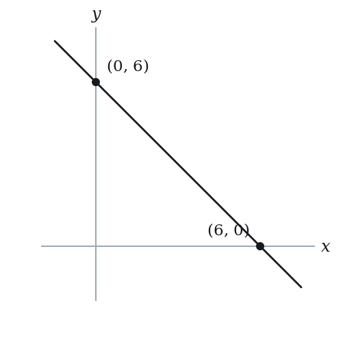
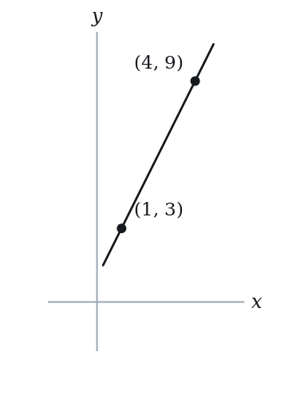
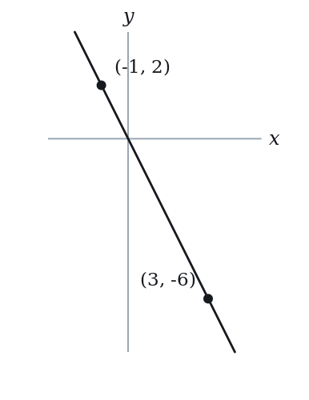

# Equation of a Line — Practice Set

**Bank code:** `COG-EQL` · **Section:** Coordinate Geometry · **30 questions** — Easy 8 · Medium 15 · Hard 7

**Lecture capsule:** [04-equation-of-a-line.md](../../06-coordinate-geometry/04-equation-of-a-line.md)

> A point and a slope fix a line, and so do two points; a horizontal line is y = c and a vertical line is x = c, which has no slope at all.

Every question below is live in the question bank under the ID shown — the sheet and the portal are the same questions. Attempt a level with the clock running, then check Part C.

---

## Part A — Questions

> **Quantitative Comparison — the four choices are always the same, so they are not reprinted:**
> **(A)** Quantity A is greater · **(B)** Quantity B is greater · **(C)** The two quantities are equal · **(D)** The relationship cannot be determined from the information given

### Level 1 · Easy — 8 questions · ~7 min

*warm-up — these must be automatic*

**Q1** · `COG-EQL-003` · MCQ · 45s

Which of the following is the equation of a horizontal line passing through the point (4, -3)?

**(A)** x = 4  
**(B)** x = -3  
**(C)** y = 4  
**(D)** y = -3  
**(E)** y = x - 7

**Q2** · `COG-EQL-004` · MCQ · 45s

Which of the following is the equation of a vertical line passing through the point (5, 2)?

**(A)** y = 5  
**(B)** y = 2  
**(C)** x = 2  
**(D)** x = 5  
**(E)** y = 2x - 8

**Q3** · `COG-EQL-007` · MCQ · 50s

Which of the following points lies on the line in the xy-plane with equation y = 2x + 1?

**(A)** (3, 7)  
**(B)** (7, 3)  
**(C)** (3, 8)  
**(D)** (4, 8)  
**(E)** (1, 2)

**Q4** · `COG-EQL-013` · QC · 45s

Line P passes through (0, 4) and (2, 4).

> **Quantity A:**  The slope of line P
> **Quantity B:**  0

**Q5** · `COG-EQL-021` · Numeric Entry · 70s

Two lines intersect at a single point. Line 1: y = 3x - 4. Line 2: y = x + 2. What is the x-coordinate of the intersection point?

*Numeric entry — write the number.*

**Q6** · `COG-EQL-024` · MCQ · 65s

Which of the following equations represents a line that passes through the origin?

**(A)** y = 3x + 2  
**(B)** 2x - y = 5  
**(C)** y = -4x  
**(D)** x + y = 1  
**(E)** y = x - 1

**Q7** · `COG-EQL-KMF-005` · MCQ · 60s

Line L has slope 3/2, and its x-intercept is -4. Which of the following points lies on line L?

**(A)** (0, -6)  
**(B)** (0, 4)  
**(C)** (2, 7)  
**(D)** (4, 12)  
**(E)** (6, 3)

**Q8** · `COG-GLE-008` · MCQ · 55s

A line passes through (0, 6) and (6, 0). What is the equation of this line?

**(A)** y = x + 6  
**(B)** y = -x + 6  
**(C)** y = x - 6  
**(D)** y = -x - 6  
**(E)** y = 6x

---

### Level 2 · Medium — 15 questions · ~21 min

*two or three steps, one planted trap each*

**Q9** · `COG-EQL-014` · MCQ · 65s

A line passes through the point (2, 5) and has slope 3. What is the equation of the line?

**(A)** y = 3x - 1  
**(B)** y = 3x + 1  
**(C)** y = 3x + 5  
**(D)** y = 3x - 5  
**(E)** y = 5x + 3

**Q10** · `COG-EQL-016` · MCQ · 75s

What is the equation of the line passing through the points (1, 3) and (4, 9)?

**(A)** y = 2x + 1  
**(B)** y = 2x - 1  
**(C)** y = 3x  
**(D)** y = 2x + 3  
**(E)** y = 6x - 3

**Q11** · `COG-EQL-019` · QC · 75s

Line L has equation y = (2/3)x - 5.

> **Quantity A:**  The y-intercept of line L
> **Quantity B:**  The x-intercept of line L

**Q12** · `COG-EQL-020` · Select all that apply · 90s

In the xy-plane, line L passes through the point (0, 3) and has slope 2.

Which of the following points lie on line L?

Indicate all such points.

**(A)** (1, 5)  
**(B)** (2, 7)  
**(C)** (3, 9)  
**(D)** (-1, 1)  
**(E)** (-2, 0)

**Q13** · `COG-EQL-022` · QC · 60s

Line 1: y = 3x + 4. Line 2: y = 3x - 7.

> **Quantity A:**  The number of intersection points of Line 1 and Line 2
> **Quantity B:**  1

**Q14** · `COG-EQL-025` · Numeric Entry · 80s

A line passes through (-1, 2) and (3, -6). What is the y-intercept of this line?

*Numeric entry — write the number.*

**Q15** · `COG-EQL-030` · Numeric Entry · 70s

Line 1: y = 2x + 1. Line 2: y = -x + 7. At what y-coordinate do these two lines intersect?

*Numeric entry — write the number.*

**Q16** · `COG-EQL-033` · Select all that apply · 90s

Which of the following are valid equations of lines passing through the point (2, 6)? Select all that apply.

**(A)** y = 3x  
**(B)** y = 2x + 2  
**(C)** y = x + 6  
**(D)** 2x + y = 10  
**(E)** y = 4x + 2

**Q17** · `COG-EQL-050` · MCQ · 120s

In the xy-plane, line L₁ has equation y = 3x - 2 and line L₂ has equation y = -2x + 8. A third line L₃ passes through the intersection of L₁ and L₂ and also passes through the origin. What is the equation of L₃?

**(A)** y = −2x  
**(B)** y = (1/2)x  
**(C)** y = (4/3)x  
**(D)** y = 2x  
**(E)** y = 3x

**Q18** · `COG-EQL-KMF-007` · Numeric Entry · 90s

The table lists three input-output pairs of a linear function g. Where does the graph of g meet the x-axis? Give the x-coordinate in fraction form.

| x | g(x) |
|---|---|
| 3 | 5/2 |
| 7 | -1/2 |
| 11 | -7/2 |

*Numeric entry — write the number.*

**Q19** · `COG-EQL-KMF-008` · MCQ · 75s

A line was translated 3 units to the left and 2 units down, and its new equation is y = 2x + 1. Which equation describes the original, unmoved line?

**(A)** y = 2x - 3  
**(B)** y = 2x - 5  
**(C)** y = 2x - 7  
**(D)** y = 2x + 5  
**(E)** y = 2x + 9

**Q20** · `COG-GLE-016` · QC · 80s

Line A has slope 3 and passes through (2, 8). Line B has slope 3 and passes through (5, 14).

> **Quantity A:**  The y-intercept of Line A
> **Quantity B:**  The y-intercept of Line B

**Q21** · `COG-GLE-034` · Numeric Entry · 100s

A line has a slope of -2 and passes through the point (3, -1). The line crosses the x-axis at point P. What is the distance from the origin to point P?

*Numeric entry — write the number.*

**Q22** · `COG-GLE-KMF-008` · Select all that apply · 100s

In the xy-plane, line p has a negative slope and crosses the y-axis above the origin. Line q is horizontal and lies below the x-axis.

Which of the following statements must be true?

Indicate all such statements.

**(A)** Lines p and q intersect at exactly one point.  
**(B)** The point where p and q intersect lies in Quadrant IV.  
**(C)** Line p crosses the x-axis at a positive x-value.  
**(D)** Line q crosses the y-axis above the origin.  
**(E)** Line p passes through the origin.  
F. Line q crosses the x-axis at exactly one point.

**Q23** · `SEC-CG-039` · QC · 90s

In the xy-plane, the point (k, k) lies on the graph of 0.4x + 0.1y = 15.

> **Quantity A:**  k
> **Quantity B:**  15

---

### Level 3 · Hard — 7 questions · ~12 min

*where 162+ is won or lost*

**Q24** · `COG-EQL-036` · Numeric Entry · 95s

Three lines are defined as follows:

Line 1: y = 2x + 3

Line 2: y = -x + 9

Line 3: y = kx - 1

All three lines pass through a common point. What is the value of k?

*Numeric entry — write the number.*

**Q25** · `COG-EQL-037` · MCQ · 100s

The line passing through (p, 2p) and (2p, p), where p ≠ 0, has a y-intercept equal to which of the following?

**(A)** -3p  
**(B)** -p  
**(C)** 0  
**(D)** p  
**(E)** 3p

**Q26** · `COG-EQL-043` · Numeric Entry · 90s

If the lines y = ax + 5 and y = 2x + b intersect at the point (3, 11), what is the value of a + b?

*Numeric entry — write the number.*

**Q27** · `COG-EQL-045` · Select all that apply · 110s

Line L has a positive slope and a negative y-intercept. Which of the following must be true? Select all that apply.

**(A)** The x-intercept of line L is negative  
**(B)** The x-intercept of line L is positive  
**(C)** Line L passes through the second quadrant (x < 0, y > 0)  
**(D)** Line L passes through the third quadrant (x < 0, y < 0)  
**(E)** Line L passes through the fourth quadrant (x > 0, y < 0)

**Q28** · `COG-EQL-048` · MCQ · 120s

In the xy-plane, line L₁ passes through (a, 0) and (0, b) where a, b > 0. A second line L₂ is obtained by reflecting L₁ across the x-axis. If L₁ and L₂ intersect only on the x-axis, which of the following represents the equation of L₂?

**(A)** bx + ay = ab  
**(B)** bx - ay = ab  
**(C)** bx - ay = -ab  
**(D)** ax + by = ab  
**(E)** ax - by = ab

**Q29** · `COG-EQL-KMF-003` · Select all that apply · 135s

In the xy-plane, line n crosses the x-axis at the point (p, 0) and crosses the y-axis at the point (0, q), where p and q are positive numbers.

Which of the following point must lie on line n?

Indicate all such points.

**(A)** (p/4, 3q/4)  
**(B)** (p, q)  
**(C)** (-p, 2q)  
**(D)** (2p, 2q)  
**(E)** (3p, -2q)  
F. (q, p)

**Q30** · `COG-GLE-038` · QC · 90s

In the xy-plane, line k passes through the points (0, 4) and (c, 0), where c > 0. Line m is perpendicular to line k and passes through the origin.

> **Quantity A:**  The slope of line m
> **Quantity B:**  c/4

---

## Part B — Answer Key

| Q | ID | Level | Type | Answer |
|---|---|---|---|---|
| 1 | `COG-EQL-003` | easy | MCQ | **D** |
| 2 | `COG-EQL-004` | easy | MCQ | **D** |
| 3 | `COG-EQL-007` | easy | MCQ | **A** |
| 4 | `COG-EQL-013` | easy | QC | **C** |
| 5 | `COG-EQL-021` | easy | Numeric Entry | **3** |
| 6 | `COG-EQL-024` | easy | MCQ | **C** |
| 7 | `COG-EQL-KMF-005` | easy | MCQ | **D** |
| 8 | `COG-GLE-008` | easy | MCQ | **B** |
| 9 | `COG-EQL-014` | medium | MCQ | **A** |
| 10 | `COG-EQL-016` | medium | MCQ | **A** |
| 11 | `COG-EQL-019` | medium | QC | **B** |
| 12 | `COG-EQL-020` | medium | Select all that apply | **A, B, C, D** |
| 13 | `COG-EQL-022` | medium | QC | **B** |
| 14 | `COG-EQL-025` | medium | Numeric Entry | **0** |
| 15 | `COG-EQL-030` | medium | Numeric Entry | **5** |
| 16 | `COG-EQL-033` | medium | Select all that apply | **A, B, D** |
| 17 | `COG-EQL-050` | medium | MCQ | **D** |
| 18 | `COG-EQL-KMF-007` | medium | Numeric Entry | **19/3** |
| 19 | `COG-EQL-KMF-008` | medium | MCQ | **A** |
| 20 | `COG-GLE-016` | medium | QC | **A** |
| 21 | `COG-GLE-034` | medium | Numeric Entry | **2.5** |
| 22 | `COG-GLE-KMF-008` | medium | Select all that apply | **A, B, C** |
| 23 | `SEC-CG-039` | medium | QC | **A** |
| 24 | `COG-EQL-036` | hard | Numeric Entry | **4** |
| 25 | `COG-EQL-037` | hard | MCQ | **E** |
| 26 | `COG-EQL-043` | hard | Numeric Entry | **7** |
| 27 | `COG-EQL-045` | hard | Select all that apply | **B, D, E** |
| 28 | `COG-EQL-048` | hard | MCQ | **B** |
| 29 | `COG-EQL-KMF-003` | hard | Select all that apply | **A, C, E** |
| 30 | `COG-GLE-038` | hard | QC | **C** |

---

## Part C — Worked Solutions

### Q1 · `COG-EQL-003` — Answer: D

A horizontal line has a constant y-value for all x. Since the line passes through (4, -3), every point on the line has y = -3. The equation is y = -3. Note that x = 4 would be a vertical line.

**Trap.** Students write x = -3 (confusing x and y) or x = 4 (writing a vertical line instead of horizontal).

### Q2 · `COG-EQL-004` — Answer: D

A vertical line has a constant x-value for all y. Since the line passes through (5, 2), every point on the line has x = 5. The equation is x = 5. A vertical line has undefined slope and cannot be written in y = mx + b form.

**Trap.** Students write y = 5 (confusing the vertical line formula x = k with y = k) or choose x = 2 (using the y-coordinate instead of the x-coordinate).

### Q3 · `COG-EQL-007` — Answer: A

A point lies on the line if its coordinates satisfy y = 2x + 1. For (3, 7): 2(3) + 1 = 7, which equals y, so (3, 7) lies on the line. The others give 2(7)+1 = 15 ≠ 3, 2(3)+1 = 7 ≠ 8, 2(4)+1 = 9 ≠ 8, 2(1)+1 = 3 ≠ 2. Answer: A.

**Trap.** Choice B reverses the coordinates. Choice C uses y = 2x + 2. Choice D uses y = 2x. Choice E uses y = x + 1.

### Q4 · `COG-EQL-013` — Answer: C

Both points have y = 4, so line P is horizontal. The slope of a horizontal line is 0. Quantity A = 0 = Quantity B. They are equal.

**Trap.** Students compute (y2-y1)/(x2-x1) = 0/2 and incorrectly call 0/2 undefined (confusing with division of zero into zero or mixing up with vertical line slope), choosing D.

### Q5 · `COG-EQL-021` — Answer: 3

At the intersection, both equations are satisfied simultaneously. Set them equal: 3x - 4 = x + 2 → 2x = 6 → x = 3.

**Trap.** Students correctly find x = 3 but then substitute to find y = 5 and report 5 as the answer, confusing x-coordinate with y-coordinate.

### Q6 · `COG-EQL-024` — Answer: C

A line passes through the origin (0, 0) if substituting x = 0 and y = 0 satisfies the equation.
A: 0 = 3(0)+2 = 2. False.
B: 2(0)-0 = 0 ≠ 5. False.
C: 0 = -4(0) = 0. True.
D: 0+0 = 0 ≠ 1. False.
E: 0 = 0-1 = -1. False.
Only C passes through the origin.

**Trap.** Students recognize that y = mx (no constant) passes through the origin but then test options without substituting, missing that C is in the form y = mx with b = 0.

### Q7 · `COG-EQL-KMF-005` — Answer: D

The x-intercept is -4, so L passes through (-4, 0). With slope 3/2: y - 0 = (3/2)(x - (-4)), so y = (3/2)(x + 4).
Test each point:
(0, -6): y = (3/2)(4) = 6, not -6. No.
(0, 4): y = 6, not 4. No.
(2, 7): y = (3/2)(6) = 9, not 7. No.
(4, 12): y = (3/2)(8) = 12. Yes.
(6, 3): y = (3/2)(10) = 15, not 3. No.
Check: slope from (-4, 0) to (4, 12) is 12/8 = 3/2.

**Trap.** Treating -4 as the y-intercept (y = 3x/2 + 4) makes (0, 4) look right, which is choice B; getting the sign wrong (y = (3/2)(x - 4)) makes (0, -6) and (6, 3) look right (choices A and E).

### Q8 · `COG-GLE-008` — Answer: B

The y-intercept is 6 (line passes through (0, 6)). The slope = (0 - 6) / (6 - 0) = -6/6 = -1. Equation: y = -1·x + 6 = -x + 6.

**Trap.** Students see the line connecting (0, 6) and (6, 0) and assign slope +1, thinking it 'rises' because 6 appears in both. The line actually falls as x increases — slope is -1.

### Q9 · `COG-EQL-014` — Answer: A

Using point-slope form with (x1, y1) = (2, 5) and m = 3:
y - 5 = 3(x - 2)
y - 5 = 3x - 6
y = 3x - 6 + 5
y = 3x - 1.

**Trap.** Students write y - 5 = 3(x - 2) but then expand incorrectly as y = 3x - 2 + 5 = 3x + 3, treating 3(x-2) as 3x - 2 instead of 3x - 6.

### Q10 · `COG-EQL-016` — Answer: A

Step 1 — Find slope: m = (9 - 3)/(4 - 1) = 6/3 = 2.
Step 2 — Use point-slope with (1, 3): y - 3 = 2(x - 1) → y - 3 = 2x - 2 → y = 2x - 2 + 3 = 2x + 1.

**Trap.** Students invert the slope formula to (x2-x1)/(y2-y1) = 3/6 = 1/2, then build an equation with slope 1/2, reaching a wrong answer not in the options — confirming the inversion error.

### Q11 · `COG-EQL-019` — Answer: B

y-intercept (Quantity A): set x = 0 → y = -5. Quantity A = -5.
x-intercept (Quantity B): set y = 0 → 0 = (2/3)x - 5 → (2/3)x = 5 → x = 15/2 = 7.5. Quantity B = 7.5.
Since 7.5 > -5, Quantity B is greater.

**Trap.** Students correctly compute both intercepts but then compare absolute values (|-5| = 5 < 7.5) and mistakenly think that since -5 has a 'larger' absolute value in isolation they are confused — or they swap which is Quantity A and Quantity B.

### Q12 · `COG-EQL-020` — Answer: A, B, C, D

The equation of line L: y = 2x + 3 (slope 2, y-intercept 3).
A. (1, 5): 2(1)+3 = 5 ✓
B. (2, 7): 2(2)+3 = 7 ✓
C. (3, 9): 2(3)+3 = 9 ✓
D. (-1, 1): 2(-1)+3 = -2+3 = 1 ✓
E. (-2, 0): 2(-2)+3 = -4+3 = -1 ≠ 0 ✗
A, B, C, D all lie on the line.

**Trap.** Students miscompute the negative-x cases: for D, they calculate 2(-1) = +2 (dropping the negative), getting 2+3 = 5 ≠ 1, and incorrectly exclude D. For E, the same error gives -4+3 = -1 ≠ 0, which is the correct computation — E really does not lie on the line.

### Q13 · `COG-EQL-022` — Answer: B

Both lines have slope 3 but different y-intercepts (4 vs -7). Parallel lines with equal slopes and different intercepts never intersect. Quantity A = 0. Quantity B = 1. Since 0 < 1, Quantity B is greater.

**Trap.** Students do not check whether the lines are parallel and assume any two distinct lines intersect exactly once, choosing C.

### Q14 · `COG-EQL-025` — Answer: 0

Step 1 — Slope: m = (-6 - 2)/(3 - (-1)) = -8/4 = -2.
Step 2 — Use point-slope with (-1, 2): y - 2 = -2(x - (-1)) = -2(x + 1) → y - 2 = -2x - 2 → y = -2x - 2 + 2 = -2x.
The y-intercept is 0.
Verification: at x = 3: y = -2(3) = -6. ✓

**Trap.** Students write x - x1 = x - (-1) = x - 1 (dropping the double negative), giving y - 2 = -2(x - 1) → y = -2x + 2 + 2 = -2x + 4. They report y-intercept = 4.

### Q15 · `COG-EQL-030` — Answer: 5

Set equal to find x: 2x + 1 = -x + 7 → 3x = 6 → x = 2. Substitute back into Line 1: y = 2(2) + 1 = 5. The y-coordinate of intersection is 5.

**Trap.** Students find x = 2 and report 2 as the answer, not realizing the question asks for the y-coordinate, not the x-coordinate.

### Q16 · `COG-EQL-033` — Answer: A, B, D

Substitute (2, 6) in each equation.
A: 3(2) = 6. Yes.
B: 2(2) + 2 = 6. Yes.
C: 2 + 6 = 8, not 6. No.
D: 2(2) + 6 = 10. Yes.
E: 4(2) + 2 = 10, not 6. No.
The correct choices are A, B and D.

**Trap.** For C, students put the y-coordinate in as the intercept (y = x + 6) without checking. For E, a sign slip turns y = 4x − 2 into y = 4x + 2, which gives 10 at x = 2.

### Q17 · `COG-EQL-050` — Answer: D

Step 1 — Find the intersection of L₁ and L₂: set 3x - 2 = -2x + 8 → 5x = 10 → x = 2. Then y = 3(2) - 2 = 4. Intersection point: (2, 4).
Step 2 — L₃ passes through (0, 0) and (2, 4). Slope = (4 - 0)/(2 - 0) = 4/2 = 2. Equation: y = 2x.

**Trap.** A uses the slope of L₂. B inverts the slope of the segment from the origin (x/y). C comes from the slip 3x + 2x = 8 − 2 = 6, giving the point (6/5, 8/5). E uses the slope of L₁. The intersection is (2, 4), so the correct slope is 2.

### Q18 · `COG-EQL-KMF-007` — Answer: 19/3

Slope between the first two rows: (-1/2 - 5/2)/(7 - 3) = (-3)/4 = -3/4.
Check with the last two rows: (-7/2 - (-1/2))/(11 - 7) = (-3)/4 = -3/4, so the table is consistent with one line.
Using the point (3, 5/2): g(x) = 5/2 - (3/4)(x - 3).
Set g(x) = 0: (3/4)(x - 3) = 5/2, so x - 3 = (5/2)*(4/3) = 10/3, giving x = 3 + 10/3 = 19/3.
Check: g(19/3) = 5/2 - (3/4)(10/3) = 5/2 - 5/2 = 0.

**Trap.** Estimating the zero by locating where the listed outputs change sign (between x = 3 and x = 7) and entering a value such as 5, instead of solving the line exactly.

### Q19 · `COG-EQL-KMF-008` — Answer: A

Undo the move: shift the new line 3 units right and 2 units up.
Shifting right by 3 replaces x with (x - 3): y = 2(x - 3) + 1 = 2x - 5.
Shifting up by 2 adds 2: y = 2x - 5 + 2 = 2x - 3.
So the original line is y = 2x - 3.
Check: move y = 2x - 3 left 3 and down 2: y = 2(x + 3) - 3 - 2 = 2x + 1, which is the given equation.

**Trap.** Applying the stated move again instead of reversing it, y = 2(x + 3) + 1 - 2 = 2x + 5 (choice D; or undoing only the horizontal move and stopping at 2x - 5 (choice B.

### Q20 · `COG-GLE-016` — Answer: A

Line A: slope = 3, through (2, 8). 8 = 3(2) + b → b = 2. Line B: slope = 3, through (5, 14). 14 = 3(5) + b → 14 = 15 + b → b = -1. Quantity A = 2, Quantity B = -1. Since 2 > -1, Quantity A is greater.

**Trap.** Students assume that two lines with the same slope must have the same y-intercept (since they are parallel). Two parallel lines have DIFFERENT y-intercepts — that is what makes them parallel rather than identical.

### Q21 · `COG-GLE-034` — Answer: 2.5

Line equation: y - (-1) = -2(x - 3) → y + 1 = -2x + 6 → y = -2x + 5. x-intercept (y = 0): 0 = -2x + 5 → x = 2.5. Point P = (2.5, 0). Distance from origin = √(2.5² + 0²) = 2.5.

**Trap.** Students find x = 2.5 correctly but then compute distance using the wrong second point — they use (3, -1) instead of the origin (0, 0): √((2.5-3)² + (0-(-1))²) = √(0.25 + 1) = √1.25 ≈ 1.12.

### Q22 · `COG-GLE-KMF-008` — Answer: A, B, C

Write p as y = mx + b with m < 0 and b > 0, and q as y = k with k < 0.
A. True. A line with a nonzero slope meets any horizontal line exactly once.
B. True. Solving mx + b = k gives x = (k - b)/m. Here k - b < 0 and m < 0, so x > 0, and the y-coordinate is k < 0. Positive x with negative y is Quadrant IV.
C. True. Setting y = 0 gives x = -b/m; with b > 0 and m < 0 this is positive.
D. False. Line q meets the y-axis at (0, k) and k < 0, so it is below the origin.
E. False. Line p meets the y-axis at (0, b) with b > 0, so it misses the origin.
F. False. A horizontal line y = k with k not equal to 0 never reaches the x-axis.
Check with m = -1, b = 2, k = -3: the lines meet where -x + 2 = -3, at (5, -3), in Quadrant IV, and p crosses the x-axis at (2, 0).

**Trap.** Reading the negative height of q as 'a line that sits above the origin' or as having an x-intercept leads to marking choices D and F as true.

### Q23 · `SEC-CG-039` — Answer: A

Because the point has equal coordinates, substitute k for both x and y: 0.4k + 0.1k = 15. The left side collapses to 0.5k, so 0.5k = 15 and k = 30. Since 30 is greater than 15, Quantity A wins.

**Trap.** Students substitute into only one term, solving 0.4k = 15 to get 37.5 or 0.1k = 15 to get 150. A point on the line y = x makes both variables equal, so both coefficients act on the same k and must be added first.

### Q24 · `COG-EQL-036` — Answer: 4

Step 1 — Find intersection of Line 1 and Line 2: set 2x + 3 = -x + 9 → 3x = 6 → x = 2. Then y = 2(2) + 3 = 7. Common point: (2, 7).
Step 2 — Line 3 must pass through (2, 7): 7 = k(2) - 1 → 8 = 2k → k = 4.

**Trap.** Students find the intersection (2, 7) but then solve 7 = 2k - 1 by computing k = 7 + 1 = 8 (failing to divide both sides by 2 after adding 1).

### Q25 · `COG-EQL-037` — Answer: E

Slope = (p - 2p)/(2p - p) = -1. Point-slope through (p, 2p): y - 2p = -(x - p), so y = -x + 3p. The y-intercept is 3p. Check with (2p, p): -2p + 3p = p.

**Trap.** Choosing D: writing y - 2p = -(x + p), a sign slip, which gives y = -x + p and intercept p. Choosing A flips the sign of the answer.

### Q26 · `COG-EQL-043` — Answer: 7

The intersection point (3, 11) lies on both lines.
For Line 1 (y = ax + 5): 11 = a(3) + 5 → 3a = 6 → a = 2.
For Line 2 (y = 2x + b): 11 = 2(3) + b → 11 = 6 + b → b = 5.
a + b = 2 + 5 = 7.

**Trap.** Students correctly find a = 2 and b = 5 but then report one of these values (2 or 5) as the final answer rather than computing their sum.

### Q27 · `COG-EQL-045` — Answer: B, D, E

Line L: y = mx + b with m > 0 and b < 0.
X-intercept = -b/m: since b < 0, -b > 0, and m > 0, so -b/m > 0. X-intercept is positive. B is true, A is false.
Quadrant analysis: the y-intercept is (0, b) with b < 0 — below the x-axis. Moving right (x > 0), y increases (positive slope) until crossing the x-axis at x = -b/m > 0. For 0 < x < -b/m, y is negative: Quadrant IV (E is true). For x > -b/m, y is positive: Quadrant I. Moving left (x < 0), y decreases further below zero: Quadrant III (D is true). The line never has y > 0 when x < 0 (since the slope is positive, y gets more negative as x decreases from 0 — we'd need x to be quite positive to make y positive). So C (Quadrant II) is never entered.

**Trap.** Students assume positive slope means the line enters Quadrant II (like y = x), forgetting the negative y-intercept shifts everything down. With a negative y-intercept, the line rises from Quadrant III through IV, crosses the positive x-axis, and continues into Quadrant I, never touching Quadrant II.

### Q28 · `COG-EQL-048` — Answer: B

Line L₁ passes through (a, 0) and (0, b). Its equation in intercept form: x/a + y/b = 1 → bx + ay = ab.
Reflecting L₁ across the x-axis replaces every point (x, y) with (x, -y). So every point (x, y) on L₁ maps to (x, -y) on L₂. The equation of L₂ is found by replacing y with -y in L₁'s equation:
bx + a(-y) = ab → bx - ay = ab.
Verification: L₁ and L₂ both pass through (a, 0) (the x-intercept), and that is their only intersection since their y-intercepts are (0, b) and (0, -b) respectively.

**Trap.** Students attempt to find L₂ by computing a new slope (which is -b/a instead of L₁'s slope -b/a... wait, the slope of L₁ = (b-0)/(0-a) = -b/a, and reflecting across the x-axis gives slope b/a). Students set up the equation with slope b/a through (a, 0): y = (b/a)(x-a), which gives bx - ay = ab — matching option B. The trap is that students confuse reflection across the x-axis with reflection across the y-axis.

### Q29 · `COG-EQL-KMF-003` — Answer: A, C, E

A line with x-intercept p and y-intercept q has the intercept equation x/p + y/q = 1. A point lies on the line exactly when its coordinates make that sum equal to 1.
A. (p/4, 3q/4): (p/4)/p + (3q/4)/q = 1/4 + 3/4 = 1. ON THE LINE.
B. (p, q): p/p + q/q = 1 + 1 = 2, not 1. NOT on the line.
C. (-p, 2q): (-p)/p + (2q)/q = -1 + 2 = 1. ON THE LINE.
D. (2p, 2q): 2 + 2 = 4, not 1. NOT on the line.
E. (3p, -2q): 3 + (-2) = 1. ON THE LINE.
F. (q, p): q/p + p/q, which equals 1 only for special values of p and q, not for every line. NOT on the line.
Check with a concrete line, p = 4 and q = 6, so the line is x/4 + y/6 = 1, or 3x + 2y = 12.
A gives (1, 4.5): 3(1) + 2(4.5) = 12. Correct.
B gives (4, 6): 12 + 12 = 24. Not 12.
C gives (-4, 12): -12 + 24 = 12. Correct.
D gives (8, 12): 24 + 24 = 48. Not 12.
E gives (12, -12): 36 - 24 = 12. Correct.
F gives (6, 4): 18 + 8 = 26. Not 12.
So the points that must lie on line n are A, C and E.

**Trap.** Pairing the two intercept values into the single point (p, q) and assuming it sits on the line; substituting gives 1 + 1 = 2 rather than 1, so selecting option B is wrong.

### Q30 · `COG-GLE-038` — Answer: C

Slope of line k = (0 - 4)/(c - 0) = -4/c.
Perpendicular lines have slopes whose product is -1, so the slope of line m is the negative reciprocal of -4/c.
Slope of line m = c/4.
The two quantities are equal for every c > 0.
Check with c = 2: line k has slope -2 and line m has slope 1/2 = 2/4.
Answer: C.

**Trap.** Choosing D because c is unknown. Both quantities are the same expression in c, so they are equal whatever c is. A second error is taking the reciprocal without changing the sign, giving -c/4 and choice B.
