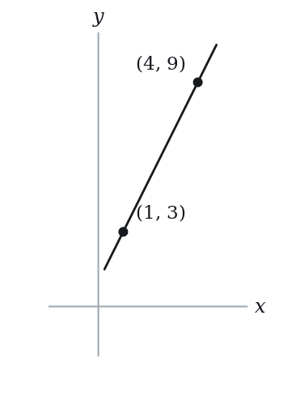
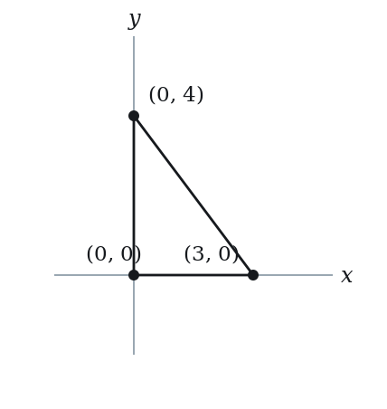
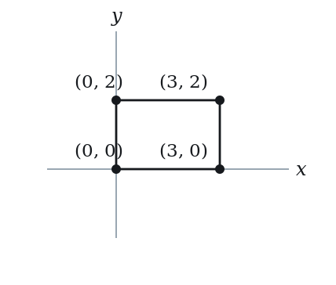
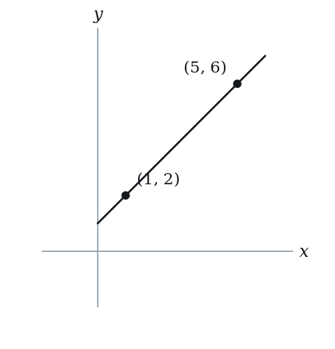

# Parallel & Perpendicular Lines — Practice Set

**Bank code:** `COG-PPL` · **Section:** Coordinate Geometry · **30 questions** — Easy 7 · Medium 15 · Hard 8

**Lecture capsule:** [05-parallel-perpendicular-lines.md](../../06-coordinate-geometry/05-parallel-perpendicular-lines.md)

> Parallel means equal slopes and different intercepts; perpendicular means the negative reciprocal, not one or the other; convert to y = mx + b before you compare.

Every question below is live in the question bank under the ID shown — the sheet and the portal are the same questions. Attempt a level with the clock running, then check Part C.

---

## Part A — Questions

> **Quantitative Comparison — the four choices are always the same, so they are not reprinted:**
> **(A)** Quantity A is greater · **(B)** Quantity B is greater · **(C)** The two quantities are equal · **(D)** The relationship cannot be determined from the information given

### Level 1 · Easy — 7 questions · ~6 min

*warm-up — these must be automatic*

**Q1** · `COG-PPL-002` · MCQ · 45s

What is the slope of a line perpendicular to y = 4x − 3?

**(A)** -4  
**(B)** -1/4  
**(C)** 1/4  
**(D)** 3  
**(E)** 4

**Q2** · `COG-PPL-003` · MCQ · 60s

Line L has equation 2x + 4y = 8. Which of the following is parallel to L?

**(A)** y = 2x + 1  
**(B)** y = -x + 3  
**(C)** y = -(1/2)x + 6  
**(D)** y = (1/2)x - 1  
**(E)** y = -2x + 4

**Q3** · `COG-PPL-004` · Numeric Entry · 40s

If line A has slope 5, what is the slope of every line perpendicular to line A?

*Numeric entry — write the number.*

**Q4** · `COG-PPL-005` · MCQ · 50s

Are the lines y = 7 and x = 3 parallel, perpendicular, or neither?

**(A)** Parallel, because both are constants  
**(B)** Neither, because one slope is 0 and the other is 3  
**(C)** Perpendicular, because a horizontal line is perpendicular to a vertical line  
**(D)** Parallel, because neither line passes through the origin  
**(E)** Neither, because the product of their slopes is not -1

**Q5** · `COG-PPL-009` · MCQ · 40s

Two lines have equations y = mx + 3 and y = 5x - 1. For the two lines to be parallel, what must the value of m be?

**(A)** -5  
**(B)** -1/5  
**(C)** 1/5  
**(D)** 3  
**(E)** 5

**Q6** · `COG-PPL-014` · QC · 55s

Line A has slope m. Line B is perpendicular to line A and has slope n. Assume m ≠ 0.

> **Quantity A:**  m × n
> **Quantity B:**  -1

**Q7** · `COG-PPL-019` · QC · 65s

Line 1: y = 3x + 2. Line 2: y = -3x + 2.

> **Quantity A:**  The slope of a line perpendicular to Line 1
> **Quantity B:**  The slope of a line perpendicular to Line 2

---

### Level 2 · Medium — 15 questions · ~22 min

*two or three steps, one planted trap each*

**Q8** · `COG-PPL-011` · MCQ · 70s

What is the equation of the line that passes through (2, 5) and is parallel to y = -3x + 1?

**(A)** y = -3x + 11  
**(B)** y = -3x - 1  
**(C)** y = (1/3)x + 5  
**(D)** y = 3x - 1  
**(E)** y = -3x + 5

**Q9** · `COG-PPL-012` · MCQ · 75s

In the xy-plane, line k is perpendicular to the line y = (1/2)x − 3 and passes through the point (4, 1). Which of the following is an equation of line k?

**(A)** y = 2x - 7  
**(B)** y = -2x + 9  
**(C)** y = (1/2)x + 1  
**(D)** y = -2x + 1  
**(E)** y = 2x + 1

**Q10** · `COG-PPL-015` · Numeric Entry · 75s

The line 4x - ky = 8 is parallel to the line y = 2x + 3. What is the value of k?

*Numeric entry — write the number.*

**Q11** · `COG-PPL-016` · Select all that apply · 100s

Which of the following are equations of lines that are parallel to, and different from, the line y = −4x + 2? Select all that apply.

**(A)** 4x + y = 7  
**(B)** 8x + 2y = 5  
**(C)** y = 4x - 2  
**(D)** y = -4x + 2  
**(E)** -4x - y = 10

**Q12** · `COG-PPL-017` · MCQ · 70s

Line L has equation 5x + 2y = 10. What is the slope of any line perpendicular to L?

**(A)** -5/2  
**(B)** -2/5  
**(C)** 2/5  
**(D)** 5/2  
**(E)** 5

**Q13** · `COG-PPL-018` · Numeric Entry · 100s

Point A is at (1, 3) and point B is at (4, 9). A line is drawn through A and B. What is the y-intercept of the line perpendicular to AB that passes through the midpoint of AB?

*Numeric entry — write the number.*

**Q14** · `COG-PPL-021` · Numeric Entry · 70s

The lines y = (k+1)x + 3 and y = 2kx - 5 are parallel. What is the value of k?

*Numeric entry — write the number.*

**Q15** · `COG-PPL-023` · MCQ · 60s

In the xy-plane, line p has equation ax + by = c, where b ≠ 0. What is the slope of a line parallel to p?

**(A)** a/b  
**(B)** -a/b  
**(C)** b/a  
**(D)** -b/a  
**(E)** c/b

**Q16** · `COG-PPL-024` · QC · 90s

Line 1 passes through (0, 0) and (3, 6). Line 2 is perpendicular to Line 1 and passes through (6, 3).

> **Quantity A:**  The y-intercept of Line 2
> **Quantity B:**  6

**Q17** · `COG-PPL-029` · QC · 100s

Line 1: 3x + 4y = 12. Line 2: 4x - 3y = 6.

> **Quantity A:**  The product of the slopes of Line 1 and Line 2
> **Quantity B:**  -1

**Q18** · `COG-PPL-030` · MCQ · 120s

In the xy-plane, triangle ABC has vertices A(0, 0), B(3, 0), and C(0, 4). What is the equation of the altitude from A to side BC?

**(A)** y = 0  
**(B)** x = 0  
**(C)** y = (3/4)x  
**(D)** y = -(4/3)x  
**(E)** y = x

**Q19** · `COG-PPL-035` · MCQ · 90s

In the xy-plane, the vertices of a rectangle are at A(0, 0), B(3, 0), C(3, 2), and D(0, 2). A diagonal is drawn from A to C. What is the slope of the line perpendicular to AC that passes through B?

**(A)** -3/2  
**(B)** -2/3  
**(C)** -1/2  
**(D)** 2/3  
**(E)** 3/2

**Q20** · `COG-PPL-039` · QC · 160s

In the xy-plane, three lines L1, L2, and L3 form a right triangle. L1: y = 3x + 2. L2 is perpendicular to L1 and passes through (1, 5). L3 passes through the x-intercepts of L1 and L2.

> **Quantity A:**  The slope of L3
> **Quantity B:**  0

**Q21** · `COG-PPL-KMF-004` · MCQ · 90s

In the xy-plane, line L has equation 2x + 6y = 9. Line M is perpendicular to L and crosses the x-axis at the point (4, 0). Which of the following points lies on line M?

**(A)** (7, -9)  
**(B)** (7, -1)  
**(C)** (7, 1)  
**(D)** (7, 9)  
**(E)** (7, 25)

**Q22** · `COG-PPL-KMF-006` · Numeric Entry · 75s

A right triangle is drawn in the xy-plane so that no side is parallel to either axis. The line through its longest side is y = kx + 4. Multiplying together the slopes of all three sides gives -6. What is the value of k?

*Numeric entry — write the number.*

---

### Level 3 · Hard — 8 questions · ~17 min

*where 162+ is won or lost*

**Q23** · `COG-PPL-031` · Select all that apply · 130s

Which of the following pairs of lines are perpendicular to each other? Select all that apply.

**(A)** y = (2/5)x + 1 and y = -(5/2)x + 3  
**(B)** 3x + y = 6 and x - 3y = 9  
**(C)** y = 4 and x = -7  
**(D)** y = 3x and y = 3x + 5  
**(E)** 2x - y = 4 and x + 2y = 8

**Q24** · `COG-PPL-032` · Numeric Entry · 100s

The distance between the parallel lines 3x + 4y = 5 and 3x + 4y = 20 is what value?

*Numeric entry — write the number.*

**Q25** · `COG-PPL-033` · MCQ · 120s

Line L is perpendicular to the segment joining P(1, 2) and Q(5, 6), and passes through the midpoint of PQ. Which of the following points lies on L?

**(A)** (2, 4)  
**(B)** (3, 3)  
**(C)** (5, 2)  
**(D)** (5, 3)  
**(E)** (1, 5)

**Q26** · `COG-PPL-040` · Select all that apply · 180s

In the xy-plane, point P = (2, 3). Line L1 passes through P and is parallel to 4x + 6y = 12. Line L2 passes through P and is perpendicular to L1. Which of the following statements are true? Select all that apply.

**(A)** The slope of L1 is −3/2  
**(B)** The slope of L2 is 3/2  
**(C)** L1 has y-intercept 4/3  
**(D)** L2 passes through the point (4, 6)  
**(E)** L1 and L2 intersect at P = (2, 3)

**Q27** · `COG-PPL-KMF-003` · MCQ · 150s

Consider the straight line L given by y = 2x - 4 and the point P = (-1, 4). Reflect P across L to obtain P', so that L is the perpendicular bisector of segment PP'. What is the sum of the two coordinates of P'?

**(A)** -2  
**(B)** 3  
**(C)** 5  
**(D)** 7  
**(E)** 8

**Q28** · `SEC-CG-006` · MCQ · 110s

In the xy-plane, line L has equation 2x + 5y = 20. Line M is perpendicular to L and passes through the x-intercept of L. At what value of y does line M cross the y-axis?

**(A)** -25  
**(B)** -10  
**(C)** -4  
**(D)** 4  
**(E)** 25

**Q29** · `SEC-CG-032` · MCQ · 110s

In the xy-plane, circle C has center (2, 3), and the point (7, 15) lies on circle C. What is the slope of the line tangent to circle C at (7, 15)?

**(A)** -12/5  
**(B)** -5/12  
**(C)** 5/12  
**(D)** 12/5  
**(E)** 13/5

**Q30** · `SEC-CG-035` · Numeric Entry · 110s

In the xy-plane, line m passes through the point (6, 6) and is perpendicular to the line x + y = 2. The point (a, b) lies on line m and is halfway between (6, 6) and the line x + y = 2. What is the value of a + b?

*Numeric entry — write the number.*

---

## Part B — Answer Key

| Q | ID | Level | Type | Answer |
|---|---|---|---|---|
| 1 | `COG-PPL-002` | easy | MCQ | **B** |
| 2 | `COG-PPL-003` | easy | MCQ | **C** |
| 3 | `COG-PPL-004` | easy | Numeric Entry | **-1/5** |
| 4 | `COG-PPL-005` | easy | MCQ | **C** |
| 5 | `COG-PPL-009` | easy | MCQ | **E** |
| 6 | `COG-PPL-014` | easy | QC | **C** |
| 7 | `COG-PPL-019` | easy | QC | **B** |
| 8 | `COG-PPL-011` | medium | MCQ | **A** |
| 9 | `COG-PPL-012` | medium | MCQ | **B** |
| 10 | `COG-PPL-015` | medium | Numeric Entry | **2** |
| 11 | `COG-PPL-016` | medium | Select all that apply | **A, B, E** |
| 12 | `COG-PPL-017` | medium | MCQ | **C** |
| 13 | `COG-PPL-018` | medium | Numeric Entry | **29/4** |
| 14 | `COG-PPL-021` | medium | Numeric Entry | **1** |
| 15 | `COG-PPL-023` | medium | MCQ | **B** |
| 16 | `COG-PPL-024` | medium | QC | **C** |
| 17 | `COG-PPL-029` | medium | QC | **C** |
| 18 | `COG-PPL-030` | medium | MCQ | **C** |
| 19 | `COG-PPL-035` | medium | MCQ | **A** |
| 20 | `COG-PPL-039` | medium | QC | **C** |
| 21 | `COG-PPL-KMF-004` | medium | MCQ | **D** |
| 22 | `COG-PPL-KMF-006` | medium | Numeric Entry | **6** |
| 23 | `COG-PPL-031` | hard | Select all that apply | **A, B, C, E** |
| 24 | `COG-PPL-032` | hard | Numeric Entry | **3** |
| 25 | `COG-PPL-033` | hard | MCQ | **C** |
| 26 | `COG-PPL-040` | hard | Select all that apply | **B, D, E** |
| 27 | `COG-PPL-KMF-003` | hard | MCQ | **D** |
| 28 | `SEC-CG-006` | hard | MCQ | **A** |
| 29 | `SEC-CG-032` | hard | MCQ | **B** |
| 30 | `SEC-CG-035` | hard | Numeric Entry | **7** |

---

## Part C — Worked Solutions

### Q1 · `COG-PPL-002` — Answer: B

The given line has slope m = 4. The perpendicular slope is the negative reciprocal: −1/4. Multiply: 4 × (−1/4) = −1 ✓.

**Trap.** Students negate the slope (getting −4) but forget to take the reciprocal, or take the reciprocal (getting 1/4) but forget to negate. Both steps are required.

### Q2 · `COG-PPL-003` — Answer: C

Rewrite 2x + 4y = 8 as 4y = -2x + 8, so y = -(1/2)x + 2. The slope is -1/2. Option C, y = -(1/2)x + 6, also has slope -1/2 and a different intercept, so it is parallel to L.

**Trap.** Students may read the coefficient of x in the original equation (2) as the slope without rearranging into slope-intercept form. Always convert to y = mx + b first.

### Q3 · `COG-PPL-004` — Answer: -1/5

For perpendicular lines, the slopes are negative reciprocals: m_perp = -1/m = -1/5. You can verify: 5 × (-1/5) = -1 ✓.

**Trap.** Students write -5 (negating without flipping) or 1/5 (flipping without negating). Both operations — flip and negate — must be done simultaneously.

### Q4 · `COG-PPL-005` — Answer: C

y = 7 is a horizontal line (slope = 0). x = 3 is a vertical line (undefined slope). A horizontal line is always perpendicular to a vertical line — they meet at right angles. This is a special case where the m1 × m2 = -1 formula does not apply (since one slope is undefined), but perpendicularity still holds geometrically.

**Trap.** Students apply the m1 × m2 = -1 formula and, since slope of x = 3 is undefined, incorrectly conclude 'neither.' The special-case rule must be remembered: horizontal ⊥ vertical.

### Q5 · `COG-PPL-009` — Answer: E

Parallel lines have equal slopes. The second line has slope 5. Therefore m must equal 5. Note: with m = 5, the lines are y = 5x + 3 and y = 5x - 1 — same slope, different intercepts, so they are indeed parallel (not the same line).

**Trap.** Students may confuse the condition for parallel (m1 = m2) with perpendicular (m1 × m2 = -1) and choose -1/5.

### Q6 · `COG-PPL-014` — Answer: C

By definition, if two lines are perpendicular, the product of their slopes equals -1 (provided neither slope is zero or undefined). So m × n = -1, which equals Quantity B.

**Trap.** Students may think the answer depends on the actual values of m and n, selecting D. But the perpendicularity condition directly gives m × n = -1, always.

### Q7 · `COG-PPL-019` — Answer: B

Perpendicular to Line 1 (slope 3): slope = -1/3. Perpendicular to Line 2 (slope -3): slope = -1/(-3) = 1/3. Quantity A = -1/3 ≈ -0.333. Quantity B = 1/3 ≈ 0.333. Quantity B is greater.

**Trap.** Students may confuse the sign when computing negative reciprocals. The perpendicular of slope -3 is 1/3 (positive), not -1/3.

### Q8 · `COG-PPL-011` — Answer: A

A parallel line has the same slope: m = -3. Using point-slope form with (2, 5): y - 5 = -3(x - 2) → y - 5 = -3x + 6 → y = -3x + 11.

**Trap.** Students may substitute x = 2, y = 5 directly into the original equation's b-value, writing y = -3x + 5 (option E). The y-intercept must be recalculated using the given point.

### Q9 · `COG-PPL-012` — Answer: B

The slope of the given line is 1/2. The perpendicular slope is -2. Using point-slope form with (4, 1): y - 1 = -2(x - 4) → y - 1 = -2x + 8 → y = -2x + 9.

**Trap.** Students may use slope 2 (taking reciprocal without negating) and get y = 2x - 7. The perpendicular slope must be the negative reciprocal: -2, not +2.

### Q10 · `COG-PPL-015` — Answer: 2

Rewrite 4x - ky = 8 as y = (4/k)x - 8/k. For this to be parallel to y = 2x + 3, their slopes must be equal: 4/k = 2 → k = 2. Check intercepts: -8/2 = -4 ≠ 3 ✓ (parallel, not the same line).

**Trap.** Students may set 4/k = 2 correctly but solve as k = 1/2 by inverting without care. Cross-multiply: 4 = 2k → k = 2.

### Q11 · `COG-PPL-016` — Answer: A, B, E

The target slope is -4. A: 4x + y = 7 → y = -4x + 7, slope = -4, y-intercept = 7 ≠ 2 ✓ parallel. B: 8x + 2y = 5 → y = -4x + 5/2, slope = -4, y-intercept = 5/2 ≠ 2 ✓ parallel. C: y = 4x - 2, slope = 4 ≠ -4 ✗. D: y = -4x + 2 — this is the SAME line as given, not a distinct parallel line ✗. E: -4x - y = 10 → y = -4x - 10, slope = -4, y-intercept = -10 ≠ 2 ✓ parallel. Answers: A, B, and E.

**Trap.** Students may include D (same line is NOT parallel by strict definition — parallel lines must be distinct). Students may also exclude E by not rearranging to find its slope. B requires dividing by 2 to reveal slope -4.

### Q12 · `COG-PPL-017` — Answer: C

Rewrite: 2y = -5x + 10 → y = -(5/2)x + 5. Slope of L = -5/2. Perpendicular slope = -1 ÷ (-5/2) = 2/5.

**Trap.** Students may read the x-coefficient (5) or the y-coefficient (2) directly without converting. Or they negate -5/2 to get 5/2 without also flipping to get 2/5.

### Q13 · `COG-PPL-018` — Answer: 29/4

Slope of AB = (9-3)/(4-1) = 6/3 = 2. Perpendicular slope = -1/2. Midpoint of AB = ((1+4)/2, (3+9)/2) = (5/2, 6). Perpendicular line through (5/2, 6): y - 6 = -1/2(x - 5/2) → y = -x/2 + 5/4 + 6 = -x/2 + 5/4 + 24/4 = -x/2 + 29/4. At x = 0: y = 29/4 = 7.25.

**Trap.** Students may forget to find the midpoint and instead pass the perpendicular through A or B. Also, students may use slope 2 instead of -1/2 for the perpendicular. A common arithmetic error is computing 5/4 + 6 as 7/4 instead of 29/4.

### Q14 · `COG-PPL-021` — Answer: 1

For parallel lines, slopes must be equal: k + 1 = 2k → 1 = k. Check that lines are distinct: y = 2x + 3 and y = 2x - 5 — same slope 2, different intercepts ✓.

**Trap.** Students may set up k + 1 = 2k correctly but make arithmetic errors. Also, after finding k = 1, they should verify the lines are not identical (they are not: 3 ≠ -5).

### Q15 · `COG-PPL-023` — Answer: B

Solve for y: by = −ax + c, so y = −(a/b)x + c/b. The slope of p is −a/b, and a parallel line has the same slope.

**Trap.** Students drop the sign that comes from moving ax across the equation and answer a/b, or they invert the coefficients and answer b/a or −b/a.

### Q16 · `COG-PPL-024` — Answer: C

Slope of Line 1 = (6-0)/(3-0) = 2. Perpendicular slope = -1/2. Line 2 through (6, 3): y - 3 = -1/2(x - 6) → y = -x/2 + 3 + 3 = -x/2 + 6. The y-intercept is 6. Quantity A = 6 = Quantity B.

**Trap.** Students may compute the perpendicular slope as -2 (forgetting to flip) and get a different y-intercept. With correct slope -1/2, the y-intercept is exactly 6.

### Q17 · `COG-PPL-029` — Answer: C

Line 1: 4y = -3x + 12 → y = -(3/4)x + 3. Slope m1 = -3/4. Line 2: -3y = -4x + 6 → y = (4/3)x - 2. Slope m2 = 4/3. Product: (-3/4)(4/3) = -12/12 = -1. Quantity A = Quantity B.

**Trap.** Students may read coefficients directly: 3 × 4 = 12 ≠ -1. The slopes must be extracted by converting to y = mx + b form first. Many students read ax + by = c as slope = a/b rather than -a/b.

### Q18 · `COG-PPL-030` — Answer: C

The altitude from A is the line through A(0,0) perpendicular to BC. Slope of BC: B=(3,0) to C=(0,4) → slope = (4-0)/(0-3) = 4/(-3) = -4/3. Perpendicular slope = -1/(-4/3) = 3/4. Altitude through A(0,0): y = (3/4)x.

**Trap.** Students may compute the slope of AB (which is 0, giving a vertical line through A, i.e., x = 0) or the slope of AC (which is undefined, giving y = 0) instead of BC. The altitude from vertex A must be perpendicular to the OPPOSITE side BC.

### Q19 · `COG-PPL-035` — Answer: A

Slope of AC = (2-0)/(3-0) = 2/3. Perpendicular slope = -3/2. The line perpendicular to AC through B(3,0) has slope -3/2.

**Trap.** Students may compute the slope of AC correctly as 2/3 but then use 2/3 or -2/3 (option B) for the perpendicular instead of -3/2. The perpendicular of 2/3 requires both flipping (→ 3/2) and negating (→ -3/2).

### Q20 · `COG-PPL-039` — Answer: C

L1: y = 3x + 2. x-intercept of L1: 0 = 3x + 2 → x = -2/3. Point A = (-2/3, 0). L2 has perpendicular slope = -1/3. Through (1, 5): y - 5 = -1/3(x - 1) → y = -x/3 + 1/3 + 5 = -x/3 + 16/3. x-intercept of L2: 0 = -x/3 + 16/3 → x = 16. Point B = (16, 0). L3 passes through A(-2/3, 0) and B(16, 0). Both points have y = 0 — they are both on the x-axis. A line through two points with the same y-value is horizontal, so slope of L3 = 0. Quantity A = 0 = Quantity B.

**Trap.** Students may rush through computing the x-intercepts and find a non-zero slope for L3. The key conceptual insight: two x-intercepts both lie on the x-axis (y = 0), so any line through them must be horizontal with slope 0. This makes the comparison trivially equal.

### Q21 · `COG-PPL-KMF-004` — Answer: D

1. Rewrite L as y = -(1/3)x + 9/6, so its slope is -1/3.
2. A perpendicular line has slope equal to the negative reciprocal: 3.
3. M passes through (4, 0) with slope 3: y = 3(x - 4).
4. At x = 7: y = 3(7 - 4) = 9, so (7, 9) is on M.
Check the others at x = 7: A gives -9 (slope -3), B gives -1 (slope -1/3, parallel to L), C gives 1 (slope 1/3), E would need slope 25/3 from (4, 0), not 3; none of these matches y = 9.

**Trap.** Flipping the slope to -3 without changing its sign gives the line y = -3(x - 4), and at x = 7 this puts the point at (7, -9), which is choice A.

### Q22 · `COG-PPL-KMF-006` — Answer: 6

1. The longest side of a right triangle is the hypotenuse, so the other two sides are the legs and they meet at the right angle.
2. Perpendicular lines that are neither vertical nor horizontal have slopes that are negative reciprocals, so the two leg slopes multiply to -1.
3. The product of all three slopes is (-1)*k = -6, so k = 6.
Check: legs with slopes 2 and -1/2 and a hypotenuse of slope 6 give 2*(-1/2)*6 = -6.

**Trap.** Treating the two leg slopes as having a product of +1 (equal reciprocals with the same sign) gives k = -6 instead of 6.

### Q23 · `COG-PPL-031` — Answer: A, B, C, E

A: slopes 2/5 and -5/2. Product = (2/5)(-5/2) = -1 ✓. B: 3x+y=6 → y = -3x+6, slope=-3. x-3y=9 → y = (1/3)x-3, slope=1/3. Product = (-3)(1/3) = -1 ✓. C: y=4 (horizontal) and x=-7 (vertical) are perpendicular ✓ (special case). D: both have slope 3 — they are parallel, not perpendicular ✗. E: 2x-y=4 → y=2x-4, slope=2. x+2y=8 → y=-x/2+4, slope=-1/2. Product = (2)(-1/2) = -1 ✓.

**Trap.** Students may miss C (the special horizontal/vertical case) and may incorrectly apply m1×m2 = -1 formula when one slope is undefined. Also, D is a common confusion — same slope means parallel, not perpendicular.

### Q24 · `COG-PPL-032` — Answer: 3

For two parallel lines ax + by = c1 and ax + by = c2, the distance is |c1 - c2| / √(a² + b²). Here a = 3, b = 4, c1 = 5, c2 = 20. Distance = |5 - 20| / √(9 + 16) = 15 / √25 = 15/5 = 3.

**Trap.** Students may compute |c1 - c2| = 15 and stop, forgetting to divide by √(a² + b²). The denominator √25 = 5 is essential and conveniently simplifies here.

### Q25 · `COG-PPL-033` — Answer: C

Slope of PQ = (6-2)/(5-1) = 4/4 = 1. Perpendicular slope = -1. Midpoint of PQ = ((1+5)/2, (2+6)/2) = (3, 4). Line L: y - 4 = -1(x - 3) → y = -x + 7. Check each option: A(2,4): 2+4=6≠7 ✗. B(3,3): 3+3=6≠7 ✗. C(5,2): 5+2=7 ✓. D(5,3): 5+3=8≠7 ✗. E(1,5): 1+5=6≠7 ✗. Answer: C.

**Trap.** Students may find the midpoint correctly but use slope 1 (same as PQ) instead of -1 (perpendicular). The perpendicular bisector has the form x + y = 7, so any point (a, b) on it satisfies a + b = 7.

### Q26 · `COG-PPL-040` — Answer: B, D, E

4x + 6y = 12 gives y = −(2/3)x + 2, so the slope is −2/3. L1 is parallel, so it has slope −2/3 and passes through (2, 3): y − 3 = −(2/3)(x − 2), so y = −(2/3)x + 13/3. L2 is perpendicular, so its slope is 3/2.
A: Slope of L1 is −2/3, not −3/2. False.
B: Slope of L2 is 3/2. True.
C: The y-intercept of L1 is 13/3, not 4/3. False.
D: From (2, 3) with slope 3/2, moving 2 right gives 3 up, so (4, 6) is on L2. True.
E: Both lines pass through P. True.
The correct choices are B, D and E.

**Trap.** For A, students flip the slope of 4x + 6y = 12 to −3/2 (reading the coefficients as 6/4 instead of 4/6). For C, students compute only 4/3 and forget to add back the 3 in y = −(2/3)x + 4/3 + 3.

### Q27 · `COG-PPL-KMF-003` — Answer: D

The line through P perpendicular to L has slope -1/2 (negative reciprocal of 2): y - 4 = -(1/2)(x + 1), i.e. y = -x/2 + 3.5.
Intersect with L: 2x - 4 = -x/2 + 3.5, so 2.5x = 7.5 and x = 3, y = 2. The foot of the perpendicular is F = (3, 2).
F is the midpoint of PP', so P' = 2F - P = (6 - (-1), 4 - 4) = (7, 0).
Sum of coordinates = 7 + 0 = 7.
Check: P' lies on y = -x/2 + 3.5? At x = 7, y = -3.5 + 3.5 = 0. Yes. Distances: PF = sqrt(16 + 4) and FP' = sqrt(16 + 4), equal.

**Trap.** Stopping at the foot of the perpendicular F = (3, 2) and adding its coordinates gives 5 (option C); using slope -2 instead of -1/2 leads to option A.

### Q28 · `SEC-CG-006` — Answer: A

Setting y = 0 in L gives 2x = 20, so L crosses the x-axis at (10, 0). Solving L for y gives 5y = -2x + 20, that is y = -(2/5)x + 4, so L has slope -2/5 and M must have the negative reciprocal slope, 5/2. Line M through (10, 0) is y - 0 = (5/2)(x - 10), which expands to y = (5/2)x - 25. At x = 0 that gives y = -25.

**Trap.** Students reuse L's own slope instead of the perpendicular one; the line through (10, 0) with slope -2/5 is simply L again, crossing the y-axis at 4, option D. The negative reciprocal of -2/5 flips the fraction as well as the sign, giving 5/2.

### Q29 · `SEC-CG-032` — Answer: B

A tangent to a circle is perpendicular to the radius drawn to the point of tangency. The radius runs from (2, 3) to (7, 15), so its slope is (15 - 3)/(7 - 2) = 12/5. The tangent's slope is the negative reciprocal of that, which is -5/12.

**Trap.** Students compute the radius slope 12/5 and stop there, answering D, or they negate without inverting and answer -12/5. Perpendicular slopes must multiply to -1, and (12/5)(-5/12) = -1 while (12/5)(-12/5) does not.

### Q30 · `SEC-CG-035` — Answer: 7

The line x + y = 2 rearranges to y = -x + 2, so its slope is -1 and any perpendicular line has slope 1. Line m therefore passes through (6, 6) with slope 1, which makes it y = x. Line m meets x + y = 2 where x + x = 2, that is at x = 1 and y = 1, the point (1, 1). Being halfway between (6, 6) and the line means being the midpoint of (6, 6) and (1, 1), which is (3.5, 3.5). So a + b = 3.5 + 3.5 = 7.

**Trap.** Students give line m the slope -1, copying x + y = 2 instead of taking its negative reciprocal; that line is parallel to x + y = 2 and never meets it, so there is no foot to measure from. Others locate the foot (1, 1) correctly but then report a + b for the foot itself, answering 2, rather than for the midpoint (3.5, 3.5).
