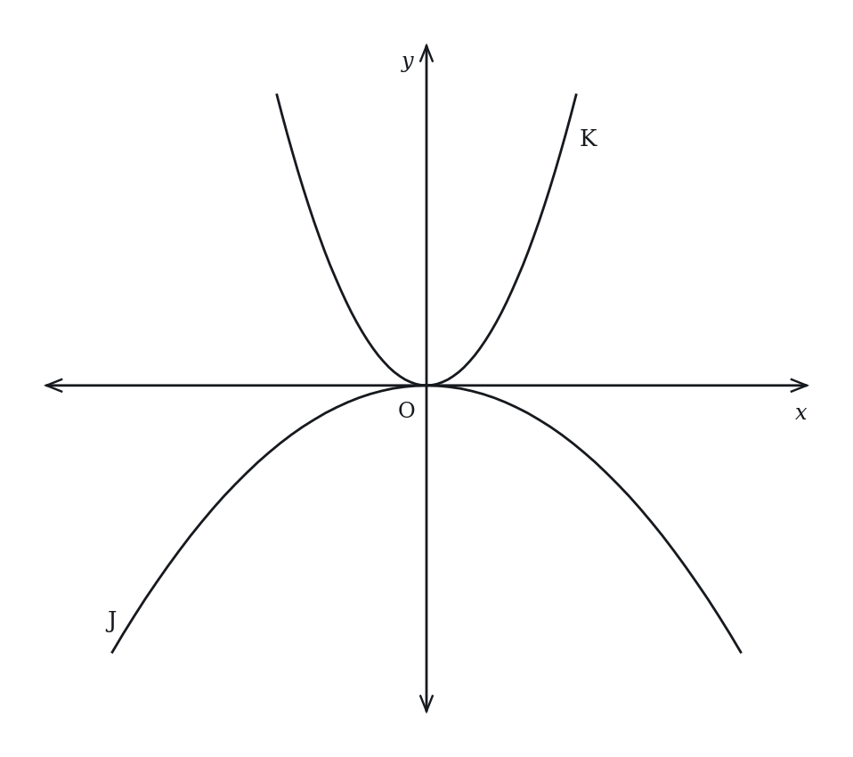

# Parabolas & Quadratic Graphs — Practice Set

**Bank code:** `COG-GQF` · **Section:** Coordinate Geometry · **30 questions** — Easy 7 · Medium 16 · Hard 7

**Lecture capsule:** [06-parabolas-quadratic-graphs.md](../../06-coordinate-geometry/06-parabolas-quadratic-graphs.md)

> The vertex sits at x = -b/(2a) and the y-intercept is c; the discriminant counts the x-intercepts, so tangency means it is zero.

Every question below is live in the question bank under the ID shown — the sheet and the portal are the same questions. Attempt a level with the clock running, then check Part C.

---

## Part A — Questions

> **Quantitative Comparison — the four choices are always the same, so they are not reprinted:**
> **(A)** Quantity A is greater · **(B)** Quantity B is greater · **(C)** The two quantities are equal · **(D)** The relationship cannot be determined from the information given

### Level 1 · Easy — 7 questions · ~6 min

*warm-up — these must be automatic*

**Q1** · `COG-GQF-001` · MCQ · 40s

What is the y-intercept of the parabola y = 3x² − 7x + 5?

**(A)** −7  
**(B)** 3  
**(C)** 5  
**(D)** 7  
**(E)** 15

**Q2** · `COG-GQF-003` · MCQ · 50s

What is the axis of symmetry of the parabola y = x² − 6x + 8?

**(A)** x = −3  
**(B)** x = 3  
**(C)** y = 3  
**(D)** x = 6  
**(E)** x = −6

**Q3** · `COG-GQF-005` · Numeric Entry · 50s

The parabola y = 2x² − 4x + 6 has its vertex at x = k. What is the value of k?

*Numeric entry — write the number.*

**Q4** · `COG-GQF-006` · MCQ · 55s

How many x-intercepts does the parabola y = x² + 4x + 4 have?

**(A)** 0  
**(B)** 1  
**(C)** 2  
**(D)** 3  
**(E)** 4

**Q5** · `COG-GQF-008` · MCQ · 60s

The parabola y = x² − 5x + 6 crosses the x-axis at two points. What are the x-intercepts?

**(A)** x = 1 and x = 6  
**(B)** x = 2 and x = 3  
**(C)** x = −2 and x = −3  
**(D)** x = −1 and x = 6  
**(E)** x = 2 and x = −3

**Q6** · `COG-GQF-010` · MCQ · 50s

How many real solutions does the equation x² + 2x + 5 = 0 have?

**(A)** 0  
**(B)** 1  
**(C)** 2  
**(D)** 3  
**(E)** Infinitely many

**Q7** · `COG-GQF-018` · Numeric Entry · 55s

The parabola y = −x² + 4x + k passes through the origin (0, 0). What is the value of k?

*Numeric entry — write the number.*

---

### Level 2 · Medium — 16 questions · ~22 min

*two or three steps, one planted trap each*

**Q8** · `COG-GQF-011` · MCQ · 75s

The vertex of the parabola y = 2x² − 8x + 3 is at point (h, k). What is the value of k?

**(A)** −11  
**(B)** −8  
**(C)** −5  
**(D)** 3  
**(E)** 4

**Q9** · `COG-GQF-012` · QC · 70s

y = x² − 4x + 7

> **Quantity A:**  The minimum value of y
> **Quantity B:**  3

**Q10** · `COG-GQF-013` · MCQ · 80s

A ball is thrown upward. Its height in feet after t seconds is given by h(t) = −16t² + 64t + 5. What is the maximum height reached by the ball?

**(A)** 5 feet  
**(B)** 64 feet  
**(C)** 69 feet  
**(D)** 75 feet  
**(E)** 85 feet

**Q11** · `COG-GQF-014` · Numeric Entry · 75s

The parabola y = x² + bx + 16 has exactly one x-intercept. If b > 0, what is the value of b?

*Numeric entry — write the number.*

**Q12** · `COG-GQF-015` · QC · 60s

The parabola y = 3x² − 12x + 7.

> **Quantity A:**  The x-coordinate of the vertex
> **Quantity B:**  2

**Q13** · `COG-GQF-017` · MCQ · 70s

The graph of y = a(x + 2)² − 5 passes through the point (0, 3). What is the value of a?

**(A)** −2  
**(B)** −1  
**(C)** 1  
**(D)** 2  
**(E)** 4

**Q14** · `COG-GQF-019` · QC · 80s

Parabola P: y = 2x² − 8x + 9

> **Quantity A:**  The y-coordinate of the vertex of P
> **Quantity B:**  The y-intercept of P

**Q15** · `COG-GQF-020` · MCQ · 75s

The profit P (in hundreds of dollars) from selling x units of a product is P = −x² + 10x − 16. How many units should be sold to maximize profit?

**(A)** 4  
**(B)** 5  
**(C)** 6  
**(D)** 8  
**(E)** 10

**Q16** · `COG-GQF-022` · MCQ · 85s

The graph of y = x² + 6x + c in the xy-plane has no x-intercepts. Which of the following could be the value of c?

**(A)** −9  
**(B)** 3  
**(C)** 6  
**(D)** 9  
**(E)** 10

**Q17** · `COG-GQF-028` · QC · 95s

The parabolas y = x² − 4x + 3 and y = −x² + 4x − 3 intersect at two points.

> **Quantity A:**  The x-coordinate of the midpoint between the two intersection points
> **Quantity B:**  2

**Q18** · `COG-GQF-036` · MCQ · 95s

The graph of y = f(x) is a parabola with vertex at (2, −3) and passes through (0, 5). Which of the following is f(x)?

**(A)** f(x) = 2(x − 2)² − 3  
**(B)** f(x) = −2(x − 2)² − 3  
**(C)** f(x) = 2(x + 2)² − 3  
**(D)** f(x) = 3(x − 2)² − 3  
**(E)** f(x) = (x − 2)² − 3

**Q19** · `COG-GQF-039` · QC · 125s

For constants a, b, c with a > 0 and b² − 4ac < 0, the parabola y = ax² + bx + c lies entirely above the x-axis.

> **Quantity A:**  The number of distinct real values of x satisfying ax² + bx + c = 0
> **Quantity B:**  The number of distinct real values of x satisfying ax² + bx + c = −1

**Q20** · `COG-GQF-KMF-002` · MCQ · 70s

Which of the following correctly describes the parabola in the xy-plane given by y = -(x + 3)^2 + 4?

**(A)** Opens upward; vertex at (-3, 4); never crosses the x-axis  
**(B)** Opens upward; vertex at (3, -4); crosses the x-axis at x = 1 and x = 5  
**(C)** Opens downward; vertex at (-3, -4); never crosses the x-axis  
**(D)** Opens downward; vertex at (3, 4); crosses the x-axis at x = 1 and x = 5  
**(E)** Opens downward; vertex at (-3, 4); crosses the x-axis at x = -5 and x = -1

**Q21** · `COG-GQF-KMF-003` · Select all that apply · 110s

The parabola given by y = -(x - 4)^2 + 7 is drawn in a coordinate plane.

Which of the following statements about this parabola are true? Select all that apply.

**(A)** Its highest point is (4, 7).  
**(B)** The point (0, -9) lies on it.  
**(C)** It is symmetric about the vertical line x = -4.  
**(D)** The point (4, -7) lies on it.  
**(E)** It crosses the x-axis at two points, both to the right of the y-axis.  
F. Every point of it lies below the x-axis.

**Q22** · `COG-GQF-KMF2-001` · QC · 80s

In the xy-plane above, parabola J is the graph of y = cx^2 and parabola K is the graph of y = dx^2, where c and d are constants.

> **Quantity A:**  c
> **Quantity B:**  d

**Q23** · `COG-GQF-KMF2-002` · QC · 85s

In the xy-plane, the graph of y = 2x^2 + bx + 9, where b is a constant, passes through two points that have the same y-coordinate, one with x-coordinate 4 and the other with x-coordinate -2.

> **Quantity A:**  b
> **Quantity B:**  -3

---

### Level 3 · Hard — 7 questions · ~13 min

*where 162+ is won or lost*

**Q24** · `COG-GQF-029` · Numeric Entry · 100s

The parabola y = x² − 6x + c is tangent to the x-axis (touches it at exactly one point). This same parabola passes through the point (7, p). What is the value of p?

*Numeric entry — write the number.*

**Q25** · `COG-GQF-031` · QC · 100s

f(x) = −3x² + 12x − 5

g(x) = 2x² − 8x + 11

> **Quantity A:**  The maximum value of f(x)
> **Quantity B:**  The minimum value of g(x)

**Q26** · `COG-GQF-033` · MCQ · 105s

The parabola y = x² + bx + c has its vertex on the line y = x. If the axis of symmetry is x = 3, what is the value of c?

**(A)** 0  
**(B)** 3  
**(C)** 6  
**(D)** 9  
**(E)** 12

**Q27** · `COG-GQF-035` · QC · 110s

The parabola y = x² − 6x + 5 and the horizontal line y = m intersect at two points with x-coordinates x₁ and x₂ (x₁ < x₂).

> **Quantity A:**  x₂ − x₁
> **Quantity B:**  4

**Q28** · `COG-GQF-037` · MCQ · 120s

Let f(x) = ax² + bx + c where a > 0. The line segment connecting the y-intercept of y = f(x) to its vertex has slope −1. The axis of symmetry is x = 3 and the y-intercept is 13. What is the minimum value of f(x)?

**(A)** 4  
**(B)** 7  
**(C)** 10  
**(D)** 13  
**(E)** 16

**Q29** · `COG-GQF-038` · Numeric Entry · 125s

The parabola y = x² − 10x + k and the line y = 2x − 3 are tangent to each other (they intersect at exactly one point). What is the value of k?

*Numeric entry — write the number.*

**Q30** · `SEC-CG-048` · MCQ · 110s

In the xy-plane, the graph of y = (x^2 + 6)(2x - 7) intersects the x-axis at exactly one point. What is the x-coordinate of that point?

**(A)** -6  
**(B)** -3.5  
**(C)** 0  
**(D)** 3.5  
**(E)** 6

---

## Part B — Answer Key

| Q | ID | Level | Type | Answer |
|---|---|---|---|---|
| 1 | `COG-GQF-001` | easy | MCQ | **C** |
| 2 | `COG-GQF-003` | easy | MCQ | **B** |
| 3 | `COG-GQF-005` | easy | Numeric Entry | **1** |
| 4 | `COG-GQF-006` | easy | MCQ | **B** |
| 5 | `COG-GQF-008` | easy | MCQ | **B** |
| 6 | `COG-GQF-010` | easy | MCQ | **A** |
| 7 | `COG-GQF-018` | easy | Numeric Entry | **0** |
| 8 | `COG-GQF-011` | medium | MCQ | **C** |
| 9 | `COG-GQF-012` | medium | QC | **C** |
| 10 | `COG-GQF-013` | medium | MCQ | **C** |
| 11 | `COG-GQF-014` | medium | Numeric Entry | **8** |
| 12 | `COG-GQF-015` | medium | QC | **C** |
| 13 | `COG-GQF-017` | medium | MCQ | **D** |
| 14 | `COG-GQF-019` | medium | QC | **B** |
| 15 | `COG-GQF-020` | medium | MCQ | **B** |
| 16 | `COG-GQF-022` | medium | MCQ | **E** |
| 17 | `COG-GQF-028` | medium | QC | **C** |
| 18 | `COG-GQF-036` | medium | MCQ | **A** |
| 19 | `COG-GQF-039` | medium | QC | **C** |
| 20 | `COG-GQF-KMF-002` | medium | MCQ | **E** |
| 21 | `COG-GQF-KMF-003` | medium | Select all that apply | **A, B, E** |
| 22 | `COG-GQF-KMF2-001` | medium | QC | **B** |
| 23 | `COG-GQF-KMF2-002` | medium | QC | **B** |
| 24 | `COG-GQF-029` | hard | Numeric Entry | **16** |
| 25 | `COG-GQF-031` | hard | QC | **A** |
| 26 | `COG-GQF-033` | hard | MCQ | **E** |
| 27 | `COG-GQF-035` | hard | QC | **D** |
| 28 | `COG-GQF-037` | hard | MCQ | **C** |
| 29 | `COG-GQF-038` | hard | Numeric Entry | **33** |
| 30 | `SEC-CG-048` | hard | MCQ | **D** |

---

## Part C — Worked Solutions

### Q1 · `COG-GQF-001` — Answer: C

The y-intercept occurs where x = 0. Substituting: y = 3(0)² − 7(0) + 5 = 5. The y-intercept is 5.

**Trap.** Students choose −7 (the coefficient of x) or 3 (the leading coefficient). In y = ax² + bx + c, the y-intercept is always c, found by setting x = 0.

### Q2 · `COG-GQF-003` — Answer: B

For y = ax² + bx + c, the axis of symmetry is x = −b/(2a). Here a = 1, b = −6. Axis of symmetry: x = −(−6)/(2×1) = 6/2 = 3. So the axis of symmetry is the vertical line x = 3.

**Trap.** Students compute b/(2a) = −6/2 = −3 (forgetting the negative sign in the formula), choosing x = −3. The formula is x = −b/(2a), not b/(2a).

### Q3 · `COG-GQF-005` — Answer: 1

The x-coordinate of the vertex is x = −b/(2a). Here a = 2, b = −4. x = −(−4)/(2×2) = 4/4 = 1. So k = 1.

**Trap.** Students compute b/(2a) = −4/4 = −1 (omitting the negative sign in the formula). The formula x = −b/(2a) always includes the negative sign.

### Q4 · `COG-GQF-006` — Answer: B

The discriminant is b^2 - 4ac = 4^2 - 4(1)(4) = 16 - 16 = 0. A zero discriminant means one repeated real root, so the parabola meets the x-axis exactly once. Equivalently x^2 + 4x + 4 = (x + 2)^2, which is zero only at x = -2, the vertex (-2, 0).

**Trap.** Choice C is the reflex 'a quadratic has two roots', ignoring the repeated root. Choice A comes from mis-signing the discriminant as 16 - 4(1)(4) = -16 < 0 and concluding no intercepts. Choices D and E count more intersections than a degree-2 graph can have: a parabola crosses a line at most twice.

### Q5 · `COG-GQF-008` — Answer: B

Set y = 0: x² − 5x + 6 = 0. Factor: (x − 2)(x − 3) = 0. So x = 2 or x = 3. The x-intercepts are x = 2 and x = 3.

**Trap.** Students write x = −2 and x = −3 by reversing the signs when factoring. From (x − 2)(x − 3) = 0, setting each factor to zero gives x − 2 = 0 → x = +2 and x − 3 = 0 → x = +3.

### Q6 · `COG-GQF-010` — Answer: A

Compute the discriminant: b² − 4ac = (2)² − 4(1)(5) = 4 − 20 = −16. Since the discriminant is negative (< 0), the equation has no real solutions. The parabola y = x² + 2x + 5 does not cross the x-axis.

**Trap.** Students see that the equation 'looks solvable' and guess 2. The discriminant test must be applied: negative discriminant → 0 real solutions, no matter how simple the coefficients look.

### Q7 · `COG-GQF-018` — Answer: 0

If the parabola passes through (0, 0), substitute x = 0 and y = 0: 0 = −(0)² + 4(0) + k → 0 = k. So k = 0.

**Trap.** Students substitute x = 0 but set the expression equal to the vertex y-value or some other quantity. Simply substitute (0, 0) into the equation: 0 = 0 + 0 + k gives k = 0.

### Q8 · `COG-GQF-011` — Answer: C

Step 1: Find the x-coordinate of the vertex: h = −b/(2a) = −(−8)/(2×2) = 8/4 = 2. Step 2: Substitute x = 2 into the equation to find k: k = 2(2)² − 8(2) + 3 = 2(4) − 16 + 3 = 8 − 16 + 3 = −5. The vertex is (2, −5), so k = −5.

**Trap.** Students choose k = 3 (the y-intercept) or k = 4 (the x-coordinate h of the vertex). The y-value of the vertex requires substituting h back into the original equation.

### Q9 · `COG-GQF-012` — Answer: C

Since a = 1 > 0, the parabola opens upward, so it has a minimum at the vertex. Vertex x-coordinate: x = −b/(2a) = −(−4)/(2×1) = 2. Minimum value: y = (2)² − 4(2) + 7 = 4 − 8 + 7 = 3. Quantity A = 3 = Quantity B = 3. The two quantities are equal.

**Trap.** Students may miscompute the vertex y-value as 4 − 8 + 7 = −1 due to arithmetic error, or choose Quantity A = 4 (the x-substituted value before subtracting). Careful: 4 − 8 = −4, then −4 + 7 = 3.

### Q10 · `COG-GQF-013` — Answer: C

The maximum height is at the vertex of the downward-opening parabola (a = −16 < 0). Vertex t-coordinate: t = −b/(2a) = −64/(2×(−16)) = −64/(−32) = 2 seconds. Maximum height: h(2) = −16(2)² + 64(2) + 5 = −16(4) + 128 + 5 = −64 + 128 + 5 = 69 feet.

**Trap.** Students choose 64 feet (the coefficient of t, not the maximum height) or 5 feet (the initial height when t = 0). The maximum height requires finding the vertex, not reading off a coefficient.

### Q11 · `COG-GQF-014` — Answer: 8

For exactly one x-intercept, the discriminant must equal zero: b² − 4ac = 0. Here a = 1, c = 16. So b² − 4(1)(16) = 0 → b² − 64 = 0 → b² = 64 → b = ±8. Since b > 0, b = 8.

**Trap.** Students compute b = 4 by taking √16 instead of applying the discriminant condition b² = 4ac = 64. The discriminant condition gives b² = 64, so b = 8, not 4.

### Q12 · `COG-GQF-015` — Answer: C

Vertex x-coordinate: x = −b/(2a) = −(−12)/(2×3) = 12/6 = 2. Quantity A = 2 = Quantity B = 2. The two quantities are equal.

**Trap.** Students compute b/(2a) = −12/6 = −2 (forgetting the negative sign), choosing Quantity B is greater. The formula is −b/(2a), and with b = −12: −(−12)/6 = +2.

### Q13 · `COG-GQF-017` — Answer: D

Substitute the point (0, 3): 3 = a(0 + 2)² − 5 → 3 = a(4) − 5 → 3 + 5 = 4a → 8 = 4a → a = 2.

**Trap.** Students confuse the vertex (−2, −5) with the given point and substitute incorrectly. The problem gives a specific point on the curve (0, 3), which must be substituted for x and y to solve for a.

### Q14 · `COG-GQF-019` — Answer: B

Quantity A (vertex y-coordinate): Vertex x = −(−8)/(2×2) = 8/4 = 2. Vertex y = 2(2)² − 8(2) + 9 = 8 − 16 + 9 = 1. Quantity A = 1. Quantity B (y-intercept): set x = 0 → y = 9. Quantity B = 9. Since 1 < 9, Quantity B is greater.

**Trap.** Students confuse the vertex y-value with the y-intercept. The y-intercept is always c = 9 (the constant term). The vertex y-value requires substituting x = −b/(2a) = 2 back into the equation, giving 1.

### Q15 · `COG-GQF-020` — Answer: B

The profit is a downward-opening parabola (a = −1 < 0), so maximum profit occurs at the vertex. Vertex x = −b/(2a) = −10/(2×(−1)) = −10/(−2) = 5. Selling 5 units maximizes profit.

**Trap.** Students solve for the x-intercepts (set P = 0: x = 2 and x = 8) and choose one of those values. The x-intercepts are break-even points, not the profit-maximizing quantity. Maximum profit is at the vertex x = 5.

### Q16 · `COG-GQF-022` — Answer: E

The graph has no x-intercepts when x² + 6x + c = 0 has no real solution, that is, when the discriminant is negative: 6² − 4(1)(c) < 0, so c > 9. Of the choices, only 10 qualifies: c = 9 gives discriminant 0 (the graph touches the x-axis), and −9, 3 and 6 give positive discriminants.

**Trap.** D (9) is the tangent case: the discriminant is 0, which still gives an x-intercept. B (3) and C (6) use c = b/2 and c = b. A (−9) comes from a sign error in the discriminant.

### Q17 · `COG-GQF-028` — Answer: C

Set the two equations equal: x² − 4x + 3 = −x² + 4x − 3 → 2x² − 8x + 6 = 0 → x² − 4x + 3 = 0 → (x − 1)(x − 3) = 0 → x = 1 or x = 3. Midpoint x-coordinate = (1 + 3)/2 = 2. Quantity A = 2 = Quantity B = 2.

**Trap.** Students stop after finding x = 1 and x = 3 and choose one of those values as the answer, or compute the product (3) instead of the average. The midpoint x-coordinate is the average: (1 + 3)/2 = 2.

### Q18 · `COG-GQF-036` — Answer: A

Vertex is (2, −3), so f(x) = a(x − 2)² − 3. Substitute the point (0, 5): 5 = a(0 − 2)² − 3 = 4a − 3 → 8 = 4a → a = 2. So f(x) = 2(x − 2)² − 3. Verify: f(0) = 2(4) − 3 = 5. ✓

**Trap.** Students choose C by writing (x + 2)² instead of (x − 2)², confusing the vertex form sign. In vertex form y = a(x − h)² + k with vertex (h, k) = (2, −3), the correct form is (x − 2)², not (x + 2)².

### Q19 · `COG-GQF-039` — Answer: C

Quantity A: Discriminant b² − 4ac < 0 (given), so ax² + bx + c = 0 has no real solutions. Quantity A = 0. Quantity B: ax² + bx + c = −1 rewrites as ax² + bx + (c + 1) = 0. New discriminant = b² − 4a(c + 1) = (b² − 4ac) − 4a. Since b² − 4ac < 0 and a > 0, we have (b² − 4ac) − 4a < 0 − 0 = 0 (strictly negative). So the new equation also has no real solutions. Quantity B = 0. Both columns equal 0, so C.

**Trap.** Students reason that since the parabola is above the x-axis, it might still come close enough to reach y = −1 somewhere. But the given conditions guarantee the entire parabola (including its minimum vertex) is above the x-axis (minimum > 0), which is strictly greater than −1. The parabola never touches y = −1.

### Q20 · `COG-GQF-KMF-002` — Answer: E

1. The equation is in vertex form y = a(x - h)^2 + k with a = -1, h = -3 and k = 4.
2. a < 0, so the parabola opens downward, and the vertex is (h, k) = (-3, 4).
3. x-intercepts: set y = 0, so (x + 3)^2 = 4, giving x + 3 = 2 or x + 3 = -2, so x = -1 or x = -5.
4. Check the y-intercept: x = 0 gives y = -9 + 4 = -5, consistent with a downward parabola whose vertex lies above the axis.
Choice A drops the minus sign in front of the squared term; B flips both the direction and the sign of the shift; D reads (x + 3) as a shift of 3 to the right; E flips the sign of the 4.

**Trap.** Reading (x + 3) as a shift 3 units to the right, so the vertex is placed at x = 3, which gives choice D.

### Q21 · `COG-GQF-KMF-003` — Answer: A, B, E

1. Write the equation as y = a(x - h)^2 + k with a = -1, h = 4, k = 7, so the vertex is (4, 7) and the parabola opens downward.
2. A: opening downward means the vertex is the highest point, (4, 7). True.
3. B: at x = 0, y = -(0 - 4)^2 + 7 = -16 + 7 = -9, so (0, -9) is on the curve. True.
4. C: the axis of symmetry is x = h = 4, not x = -4. False.
5. D: at x = 4, y = -(0)^2 + 7 = 7, not -7. False.
6. E: set y = 0: (x - 4)^2 = 7, so x = 4 + sqrt(7) or x = 4 - sqrt(7). Since sqrt(7) is about 2.65, the roots are about 6.65 and 1.35, both positive. True.
7. F: the vertex height is 7 > 0, so part of the curve is above the x-axis. False.
Check: true statements are A, B, E; C, D, F are false, so the key is not every option.

**Trap.** Reading (x - 4) as a shift 4 units to the left puts the axis at x = -4 (option C); confusing the vertex coordinates by swapping the signs gives (4, -7) (option D).

### Q22 · `COG-GQF-KMF2-001` — Answer: B

For a parabola of the form y = ax^2, the sign of the coefficient decides which way it opens: upward when a is positive, downward when a is negative.
Parabola J opens downward, so c is negative.
Parabola K opens upward, so d is positive.
Every negative number is less than every positive number, so c < d and Quantity B is greater.
How wide or narrow the two curves look does not enter into it. Width reflects the size of the coefficient, which would settle the comparison only if the two coefficients had the same sign.

**Trap.** Students compare only the widths, see that K is the narrower curve and so has the coefficient of larger size, and choose A on that basis. Because J opens downward its coefficient is negative, and the comparison is decided by sign before size matters at all.

### Q23 · `COG-GQF-KMF2-002` — Answer: B

The y-coordinate at x = 4 is 2(16) + 4b + 9 = 41 + 4b, and the y-coordinate at x = -2 is 2(4) - 2b + 9 = 17 - 2b.
These are equal, so 41 + 4b = 17 - 2b, giving 6b = -24 and b = -4.
A quicker route: the graph of a quadratic is symmetric about a vertical line, and it takes the same y-coordinate at two points exactly when those points are the same distance from that line. So the line of symmetry is x = (4 + (-2))/2 = 1. For y = 2x^2 + bx + 9 the line of symmetry is x = -b/(2(2)) = -b/4, and setting -b/4 = 1 gives b = -4.
Since -4 is less than -3, Quantity B is greater.

**Trap.** Dropping the sign in the symmetry formula, as b/4 = 1, gives b = 4 and makes Quantity A look greater. Substituting b = 4 back in gives y-coordinates of 57 and 9 at the two x-values, which are not equal.

### Q24 · `COG-GQF-029` — Answer: 16

Step 1: For tangency to the x-axis, discriminant = 0: (−6)² − 4(1)c = 0 → 36 − 4c = 0 → c = 9. Step 2: The parabola is y = x² − 6x + 9 = (x − 3)². Step 3: Substitute x = 7: y = (7 − 3)² = 4² = 16. So p = 16.

**Trap.** Students find c = 9 correctly but compute y(7) with arithmetic errors: they write 49 − 42 = 6 (instead of 7) and get 6 + 9 = 15, or forget to add c = 9 entirely. Careful: 49 − 42 + 9 = 16.

### Q25 · `COG-GQF-031` — Answer: A

f(x) = −3x² + 12x − 5 (a = −3 < 0, opens down → has maximum): vertex x = −12/(2×−3) = 2. Maximum f(2) = −3(4) + 12(2) − 5 = −12 + 24 − 5 = 7. g(x) = 2x² − 8x + 11 (a = 2 > 0, opens up → has minimum): vertex x = −(−8)/(2×2) = 2. Minimum g(2) = 2(4) − 8(2) + 11 = 8 − 16 + 11 = 3. Quantity A = 7 > Quantity B = 3. Quantity A is greater.

**Trap.** Students confuse which function has a maximum vs minimum. f has a negative leading coefficient (has a maximum), g has a positive leading coefficient (has a minimum). Students who swap these will compute 3 vs 7 and choose incorrectly.

### Q26 · `COG-GQF-033` — Answer: E

Step 1: Axis of symmetry is x = −b/2 = 3, so b = −6. Step 2: The vertex x-coordinate is 3. Since the vertex lies on y = x, the vertex y-coordinate equals 3. So the vertex is (3, 3). Step 3: Substitute (3, 3) into y = x² + bx + c: 3 = (3)² + (−6)(3) + c = 9 − 18 + c = −9 + c. Solve: c = 12.

**Trap.** Students compute c = b²/4 = 36/4 = 9, confusing c with the result of the vertex formula c − b²/(4a). The vertex y-value is c − b²/(4a) = c − 9, and setting this equal to 3 gives c = 12.

### Q27 · `COG-GQF-035` — Answer: D

Set x² − 6x + 5 = m → x² − 6x + (5 − m) = 0. The difference of roots is x₂ − x₁ = √(discriminant)/a = √(36 − 4(5 − m))/1 = √(16 + 4m). For two intersections: 16 + 4m > 0 → m > −4. If m = 0: x₂ − x₁ = √16 = 4 (equal to Quantity B). If m = 5: x₂ − x₁ = √36 = 6 > 4 (Quantity A greater). If m = −3: x₂ − x₁ = √4 = 2 < 4 (Quantity B greater). Since m is unspecified and different values yield different relationships, the answer is D.

**Trap.** Students assume m = 0 (the x-axis) and compute x₂ − x₁ = 4, choosing C. But m is not specified — it can be any value for which the line intersects the parabola at two points, producing varied differences.

### Q28 · `COG-GQF-037` — Answer: C

Step 1: The y-intercept is (0, 13) and the axis of symmetry is x = 3, so the vertex is (3, k) for some k. Step 2: Slope from y-intercept to vertex: slope = (k − 13)/(3 − 0) = −1. Solving: k − 13 = −3 → k = 10. Step 3: Since a > 0, the parabola opens upward, so the vertex gives the minimum. Minimum f(x) = 10. Verification: slope from (0, 13) to (3, 10) = (10 − 13)/3 = −3/3 = −1. ✓

**Trap.** Students reverse the slope calculation and compute (13 − k)/3 = −1, giving k = 16 (option E). Always compute slope as (y₂ − y₁)/(x₂ − x₁) with consistent ordering: from (0, 13) to (3, k), slope = (k − 13)/(3 − 0).

### Q29 · `COG-GQF-038` — Answer: 33

Step 1: Set the parabola equal to the line: x² − 10x + k = 2x − 3 → x² − 12x + (k + 3) = 0. Step 2: For tangency (exactly one intersection), discriminant = 0: (−12)² − 4(1)(k + 3) = 0 → 144 − 4(k + 3) = 0 → 144 = 4(k + 3) → 36 = k + 3 → k = 33. Step 3: Verify: x² − 12x + 36 = (x − 6)² = 0 → x = 6. Line y: 2(6) − 3 = 9. Parabola y: 36 − 60 + 33 = 9. ✓

**Trap.** Students set discriminant = 0 for the original parabola y = x² − 10x + k without incorporating the line, getting 100 − 4k = 0 → k = 25. The tangency condition applies to the equation formed after setting parabola equal to line: x² − 12x + (k + 3) = 0.

### Q30 · `SEC-CG-048` — Answer: D

The graph meets the x-axis where y = 0, and a product is zero only when one of its factors is zero. The first factor, x^2 + 6, is a square plus a positive number, so it is at least 6 for every real x and can never be zero — it contributes no x-intercept at all. That leaves 2x - 7 = 0, which gives x = 7/2 = 3.5, the single crossing point.

**Trap.** Students set x^2 + 6 = 0, move the 6 across and take a square root of -6, producing a spurious answer such as 6 or -6. A sum of a square and a positive constant has no real root, which is exactly why the question can promise only one intersection.
