# Reading & Comparing Data — Practice Set

**Bank code:** `DAT-RCD` · **Section:** Data Interpretation · **30 questions** — Easy 7 · Medium 16 · Hard 7

**Lecture capsule:** [01-di-strategy.md](../../08-data-interpretation/01-di-strategy.md)

> Read the title and the units before the numbers; most DI questions are a ratio, a percent change or a comparison, and one exhibit usually serves several questions.

Every question below is live in the question bank under the ID shown — the sheet and the portal are the same questions. Attempt a level with the clock running, then check Part C.

---

## Part A — Questions

> **Quantitative Comparison — the four choices are always the same, so they are not reprinted:**
> **(A)** Quantity A is greater · **(B)** Quantity B is greater · **(C)** The two quantities are equal · **(D)** The relationship cannot be determined from the information given

### Level 1 · Easy — 7 questions · ~6 min

*warm-up — these must be automatic*

**Q1** · `DAT-RCD-001` · MCQ · 45s

The bar graph below shows the monthly sales, in units, of a bookstore from January through May.

What was the total number of units sold across all five months?

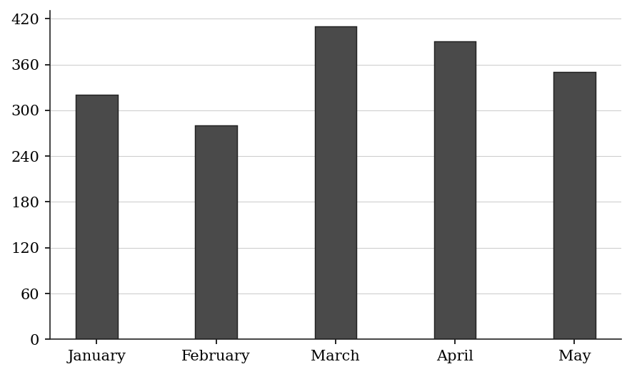

**(A)** 350  
**(B)** 1,400  
**(C)** 1,740  
**(D)** 1,750  
**(E)** 1,800

**Q2** · `DAT-RCD-004` · QC · 50s

The table below shows the population (in thousands) of five cities:

City A: 450    City B: 380    City C: 520    City D: 410    City E: 490

> **Quantity A:**  The range of the population values (max - min)
> **Quantity B:**  150

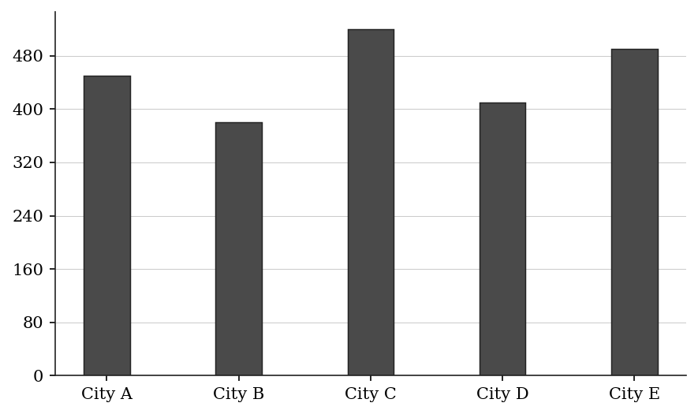

**Q3** · `DAT-RCD-005` · Numeric Entry · 55s

The table below shows the annual rainfall (in millimeters) recorded in a city over five years:

What is the average (arithmetic mean) annual rainfall over these five years? Give your answer in millimeters.

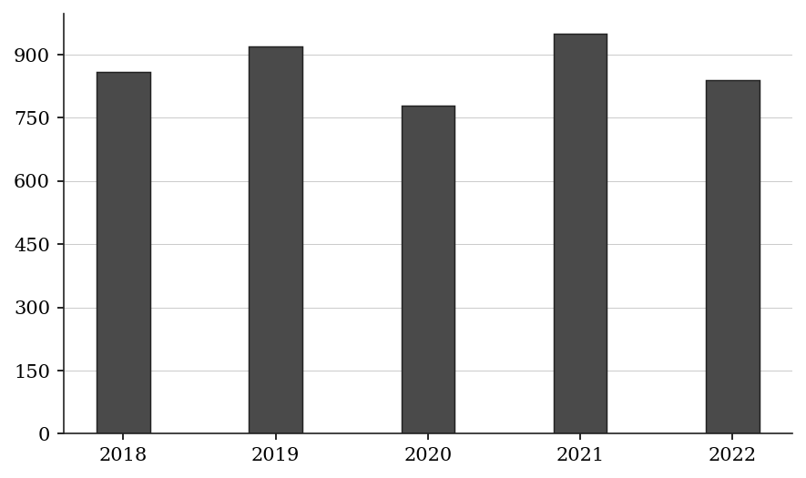

*Numeric entry — write the number.*

**Q4** · `DAT-RCD-006` · MCQ · 35s

The table below shows the number of customer complaints received per month at a service center:

In which month were the fewest complaints received?

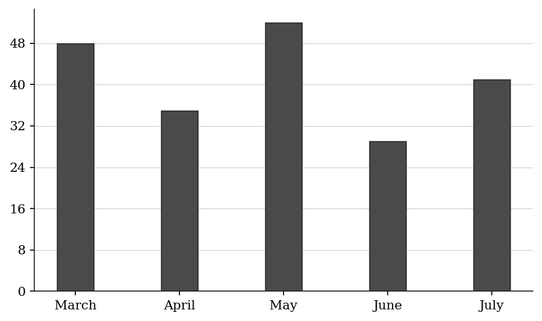

**(A)** March  
**(B)** April  
**(C)** May  
**(D)** June  
**(E)** July

**Q5** · `DAT-RCD-010` · Select all that apply · 55s

The table below shows the number of products sold each day of the week at a retail store:

Which of the following days on sales were below 115 units?

Select all that apply.

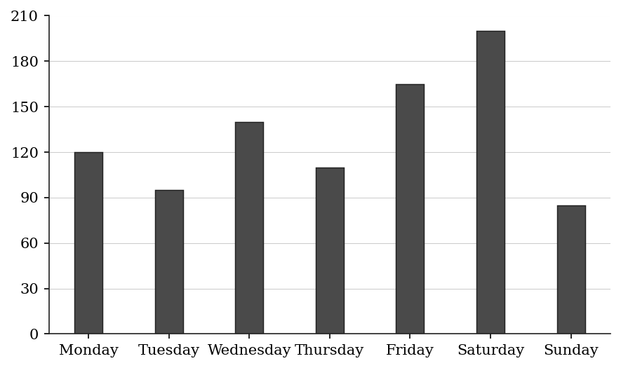

**(A)** Monday  
**(B)** Tuesday  
**(C)** Thursday  
**(D)** Friday  
**(E)** Sunday

**Q6** · `DAT-RCD-013` · MCQ · 75s

The table below shows electricity consumption (in kWh) and cost per kWh for three months:

June: 400 kWh at $0.12/kWh

July: 600 kWh at $0.12/kWh

August: 500 kWh at $0.15/kWh

What was the total electricity bill for the three-month period?

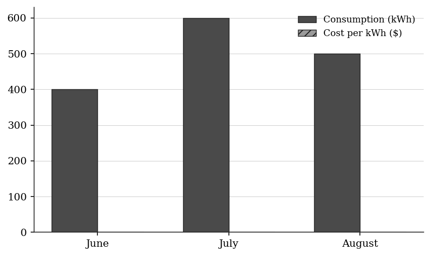

**(A)** $168.00  
**(B)** $180.00  
**(C)** $195.00  
**(D)** $204.00  
**(E)** $216.00

**Q7** · `DAT-RCD-015` · Numeric Entry · 65s

The table below shows the market share (in percent) of five smartphone brands in a country:

If the total smartphone market in this country is 8 million units, how many units (in millions) do Brand A and Brand B together account for?

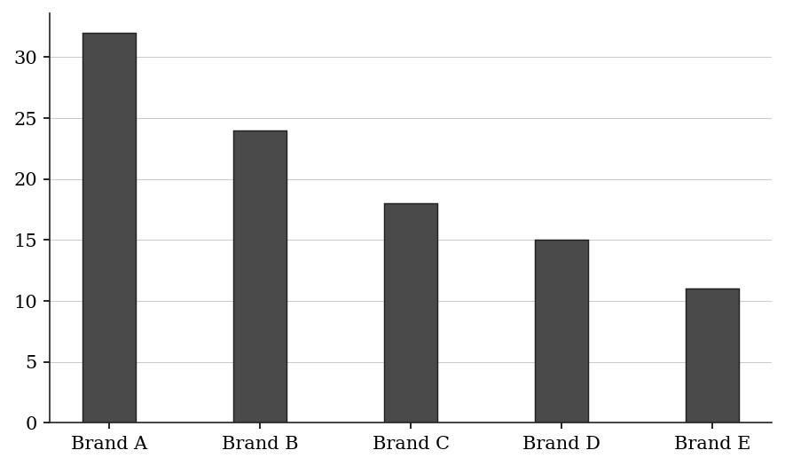

*Numeric entry — write the number.*

---

### Level 2 · Medium — 16 questions · ~22 min

*two or three steps, one planted trap each*

**Q8** · `DAT-RCD-011` · MCQ · 75s

The table below shows the number of units sold and the price per unit for four products:

Product A: 200 units at $15 each

Product B: 350 units at $8 each

Product C: 120 units at $25 each

Product D: 480 units at $6 each

Which product generated the highest total revenue?

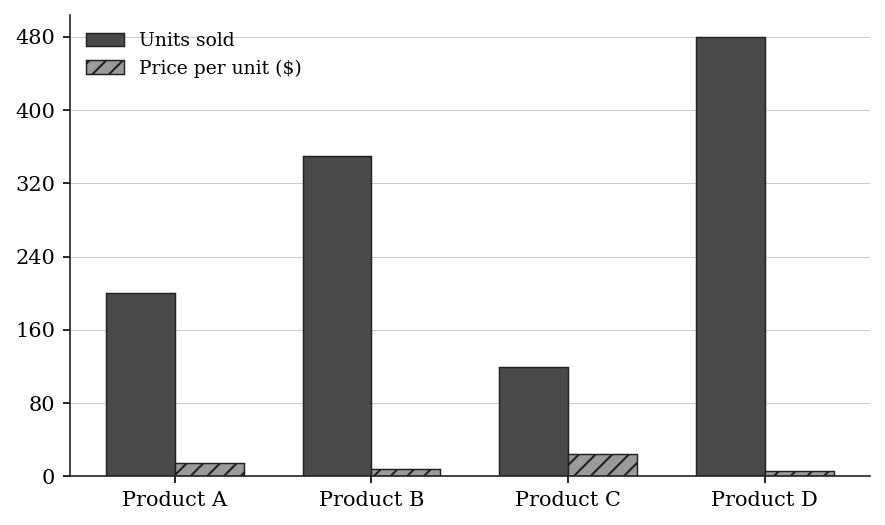

**(A)** Product A  
**(B)** Product B  
**(C)** Product C  
**(D)** Product D  
**(E)** Products A and C generated the same total revenue

**Q9** · `DAT-RCD-012` · MCQ · 80s

The bar graph below shows the number of visitors to a museum each year:

In which year did the museum experience the greatest year-over-year INCREASE in visitors?

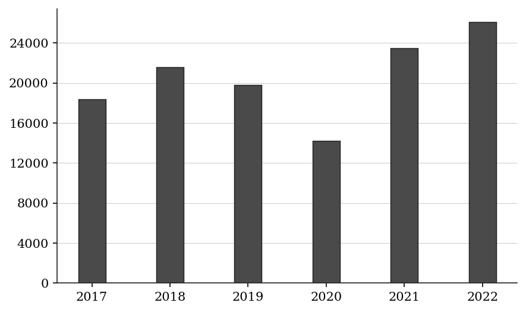

**(A)** 2018  
**(B)** 2019  
**(C)** 2020  
**(D)** 2021  
**(E)** 2022

**Q10** · `DAT-RCD-014` · QC · 80s

The number of books borrowed from a library each month was: January 1,240; February 980; March 1,150; April 1,320; May 1,060; June 1,180.

> **Quantity A:**  The average (mean) number of books borrowed per month
> **Quantity B:**  1,150

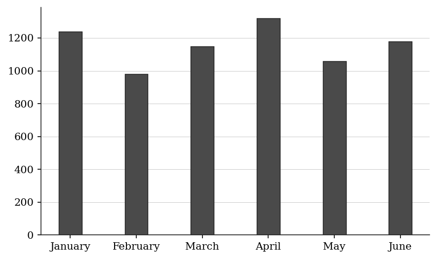

**Q11** · `DAT-RCD-016` · MCQ · 70s

The table below shows the number of students enrolled in five courses at a college:

What fraction of the total enrollment is in Statistics? (Reduce to lowest terms.)

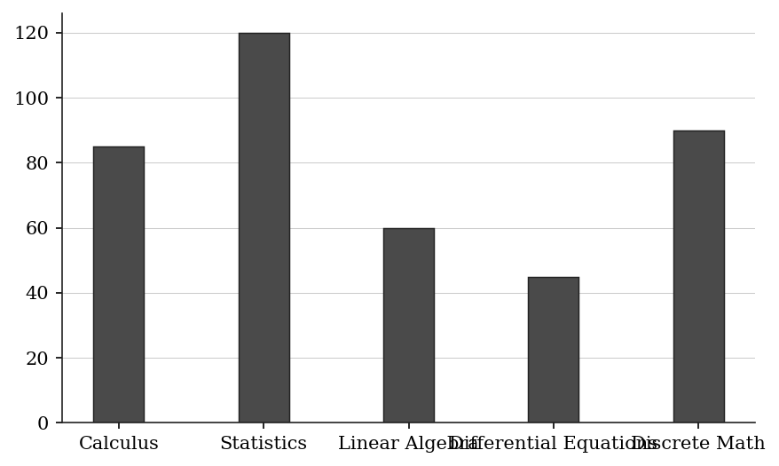

**(A)** 6/25  
**(B)** 2/7  
**(C)** 3/10  
**(D)** 4/13  
**(E)** 1/3

**Q12** · `DAT-RCD-019` · Numeric Entry · 80s

The table below shows scores (out of 100) that a student received on six quizzes:

The teacher drops the lowest score before computing the final average. What is the student's final average score? Round to the nearest whole number.

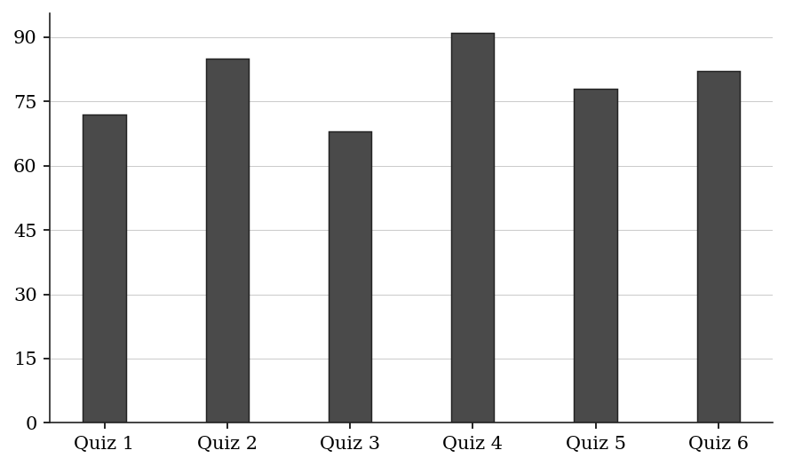

*Numeric entry — write the number.*

**Q13** · `DAT-RCD-021` · MCQ · 80s

The table below shows the number of items sold by three salespeople in four regions:

North  South  East  West

Sarah        140     95    110    130

James         80    125    160     90

Linda        105     70     85    145

Which salesperson had the highest TOTAL sales across all four regions?

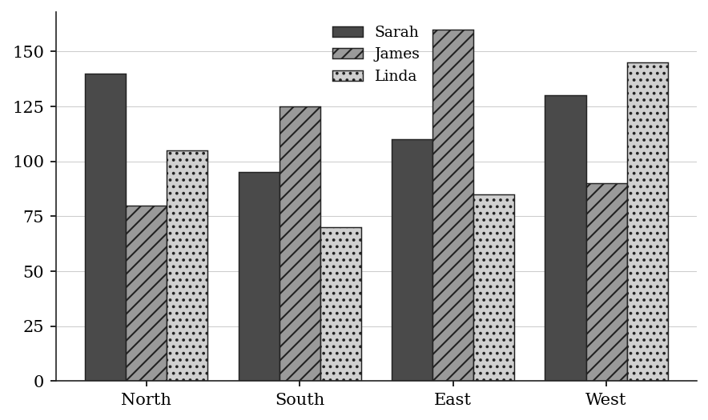

| Salesperson | North | South | East | West |
|---|---|---|---|---|
| Sarah | 140 | 95 | 110 | 130 |
| James | 80 | 125 | 160 | 90 |
| Linda | 105 | 70 | 85 | 145 |

**(A)** Sarah  
**(B)** James  
**(C)** Linda  
**(D)** Sarah and James are tied  
**(E)** James and Linda are tied

**Q14** · `DAT-RCD-024` · Select all that apply · 65s

A support team resolved the following numbers of tickets in weeks 1 to 8: 220, 195, 240, 210, 230, 185, 250, 200. The team's target is at least 215 tickets per week. In which of the following weeks did the team meet or exceed the target? Indicate all such weeks.

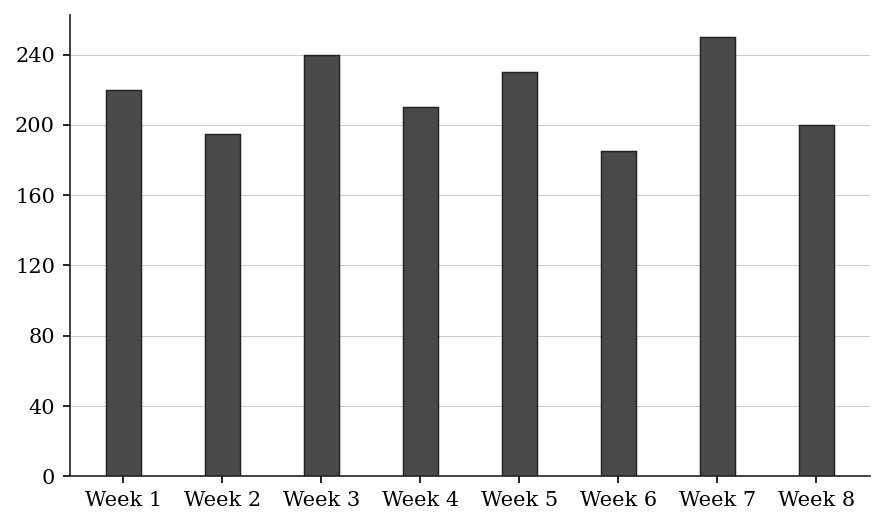

**(A)** Week 1  
**(B)** Week 3  
**(C)** Week 4  
**(D)** Week 5  
**(E)** Week 7

**Q15** · `DAT-RCD-025` · Select all that apply · 90s

The table below shows the annual revenue (in millions) and annual cost (in millions) for five product lines:

Line A: Revenue $80M, Cost $55M

Line B: Revenue $120M, Cost $95M

Line C: Revenue $65M, Cost $48M

Line D: Revenue $95M, Cost $80M

Line E: Revenue $110M, Cost $72M

Which of the following product lines have a profit margin (profit ÷ revenue) greater than 25 percent?

Indicate all such product lines.

**(A)** Line A  
**(B)** Line B  
**(C)** Line C  
**(D)** Line D  
**(E)** Line E

**Q16** · `DAT-RCD-026` · QC · 90s

The table below shows the number of cars sold by a dealership each month for two consecutive years:

Year 1   Year 2

> **Quantity A:**  Total cars sold in Year 1 (Jan–Jun)
> **Quantity B:**  Total cars sold in Year 2 (Jan–Jun)

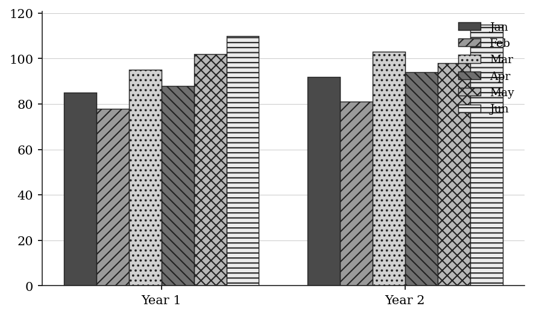

**Q17** · `DAT-RCD-038` · QC · 120s

The table below shows the annual sales (in thousands of dollars) for a retailer across three store locations:

> **Quantity A:**  The median of the three locations' annual total sales
> **Quantity B:**  The arithmetic mean of the three locations' annual total sales

| Location | Q1 Sales | Q2 Sales | Q3 Sales | Q4 Sales |
|---|---|---|---|---|
| North | $180K | $220K | $195K | $240K |
| South | $150K | $160K | $210K | $280K |
| East | $200K | $175K | $230K | $195K |

**Q18** · `DAT-RCD-KMF2-002` · MCQ · 75s

SURVEY RESULTS

A survey of 420 part-time employees and 580 full-time employees was conducted. All 1,000 of the employees surveyed indicated whether, for each of five factors, the factor is important to consider when choosing a workplace. For each of the five factors, the percent of the employees surveyed who indicated that factor as important to consider is given in the table.

The number of employees surveyed who indicated training programs as important to consider was approximately what percent of the number who indicated flexible hours as important to consider?

| Factor | Percent |
|---|---|
| Flexible hours | 72% |
| Commute time | 64% |
| Health benefits | 58% |
| Training programs | 45% |
| On-site parking | 30% |

**(A)** 27%  
**(B)** 45%  
**(C)** 63%  
**(D)** 72%  
**(E)** 160%

**Q19** · `DAT-RCD-KMF2-003` · Numeric Entry · 85s

SURVEY RESULTS

A survey of 420 part-time employees and 580 full-time employees was conducted. All 1,000 of the employees surveyed indicated whether, for each of five factors, the factor is important to consider when choosing a workplace. For each of the five factors, the percent of the employees surveyed who indicated that factor as important to consider is given in the table.

If 38 percent of the employees surveyed indicated both commute time and health benefits as important to consider, what percent of the employees surveyed indicated neither of these two factors as important to consider?

| Factor | Percent |
|---|---|
| Flexible hours | 72% |
| Commute time | 64% |
| Health benefits | 58% |
| Training programs | 45% |
| On-site parking | 30% |

*Numeric entry — write the number.*

**Q20** · `DAT-RCD-KMF2-004` · MCQ · 75s

NUMBER OF PRINTERS OWNED BY A RANDOM SAMPLE OF 750 OFFICES

If one of the 750 offices were selected at random, what is the probability that the office selected would own more than 2 printers?

| Number of Printers Owned | Number of Offices |
|---|---|
| At least 1 | 750 |
| At least 2 | 480 |
| At least 3 | 180 |
| At least 4 | 55 |
| At least 5 | 12 |

**(A)** 2/125  
**(B)** 11/150  
**(C)** 6/25  
**(D)** 2/5  
**(E)** 16/25

**Q21** · `DAT-RCD-KMF2-008` · MCQ · 85s

ANNUAL PER CAPITA CONSUMPTION OF THREE FOODS IN COUNTRY R, FOR SELECTED YEARS

in pounds

Let a, b, and c represent the ranges of the annual per capita consumption of cheese, poultry, and ice cream, respectively, for the six years shown. Which of the following is true?

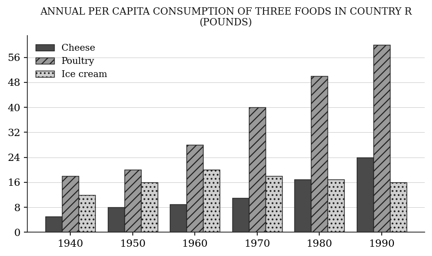

**(A)** a > b > c  
**(B)** a > c > b  
**(C)** b > a > c  
**(D)** b > c > a  
**(E)** c > a > b

**Q22** · `DAT-RCD-KMF2-009` · MCQ · 85s

MAXIMUM AND MINIMUM WATER DEPTHS OF SEVEN LAKES

in feet

Each point represents one lake.

For exactly three of the seven lakes, the maximum depth is greater than that of a certain one of the lakes, and for exactly three it is less. Which lake is that?

**(A)** Arrow  
**(B)** Cobalt  
**(C)** Dunlin  
**(D)** Elkhorn  
**(E)** Grayling

**Q23** · `DAT-RCD-KMF2-013` · Numeric Entry · 75s

NUMBER OF TEACHERS AND NUMBER OF SUPPORT STAFF AT 20 SCHOOLS

Each point represents one school.

What percent of the 20 schools have fewer than 52 teachers?

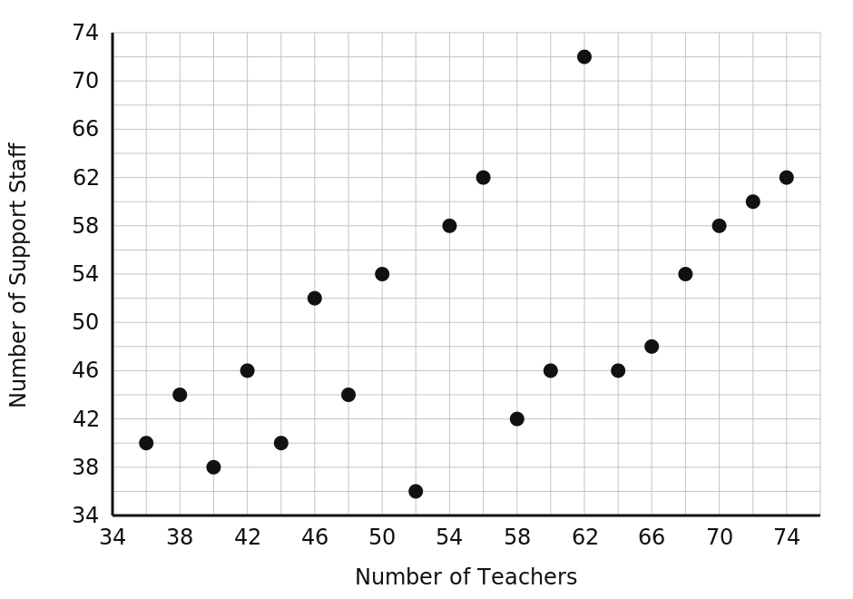

*Numeric entry — write the number.*

---

### Level 3 · Hard — 7 questions · ~12 min

*where 162+ is won or lost*

**Q24** · `DAT-RCD-027` · MCQ · 95s

The table below shows the population (in thousands) of a city and the percentage of the population that uses public transit, for each year from 2018 to 2022:

2018: Population 840K, Transit users 34%

2019: Population 880K, Transit users 32%

2020: Population 860K, Transit users 35%

2021: Population 910K, Transit users 30%

2022: Population 950K, Transit users 28%

In which year was the NUMBER of transit users the highest?

**(A)** 2018  
**(B)** 2019  
**(C)** 2020  
**(D)** 2021  
**(E)** 2022

**Q25** · `DAT-RCD-028` · MCQ · 100s

The table below shows the quarterly sales figures (in units) and the average selling price per unit (in dollars) for a company over one year:

Q1: 1,200 units at $45/unit

Q2: 1,500 units at $42/unit

Q3: 1,350 units at $48/unit

Q4: 1,600 units at $40/unit

By what percent did Q3 revenue exceed Q2 revenue? Round to one decimal place.

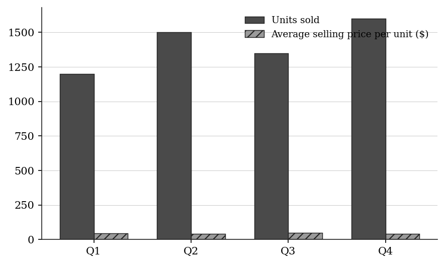

**(A)** 1.4%  
**(B)** 2.9%  
**(C)** 4.8%  
**(D)** 6.3%  
**(E)** 8.6%

**Q26** · `DAT-RCD-029` · QC · 95s

The table below shows the number of students in each grade at a school, along with the fraction who participate in at least one sport:

Grade 9: 180 students, 2/5 participate in sports

Grade 10: 210 students, 3/7 participate in sports

Grade 11: 160 students, 9/16 participate in sports

Grade 12: 190 students, 7/19 participate in sports

> **Quantity A:**  Number of Grade 10 sports participants
> **Quantity B:**  Number of Grade 11 sports participants

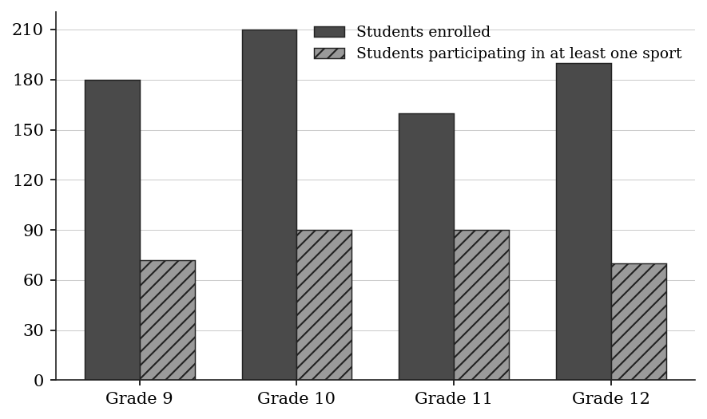

| Grade | Students | Fraction participating in sports |
|---|---|---|
| Grade 9 | 180 | 2/5 |
| Grade 10 | 210 | 3/7 |
| Grade 11 | 160 | 9/16 |
| Grade 12 | 190 | 7/19 |

**Q27** · `DAT-RCD-034` · Select all that apply · 110s

The table shows enrollment and average GPA for four university departments:

Computer Science: 400 students, average GPA 3.2

Economics: 300 students, average GPA 3.4

Biology: 200 students, average GPA 3.0

History: 100 students, average GPA 3.8

The combined GPA of any group of departments is the average of their GPAs weighted by enrollment. GPA-points means enrollment × average GPA.

Which of the following statements are true?

Indicate all such statements.

**(A)** The overall GPA of all four departments is greater than 3.50.  
**(B)** Economics contributes more GPA-points than History.  
**(C)** The combined GPA of the departments other than Biology is greater than 3.55.  
**(D)** History has the highest average GPA of the four departments and the fewest GPA-points.  
**(E)** The combined GPA of Computer Science and Economics is less than 3.55.

**Q28** · `DAT-RCD-KMF2-001` · Select all that apply · 110s

SURVEY RESULTS

A survey of 420 part-time employees and 580 full-time employees was conducted. All 1,000 of the employees surveyed indicated whether, for each of five factors, the factor is important to consider when choosing a workplace. For each of the five factors, the percent of the employees surveyed who indicated that factor as important to consider is given in the table.

Which of the following statements about the employees surveyed must be true?

Indicate all such statements.

| Factor | Percent |
|---|---|
| Flexible hours | 72% |
| Commute time | 64% |
| Health benefits | 58% |
| Training programs | 45% |
| On-site parking | 30% |

**(A)** Fewer than 45 percent of the employees surveyed were part-time employees.  
**(B)** Of the full-time employees, more indicated flexible hours as important to consider than indicated health benefits as important to consider.  
**(C)** At least 140 of the part-time employees indicated flexible hours as important to consider.  
**(D)** Fewer than 60 percent of the full-time employees indicated health benefits as important to consider.  
**(E)** More than half of the employees surveyed indicated commute time as important to consider.

**Q29** · `DAT-RCD-KMF2-011` · Numeric Entry · 115s

MAXIMUM AND MINIMUM WATER DEPTHS OF SEVEN LAKES

in feet

Each point represents one lake.

In how many pairs of lakes is the lake with the greater maximum depth also the lake with the smaller minimum depth?

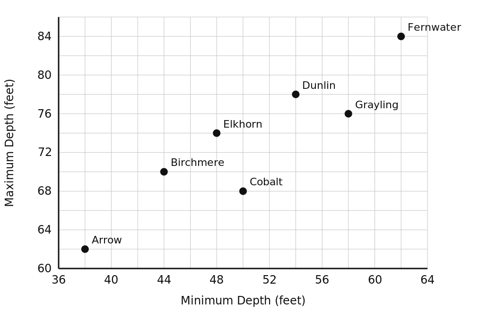

*Numeric entry — write the number.*

**Q30** · `DAT-RCD-KMF2-015` · MCQ · 125s

NUMBER OF TEACHERS AND NUMBER OF SUPPORT STAFF AT 20 SCHOOLS

Each point represents one school.

Two of the 20 schools will be selected at random, one at a time and without replacement. Approximately what is the probability that at least one of the two schools selected has more support staff than teachers?

**(A)** 0.35  
**(B)** 0.40  
**(C)** 0.55  
**(D)** 0.65  
**(E)** 0.80

---

## Part B — Answer Key

| Q | ID | Level | Type | Answer |
|---|---|---|---|---|
| 1 | `DAT-RCD-001` | easy | MCQ | **D** |
| 2 | `DAT-RCD-004` | easy | QC | **B** |
| 3 | `DAT-RCD-005` | easy | Numeric Entry | **870** |
| 4 | `DAT-RCD-006` | easy | MCQ | **D** |
| 5 | `DAT-RCD-010` | easy | Select all that apply | **B, C, E** |
| 6 | `DAT-RCD-013` | easy | MCQ | **C** |
| 7 | `DAT-RCD-015` | easy | Numeric Entry | **4.48** |
| 8 | `DAT-RCD-011` | medium | MCQ | **E** |
| 9 | `DAT-RCD-012` | medium | MCQ | **D** |
| 10 | `DAT-RCD-014` | medium | QC | **A** |
| 11 | `DAT-RCD-016` | medium | MCQ | **C** |
| 12 | `DAT-RCD-019` | medium | Numeric Entry | **82** |
| 13 | `DAT-RCD-021` | medium | MCQ | **A** |
| 14 | `DAT-RCD-024` | medium | Select all that apply | **A, B, D, E** |
| 15 | `DAT-RCD-025` | medium | Select all that apply | **A, C, E** |
| 16 | `DAT-RCD-026` | medium | QC | **B** |
| 17 | `DAT-RCD-038` | medium | QC | **B** |
| 18 | `DAT-RCD-KMF2-002` | medium | MCQ | **C** |
| 19 | `DAT-RCD-KMF2-003` | medium | Numeric Entry | **16%** |
| 20 | `DAT-RCD-KMF2-004` | medium | MCQ | **C** |
| 21 | `DAT-RCD-KMF2-008` | medium | MCQ | **C** |
| 22 | `DAT-RCD-KMF2-009` | medium | MCQ | **D** |
| 23 | `DAT-RCD-KMF2-013` | medium | Numeric Entry | **40%** |
| 24 | `DAT-RCD-027` | hard | MCQ | **C** |
| 25 | `DAT-RCD-028` | hard | MCQ | **B** |
| 26 | `DAT-RCD-029` | hard | QC | **C** |
| 27 | `DAT-RCD-034` | hard | Select all that apply | **B, D, E** |
| 28 | `DAT-RCD-KMF2-001` | hard | Select all that apply | **A, C, E** |
| 29 | `DAT-RCD-KMF2-011` | hard | Numeric Entry | **3** |
| 30 | `DAT-RCD-KMF2-015` | hard | MCQ | **D** |

---

## Part C — Worked Solutions

### Q1 · `DAT-RCD-001` — Answer: D

Add all five monthly values: 320 + 280 + 410 + 390 + 350.
320 + 280 = 600
600 + 410 = 1,010
1,010 + 390 = 1,400
1,400 + 350 = 1,750
Total = 1,750 units.

**Trap.** A (350) is the monthly mean, not the total. B (1,400) omits May. C (1,740) reads March as 400 instead of 410. E (1,800) rounds each month to the nearest hundred before adding.

### Q2 · `DAT-RCD-004` — Answer: B

Maximum value = City C = 520. Minimum value = City B = 380.
Range = 520 - 380 = 140.
Quantity A = 140. Quantity B = 150.
140 < 150, so Quantity B is greater.

**Trap.** Students may misidentify the minimum as City D (410) instead of City B (380), computing range = 520 - 410 = 110, and still conclude B is greater. The key step is correctly reading the minimum from the table.

### Q3 · `DAT-RCD-005` — Answer: 870

Sum of all values: 860 + 920 + 780 + 950 + 840.
860 + 920 = 1,780
1,780 + 780 = 2,560
2,560 + 950 = 3,510
3,510 + 840 = 4,350
Mean = 4,350 ÷ 5 = 870 mm.

**Trap.** Students may add incorrectly, or forget to divide by 5. Some may divide by 4 (counting intervals between years) instead of 5.

### Q4 · `DAT-RCD-006` — Answer: D

Compare all five values: March = 48, April = 35, May = 52, June = 29, July = 41. The minimum is 29, which occurs in June.

**Trap.** Students may confuse 'fewest' with 'greatest decrease from previous month.' The question asks only for the minimum value, not a trend.

### Q5 · `DAT-RCD-010` — Answer: B, C, E

Check each listed option against the threshold of 115:
Monday (A): 120 — NOT below 115
Tuesday (B): 95 — below 115 ✓
Thursday (C): 110 — below 115 ✓
Friday (D): 165 — NOT below 115
Sunday (E): 85 — below 115 ✓
Correct answers: B (Tuesday), C (Thursday), E (Sunday).

**Trap.** Students may include Monday (120) thinking it is close to 115. Note: the options omit Wednesday and Saturday, so students should only evaluate the five listed days. Thursday (110) is below 115 and must be included.

### Q6 · `DAT-RCD-013` — Answer: C

Calculate the bill for each month:
June: 400 × $0.12 = $48.00
July: 600 × $0.12 = $72.00
August: 500 × $0.15 = $75.00
Total: $48 + $72 + $75 = $195.00.

**Trap.** Students apply the same rate ($0.12/kWh) to August instead of the higher rate ($0.15/kWh), computing August = 500 × 0.12 = $60 and arriving at a total of $180 (option B).

### Q7 · `DAT-RCD-015` — Answer: 4.48

Brand A share = 32%, Brand B share = 24%. Combined share = 32 + 24 = 56%.
Units = 56% of 8 million = 0.56 × 8 = 4.48 million units.

**Trap.** Students add 32 + 24 = 56 and then forget to divide by 100, computing 56 × 8 = 448 instead of 4.48 (off by a factor of 100).

### Q8 · `DAT-RCD-011` — Answer: E

Calculate total revenue (units × price) for each product:
Product A: 200 × $15 = $3,000
Product B: 350 × $8 = $2,800
Product C: 120 × $25 = $3,000
Product D: 480 × $6 = $2,880
Revenues: A = $3,000, B = $2,800, C = $3,000, D = $2,880.
Products A and C are tied at $3,000, which is the highest revenue. Answer: E.

**Trap.** Students assume Product D (480 units — the most sold) generates the highest revenue without computing. 480 × $6 = $2,880 < $3,000. High volume does not guarantee high revenue when prices differ.

### Q9 · `DAT-RCD-012` — Answer: D

Calculate the year-over-year change for each year:
2018 vs 2017: 21,600 - 18,400 = +3,200
2019 vs 2018: 19,800 - 21,600 = -1,800 (decrease)
2020 vs 2019: 14,200 - 19,800 = -5,600 (decrease)
2021 vs 2020: 23,500 - 14,200 = +9,300
2022 vs 2021: 26,100 - 23,500 = +2,600
Greatest increase: 2021 with +9,300 visitors.

**Trap.** Students identify 2022 as having the highest VALUE (26,100) and choose D. The question asks for the greatest INCREASE (change from prior year), not the highest absolute count. 2021 shows a rebound of +9,300 from the pandemic-impacted 2020 figure.

### Q10 · `DAT-RCD-014` — Answer: A

Sum all six months: 1,240 + 980 + 1,150 + 1,320 + 1,060 + 1,180.
1,240 + 980 = 2,220
2,220 + 1,150 = 3,370
3,370 + 1,320 = 4,690
4,690 + 1,060 = 5,750
5,750 + 1,180 = 6,930
Mean = 6,930 ÷ 6 = 1,155.
Quantity A = 1,155. Quantity B = 1,150.
1,155 > 1,150, so Quantity A is greater.

**Trap.** Students notice that 1,150 appears as one of the monthly values (March) and assume the mean equals that value, choosing C. The actual mean is 1,155, which is slightly above 1,150 because the values above 1,150 outweigh those below.

### Q11 · `DAT-RCD-016` — Answer: C

Total enrollment = 85 + 120 + 60 + 45 + 90 = 400.
Statistics enrollment = 120.
Fraction = 120/400 = 3/10.

**Trap.** Students may compute 120/280 — dividing by the non-Statistics enrollment instead of the total enrollment — and get 3/7, which looks plausible but is wrong.

### Q12 · `DAT-RCD-019` — Answer: 82

Lowest score = Quiz 3 = 68. Drop it.
Remaining scores: 72, 85, 91, 78, 82.
Sum = 72 + 85 + 91 + 78 + 82 = 408.
Average = 408 ÷ 5 = 81.6 ≈ 82.

**Trap.** Students forget to drop the lowest score and average all six: (72+85+68+91+78+82)/6 = 476/6 ≈ 79. Or they drop the wrong score — dropping Quiz 1 (72) instead of Quiz 3 (68), which gives (85+68+91+78+82)/5 = 404/5 = 80.8 ≈ 81.

### Q13 · `DAT-RCD-021` — Answer: A

Calculate total sales for each salesperson:
Sarah: 140 + 95 + 110 + 130 = 475
James: 80 + 125 + 160 + 90 = 455
Linda: 105 + 70 + 85 + 145 = 405
Sarah has the highest total at 475.

**Trap.** Students may focus on James's East region (160, the single highest individual value) and assume James has the highest total. One high value in a single region does not guarantee the highest overall sum.

### Q14 · `DAT-RCD-024` — Answer: A, B, D, E

The target is 215. Week 1: 220, meets. Week 3: 240, meets. Week 5: 230, meets. Week 7: 250, meets. Week 4: 210, does not meet. The answers are A, B, C and E.

**Trap.** Students include Week 4 because 210 is within 5 of the target.

### Q15 · `DAT-RCD-025` — Answer: A, C, E

Profit = Revenue - Cost. Profit margin = Profit / Revenue × 100.
Line A: Profit = 80-55 = $25M. Margin = 25/80 = 31.25% > 25% ✓
Line B: Profit = 120-95 = $25M. Margin = 25/120 ≈ 20.8% < 25% ✗
Line C: Profit = 65-48 = $17M. Margin = 17/65 ≈ 26.2% > 25% ✓
Line D: Profit = 95-80 = $15M. Margin = 15/95 ≈ 15.8% < 25% ✗
Line E: Profit = 110-72 = $38M. Margin = 38/110 ≈ 34.5% > 25% ✓
Correct answers: A, C, E.

**Trap.** Students may choose Line B because it has the same absolute profit ($25M) as Line A. But Line B's margin is only 20.8% because its revenue base ($120M) is much larger. Absolute profit and profit margin are not the same thing.

### Q16 · `DAT-RCD-026` — Answer: B

Year 1 total: 85 + 78 + 95 + 88 + 102 + 110 = 558.
85+78=163; 163+95=258; 258+88=346; 346+102=448; 448+110=558.
Year 2 total: 92 + 81 + 103 + 94 + 98 + 115 = 583.
92+81=173; 173+103=276; 276+94=370; 370+98=468; 468+115=583.
Quantity A = 558. Quantity B = 583. Quantity B is greater.

**Trap.** Students notice that May Year 1 (102) > May Year 2 (98) — the only month where Year 1 exceeds Year 2 — and jump to A or D without summing all months. Year 2 wins overall despite one lower month.

### Q17 · `DAT-RCD-038` — Answer: B

Step 1 — Calculate annual totals:
North: 180+220+195+240 = $835K
South: 150+160+210+280 = $800K
East: 200+175+230+195 = $800K
Step 2 — Median of {835, 800, 800}:
Sorted: 800, 800, 835. Median = 800.
Quantity A = $800K.
Step 3 — Mean of {835, 800, 800}:
Sum = 835 + 800 + 800 = 2,435.
Mean = 2,435 / 3 ≈ $811.67K.
Quantity B ≈ $811.67K.
$800K < $811.67K. Quantity B is greater.

**Trap.** Students may assume the median and mean are equal because two of the three locations share the same total ($800K). However, the presence of North ($835K) — a value above the median — pulls the mean above $800K. Whenever the distribution is not symmetric, mean ≠ median.

### Q18 · `DAT-RCD-KMF2-002` — Answer: C

Of the 1,000 employees surveyed, 45 percent indicated training programs, which is 450 employees, and 72 percent indicated flexible hours, which is 720 employees.
The question asks what percent 450 is of 720, so divide 450 by 720: 450/720 = 0.625, which is 62.5 percent. Of the choices given, 63 percent is closest.
Because both counts come from the same total of 1,000, the ratio 45/72 gives the same result without finding the counts at all.

**Trap.** 27% comes from subtracting the two percents, 72 − 45, which answers how many percentage points apart they are, not what percent one is of the other. 160% is 720/450, the reciprocal, which answers the reverse question. 45% and 72% are the table entries themselves.

### Q19 · `DAT-RCD-KMF2-003` — Answer: 16%

Work in percents of the employees surveyed. Commute time was indicated by 64 percent and health benefits by 58 percent, and 38 percent indicated both.
Adding 64 and 58 counts everyone who indicated both of them twice, so subtract the overlap once to get the percent who indicated at least one of the two:
64 + 58 − 38 = 84 percent.
Everyone else indicated neither, so the percent who indicated neither is
100 − 84 = 16 percent.

**Trap.** Adding the two percents to get 122 and stopping there, or subtracting 64 + 58 from 100 without adding the overlap back, which gives a negative figure and signals the overlap was missed. Subtracting only one factor, as in 100 − 64 = 36 or 100 − 58 = 42, ignores the other.

### Q20 · `DAT-RCD-KMF2-004` — Answer: C

Owning more than 2 printers is the same as owning at least 3 printers, and the table gives that count directly as 180 offices.
The probability is therefore
180/750 = 18/75 = 6/25.

**Trap.** 16/25 is 480/750, the probability of owning at least 2 printers; that answers "more than 1" rather than "more than 2" and is the off-by-one row error. 2/5 is 300/750, the probability of owning exactly 2. 11/150 and 2/125 use the 55 and 12 rows.

### Q21 · `DAT-RCD-KMF2-008` — Answer: C

The range of a set of values is its greatest value minus its least value, so only the highest and lowest bar for each food matter.
Cheese runs from 5 to 24, so a = 24 − 5 = 19.
Poultry runs from 18 to 60, so b = 60 − 18 = 42.
Ice cream runs from 12 to 20, so c = 20 − 12 = 8.
Since 42 > 19 > 8, the order is b > a > c.

**Trap.** Ranking the foods by their 1990 values, or by how high they sit overall, puts poultry first and cheese second and ice cream last, which happens to give the same order here only by coincidence of the endpoints; the reliable route is the high-minus-low for each. The real pitfall is ice cream, which rises and then falls: its range is set by its 1960 peak of 20 and its 1940 value of 12, neither of which is an endpoint of the time span.

### Q22 · `DAT-RCD-KMF2-009` — Answer: D

A value with as many above it as below it is the middle value once the list is in order, and with seven lakes that is the fourth.
Reading the maximum depths off the vertical axis and sorting them: Arrow 62, Cobalt 68, Birchmere 70, Elkhorn 74, Grayling 76, Dunlin 78, Fernwater 84.
The fourth is 74, which belongs to Elkhorn. Three lakes are deeper (76, 78 and 84) and three are shallower (62, 68 and 70), as required.

**Trap.** Cobalt sits in the middle of the seven by *minimum* depth, which is the horizontal axis and the one the eye runs along first. Picking the point nearest the center of the cloud is also wrong: only the ordering of the maximum depths matters, not where a point sits in the plane.

### Q23 · `DAT-RCD-KMF2-013` — Answer: 40%

Read the horizontal coordinates. The schools with fewer than 52 teachers have 36, 38, 40, 42, 44, 46, 48 and 50 teachers, which is 8 of the 20.
8/20 = 0.40, or 40 percent.

**Trap.** Counting schools with fewer than 52 support staff instead reads the vertical axis and gives a different figure. The gridlines run every 2 while only every other one carries a label, so the school with 50 teachers has to be counted in and the one with 52 left out.

### Q24 · `DAT-RCD-027` — Answer: C

Compute number of transit users = Population × Transit percentage:
2018: 840 × 0.34 = 285.6K
2019: 880 × 0.32 = 281.6K
2020: 860 × 0.35 = 301.0K
2021: 910 × 0.30 = 273.0K
2022: 950 × 0.28 = 266.0K
Highest number of transit users: 2020 with 301.0K.

**Trap.** Students see that 2022 has the largest population (950K) and choose E without computing. High population does not mean high transit usage if the transit rate is low. 2022's 28% of 950K = 266K, well below 2020's 35% of 860K = 301K.

### Q25 · `DAT-RCD-028` — Answer: B

Q2 revenue = 1,500 × $42 = $63,000.
Q3 revenue = 1,350 × $48 = $64,800.
Difference = 64,800 - 63,000 = $1,800.
Percent change = 1,800 / 63,000 × 100 = 1,800/63,000 ≈ 2.857% ≈ 2.9%.

**Trap.** Students compute (64,800 - 63,000)/64,800 = 1,800/64,800 ≈ 2.78% — using Q3 (the new value) as the denominator instead of Q2 (the original). Percent change always uses the original quantity as the base.

### Q26 · `DAT-RCD-029` — Answer: C

Grade 10: 210 × 3/7 = 630/7 = 90 students.
Grade 11: 160 × 9/16 = 1,440/16 = 90 students.
Quantity A = 90. Quantity B = 90. The two quantities are equal.

**Trap.** Students see that Grade 11 has a higher fraction (9/16 = 56.25%) than Grade 10 (3/7 ≈ 42.9%) and assume Grade 11 has more participants without computing. The smaller base (160 vs 210) exactly cancels the higher rate, giving 90 participants each.

### Q27 · `DAT-RCD-034` — Answer: B, D, E

GPA-points (enrollment × average GPA): CS 1,280; Economics 1,020; Biology 600; History 380. Total = 3,280 for 1,000 students, so the overall GPA is 3.28.
A: 3.28 does not exceed 3.50. False.
B: Economics 1,020 > History 380. True.
C: Without Biology, (1,280 + 1,020 + 380)/800 = 3.35, which does not exceed 3.55. False.
D: History has the highest average GPA (3.8) and the fewest points (380). True.
E: CS and Economics together: 2,300/700 ≈ 3.29, below 3.55. True.
Answer: B, D, E.

**Trap.** Students may assume the department with the highest GPA (History, 3.8) dominates the weighted average and makes the overall GPA high. In reality History has the smallest enrollment (100), so its GPA-points (380) are the lowest. Large-enrollment departments drive the weighted average.

### Q28 · `DAT-RCD-KMF2-001` — Answer: A, C, E

The table gives percents of all 1,000 employees surveyed, so each percent is also a count out of 1,000: flexible hours 720, commute time 640, health benefits 580, training programs 450, on-site parking 300.
A: there were 420 part-time employees out of 1,000, which is 42 percent, and 42 is less than 45. True.
B: 720 employees indicated flexible hours and 580 indicated health benefits, but the table says nothing about how either group splits between part-time and full-time. All 580 full-time employees could have indicated health benefits while only 300 of them indicated flexible hours, with the other 420 who indicated flexible hours being part-time. That is consistent with every number given, so this need not be true.
C: 720 employees indicated flexible hours, and at most 580 of them could be full-time, since there are only 580 full-time employees. So at least 720 − 580 = 140 of them are part-time. True.
D: 580 employees indicated health benefits and there are exactly 580 full-time employees, so it is possible that all of them are the full-time employees, making the figure 100 percent of the full-time employees. This need not be true.
E: 640 of the 1,000 employees surveyed indicated commute time, which is 64 percent, and that is more than half. True.

**Trap.** B and D look checkable but are not. The table reports each factor only for the 1,000 employees as a whole, never split by part-time and full-time, so any claim about what the full-time employees alone did is undetermined unless a count forces it. C is true only because 720 exceeds the 580 full-time employees; that overflow is the one piece of subgroup information the table does force.

### Q29 · `DAT-RCD-KMF2-011` — Answer: 3

A pair qualifies when the two lakes are ranked in opposite orders by the two depths, so list the lakes in order of minimum depth and write each one's maximum beside it:
Arrow 62, Birchmere 70, Elkhorn 74, Cobalt 68, Dunlin 78, Grayling 76, Fernwater 84.
Now look for a lake later in this list whose maximum is smaller than one earlier in it. There are three such pairs:
Birchmere and Cobalt, 70 against 68;
Elkhorn and Cobalt, 74 against 68;
Dunlin and Grayling, 78 against 76.
Every other pair is ranked the same way by both depths, so the answer is 3.

**Trap.** Counting the lakes that sit below the general upward drift rather than the pairs they form. Cobalt and Grayling are the two points below the drift, but Cobalt is involved in two qualifying pairs and Grayling in one, so the pair count is three, not two.

### Q30 · `DAT-RCD-KMF2-015` — Answer: D

First count the schools with more support staff than teachers. Those are the points above the line where the two counts would be equal: (36, 40), (38, 44), (42, 46), (46, 52), (50, 54), (54, 58), (56, 62) and (62, 72) — eight of them. The other twelve have more teachers.
"At least one" is easier through its opposite. The probability that neither selected school qualifies is
(12/20)(11/19) = 132/380, about 0.347.
So the probability that at least one does is about
1 − 0.347 = 0.653, which is closest to 0.65.

**Trap.** 0.35 is the probability of the opposite event, the figure this method produces on the way and the easiest place to stop. 0.80 doubles 8/20, as though the two draws were independent and their chances could simply be added; they are made without replacement, and adding also double-counts the case where both qualify.
