# Bar & Line Graphs — Practice Set

**Bank code:** `DAT-BAR` · **Section:** Data Interpretation · **30 questions** — Easy 7 · Medium 16 · Hard 7

**Lecture capsule:** [02-bar-line-graphs.md](../../08-data-interpretation/02-bar-line-graphs.md)

> A bar compares amounts and a line shows change over time; read the axis scale first, and remember a steeper line is a faster change, not a bigger value.

Every question below is live in the question bank under the ID shown — the sheet and the portal are the same questions. Attempt a level with the clock running, then check Part C.

---

## Part A — Questions

> **Quantitative Comparison — the four choices are always the same, so they are not reprinted:**
> **(A)** Quantity A is greater · **(B)** Quantity B is greater · **(C)** The two quantities are equal · **(D)** The relationship cannot be determined from the information given

### Level 1 · Easy — 7 questions · ~6 min

*warm-up — these must be automatic*

**Q1** · `DAT-BAR-002` · MCQ · 40s

The bar graph below shows the annual revenue (in $ millions) of four companies:

What is the total revenue of all four companies combined?

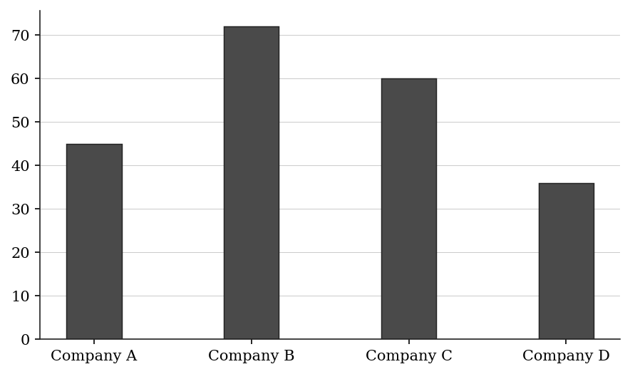

**(A)** $189 million  
**(B)** $195 million  
**(C)** $207 million  
**(D)** $213 million  
**(E)** $219 million

**Q2** · `DAT-BAR-004` · Numeric Entry · 50s

The bar graph below shows the number of units sold by 5 products last quarter:

What is the average (arithmetic mean) number of units sold per product?

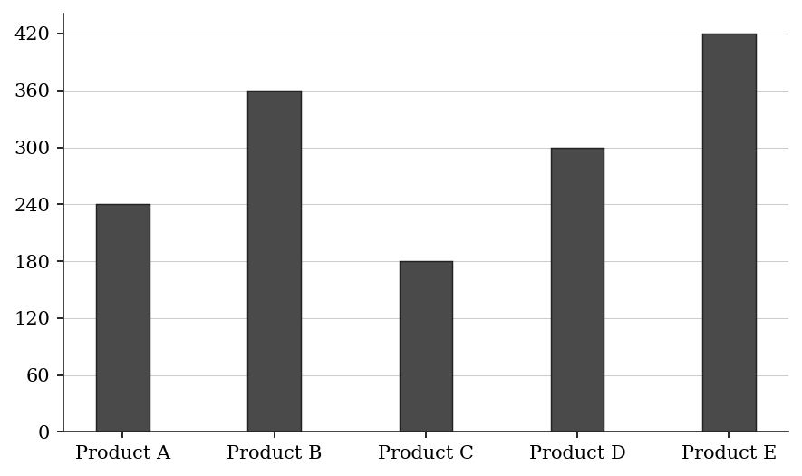

*Numeric entry — write the number.*

**Q3** · `DAT-BAR-006` · QC · 50s

The bar graph below shows the scores of three students on two tests:

Alice: Test 1 = 70, Test 2 = 85

Bob: Test 1 = 90, Test 2 = 75

Carol: Test 1 = 80, Test 2 = 80

> **Quantity A:**  Alice's average score across both tests
> **Quantity B:**  Bob's average score across both tests

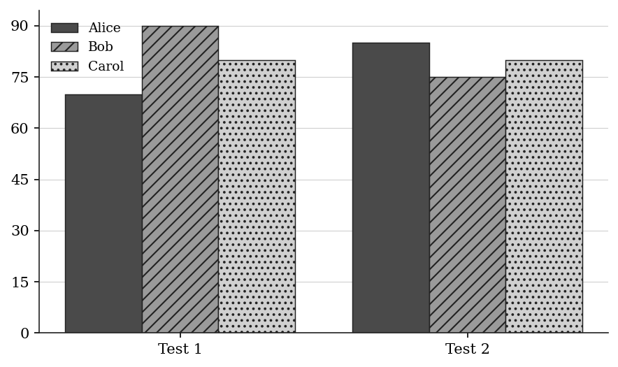

**Q4** · `DAT-BAR-022` · MCQ · 65s

The grouped bar graph below shows the number of morning and evening flights operated by an airline at three airports:

Airport A: Morning=30, Evening=20

Airport B: Morning=25, Evening=35

Airport C: Morning=40, Evening=30

At which airport does the evening flight count exceed the morning flight count?

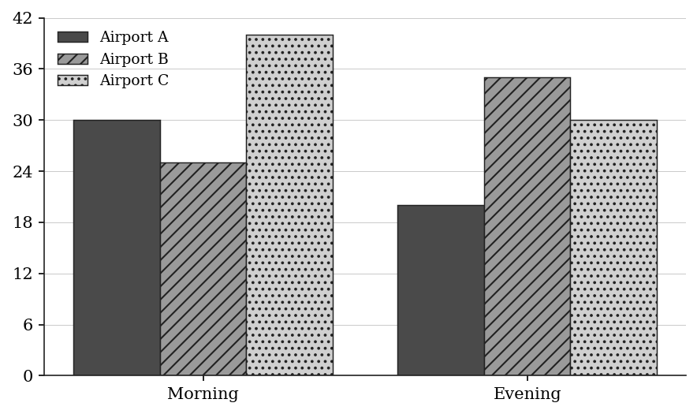

**(A)** Airport A only  
**(B)** Airport B only  
**(C)** Airport C only  
**(D)** Airports A and B  
**(E)** Airports B and C

**Q5** · `DAT-LIN-001` · MCQ · 40s

The line graph shows a store's daily sales (in $hundreds):

On which day were sales the highest?

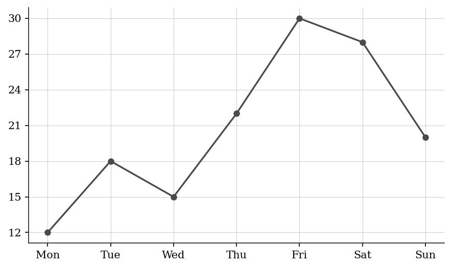

**(A)** Thursday  
**(B)** Friday  
**(C)** Saturday  
**(D)** Sunday  
**(E)** Tuesday

**Q6** · `DAT-LIN-005` · Numeric Entry · 50s

The line graph shows a student's test scores over 5 weeks:

What is the student's average (mean) score over the 5 weeks?

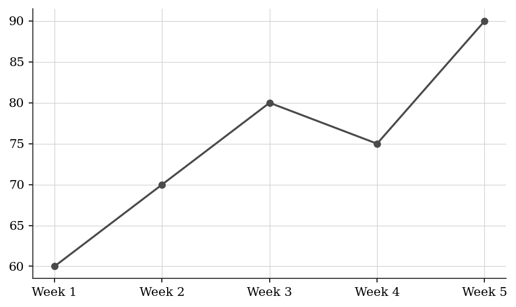

*Numeric entry — write the number.*

**Q7** · `DAT-LIN-008` · QC · 45s

The line graph shows a school's enrollment over 4 years:

> **Quantity A:**  The increase in enrollment from Year 1 to Year 2
> **Quantity B:**  The increase in enrollment from Year 3 to Year 4

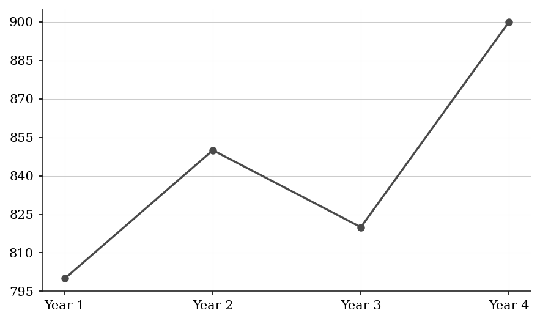

---

### Level 2 · Medium — 16 questions · ~21 min

*two or three steps, one planted trap each*

**Q8** · `DAT-BAR-011` · MCQ · 65s

The bar graph below shows the number of cars sold by a dealership over 6 months:

By what percentage did sales increase from February to April?

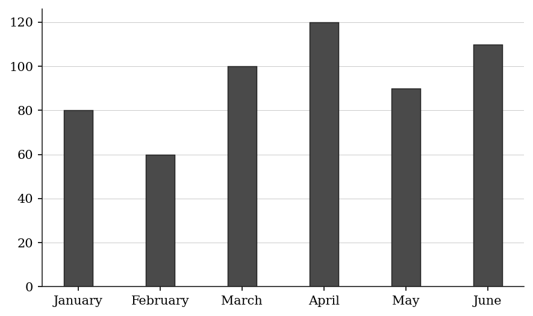

**(A)** 50%  
**(B)** 75%  
**(C)** 80%  
**(D)** 100%  
**(E)** 120%

**Q9** · `DAT-BAR-012` · QC · 75s

The bar graph below shows exports (in $ millions) from Country X over three years:

> **Quantity A:**  Percent increase in exports from 2021 to 2022
> **Quantity B:**  Percent decrease in exports from 2022 to 2023

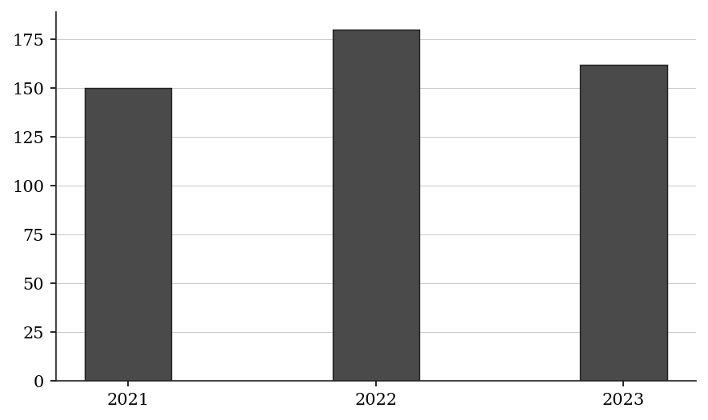

**Q10** · `DAT-BAR-015` · MCQ · 70s

The stacked bar graph shows the number of hardcover books and the number of paperback books a store sold in each of three months. In February, what percent of the books sold were hardcovers?

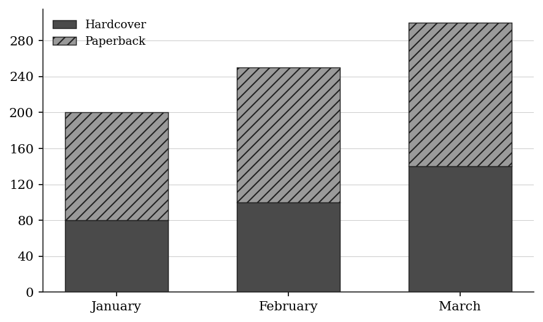

**(A)** 30%  
**(B)** 35%  
**(C)** 40%  
**(D)** 45%  
**(E)** 50%

**Q11** · `DAT-BAR-017` · Numeric Entry · 75s

The bar graph below shows the monthly expenses (in $) of a household:

What percent of total monthly expenses is spent on Food and Utilities combined? Round to the nearest whole percent.

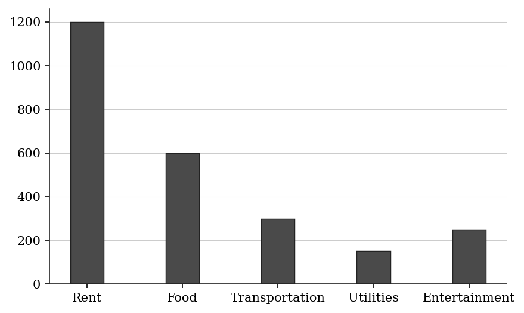

*Numeric entry — write the number.*

**Q12** · `DAT-BAR-023` · Numeric Entry · 70s

The bar graph below shows the sales (in $ thousands) of a company for each quarter of 2023:

If the company's annual sales target was $800,000, by what amount (in $ thousands) did actual annual sales exceed or fall short of the target?

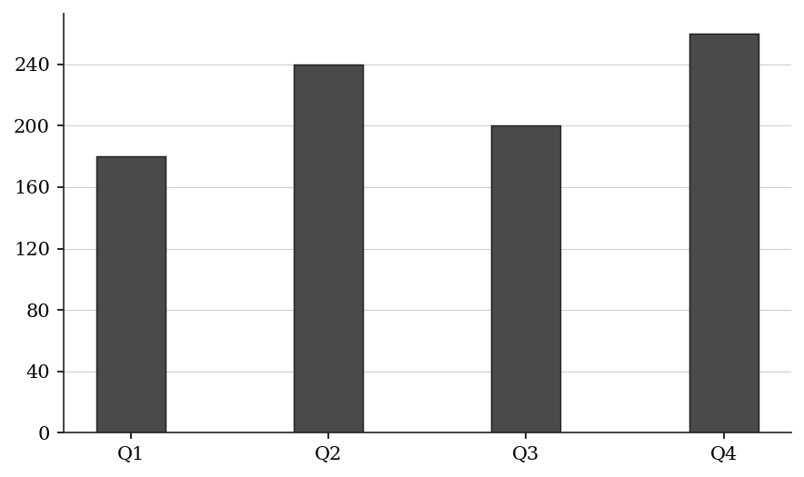

*Numeric entry — write the number.*

**Q13** · `DAT-BAR-026` · QC · 80s

The stacked bar graph below shows the number of new and renewal subscriptions for a magazine in two years. The lower segment represents new subscriptions and the upper segment represents renewals:

Year 1: New=800, Total bar=2000 (so Renewals=1200)

Year 2: New=1000, Total bar=2200 (so Renewals=1200)

> **Quantity A:**  The fraction of total subscriptions that are renewals in Year 1
> **Quantity B:**  The fraction of total subscriptions that are renewals in Year 2

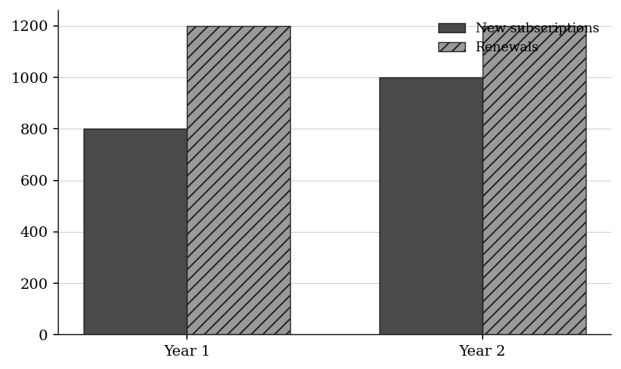

**Q14** · `DAT-BAR-KMF-001` · MCQ · 90s

The bar chart shows how the municipal budget of the town of Tarnby was divided among five departments in 2000 and in 2015, each department shown as a percent of that year's total budget. The total budget was $5.0 million in 2000 and $18.0 million in 2015.

For how many of the five departments was the percent share lower in 2015 than in 2000 while the dollar amount was higher in 2015 than in 2000?

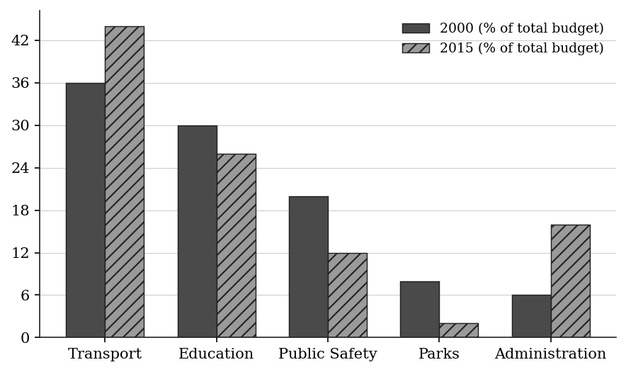

**(A)** 0  
**(B)** 1  
**(C)** 2  
**(D)** 3  
**(E)** 4

**Q15** · `DAT-BAR-KMF-004` · Select all that apply · 150s

The bar graph shows average daily household water use (liters per household) in five towns, from random samples in 2008, 2014 and 2020.

Which of the following statements about the graph are correct?

Indicate all such statements.

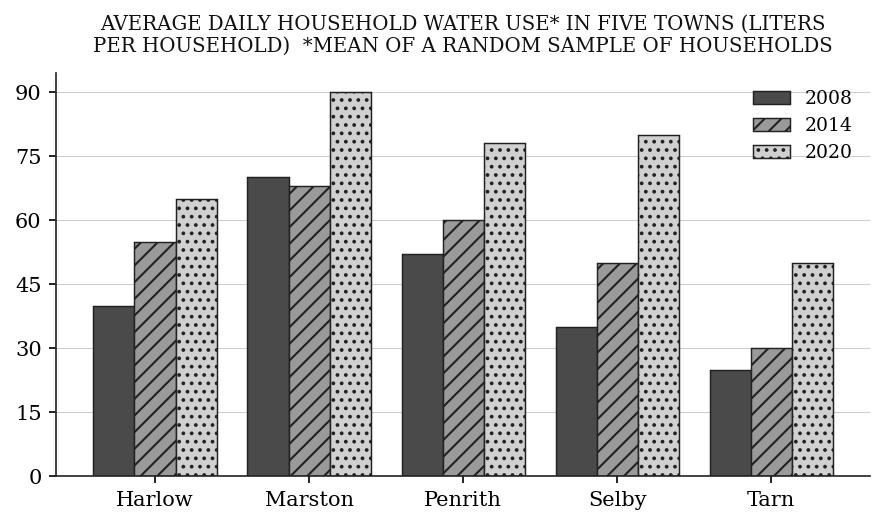

**(A)** Average use rose from each survey year to the next in every one of the five towns.  
**(B)** The town with the greatest average use in 2008 also had the greatest average use in 2020.  
**(C)** The town whose average use grew the most from 2008 to 2020 also had the greatest average use in 2020.  
**(D)** Harlow had the median average use of the five towns in 2014.  
**(E)** In exactly two of the towns, the 2020 average was at least twice the 2008 average.

**Q16** · `DAT-BAR-KMF-005` · MCQ · 90s

The bar graph shows the average daily ridership, in thousands of riders, on Metro line K for each month of 2018 and 2019. By how many thousand riders does the range of the monthly values for July through December of 2019 exceed the range of the monthly values for January through June of 2018?

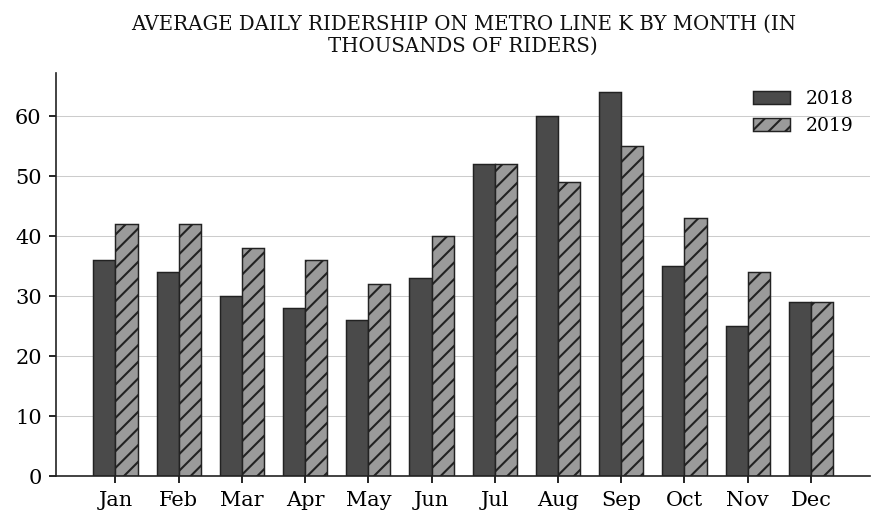

**(A)** 10  
**(B)** 16  
**(C)** 26  
**(D)** 29  
**(E)** 36

**Q17** · `DAT-LIN-011` · MCQ · 65s

The line graph shows a company's monthly profit (in $thousands):

By approximately what percent did profit increase from January to June?

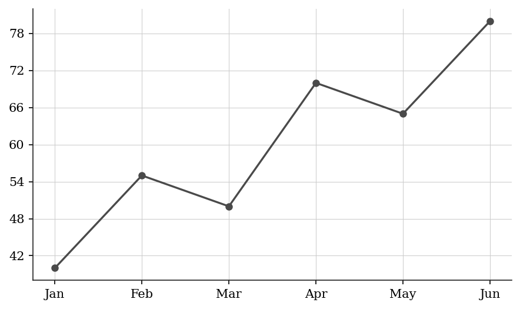

**(A)** 33%  
**(B)** 50%  
**(C)** 75%  
**(D)** 80%  
**(E)** 100%

**Q18** · `DAT-LIN-013` · Numeric Entry · 70s

The line graph shows two products' monthly sales (in units):

Product A: Jan: 100, Feb: 130, Mar: 160, Apr: 140, May: 180

Product B: Jan: 120, Feb: 120, Mar: 140, Apr: 160, May: 160

Over the 5 months shown, by how many total units did Product A outsell Product B? (Enter a negative number if Product B outsold Product A.)

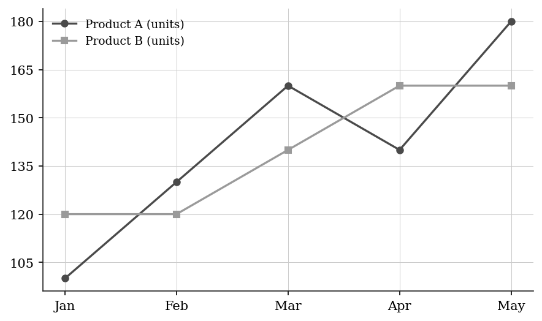

*Numeric entry — write the number.*

**Q19** · `DAT-LIN-014` · QC · 75s

The line graph shows annual export value (in $billions):

> **Quantity A:**  The percent increase in exports from Year 1 to Year 3
> **Quantity B:**  The percent increase in exports from Year 3 to Year 5

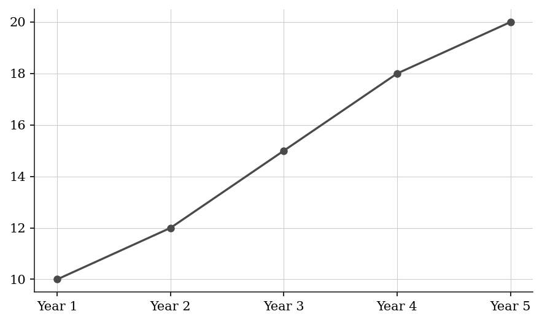

**Q20** · `DAT-LIN-015` · Select all that apply · 70s

The line graph shows a city's population (in thousands) over 6 years:

Which of the following years in the population DECREASED compared to the previous year?

Select all that apply.

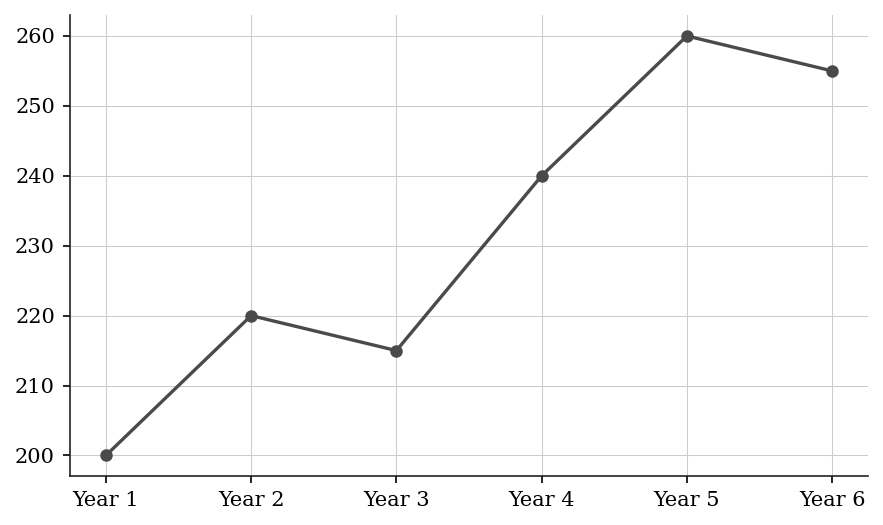

**(A)** Year 2  
**(B)** Year 3  
**(C)** Year 4  
**(D)** Year 5  
**(E)** Year 6

**Q21** · `DAT-LIN-019` · QC · 65s

The line graph shows monthly sales (in units) for two product lines:

Product X: Jan: 200, Feb: 250, Mar: 300

Product Y: Jan: 300, Feb: 275, Mar: 250

> **Quantity A:**  The total sales of Product X over the 3 months
> **Quantity B:**  The total sales of Product Y over the 3 months

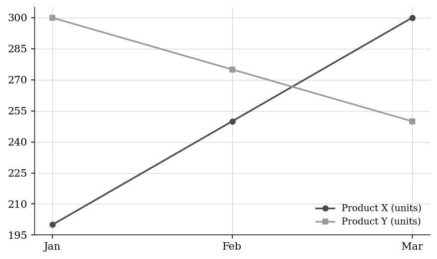

**Q22** · `DAT-LIN-020` · MCQ · 80s

The line graph shows a town's electricity consumption (in MWh) by month:

If the data represents a typical year, approximately what is the average monthly electricity consumption for the year?

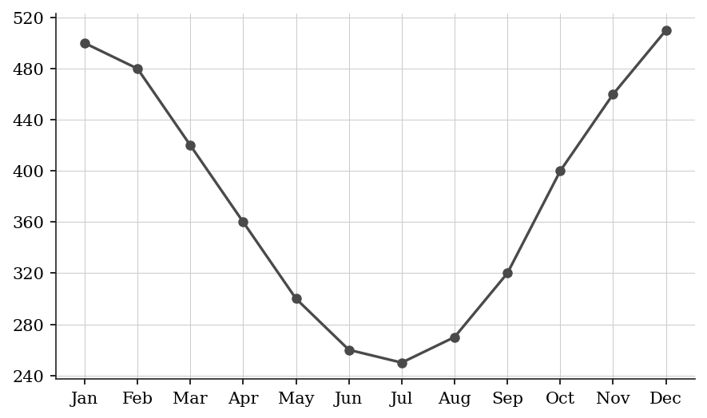

**(A)** 310 MWh  
**(B)** 360 MWh  
**(C)** 380 MWh  
**(D)** 420 MWh  
**(E)** 450 MWh

**Q23** · `DAT-LIN-KMF-006` · MCQ · 90s

The line graph gives, for ten census years, the percent of the residents of Harbor Province who were under 15 and the percent who were 70 or older; the table gives the province's total number of residents (in thousands) in each of those years. In which of these years was the share of residents aged 15 through 69 the largest?

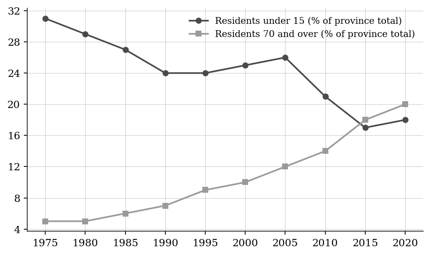

| Year | 1975 | 1980 | 1985 | 1990 | 1995 | 2000 | 2005 | 2010 | 2015 | 2020 |
|---|---|---|---|---|---|---|---|---|---|---|
| Total residents (thousands) | 800 | 850 | 900 | 1000 | 1100 | 1150 | 1200 | 1250 | 1300 | 1400 |

**(A)** 1975  
**(B)** 1990  
**(C)** 2005  
**(D)** 2015  
**(E)** 2020

---

### Level 3 · Hard — 7 questions · ~12 min

*where 162+ is won or lost*

**Q24** · `DAT-BAR-027` · MCQ · 95s

The bar graph below shows the revenue (in $ millions) of Company Z for each of the past 5 years:

Which year showed the greatest percent decrease in revenue compared to the immediately preceding year?

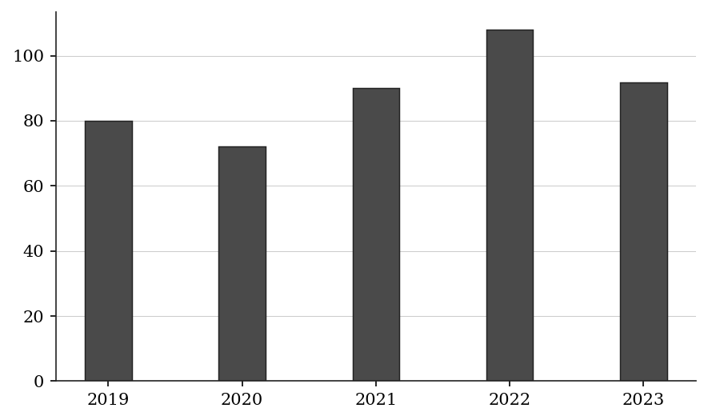

**(A)** 2020  
**(B)** 2021  
**(C)** 2022  
**(D)** 2023  
**(E)** Revenue never decreased

**Q25** · `DAT-BAR-034` · QC · 100s

The bar graph below shows the test score distributions for two classes. Each class has 20 students:

Class 1 scores: 5 students scored 60, 8 students scored 75, 7 students scored 90

Class 2 scores: 6 students scored 65, 9 students scored 80, 5 students scored 95

> **Quantity A:**  The arithmetic mean score of Class 1
> **Quantity B:**  The arithmetic mean score of Class 2

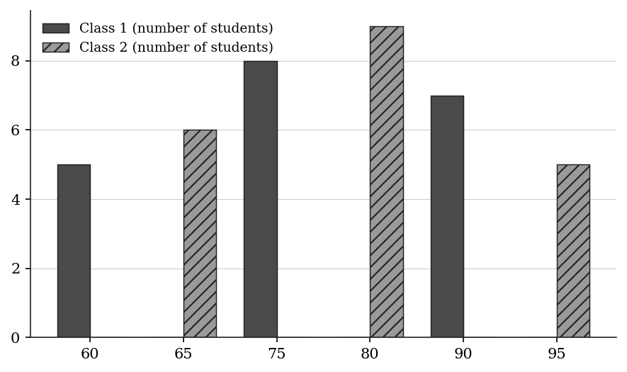

**Q26** · `DAT-BAR-040` · Select all that apply · 110s

The grouped bar graph below shows the revenue (in $ millions) and costs (in $ millions) for four business units in 2023:

Unit 1: Revenue=500, Cost=380

Unit 2: Revenue=320, Cost=260

Unit 3: Revenue=450, Cost=405

Unit 4: Revenue=280, Cost=196

The company plans to close any unit with a profit margin below 15% and expand any unit with a profit margin above 25%. (Profit margin = (Revenue - Cost)/Revenue × 100).

Which of the following statements are true?

Indicate all such statements.

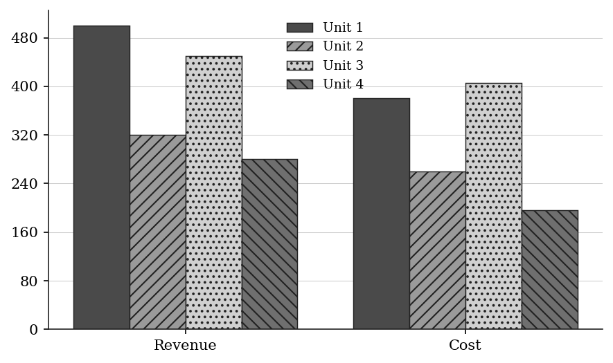

**(A)** Unit 1 will be expanded  
**(B)** Unit 2 will be closed  
**(C)** Unit 3 will be closed  
**(D)** Unit 4 will be expanded  
**(E)** Exactly two units will neither be closed nor expanded

**Q27** · `DAT-LIN-027` · MCQ · 95s

The line graph shows a company's revenue (in $millions) and expenses (in $millions) each year:

In which year was the company's profit margin (profit as a percent of revenue) the highest?

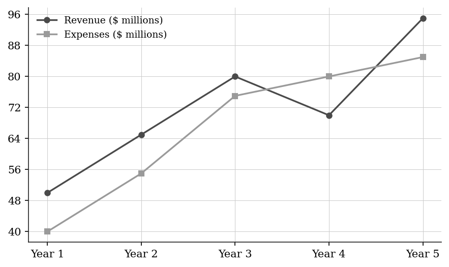

**(A)** Year 1  
**(B)** Year 2  
**(C)** Year 3  
**(D)** Year 4  
**(E)** Year 5

**Q28** · `DAT-LIN-035` · QC · 105s

The line graph shows a car's fuel efficiency (miles per gallon) at different speeds:

30 mph: 35 mpg, 40 mph: 40 mpg, 50 mph: 42 mpg, 60 mph: 38 mpg, 70 mph: 30 mpg

A driver travels 120 miles at 40 mph and then 120 miles at 60 mph.

> **Quantity A:**  Total gallons of fuel used for the 240-mile trip
> **Quantity B:**  6.2 gallons

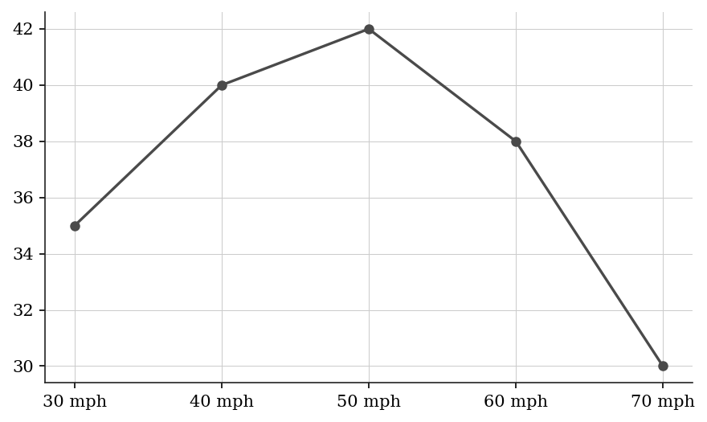

**Q29** · `SEC-DI-002` · Numeric Entry · 110s

The stacked bar chart shows the staff headcount of Meridian Logistics in each of the divisions Warehouse, Transport and Office for the years 2019 through 2022. The number printed inside each band is that division's headcount, and the number above each bar is the company total for that year.

Each employee in the Warehouse division handled an average of 900 parcels in 2019 and an average of 1,100 parcels in 2021. The total number of parcels handled by the Warehouse division in 2021 exceeded the total number it handled in 2019 by how many thousand parcels?

Give your answer as an integer number of thousands of parcels.

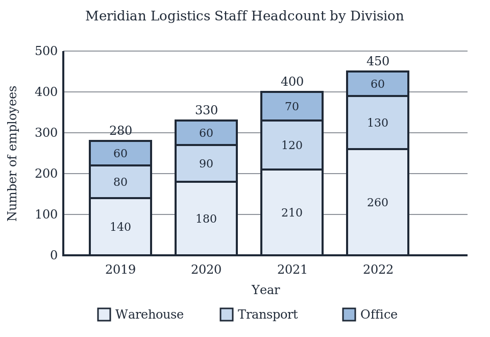

*Numeric entry — write the number.*

**Q30** · `SEC-DI-005` · Select all that apply · 120s

The graph shows the monthly revenue, in thousands of dollars, of two products, Aster and Borel, sold by Calder Instruments over six consecutive months.

Which of the following months for product Aster's revenue was at least 50 percent greater than product Borel's revenue?

Select all that apply.

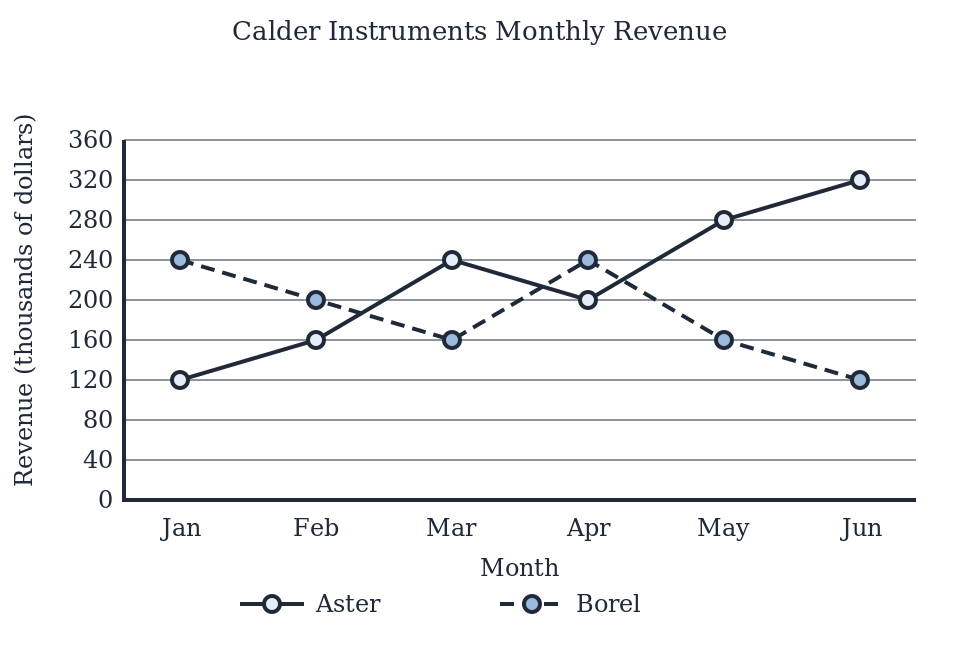

**(A)** Jan  
**(B)** Feb  
**(C)** Mar  
**(D)** Apr  
**(E)** May  
F. Jun

---

## Part B — Answer Key

| Q | ID | Level | Type | Answer |
|---|---|---|---|---|
| 1 | `DAT-BAR-002` | easy | MCQ | **D** |
| 2 | `DAT-BAR-004` | easy | Numeric Entry | **300** |
| 3 | `DAT-BAR-006` | easy | QC | **B** |
| 4 | `DAT-BAR-022` | easy | MCQ | **B** |
| 5 | `DAT-LIN-001` | easy | MCQ | **B** |
| 6 | `DAT-LIN-005` | easy | Numeric Entry | **75** |
| 7 | `DAT-LIN-008` | easy | QC | **B** |
| 8 | `DAT-BAR-011` | medium | MCQ | **D** |
| 9 | `DAT-BAR-012` | medium | QC | **A** |
| 10 | `DAT-BAR-015` | medium | MCQ | **C** |
| 11 | `DAT-BAR-017` | medium | Numeric Entry | **30** |
| 12 | `DAT-BAR-023` | medium | Numeric Entry | **80** |
| 13 | `DAT-BAR-026` | medium | QC | **A** |
| 14 | `DAT-BAR-KMF-001` | medium | MCQ | **C** |
| 15 | `DAT-BAR-KMF-004` | medium | Select all that apply | **B, D, E** |
| 16 | `DAT-BAR-KMF-005` | medium | MCQ | **B** |
| 17 | `DAT-LIN-011` | medium | MCQ | **E** |
| 18 | `DAT-LIN-013` | medium | Numeric Entry | **10** |
| 19 | `DAT-LIN-014` | medium | QC | **A** |
| 20 | `DAT-LIN-015` | medium | Select all that apply | **B, E** |
| 21 | `DAT-LIN-019` | medium | QC | **B** |
| 22 | `DAT-LIN-020` | medium | MCQ | **C** |
| 23 | `DAT-LIN-KMF-006` | medium | MCQ | **B** |
| 24 | `DAT-BAR-027` | hard | MCQ | **D** |
| 25 | `DAT-BAR-034` | hard | QC | **B** |
| 26 | `DAT-BAR-040` | hard | Select all that apply | **C, D, E** |
| 27 | `DAT-LIN-027` | hard | MCQ | **A** |
| 28 | `DAT-LIN-035` | hard | QC | **B** |
| 29 | `SEC-DI-002` | hard | Numeric Entry | **105** |
| 30 | `SEC-DI-005` | hard | Select all that apply | **C, E, F** |

---

## Part C — Worked Solutions

### Q1 · `DAT-BAR-002` — Answer: D

Add all four values: 45 + 72 + 60 + 36 = 213. The total revenue is $213 million.

**Trap.** Students may misread one bar value (e.g., read Company D as 39 instead of 36) and arrive at 216, which is not among the options, or make an addition error and pick a nearby incorrect option.

### Q2 · `DAT-BAR-004` — Answer: 300

Sum = 240 + 360 + 180 + 300 + 420 = 1500. Number of products = 5. Mean = 1500 / 5 = 300.

**Trap.** Students may add only four of the five products (e.g., skip Product E), computing 1080/4 = 270 instead of 1500/5 = 300.

### Q3 · `DAT-BAR-006` — Answer: B

Alice's average = (70 + 85) / 2 = 155 / 2 = 77.5. Bob's average = (90 + 75) / 2 = 165 / 2 = 82.5. Quantity B (82.5) > Quantity A (77.5). Answer: B.

**Trap.** Students may look only at Test 2 (Alice scored 85 vs Bob's 75) and assume Alice's average is higher, choosing A. But Bob's large advantage on Test 1 (90 vs 70) outweighs Alice's advantage on Test 2 (85 vs 75).

### Q4 · `DAT-BAR-022` — Answer: B

Airport A: Morning=30, Evening=20. Evening (20) < Morning (30). NO. Airport B: Morning=25, Evening=35. Evening (35) > Morning (25). YES. Airport C: Morning=40, Evening=30. Evening (30) < Morning (40). NO. Only Airport B qualifies.

**Trap.** Students reading a grouped bar chart may accidentally compare Airport B's morning count to Airport A's evening count, or they may confuse which bar represents morning vs evening if they do not track carefully.

### Q5 · `DAT-LIN-001` — Answer: B

Reading the values directly: Mon=12, Tue=18, Wed=15, Thu=22, Fri=30, Sat=28, Sun=20. The maximum value is 30, which occurs on Friday.

**Trap.** Students may confuse Friday (30) with Saturday (28) since Saturday is physically later on the graph and might seem like the peak visually.

### Q6 · `DAT-LIN-005` — Answer: 75

Sum of scores: 60 + 70 + 80 + 75 + 90 = 375. Number of weeks = 5. Mean = 375 ÷ 5 = 75.

**Trap.** Students may average the first and last score only (60+90)/2 = 75, which happens to be correct here but for the wrong reason. The calculation must sum all five values.

### Q7 · `DAT-LIN-008` — Answer: B

Quantity A: Year 2 - Year 1 = 850 - 800 = 50. Quantity B: Year 4 - Year 3 = 900 - 820 = 80. Since 80 > 50, Quantity B is greater.

**Trap.** Students may compare the absolute values of Year 2 (850) and Year 4 (900) rather than the changes. Year 4 is higher, but the question asks about the change (increase), not the absolute level.

### Q8 · `DAT-BAR-011` — Answer: D

February sales = 60. April sales = 120. Percent change = (New - Old) / Old × 100 = (120 - 60) / 60 × 100 = 60/60 × 100 = 100%.

**Trap.** Students divide by the new value (120) instead of the original (60): 60/120 × 100 = 50%, choosing A. Percent change always uses the original value as the denominator.

### Q9 · `DAT-BAR-012` — Answer: A

Quantity A: Percent increase from 2021 to 2022 = (180 - 150)/150 × 100 = 30/150 × 100 = 20%. Quantity B: Percent decrease from 2022 to 2023 = (180 - 162)/180 × 100 = 18/180 × 100 = 10%. Quantity A (20%) > Quantity B (10%).

**Trap.** Students may compute both changes as absolute differences (30 vs 18) and note 30 > 18, arriving at the correct letter A but for the wrong reason. Or they may use the same base (150) for both calculations, computing 18/150 × 100 = 12% for Quantity B, which still gives A > B but is arithmetically incorrect.

### Q10 · `DAT-BAR-015` — Answer: C

In February the store sold 100 hardcovers out of 250 books in all, and 100/250 = 0.4, or 40 percent.

**Trap.** Students divide the hardcover count by the paperback count, 100/150, and answer about 67 percent, or they read the top of the February bar (250) as the paperback segment. The base of the percent is the total for the month, not the other segment.

### Q11 · `DAT-BAR-017` — Answer: 30

Food + Utilities = 600 + 150 = 750. Total = 1200 + 600 + 300 + 150 + 250 = 2500. Percentage = 750/2500 × 100 = 30%.

**Trap.** Students may compute Food + Utilities as a percentage of the non-rent expenses only: 750/(2500-1200) = 750/1300 ≈ 57.7%, misunderstanding 'total monthly expenses.'

### Q12 · `DAT-BAR-023` — Answer: 80

Total annual sales = 180 + 240 + 200 + 260 = 880 thousand. Target = 800 thousand. Excess = 880 - 800 = 80 thousand. The company exceeded the target by $80,000.

**Trap.** Students may compute the total as 880 but then forget to subtract the target (800), entering 880 instead of 80. Or students may add incorrectly: 180+240=420, 200+260=460, 420+460=880 is correct, but some may compute 420+460=840, giving 40 as the answer.

### Q13 · `DAT-BAR-026` — Answer: A

Quantity A: Renewals Year 1 = 2000 - 800 = 1200. Fraction = 1200/2000 = 0.60. Quantity B: Renewals Year 2 = 2200 - 1000 = 1200. Fraction = 1200/2200 ≈ 0.545. Quantity A (0.60) > Quantity B (0.545).

**Trap.** Students notice that renewals are exactly 1200 in both years and immediately choose C (equal renewals). However, the question asks for the FRACTION of total subscriptions, not the absolute number of renewals. Since the total is larger in Year 2 (2200 vs 2000) but renewals are equal, Year 2's fraction is smaller.

### Q14 · `DAT-BAR-KMF-001` — Answer: C

Shares that fell from 2000 to 2015: Education (30 to 26), Public Safety (20 to 12), Parks (8 to 2). Transport and Administration rose.
Dollar amounts, in millions (2000 total 5.0, 2015 total 18.0):
Education: 0.30*5.0 = 1.50 and 0.26*18.0 = 4.68, higher.
Public Safety: 0.20*5.0 = 1.00 and 0.12*18.0 = 2.16, higher.
Parks: 0.08*5.0 = 0.40 and 0.02*18.0 = 0.36, lower.
So exactly 2 departments meet both conditions.
Check: Parks is the only one whose dollars fell, so 3 - 1 = 2.

**Trap.** Counting every department whose share fell, without converting to dollars, gives 3 (choice D); the larger 2015 budget hides that Parks is the only one that actually lost dollars.

### Q15 · `DAT-BAR-KMF-004` — Answer: B, D, E

Data (2008, 2014, 2020): Harlow 40, 55, 65; Marston 70, 68, 90; Penrith 52, 60, 78; Selby 35, 50, 80; Tarn 25, 30, 50.
A: Marston fell from 70 to 68, so not every town rose. False.
B: greatest in 2008 is Marston (70); greatest in 2020 is Marston (90, vs Selby 80). True.
C: growth 2008 to 2020: Harlow 25, Marston 20, Penrith 26, Selby 45, Tarn 25. Largest is Selby, but the greatest 2020 value belongs to Marston. False.
D: 2014 values in order: Tarn 30, Selby 50, Harlow 55, Penrith 60, Marston 68. The median (third) is 55, which is Harlow. True.
E: 2020/2008: Harlow 65/40 = 1.63, Marston 1.29, Penrith 1.5, Selby 80/35 = 2.29, Tarn 50/25 = 2.0. Selby and Tarn qualify, exactly two. True.
Answer: B, D, E.

**Trap.** Treating Tarn's 2020 value (exactly double its 2008 value) as not 'at least twice' makes statement E look false (omits choice E); reading the town with the biggest increase as the highest-usage town wrongly selects choice C.

### Q16 · `DAT-BAR-KMF-005` — Answer: B

2019, July to December: 52, 49, 55, 43, 34, 29. Range = 55 - 29 = 26.
2018, January to June: 36, 34, 30, 28, 26, 33. Range = 36 - 26 = 10.
Difference = 26 - 10 = 16.
Check the distractors: 2019 January to June is 42, 42, 38, 36, 32, 40 with range 10 (option A). 2018 July to December is 52, 60, 64, 35, 25, 29 with range 64 - 25 = 39, giving 39 - 10 = 29 (option D). Option C is just 26 with no subtraction; option E is 26 + 10.

**Trap.** Using the wrong year for the second-half range: 2018 July to December has range 39, so 39 - 10 = 29 (option D).

### Q17 · `DAT-LIN-011` — Answer: E

Percent change = (New - Original) / Original × 100 = (80 - 40) / 40 × 100 = 40/40 × 100 = 100%. Profit doubled from January to June.

**Trap.** Students may use June's value (80) as the denominator: 40/80 × 100 = 50%. Always divide by the ORIGINAL (January) value, not the new (June) value.

### Q18 · `DAT-LIN-013` — Answer: 10

Total sales for each product:
Product A: 100+130+160+140+180 = 710
Product B: 120+120+140+160+160 = 700
Difference: 710 - 700 = 10. Product A outsold Product B by 10 units.

**Trap.** Students may compare only the final month (May) values: A=180, B=160, difference=20. But the question asks for total over all 5 months. Summing all values gives a difference of only 10.

### Q19 · `DAT-LIN-014` — Answer: A

Quantity A: (15-10)/10 × 100 = 5/10 × 100 = 50%
Quantity B: (20-15)/15 × 100 = 5/15 × 100 = 33.3%
Both have the same absolute increase (+5 billion), but the percent change depends on the base. Year 1's base (10) is smaller than Year 3's base (15), so Quantity A's percent is larger. 50% > 33.3%, so Quantity A is greater.

**Trap.** Students notice that both intervals have the same absolute increase of +5 billion and assume the percent changes are equal, choosing C. The percent change depends on the base value, not just the absolute change.

### Q20 · `DAT-LIN-015` — Answer: B, E

Compare each year to the previous:
Year 2 vs Year 1: 220 > 200 → increase
Year 3 vs Year 2: 215 < 220 → DECREASE ✓
Year 4 vs Year 3: 240 > 215 → increase
Year 5 vs Year 4: 260 > 240 → increase
Year 6 vs Year 5: 255 < 260 → DECREASE ✓
Years with decreases: Year 3 (B) and Year 6 (E).

**Trap.** Students may select years where the population is below the overall trend line rather than years where it decreased from the immediately preceding year. Year 3 (215) is lower than Year 2 (220) — that is a decrease. Year 6 (255) is lower than Year 5 (260) — also a decrease.

### Q21 · `DAT-LIN-019` — Answer: B

Quantity A (Product X): 200 + 250 + 300 = 750
Quantity B (Product Y): 300 + 275 + 250 = 825
750 < 825, so Quantity B is greater.

**Trap.** Students observe that Product X ends higher (300) than Product Y (250) in March and assume X has more total sales. But totaling all three months reveals Y had much higher early sales (300 in Jan vs 200 in Jan) that outweigh X's advantage in March.

### Q22 · `DAT-LIN-020` — Answer: C

Sum all months: 500+480+420+360+300+260+250+270+320+400+460+510 = 4,530. Average = 4,530 / 12 = 377.5 ≈ 380 MWh. Answer C is closest.

**Trap.** Students may average only January (500) and July (250), the apparent peak and trough: (500+250)/2 = 375 ≈ 380. This coincidentally gives the right answer, but the proper method is to sum all 12 values.

### Q23 · `DAT-LIN-KMF-006` — Answer: B

Residents aged 15 through 69 are everyone who is neither under 15 nor 70 or older, so their share = 100 - (under-15 share) - (70+ share). The largest middle share comes in the year where the two outer shares add up to the least.
1975: 31 + 5 = 36, middle 64%.
1990: 24 + 7 = 31, middle 69%.
2005: 26 + 12 = 38, middle 62%.
2015: 17 + 18 = 35, middle 65%.
2020: 18 + 20 = 38, middle 62%.
(The other years, for reference: 1980 gives 34, 1985 gives 33, 1995 gives 33, 2000 gives 35, 2010 gives 35.)
The smallest outer total is 31 in 1990, so the middle share peaks at 69% in 1990.

**Trap.** Choosing the year with the lowest under-15 share, 2015 (option D), without adding the 70+ share, which is high that year.

### Q24 · `DAT-BAR-027` — Answer: D

Only years 2020 and 2023 show a decrease. 2020: (80-72)/80 × 100 = 8/80 × 100 = 10%. 2023: (108-91.8)/108 × 100 = 16.2/108 × 100 = 15%. The greatest percent decrease is in 2023 at 15%. Answer: D.

**Trap.** Students may focus on 2020 because the absolute decrease in 2020 (8 million) seems comparable and appears earlier in the data. The critical error is comparing absolute changes (8M vs 16.2M) when the question asks for percent decrease. Students who check 2020's percent decrease (10%) but do not verify 2023's (15%) will choose A.

### Q25 · `DAT-BAR-034` — Answer: B

Class 1 mean = (5×60 + 8×75 + 7×90) / 20 = (300 + 600 + 630) / 20 = 1530/20 = 76.5. Class 2 mean = (6×65 + 9×80 + 5×95) / 20 = (390 + 720 + 475) / 20 = 1585/20 = 79.25. Quantity B (79.25) > Quantity A (76.5).

**Trap.** Students may compare the simple averages of the three score values: Class 1: (60+75+90)/3=75; Class 2: (65+80+95)/3=80. This gives the correct ordering (B > A) but for the wrong reason — it ignores the weights (number of students at each score level). A student who notices Class 1 has more students at the higher score (90) may incorrectly assume Class 1 has a higher weighted mean.

### Q26 · `DAT-BAR-040` — Answer: C, D, E

Profit margins: Unit 1: (500-380)/500 = 120/500 = 24%. Not above 25% (expand), not below 15% (close) — NEITHER. Unit 2: (320-260)/320 = 60/320 = 18.75%. Not above 25%, not below 15% — NEITHER. Unit 3: (450-405)/450 = 45/450 = 10%. Below 15% — CLOSED. Unit 4: (280-196)/280 = 84/280 = 30%. Above 25% — EXPANDED. Check statements: A: Unit 1 margin=24% < 25%, so NOT expanded. False. B: Unit 2 margin=18.75%, not below 15%, NOT closed. False. C: Unit 3 margin=10% < 15%, will be closed. True. D: Unit 4 margin=30% > 25%, will be expanded. True. E: Units 1 and 2 are neither closed nor expanded (margins 24% and 18.75%). Exactly two units — true. Correct: C, D, E.

**Trap.** For Unit 1, students may round 24% up to 25% and incorrectly include it as 'expanded' (choosing A). For Unit 2, students may confuse 18.75% as being 'close to 20%' and round incorrectly. The critical insight for statement E: students must correctly identify all four units' statuses before they can verify that exactly two are in the 'neither' category.

### Q27 · `DAT-LIN-027` — Answer: A

Profit = Revenue - Expenses. Profit margin = Profit / Revenue × 100.
Year 1: Profit = 50-40 = 10. Margin = 10/50 × 100 = 20%
Year 2: Profit = 65-55 = 10. Margin = 10/65 × 100 ≈ 15.4%
Year 3: Profit = 80-75 = 5. Margin = 5/80 × 100 = 6.25%
Year 4: Profit = 70-80 = -10. Margin is negative (a loss).
Year 5: Profit = 95-85 = 10. Margin = 10/95 × 100 ≈ 10.5%
Year 1 has the highest profit margin at 20%.

**Trap.** Students may look for the year with the highest absolute profit (all of Years 1, 2, and 5 have profit=$10M and appear equal) and not compute the margin. Among those three years, Year 1 has the smallest revenue base (50M), yielding the highest margin. Students who compare only absolute profits will see a three-way tie and guess incorrectly.

### Q28 · `DAT-LIN-035` — Answer: B

Fuel used = Distance / Fuel Efficiency.
At 40 mph (40 mpg): 120 / 40 = 3.000 gallons
At 60 mph (38 mpg): 120 / 38 ≈ 3.158 gallons
Total fuel = 3.000 + 3.158 = 6.158 gallons ≈ 6.16 gallons
Quantity A ≈ 6.16 gallons. Quantity B = 6.2 gallons. Since 6.16 < 6.2, Quantity B is greater.

**Trap.** Students may average the two fuel efficiencies: (40+38)/2 = 39 mpg, then compute 240/39 ≈ 6.15 gallons. This gives approximately the same answer and method is close but conceptually wrong (cannot simple-average mpg for equal distances — harmonic mean applies). The correct calculation gives 6.158, still less than 6.2, so the conclusion remains B.

### Q29 · `SEC-DI-002` — Answer: 105

Use only the Warehouse band, not the whole bar. Warehouse headcount was 140 in 2019 and 210 in 2021. Parcels in 2019 = 140 * 900 = 126,000. Parcels in 2021 = 210 * 1,100 = 231,000. The excess is 231,000 - 126,000 = 105,000 parcels, which is 105 thousand parcels.

**Trap.** Reading the top of each stacked bar rather than the Warehouse band uses the company totals 280 and 400, giving 400 * 1,100 - 280 * 900 = 188,000, and an answer of 188. In a stacked bar the top edge is the cumulative total, not the value of the top or bottom segment.

### Q30 · `SEC-DI-005` — Answer: C, E, F

Aster is at least 50 percent greater than Borel exactly when Aster is at least 1.5 times Borel. January: 1.5 * 240 = 360 and Aster is 120, no. February: 1.5 * 200 = 300 and Aster is 160, no. March: 1.5 * 160 = 240 and Aster is exactly 240, yes. April: 1.5 * 240 = 360 and Aster is 200, no. May: 1.5 * 160 = 240 and Aster is 280, yes. June: 1.5 * 120 = 180 and Aster is 320, yes. So March, May and June qualify.

**Trap.** March is the trap: Aster's 240 is exactly 1.5 times Borel's 160, so Aster is exactly 50 percent greater. Students who require a strict inequality drop March and select only May and June.
