# Pie Charts — Practice Set

**Bank code:** `DAT-PIE` · **Section:** Data Interpretation · **30 questions** — Easy 6 · Medium 15 · Hard 9

**Lecture capsule:** [03-pie-charts.md](../../08-data-interpretation/03-pie-charts.md)

> A sector is a percent of a whole, and 1 percent is 3.6 degrees; when two charts appear, check whether the totals are the same before you compare any two slices.

Every question below is live in the question bank under the ID shown — the sheet and the portal are the same questions. Attempt a level with the clock running, then check Part C.

---

## Part A — Questions

> **Quantitative Comparison — the four choices are always the same, so they are not reprinted:**
> **(A)** Quantity A is greater · **(B)** Quantity B is greater · **(C)** The two quantities are equal · **(D)** The relationship cannot be determined from the information given

### Level 1 · Easy — 6 questions · ~5 min

*warm-up — these must be automatic*

**Q1** · `DAT-PIE-003` · MCQ · 55s

A pie chart shows a company's revenue sources:

Which sector is the largest, and approximately how many times larger is it than the smallest sector?

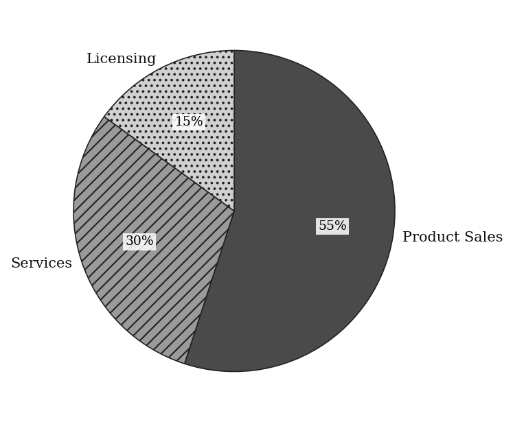

**(A)** Product Sales; about 2.5 times  
**(B)** Product Sales; about 3.7 times  
**(C)** Services; about 2 times  
**(D)** Product Sales; about 5 times  
**(E)** Services; about 3 times

**Q2** · `DAT-PIE-004` · Numeric Entry · 45s

A pie chart shows how a nonprofit distributes its $250,000 annual grant:

How many dollars are allocated to Programs? Give the exact dollar amount.

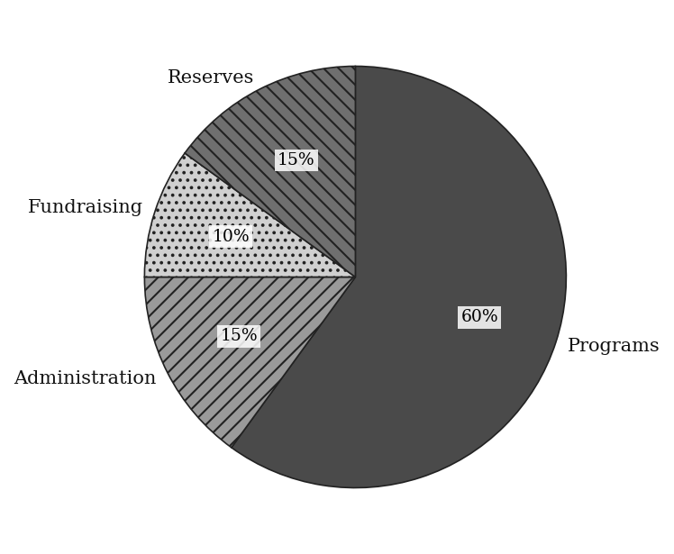

*Numeric entry — write the number.*

**Q3** · `DAT-PIE-006` · MCQ · 60s

A pie chart shows the distribution of 500 animals at a zoo:

Which two categories together account for exactly 50% of all animals?

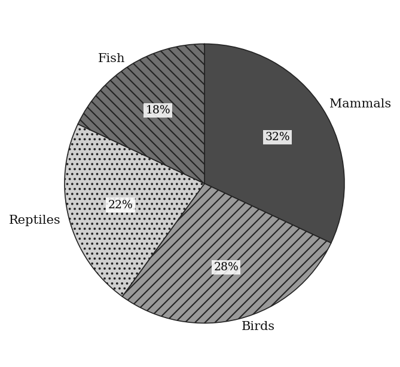

**(A)** Mammals and Birds  
**(B)** Mammals and Reptiles  
**(C)** Birds and Reptiles  
**(D)** Birds and Fish  
**(E)** Reptiles and Fish

**Q4** · `DAT-PIE-008` · Numeric Entry · 50s

A pie chart sector representing the 'Housing' category spans an angle of 90 degrees.

What percentage of the total does the Housing category represent?

*Numeric entry — write the number.*

**Q5** · `DAT-PIE-KMF-003` · MCQ · 60s

The pie chart shows how Harbor Books' 2023 revenue split across five genres. Approximately how many more degrees does the Mystery wedge span than the Sci-Fi wedge?

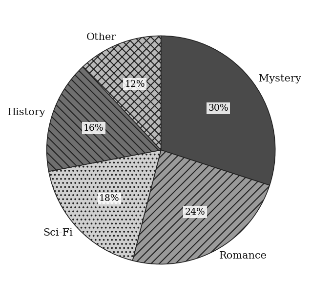

**(A)** 12  
**(B)** 43  
**(C)** 65  
**(D)** 108  
**(E)** 173

**Q6** · `DAT-PIE-KMF2-004` · QC · 50s

> **Quantity A:**  The percent of Town P's annual energy use that is used for water heating and space cooling combined
> **Quantity B:**  The percent of Town P's annual energy use that is used for space heating

---

### Level 2 · Medium — 15 questions · ~19 min

*two or three steps, one planted trap each*

**Q7** · `DAT-PIE-011` · MCQ · 75s

A pie chart shows how a city's annual budget of $3,600,000 is spent:

If the city increases its total budget by 25% next year but keeps the same percentage allocations, how much more money (in dollars) will be spent on Education next year compared to this year?

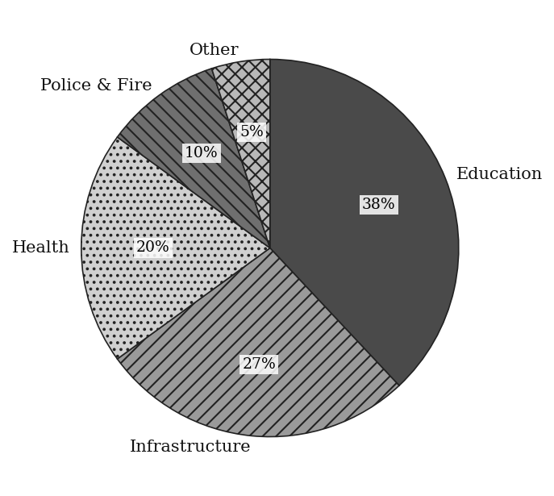

**(A)** $320,000  
**(B)** $342,000  
**(C)** $360,000  
**(D)** $380,000  
**(E)** $400,000

**Q8** · `DAT-PIE-012` · QC · 65s

A pie chart shows the distribution of 960 students across five majors:

> **Quantity A:**  The number of Engineering students
> **Quantity B:**  The combined number of Arts and Science students

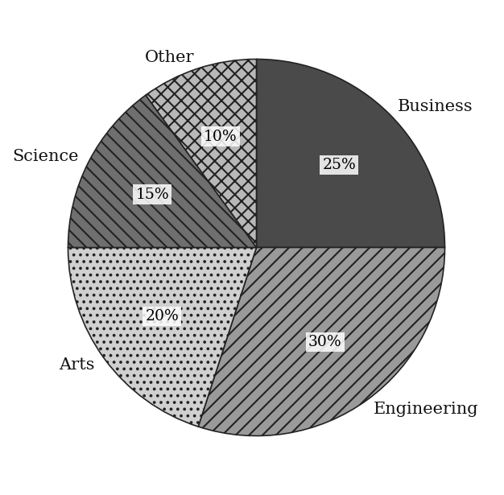

**Q9** · `DAT-PIE-013` · Numeric Entry · 70s

A pie chart shows how a family spends its monthly income:

Other: (unlabeled)

If the family's monthly income is $5,000, how many dollars are spent on the 'Other' category?

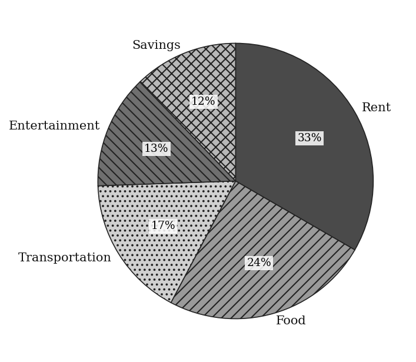

*Numeric entry — write the number.*

**Q10** · `DAT-PIE-015` · QC · 65s

A company pie chart shows annual revenue allocated as:

The company's total revenue is $8,000,000.

> **Quantity A:**  The dollar amount allocated to R&D and Marketing combined
> **Quantity B:**  The dollar amount allocated to Operations

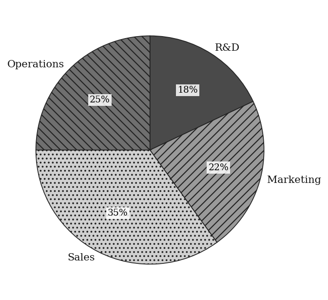

**Q11** · `DAT-PIE-017` · Select all that apply · 80s

A pie chart shows how 2,000 households are classified by annual income:

Under $30K: 20%

$30K–$60K: 35%

$60K–$100K: 28%

Over $100K: 17%

Which of the following categories contain more than 400 households?

Select all that apply.

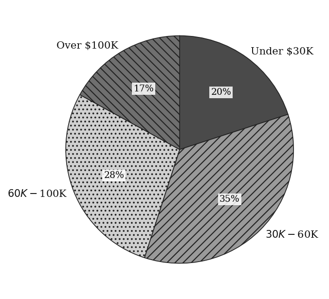

**(A)** Under $30K  
**(B)** $30K–$60K  
**(C)** $60K–$100K  
**(D)** Over $100K  
**(E)** None of the above

**Q12** · `DAT-PIE-018` · MCQ · 65s

A pie chart shows a university's enrollment of 4,500 students.

What fraction of the total enrollment is in Engineering?

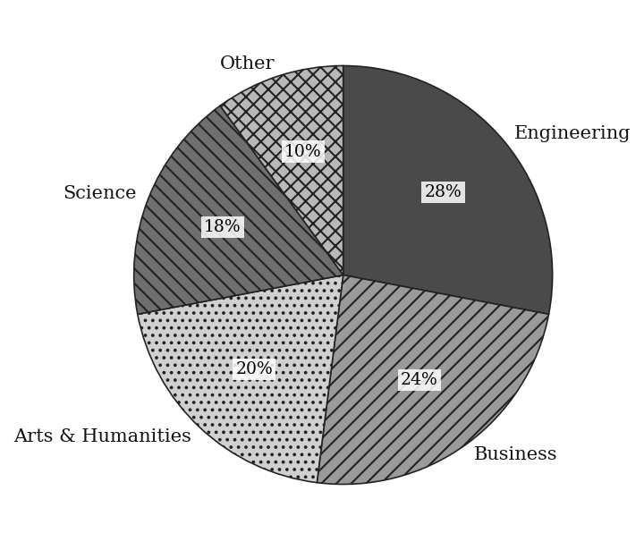

**(A)** 7/25  
**(B)** 7/18  
**(C)** 7/13  
**(D)** 7/6  
**(E)** 7/5

**Q13** · `DAT-PIE-019` · QC · 70s

A company's expenses are shown in a pie chart with total expenses of $2,400,000:

> **Quantity A:**  The dollar amount spent on Salaries
> **Quantity B:**  Three times the dollar amount spent on Rent

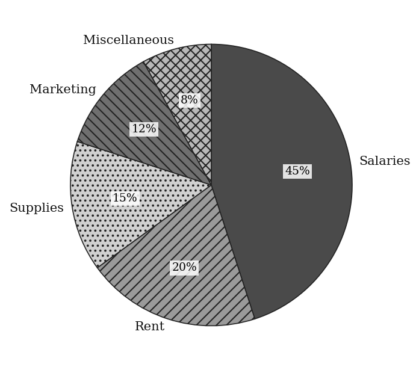

**Q14** · `DAT-PIE-021` · Select all that apply · 90s

A pie chart shows the composition of a 500-piece coin collection. A 'Rare Coins' category is added, making up 10 percent of the collection, and all other categories are scaled down proportionally so that the total remains 100 percent. The collection still contains 500 pieces. Select all statements that are true after the rescaling. Indicate all such statements.

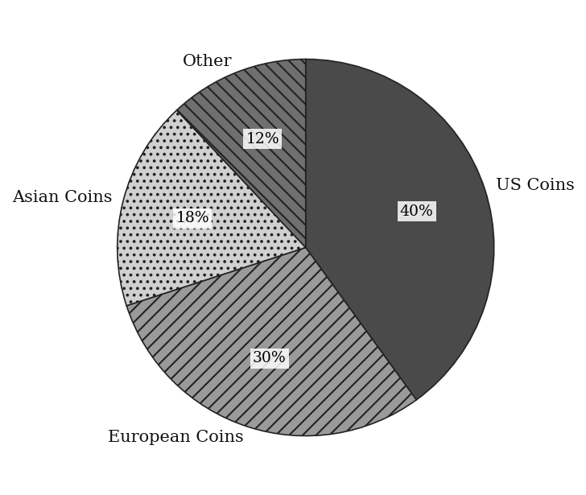

**(A)** US Coins will represent less than 38% of the collection.  
**(B)** European Coins will represent exactly 30% of the collection.  
**(C)** Asian Coins will represent less than 17% of the collection.  
**(D)** The number of US Coins will be less than 200.  
**(E)** Other will represent more than 11% of the collection.

**Q15** · `DAT-PIE-022` · Numeric Entry · 75s

A pie chart shows the vote distribution in an election among five candidates:

Candidate E: (unlabeled)

Candidate E received 1,200 votes. What was the total number of votes cast in the election?

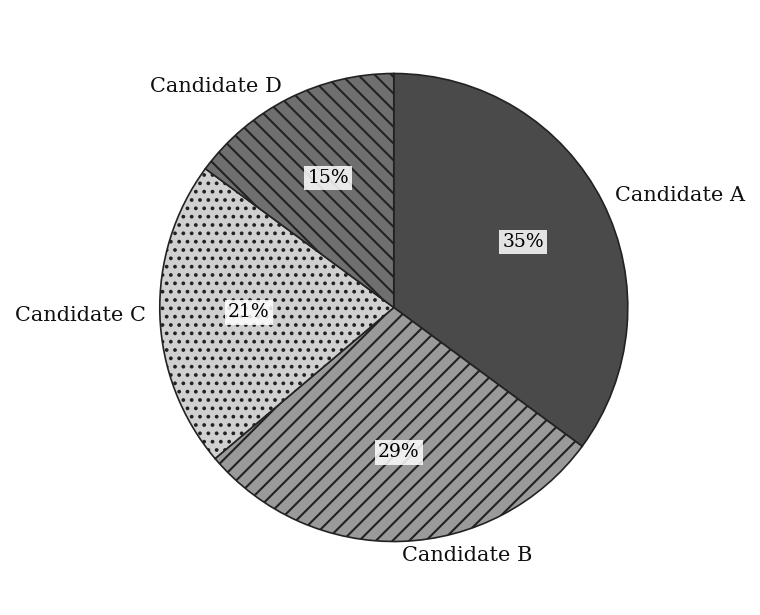

*Numeric entry — write the number.*

**Q16** · `DAT-PIE-024` · MCQ · 75s

A pie chart shows how the 900 students in a school are distributed across four extracurricular activities. No student participates in more than one activity.

The number of students in Debate is what fraction of the number of students in Sports?

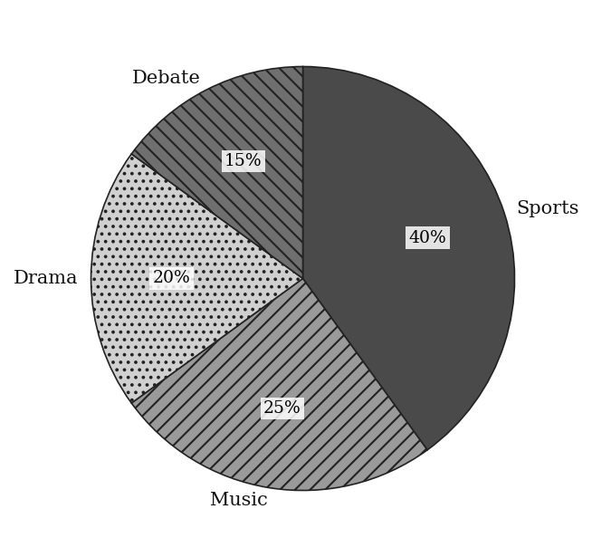

**(A)** 3/20  
**(B)** 3/11  
**(C)** 3/8  
**(D)** 2/5  
**(E)** 8/3

**Q17** · `DAT-PIE-025` · Select all that apply · 90s

A pie chart shows a company's $5,000,000 budget:

The company cuts 10% from each category and reallocates all savings to Personnel.

Which of the following statements are true after the reallocation?

Indicate all such statements.

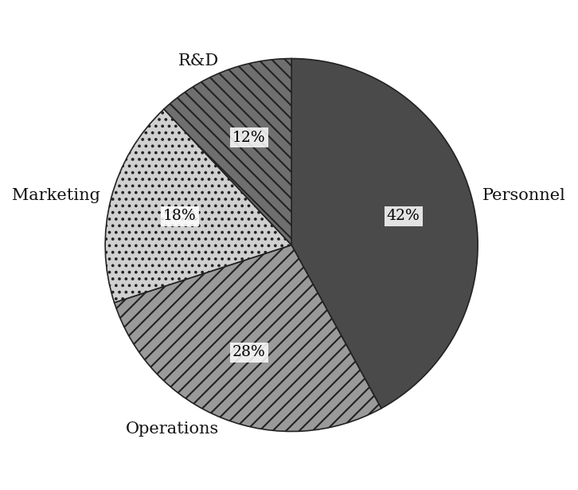

**(A)** The new Personnel allocation exceeds $2,500,000.  
**(B)** R&D allocation after the cut equals $540,000.  
**(C)** Total budget remains $5,000,000.  
**(D)** The new Personnel percentage of the budget exceeds 50%.  
**(E)** Marketing allocation after the cut (before reallocation) equals $810,000.

**Q18** · `DAT-PIE-KMF-002` · MCQ · 90s

The pie chart shows Harbor Books' 2023 revenue by genre, and the table shows the same total revenue split by format. Exactly one quarter of the revenue from e-books came from Mystery titles. What fraction of all Mystery revenue was earned through e-book sales?

| Format | Percent of total 2023 revenue |
|---|---|
| E-book | 48% |
| Print | 52% |

**(A)** 1/4  
**(B)** 3/10  
**(C)** 2/5  
**(D)** 1/2  
**(E)** 5/8

**Q19** · `DAT-PIE-KMF2-003` · MCQ · 80s

The annual energy used for space cooling in Town P is approximately what percent less than the annual energy used for space heating?

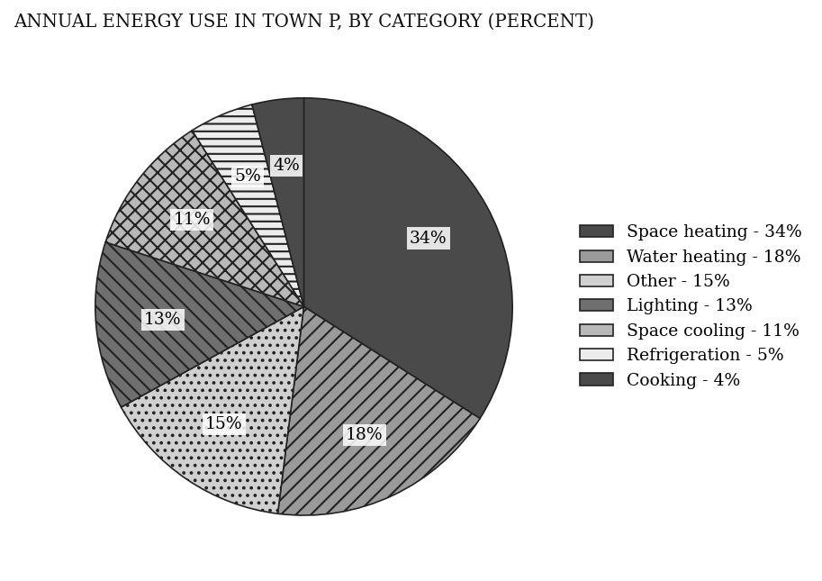

**(A)** 23%  
**(B)** 32%  
**(C)** 46%  
**(D)** 68%  
**(E)** 209%

**Q20** · `DAT-PIE-KMF2-005` · MCQ · 75s

REGIONAL WATER AUTHORITY SPENDING BY CATEGORY, 2023

Total: $18 billion

If 60 percent of the spending on pipeline renewal was for materials and 40 percent was for labor, approximately how many billion dollars was spent on materials for pipeline renewal?

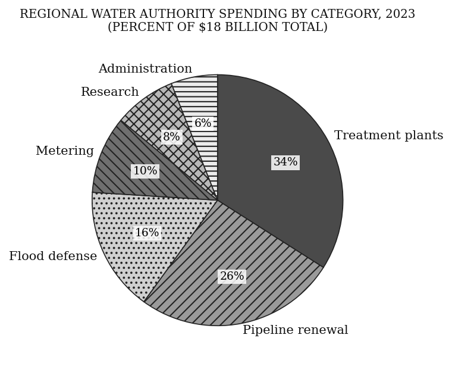

**(A)** 1.9  
**(B)** 2.8  
**(C)** 4.7  
**(D)** 6.1  
**(E)** 10.8

**Q21** · `SEC-DI-007` · MCQ · 90s

The circle graph shows how Fenwick Municipal Library allocated its 2024 operating budget of $1,500,000 among five categories, and the table below it gives the amount, in dollars, that each category received in 2023.

The amount the library allocated to Collections in 2024 was approximately what percent greater than the amount it allocated to Collections in 2023?

**(A)** 16%  
**(B)** 18%  
**(C)** 30%  
**(D)** 84%  
**(E)** 118%

---

### Level 3 · Hard — 9 questions · ~15 min

*where 162+ is won or lost*

**Q22** · `DAT-PIE-027` · MCQ · 90s

The pie charts show the distribution of employees at TechCorp in 2020 and 2023:

2020 — Total: 1,200 employees

2023 — Total: 1,800 employees

By what percent did the actual number of Engineering employees change from 2020 to 2023?

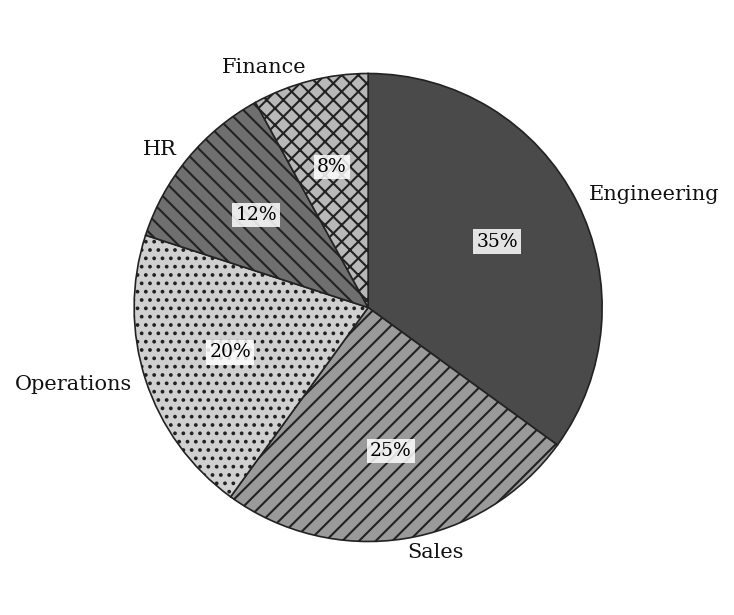

**(A)** Decreased by approximately 14.3%  
**(B)** Decreased by 5 percentage points  
**(C)** Increased by approximately 28.6%  
**(D)** Increased by 5 percentage points  
**(E)** Increased by approximately 54%

**Q23** · `DAT-PIE-028` · QC · 95s

Two companies display their employee distributions in separate pie charts:

Alpha Corp — Total: 2,000 employees

Beta Corp — Total: 1,500 employees

> **Quantity A:**  Combined Marketing employees from both companies
> **Quantity B:**  Tech employees at Alpha Corp minus Tech employees at Beta Corp

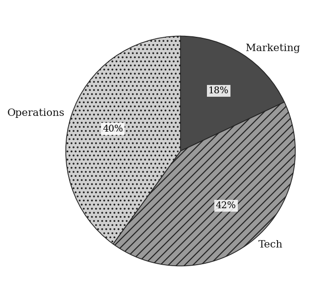

**Q24** · `DAT-PIE-029` · Numeric Entry · 85s

The pie charts show how two universities distribute their research funding:

University A — Total funding: $4,000,000

University B — Total funding: $3,000,000

How much more money (in dollars) does University A spend on STEM than University B spends on Humanities?

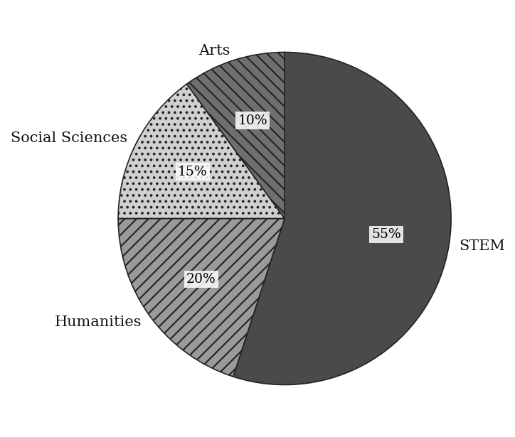

*Numeric entry — write the number.*

**Q25** · `DAT-PIE-030` · MCQ · 90s

A pie chart shows the 2019 distribution of 1,500 employees:

In 2022, the total workforce grew to 2,100. The number of Tech employees remained exactly the same (no new hires or departures in Tech). All new positions were added to the other departments.

What percentage of the 2022 workforce works in Tech? (Round to the nearest whole percent.)

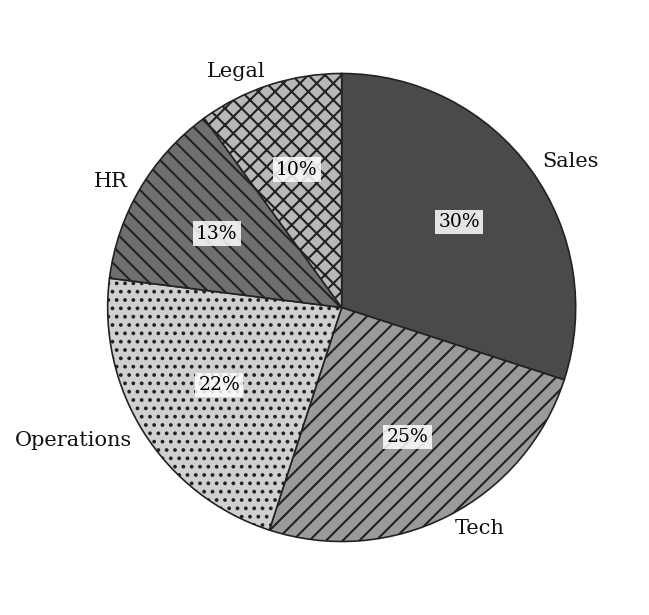

**(A)** 15%  
**(B)** 18%  
**(C)** 20%  
**(D)** 22%  
**(E)** 25%

**Q26** · `DAT-PIE-031` · Select all that apply · 105s

The pie charts show revenue distribution for RetailCo across two years:

2021 — Total revenue: $6,000,000

2023 — Total revenue: $9,000,000

Which of the following statements are true?

Indicate all such statements.

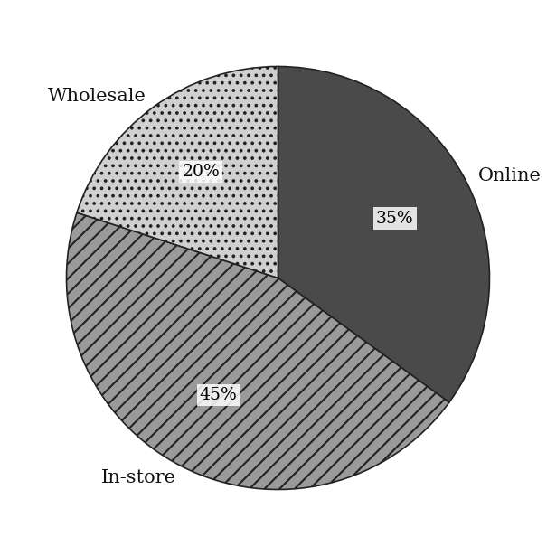

**(A)** Online revenue more than doubled from 2021 to 2023.  
**(B)** In-store revenue decreased from 2021 to 2023.  
**(C)** Wholesale revenue increased from 2021 to 2023.  
**(D)** The percent change in Online revenue from 2021 to 2023 exceeds 100%.  
**(E)** In-store revenue in 2023 is greater than Online revenue in 2021.

**Q27** · `DAT-PIE-033` · QC · 95s

A pie chart shows Country X's energy sources in 2015 (total = 500 terawatt-hours):

A second pie chart shows the same country's energy in 2022 (total = 800 terawatt-hours):

> **Quantity A:**  The increase in actual Renewables output (in TWh) from 2015 to 2022
> **Quantity B:**  The total Coal output (in TWh) in 2022

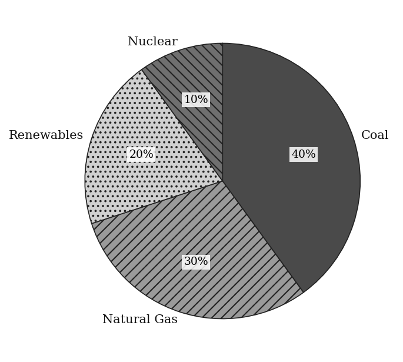

**Q28** · `DAT-PIE-037` · MCQ · 110s

The pie charts show the distribution of a country's exports in 2015 and 2020:

2015 — Total exports: $80 billion

2020 — Total exports: $120 billion

Which answer choice is closest to the ratio of the percent change in Services exports to the percent change in Agriculture exports from 2015 to 2020?

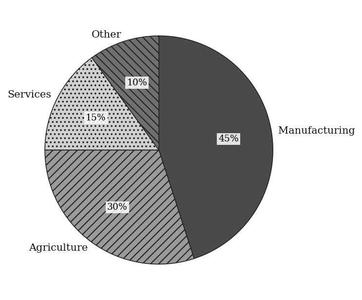

**(A)** 2.5 : 1  
**(B)** 3 : 1  
**(C)** 3.75 : 1  
**(D)** 4 : 1  
**(E)** 5 : 1

**Q29** · `DAT-PIE-KMF-006` · MCQ · 120s

The pie chart shows how a firm's 2018 revenue, in millions of dollars, was divided among its divisions.

Across all divisions the firm took in $52.0 million during 2014. Each year after that, through 2018, its total revenue climbed by a minimum of 1.5 million dollars over the preceding year. What is the greatest total revenue the firm could have had in 2016?

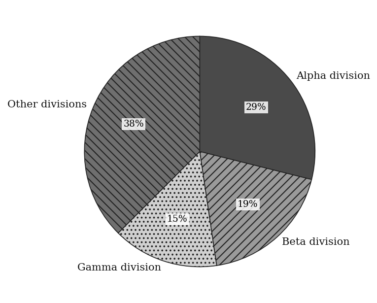

**(A)** $55.0 million  
**(B)** $58.0 million  
**(C)** $59.5 million  
**(D)** $61.0 million  
**(E)** $62.5 million

**Q30** · `SEC-DI-008` · QC · 105s

The circle graph shows how Fenwick Municipal Library allocated its 2024 operating budget of $1,500,000 among five categories, and the table below it gives the amount, in dollars, that each category received in 2023.

> **Quantity A:**  Facilities' 2024 allocation as a percent of the library's total 2024 budget
> **Quantity B:**  Facilities' 2023 allocation as a percent of the library's total 2023 budget

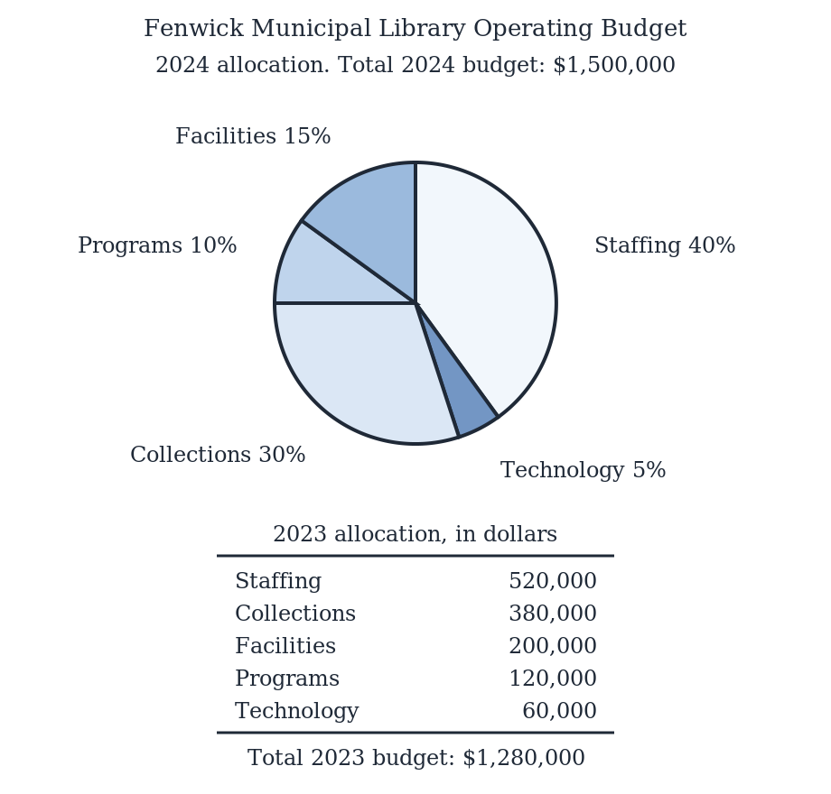

---

## Part B — Answer Key

| Q | ID | Level | Type | Answer |
|---|---|---|---|---|
| 1 | `DAT-PIE-003` | easy | MCQ | **B** |
| 2 | `DAT-PIE-004` | easy | Numeric Entry | **150000** |
| 3 | `DAT-PIE-006` | easy | MCQ | **C** |
| 4 | `DAT-PIE-008` | easy | Numeric Entry | **25** |
| 5 | `DAT-PIE-KMF-003` | easy | MCQ | **B** |
| 6 | `DAT-PIE-KMF2-004` | easy | QC | **B** |
| 7 | `DAT-PIE-011` | medium | MCQ | **B** |
| 8 | `DAT-PIE-012` | medium | QC | **B** |
| 9 | `DAT-PIE-013` | medium | Numeric Entry | **500** |
| 10 | `DAT-PIE-015` | medium | QC | **A** |
| 11 | `DAT-PIE-017` | medium | Select all that apply | **B, C** |
| 12 | `DAT-PIE-018` | medium | MCQ | **A** |
| 13 | `DAT-PIE-019` | medium | QC | **B** |
| 14 | `DAT-PIE-021` | medium | Select all that apply | **A, C, D** |
| 15 | `DAT-PIE-022` | medium | Numeric Entry | **20000** |
| 16 | `DAT-PIE-024` | medium | MCQ | **C** |
| 17 | `DAT-PIE-025` | medium | Select all that apply | **B, C, E** |
| 18 | `DAT-PIE-KMF-002` | medium | MCQ | **C** |
| 19 | `DAT-PIE-KMF2-003` | medium | MCQ | **D** |
| 20 | `DAT-PIE-KMF2-005` | medium | MCQ | **B** |
| 21 | `SEC-DI-007` | medium | MCQ | **B** |
| 22 | `DAT-PIE-027` | hard | MCQ | **C** |
| 23 | `DAT-PIE-028` | hard | QC | **A** |
| 24 | `DAT-PIE-029` | hard | Numeric Entry | **1300000** |
| 25 | `DAT-PIE-030` | hard | MCQ | **B** |
| 26 | `DAT-PIE-031` | hard | Select all that apply | **A, C, D, E** |
| 27 | `DAT-PIE-033` | hard | QC | **B** |
| 28 | `DAT-PIE-037` | hard | MCQ | **C** |
| 29 | `DAT-PIE-KMF-006` | hard | MCQ | **D** |
| 30 | `SEC-DI-008` | hard | QC | **B** |

---

## Part C — Worked Solutions

### Q1 · `DAT-PIE-003` — Answer: B

Largest sector: Product Sales at 55%. Smallest: Licensing at 15%. Ratio = 55 / 15 = 3.67, approximately 3.7 times larger.

**Trap.** Students compute the difference 55 − 15 = 40 (a percentage-point gap) and report '40 points larger' rather than forming the ratio 55/15 to find how many times larger.

### Q2 · `DAT-PIE-004` — Answer: 150000

Programs = 60% of $250,000 = 0.60 × 250,000 = $150,000.

**Trap.** Students compute 60% of 250 = 150 (forgetting the three zeros) and enter 150 instead of 150,000.

### Q3 · `DAT-PIE-006` — Answer: C

Check all pairs:
Mammals + Birds = 32 + 28 = 60%
Mammals + Reptiles = 32 + 22 = 54%
Birds + Reptiles = 28 + 22 = 50% ✓
Birds + Fish = 28 + 18 = 46%
Reptiles + Fish = 22 + 18 = 40%
Birds and Reptiles together equal exactly 50%.

**Trap.** Students pick the first pair they try without checking all options. Note that Mammals + Fish = 32 + 18 = 50% also equals 50%, but that pair is not listed as an option — confirming that C (Birds + Reptiles = 50%) is the answer.

### Q4 · `DAT-PIE-008` — Answer: 25

A full circle = 360°. Percentage = (angle / 360) × 100 = (90 / 360) × 100 = 0.25 × 100 = 25%.

**Trap.** Students divide by 180 instead of 360, computing 90/180 × 100 = 50%, mistakenly treating a semicircle (180°) as the full reference for a pie chart.

### Q5 · `DAT-PIE-KMF-003` — Answer: B

The full circle is 360 degrees, so 1 percent of revenue corresponds to 3.6 degrees.
Mystery - Sci-Fi = 30% - 18% = 12 percentage points.
12 x 3.6 = 43.2 degrees, which is closest to 43.
Check: Mystery wedge = 30 x 3.6 = 108 degrees; Sci-Fi wedge = 18 x 3.6 = 64.8 degrees; 108 - 64.8 = 43.2.

**Trap.** Reporting the 12 percentage-point gap without converting to degrees gives 12 (choice A). Adding the two wedges instead of subtracting gives 48 x 3.6 = 172.8, about 173 (choice E).

### Q6 · `DAT-PIE-KMF2-004` — Answer: B

Both quantities are already percents of the same total, so they can be compared directly without working out any amounts.
Water heating is 18 percent and space cooling is 11 percent, so together they account for
18 + 11 = 29 percent.
Space heating alone is 34 percent.
Since 29 is less than 34, Quantity B is greater.

**Trap.** Students add space heating to one of the other slices by mistake, or assume that two categories together must exceed any single one. Space heating is the largest slice on the chart and here it outweighs the two smaller ones combined.

### Q7 · `DAT-PIE-011` — Answer: B

This year's Education spend = 38% × $3,600,000 = $1,368,000.
New total budget = 1.25 × $3,600,000 = $4,500,000.
Next year's Education spend = 38% × $4,500,000 = $1,710,000.
Increase = $1,710,000 − $1,368,000 = $342,000.
Shortcut: Since the percentage is fixed, the increase in Education = 38% × (budget increase) = 38% × ($4,500,000 − $3,600,000) = 38% × $900,000 = $342,000.

**Trap.** Students compute 25% of the total budget ($900,000) and report $900,000 as the Education increase, forgetting to apply the 38% Education allocation rate to that budget increase.

### Q8 · `DAT-PIE-012` — Answer: B

Quantity A: Engineering = 30% of 960 = 288 students.
Quantity B: Arts + Science = 20% + 15% = 35% of 960 = 336 students.
336 > 288, so Quantity B is greater.

**Trap.** Students see Engineering (30%) listed prominently and assume it must be the largest group, without adding Arts (20%) and Science (15%) together to get 35% — which exceeds Engineering's 30%.

### Q9 · `DAT-PIE-013` — Answer: 500

Step 1: Find the Other percentage.
Other = 100% − 30% − 22% − 15% − 12% − 11% = 100% − 90% = 10%.
Step 2: 10% of $5,000 = 0.10 × 5,000 = $500.

**Trap.** Students try to estimate the unlabeled slice visually (guessing 'about 8%') instead of computing 100% minus the sum of all labeled slices = 10%.

### Q10 · `DAT-PIE-015` — Answer: A

Quantity A: R&D + Marketing = 18% + 22% = 40% of $8,000,000 = $3,200,000.
Quantity B: Operations = 25% of $8,000,000 = $2,000,000.
$3,200,000 > $2,000,000, so Quantity A is greater.
Shortcut: Same total, so just compare 40% vs 25%. 40% > 25%, Quantity A wins.

**Trap.** Students add 18 + 22 incorrectly as 38% instead of 40%, then compare 38% to 25% — the conclusion is still correct, but the computation is wrong and could mislead on a closer question.

### Q11 · `DAT-PIE-017` — Answer: B, C

Compute households in each category:
A. Under $30K: 20% × 2,000 = 400 — exactly 400, NOT more than 400.
B. $30K–$60K: 35% × 2,000 = 700 > 400 ✓
C. $60K–$100K: 28% × 2,000 = 560 > 400 ✓
D. Over $100K: 17% × 2,000 = 340 < 400.
Select B and C.

**Trap.** Students include A because 20% × 2,000 = 400 and they interpret 'more than 400' as 'at least 400.' The question uses a strict inequality, so 400 is excluded.

### Q12 · `DAT-PIE-018` — Answer: A

Engineering = 28% = 28/100. Simplify: divide numerator and denominator by 4 → 7/25.
The total enrollment (4,500) is irrelevant — the fraction is directly the percentage expressed as a fraction: 28/100 = 7/25.

**Trap.** B compares Engineering (28%) with all other students (72%), 28/72. C compares it with Engineering plus Business, 28/52. D compares it with Business (24%), 28/24. E compares it with Arts and Humanities (20%), 28/20.

### Q13 · `DAT-PIE-019` — Answer: B

Since both use the same total, compare percentages:
Quantity A: Salaries = 45%.
Quantity B: Three times Rent = 3 × 20% = 60%.
45% < 60%, so Quantity B is greater.
Verification with dollars: Salaries = $1,080,000. 3 × Rent = 3 × $480,000 = $1,440,000. Quantity B is greater.

**Trap.** Students compute Salaries = $1,080,000 and 3 × Rent = $1,440,000 correctly but then misread which column is larger, or they compare 45% vs 20% (forgetting to triple the Rent percentage) and choose A.

### Q14 · `DAT-PIE-021` — Answer: A, C, D

The other four categories now share 90%, so each original percentage is multiplied by 0.90.
US: 40% × 0.90 = 36%, which is less than 38%. A is true.
European: 30% × 0.90 = 27%, not exactly 30%. B is false.
Asian: 18% × 0.90 = 16.2%, which is less than 17%. C is true.
US count: 36% × 500 = 180, which is less than 200. D is true.
Other: 12% × 0.90 = 10.8%, which is not more than 11%. E is false.
The correct choices are A, C and D.

**Trap.** B keeps the old 30% share as if the new category took nothing from European Coins. E keeps the old 12% (or rounds 10.8% up past 11%) instead of scaling it by 0.90.

### Q15 · `DAT-PIE-022` — Answer: 20000

Step 1: Find Candidate E's percentage.
E = 100% − 33% − 27% − 20% − 14% = 100% − 94% = 6%.
Step 2: If 6% = 1,200 votes, then total = 1,200 / 0.06 = 20,000 votes.

**Trap.** Students visually estimate Candidate E's unlabeled slice as 'about 5%' and divide 1,200 / 0.05 = 24,000 (wrong), rather than computing 100% − 94% = 6% exactly.

### Q16 · `DAT-PIE-024` — Answer: C

Fraction = Debate count / Sports count = (15% × 900) / (40% × 900) = 15% / 40% = 15/40 = 3/8.
The total (900) cancels. Answer: 3/8.

**Trap.** A (3/20) gives Debate as a fraction of all students (15%). B (3/11) compares Debate with Sports plus Debate, 15/55. D (2/5) is the Sports share of all students (40%). E (8/3) inverts the fraction.

### Q17 · `DAT-PIE-025` — Answer: B, C, E

Original allocations:
Personnel: 42% × $5M = $2,100,000
Operations: 28% × $5M = $1,400,000
Marketing: 18% × $5M = $900,000
R&D: 12% × $5M = $600,000
After 10% cut on each:
Personnel: $2,100,000 × 0.90 = $1,890,000
Operations: $1,400,000 × 0.90 = $1,260,000
Marketing: $900,000 × 0.90 = $810,000
R&D: $600,000 × 0.90 = $540,000
Total savings = 10% × $5,000,000 = $500,000 (reallocated to Personnel)
New Personnel = $1,890,000 + $500,000 = $2,390,000
A: $2,390,000 > $2,500,000? NO → False
B: R&D = $540,000 ✓ → True
C: Total budget = $5,000,000 (internal redistribution) ✓ → True
D: Personnel% = $2,390,000 / $5,000,000 = 47.8% > 50%? NO → False
E: Marketing after cut = $810,000 ✓ → True
Answers: B, C, E.

**Trap.** Students forget that Personnel is also cut by 10% before the savings are added back. They compute new Personnel = $2,100,000 + $500,000 = $2,600,000 (skipping the Personnel cut), making A and D appear true.

### Q18 · `DAT-PIE-KMF-002` — Answer: C

E-book revenue = 48% of $1,250,000 = $600,000.
Mystery e-book revenue = (1/4)(600,000) = $150,000.
Mystery revenue = 30% of $1,250,000 = $375,000.
Fraction = 150,000/375,000 = 2/5.
Check with percents of the total: Mystery e-books = 12% of total; 12/30 = 2/5.

**Trap.** Reusing the given quarter as the answer (choice A), or dividing the Mystery share by the e-book share, 30/48 = 5/8 (choice E), which inverts the ratio.

### Q19 · `DAT-PIE-KMF2-003` — Answer: D

Percent less is measured against the quantity being compared to, which here is space heating.
Space cooling is 11 percent of the total and space heating is 34 percent. The gap between them is
34 − 11 = 23 percentage points.
As a share of space heating,
23/34, which is about 0.676, or roughly 68%.
The total energy of the town never enters the calculation, since both figures are shares of the same total and the ratio is unaffected.

**Trap.** Students report the raw gap of 23 percentage points as 23%, choice A, or divide by the wrong quantity, computing 23/11 and answering 209%. Percent less always divides by the larger, original quantity.

### Q20 · `DAT-PIE-KMF2-005` — Answer: B

Pipeline renewal is 26 percent of the $18 billion total:
0.26(18) = 4.68 billion dollars.
Materials are 60 percent of that:
0.60(4.68) = 2.808,
which is about 2.8 billion dollars.

**Trap.** 4.7 is the whole pipeline-renewal slice, stopping one step early. 1.9 is 40 percent of it, the labor share. 10.8 is 60 percent of the full $18 billion, applying the split to the total rather than to the slice. 6.1 is 34 percent of 18, the treatment-plants slice.

### Q21 · `SEC-DI-007` — Answer: B

Collections received 30 percent of the 2024 budget: 0.30 * $1,500,000 = $450,000. The table gives the 2023 Collections figure as $380,000. The increase is $450,000 - $380,000 = $70,000, and the percent increase is 70,000/380,000 = 0.1842, which is about 18 percent.

**Trap.** Dividing the $70,000 increase by the 2024 amount gives 70,000/450,000 = 15.6 percent, which rounds to choice A, 16 percent. The base for a percent increase is the earlier amount, $380,000.

### Q22 · `DAT-PIE-027` — Answer: C

2020 Engineering headcount = 35% × 1,200 = 420 employees.
2023 Engineering headcount = 30% × 1,800 = 540 employees.
Percent change = (540 − 420) / 420 × 100 = 120/420 × 100 ≈ 28.6% increase.

**Trap.** Students compare the pie chart percentages directly: 35% in 2020 vs 30% in 2023, concluding a 5 percentage point decrease (option D or B). The actual headcount increased by 28.6% even though the percentage share fell, because the total workforce grew substantially.

### Q23 · `DAT-PIE-028` — Answer: A

Quantity A: Marketing at Alpha = 18% × 2,000 = 360. Marketing at Beta = 24% × 1,500 = 360. Combined = 720.
Quantity B: Tech at Alpha = 42% × 2,000 = 840. Tech at Beta = 38% × 1,500 = 570. Difference = 840 − 570 = 270.
720 > 270, so Quantity A is greater.

**Trap.** Students add percentages across companies — Marketing total = 18%+24% = 42%, Tech difference = 42%−38% = 4% — and try to compare 42% vs 4% without applying the different totals. This method breaks down entirely when totals differ.

### Q24 · `DAT-PIE-029` — Answer: 1300000

University A STEM = 55% × $4,000,000 = $2,200,000.
University B Humanities = 30% × $3,000,000 = $900,000.
Difference = $2,200,000 − $900,000 = $1,300,000.

**Trap.** Students compare STEM% at University A (55%) with Humanities% at University B (30%), compute 25%, and apply it to some combined total — ignoring that the two universities have different totals and require separate calculations.

### Q25 · `DAT-PIE-030` — Answer: B

2019 Tech employees = 25% × 1,500 = 375.
2022 total workforce = 2,100. Tech remains at 375.
2022 Tech% = 375 / 2,100 × 100 = 17.86% ≈ 18%.

**Trap.** Students assume Tech's percentage stays at 25% because 'the Tech department did not change.' They ignore that the denominator grew from 1,500 to 2,100, which decreases Tech's share from 25% to 18%.

### Q26 · `DAT-PIE-031` — Answer: A, C, D, E

Compute actual revenues:
2021: Online = 35% × $6M = $2,100,000; In-store = 45% × $6M = $2,700,000; Wholesale = 20% × $6M = $1,200,000.
2023: Online = 50% × $9M = $4,500,000; In-store = 30% × $9M = $2,700,000; Wholesale = 20% × $9M = $1,800,000.
A: $4,500,000 > 2 × $2,100,000 = $4,200,000 → more than doubled. True.
B: In-store 2021 = $2,700,000; In-store 2023 = $2,700,000. No change — did NOT decrease. False.
C: Wholesale $1,200,000 → $1,800,000. Increased. True.
D: Online % change = (4,500,000 − 2,100,000) / 2,100,000 × 100 ≈ 114.3% > 100%. True.
E: In-store 2023 = $2,700,000 > Online 2021 = $2,100,000. True.
Answers: A, C, D, E.

**Trap.** Students see In-store percentage dropped from 45% to 30% and conclude B is true. They fail to compute that 30% of the larger 2023 total ($9M) = $2,700,000 — the same dollar amount as 45% of the smaller 2021 total. Percentage share fell; actual revenue did not.

### Q27 · `DAT-PIE-033` — Answer: B

Renewables 2015 = 20% × 500 = 100 TWh.
Renewables 2022 = 35% × 800 = 280 TWh.
Quantity A: Increase in Renewables = 280 − 100 = 180 TWh.
Quantity B: Coal 2022 = 25% × 800 = 200 TWh.
180 < 200, so Quantity B is greater.

**Trap.** Students compare the Renewables percentage-point increase (+15 pp) with the Coal percentage in 2022 (25%) without computing actual TWh. They may reason '15 < 25 so Quantity B is greater' — reaching the right answer but for the wrong reason — or get confused by the algebra and choose Quantity A.

### Q28 · `DAT-PIE-037` — Answer: C

Services 2015 = 15% × $80B = $12B.
Services 2020 = 25% × $120B = $30B.
Percent change in Services = (30 − 12) / 12 × 100 = 18/12 × 100 = 150%.
Agriculture 2015 = 30% × $80B = $24B.
Agriculture 2020 = 28% × $120B = $33.6B.
Percent change in Agriculture = (33.6 − 24) / 24 × 100 = 9.6/24 × 100 = 40%.
Ratio = 150% / 40% = 150/40 = 15/4 = 3.75 : 1.

**Trap.** Students compare percentage-point changes in the pie charts: Services +10 pp (15%→25%), Agriculture −2 pp (30%→28%), and form a ratio of 10:(−2) = −5:1, which is meaningless. The question requires computing actual dollar values and then percentage changes in those dollar amounts.

### Q29 · `DAT-PIE-KMF-006` — Answer: D

2018 total = 18.5 + 12.0 + 9.5 + 24.0 = 64.0 million.
From 2014 to 2018 there are 4 yearly steps, each at least 1.5.
2016 is as large as possible when the two steps after it (2017 and 2018) are as small as possible.
Greatest 2016 total = 64.0 - 2(1.5) = 61.0 million.
Check it is reachable: 52.0 to 61.0 needs 9.0 over 2 steps (for example 4.5 each, both at least 1.5), and 61.0 to 64.0 is 1.5 + 1.5. Answer D.

**Trap.** Assuming equal yearly increases of (64 - 52)/4 = 3 gives 58.0 (choice B); subtracting only one minimum step after 2016 gives 62.5 (choice E); subtracting three minimum steps gives 59.5 (choice C); finding the least possible value instead gives 55.0 (choice A).

### Q30 · `SEC-DI-008` — Answer: B

Quantity A is read straight off the circle graph: Facilities took 15 percent of the 2024 budget. For Quantity B, the chart prints the 2023 total as $1,280,000 (and the five table entries confirm it), and Facilities received $200,000 of that, so its share is 200,000/1,280,000 = 0.15625, or 15.625 percent. Since 15.625 is greater than 15, Quantity B is greater.

**Trap.** Comparing dollars instead of shares makes Quantity A look bigger: Facilities got 0.15 * 1,500,000 = $225,000 in 2024 against $200,000 in 2023, which points to choice A. A larger dollar amount out of a much larger budget can still be a smaller share of it.
