# Tables & Data Sets — Practice Set

**Bank code:** `DAT-TBL` · **Section:** Data Interpretation · **30 questions** — Easy 7 · Medium 16 · Hard 7

**Lecture capsule:** [04-tables.md](../../08-data-interpretation/04-tables.md)

> Find the row and the column before you compute anything; in a two-way table the hard part is deciding which total is the base of the percent you were asked for.

Every question below is live in the question bank under the ID shown — the sheet and the portal are the same questions. Attempt a level with the clock running, then check Part C.

---

## Part A — Questions

> **Quantitative Comparison — the four choices are always the same, so they are not reprinted:**
> **(A)** Quantity A is greater · **(B)** Quantity B is greater · **(C)** The two quantities are equal · **(D)** The relationship cannot be determined from the information given

### Level 1 · Easy — 7 questions · ~6 min

*warm-up — these must be automatic*

**Q1** · `DAT-TBL-001` · MCQ · 40s

The table below shows the number of books sold by three bookstores in three months.

January   February   March

How many books did Store B sell in February?

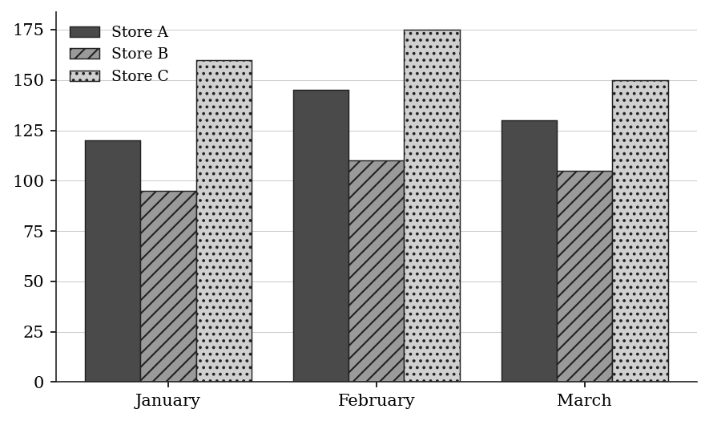

**(A)** 95  
**(B)** 105  
**(C)** 110  
**(D)** 145  
**(E)** 175

**Q2** · `DAT-TBL-003` · Numeric Entry · 45s

The table below shows the number of employees in each department of a company.

Department Employees

Engineering 45

Marketing 28

Sales 34

HR 13

Finance 20

What is the total number of employees in the company?

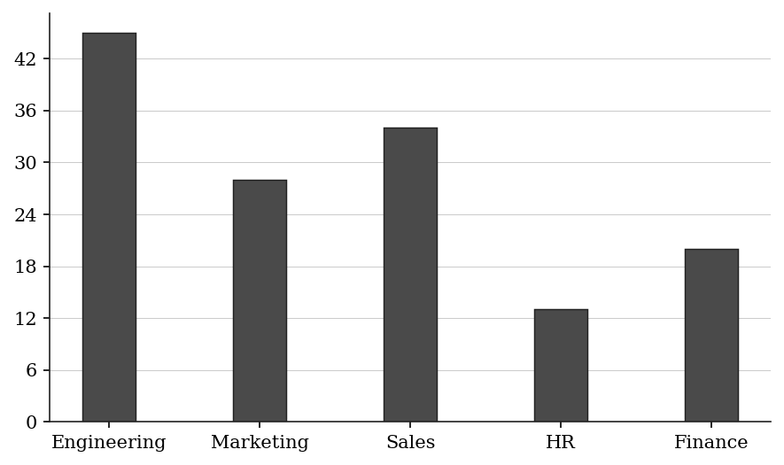

*Numeric entry — write the number.*

**Q3** · `DAT-TBL-006` · Numeric Entry · 45s

The table below shows the frequency distribution of scores on a 5-question quiz.

Score Frequency

0 2

1 5

2 8

3 10

4 6

5 4

How many students took the quiz in total?

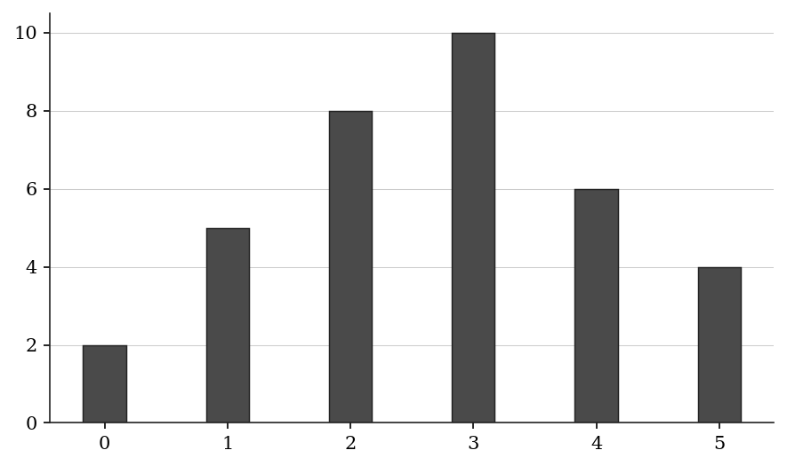

*Numeric entry — write the number.*

**Q4** · `DAT-TBL-007` · QC · 50s

The table below shows the number of items sold by two sales representatives in three regions.

North   South   East

> **Quantity A:**  Total items sold by Rep A
> **Quantity B:**  Total items sold by Rep B

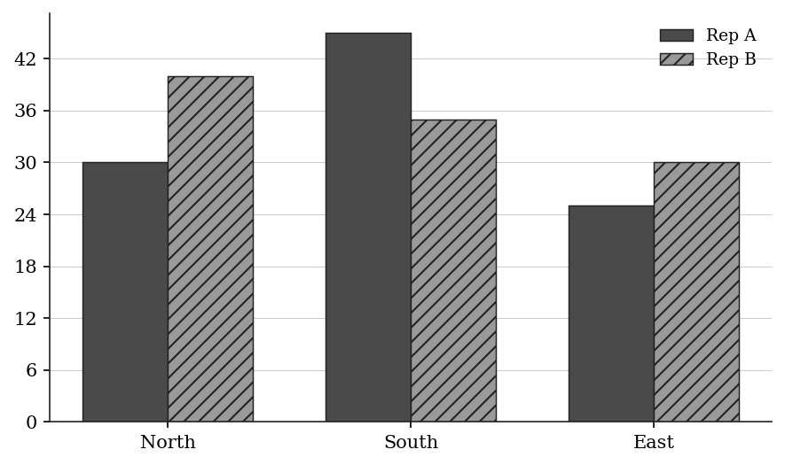

**Q5** · `DAT-TBL-009` · MCQ · 45s

The table below shows the number of students who passed and failed a standardized test in two schools.

Passed   Failed   Total

What percentage of School A's students passed the test?

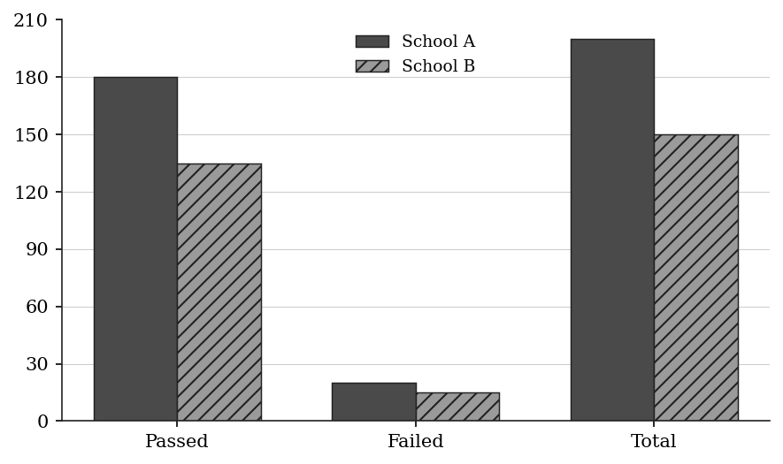

**(A)** 80%  
**(B)** 85%  
**(C)** 88%  
**(D)** 90%  
**(E)** 95%

**Q6** · `DAT-TBL-KMF-009` · MCQ · 60s

COST OF FABRIC ROLLS, BY ROLL WIDTH AND FIBER, in dollars per linear meter. Note: every roll listed is 1 millimeter thick.

For the 25-centimeter-wide rolls listed, which of the following is closest to the ratio of the cost per linear meter of the least expensive fiber to the cost per linear meter of the most expensive fiber?

| Roll Width (in centimeters) | Linen | Hemp | Jute |
|---|---|---|---|
| 10 | $2.00 | $1.60 | $1.20 |
| 15 | $3.00 | $2.40 | $1.80 |
| 20 | $4.00 | $3.20 | $2.40 |
| 25 | $4.90 | $4.20 | $3.50 |
| 30 | $6.00 | $5.00 | $4.20 |

**(A)** 3 to 5  
**(B)** 5 to 7  
**(C)** 5 to 6  
**(D)** 6 to 7  
**(E)** 7 to 5

**Q7** · `DAT-TBL-KMF-013` · MCQ · 60s

The table shows bicycle ownership in a random sample of 750 households. One household is drawn at random from the sample. What is the chance that it owns no more than 2 bicycles?

| Number of bicycles owned | Number of households |
|---|---|
| At least 1 | 750 |
| At least 2 | 465 |
| At least 3 | 210 |
| More than 3 | 60 |

**(A)** 7/25  
**(B)** 19/50  
**(C)** 31/50  
**(D)** 18/25  
**(E)** 23/25

---

### Level 2 · Medium — 16 questions · ~20 min

*two or three steps, one planted trap each*

**Q8** · `DAT-TBL-011` · MCQ · 65s

The contingency table below shows survey results from 200 respondents about beverage preference by age group.

Prefer Tea   Prefer Coffee   Total

Age < 30:           40            60          100

Age >= 30:           70            30          100

What fraction of all respondents who prefer tea are aged 30 or older?

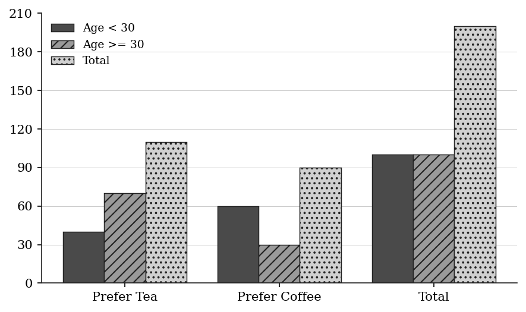

**(A)** 3/11  
**(B)** 3/10  
**(C)** 7/20  
**(D)** 7/11  
**(E)** 7/10

**Q9** · `DAT-TBL-012` · Numeric Entry · 75s

The frequency table below shows the distribution of scores on a 10-point quiz.

Score Frequency

5 3

6 7

7 10

8 12

9 6

10 2

What is the mean score? Round your answer to the nearest tenth.

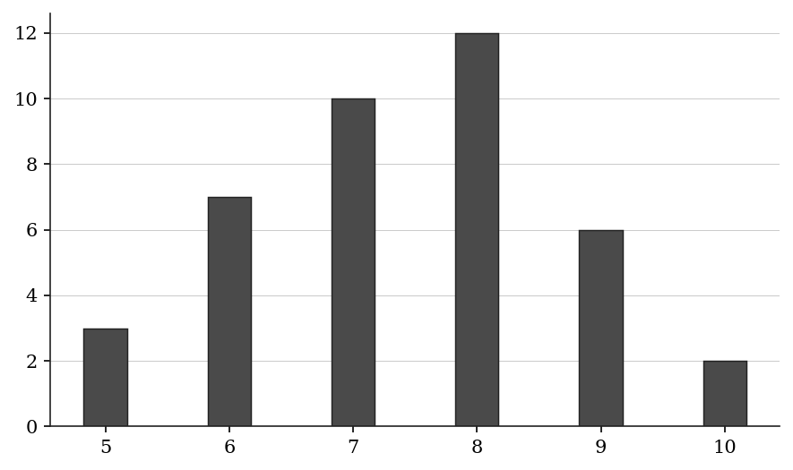

*Numeric entry — write the number.*

**Q10** · `DAT-TBL-013` · MCQ · 70s

The table below shows sales data (in units) for four products across three regions.

North   South   West   Total

The West region's sales of Product B represent what percent of the total West region sales?

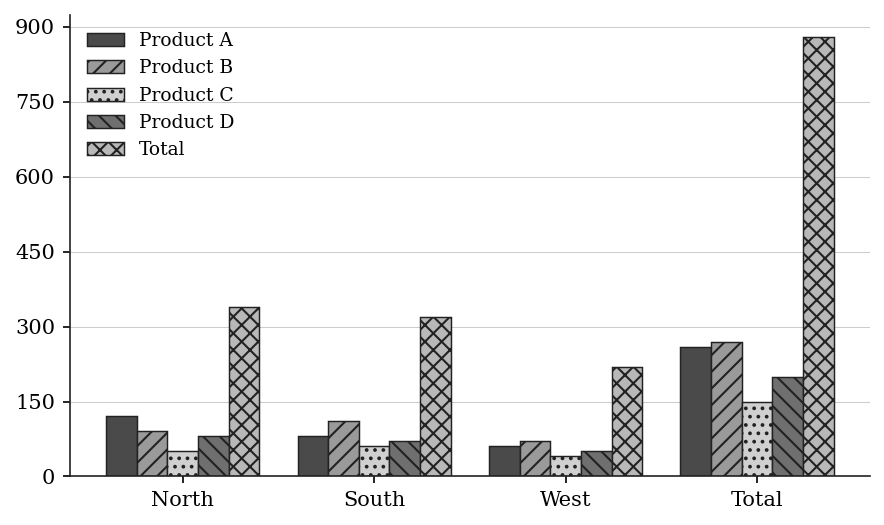

**(A)** 28.6%  
**(B)** 31.8%  
**(C)** 33.3%  
**(D)** 35.0%  
**(E)** 38.5%

**Q11** · `DAT-TBL-014` · QC · 75s

The contingency table below shows the results of a survey of 300 people about exercise habits.

Exercises Daily   Does Not Exercise Daily   Total

Age < 40:              90                  60               150

Age >= 40:             60                  90               150

> **Quantity A:**  The probability that a randomly selected person aged under 40 exercises daily
> **Quantity B:**  The probability that a randomly selected person who exercises daily is aged under 40

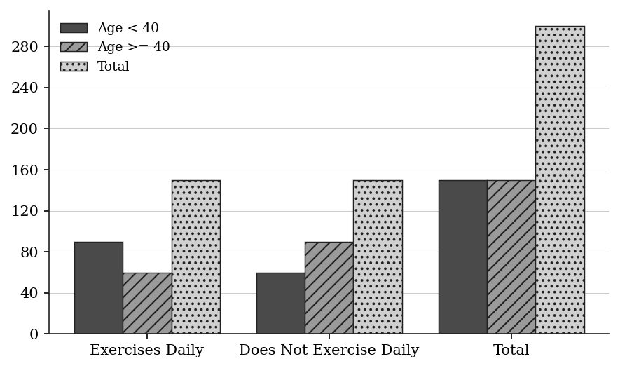

**Q12** · `DAT-TBL-016` · Select all that apply · 70s

The table below shows the number of hours five employees worked in a week.

Employee   Hours Worked

Ana              42

Ben              35

Cara             48

Dan              38

Eva              45

Which employees worked more than the mean number of hours worked by the group? Select all that apply.

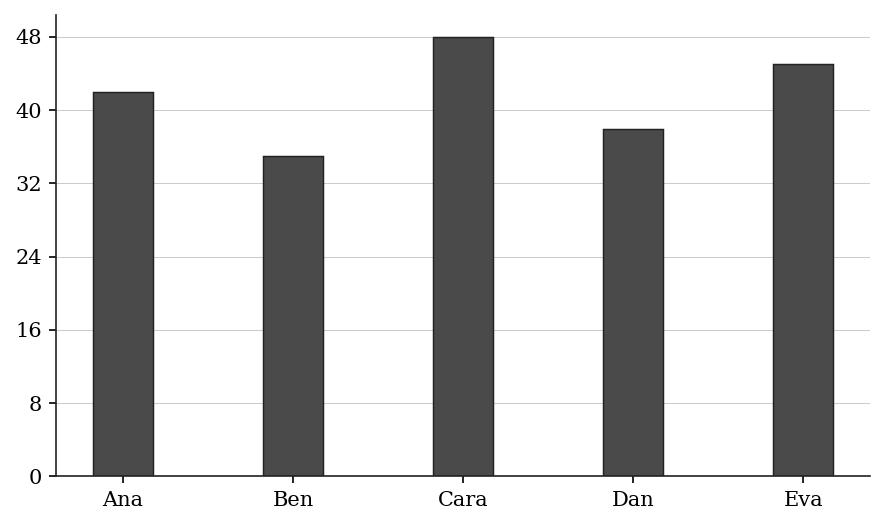

**(A)** Ana  
**(B)** Ben  
**(C)** Cara  
**(D)** Dan  
**(E)** Eva

**Q13** · `DAT-TBL-019` · QC · 60s

The table below shows prices (in dollars) and quantities sold for three products.

> **Quantity A:**  Total revenue from Product X
> **Quantity B:**  Total revenue from Product Z

| Product | Price ($) | Quantity Sold |
|---|---|---|
| X | 15 | 80 |
| Y | 25 | 50 |
| Z | 10 | 120 |

**Q14** · `DAT-TBL-020` · Select all that apply · 80s

The table below shows the results of a student survey on preferred study locations (480 students total).

Location          Frequency

Library                144

Cafe                    96

Home                   168

Dorm Room               72

Which of the following statements are true? Select all that apply.

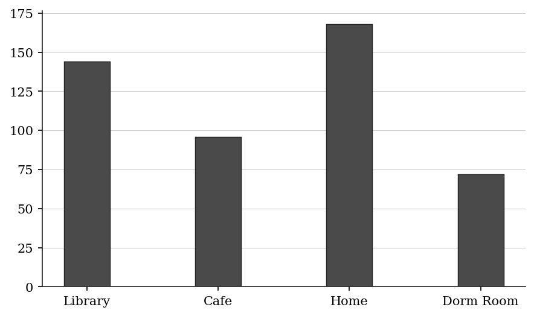

**(A)** More than 30% of students prefer studying at home.  
**(B)** The library is preferred by exactly 30% of students.  
**(C)** Fewer than 20% of students prefer dorm rooms.  
**(D)** Cafe and dorm room together account for more than one-third of students.  
**(E)** Home is preferred by exactly twice as many students as the cafe.

**Q15** · `DAT-TBL-021` · Numeric Entry · 80s

The table below shows the distribution of ages in a group of 50 people.

Using the midpoint of each age range, what is the estimated mean age of the group? Round your answer to the nearest tenth.

| Age Range | Midpoint | Frequency |
|---|---|---|
| 20 – 29 | 24.5 | 8 |
| 30 – 39 | 34.5 | 15 |
| 40 – 49 | 44.5 | 18 |
| 50 – 59 | 54.5 | 9 |

*Numeric entry — write the number.*

**Q16** · `DAT-TBL-022` · MCQ · 75s

The table below shows exports (in millions of dollars) from a country to four trading partners over two years.

Year 1   Year 2

Which partner showed the greatest percentage increase in exports from Year 1 to Year 2?

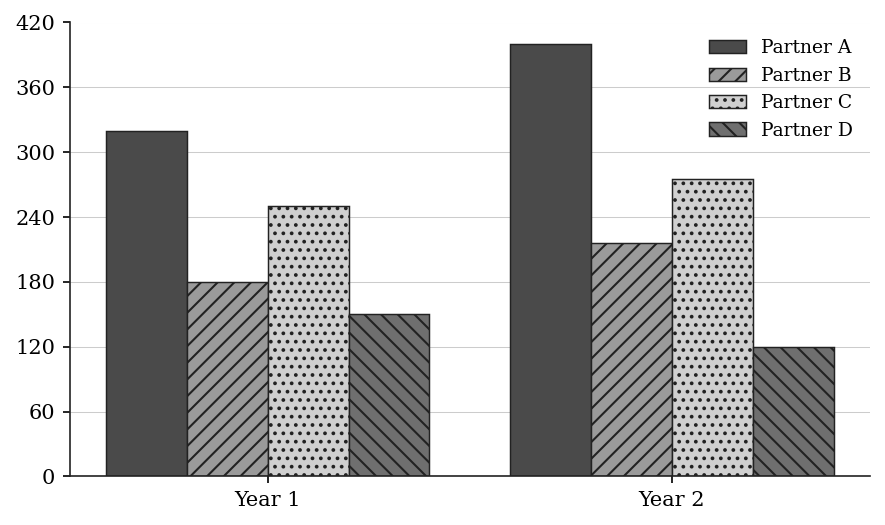

**(A)** Partner A  
**(B)** Partner B  
**(C)** Partner C  
**(D)** Partner D  
**(E)** Partners A and B tied

**Q17** · `DAT-TBL-024` · Select all that apply · 85s

The two-way table below shows survey results from 400 workers about job satisfaction and work mode.

Satisfied   Not Satisfied   Total

Which of the following values can be correctly computed from this table? Select all that apply.

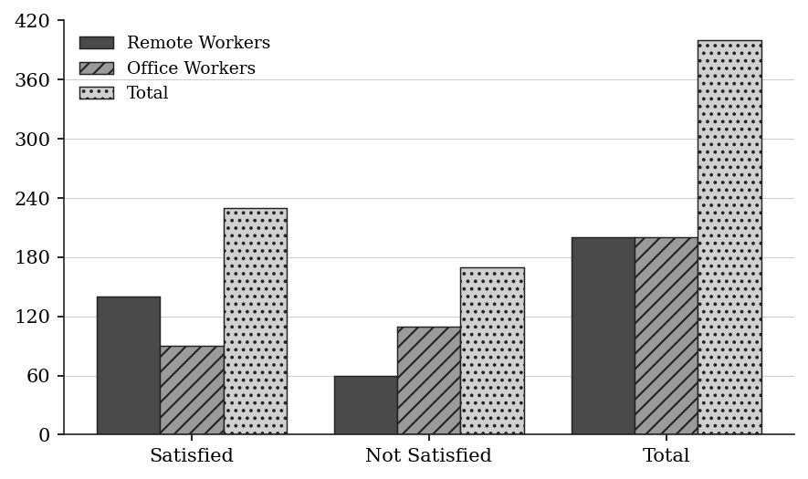

**(A)** The probability that a randomly selected worker is both remote and satisfied is 140/400.  
**(B)** The probability that a randomly selected remote worker is satisfied is 140/200.  
**(C)** The probability that a randomly selected satisfied worker is remote is 140/170.  
**(D)** The probability that a randomly selected worker is remote is 200/400.  
**(E)** The probability that a randomly selected office worker is not satisfied is 110/400.

**Q18** · `DAT-TBL-025` · MCQ · 65s

A store sold the following numbers of items, by category and month.

January: Apparel 200, Footwear 150, Accessories 100 (total 450)

February: Apparel 180, Footwear 170, Accessories 90 (total 440)

March: Apparel 220, Footwear 130, Accessories 110 (total 460)

What fraction of all items sold in February were Footwear?

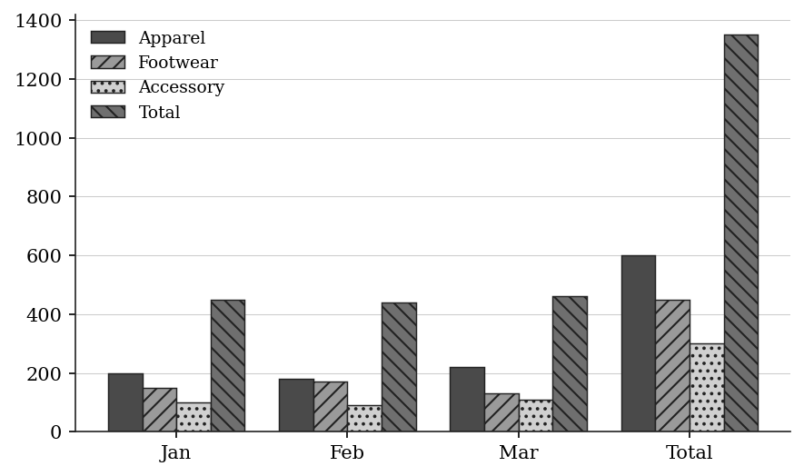

**(A)** 17/135  
**(B)** 15/44  
**(C)** 17/45  
**(D)** 17/44  
**(E)** 17/18

**Q19** · `DAT-TBL-026` · Numeric Entry · 55s

The table below shows the median weekly earnings (in dollars) for workers in five occupations in two different years.

By how many dollars did the median weekly earnings for Engineers increase from Year 1 to Year 2?

| Occupation | Year 1 | Year 2 |
|---|---|---|
| Teacher | 820 | 902 |
| Engineer | 1200 | 1380 |
| Nurse | 980 | 1078 |
| Accountant | 1050 | 1155 |
| Technician | 750 | 825 |

*Numeric entry — write the number.*

**Q20** · `DAT-TBL-029` · QC · 85s

The table below shows the population (in thousands) of two cities over four years.

2010   2012   2014   2016

> **Quantity A:**  The percent increase in City A's population from 2010 to 2016
> **Quantity B:**  The percent increase in City B's population from 2010 to 2016

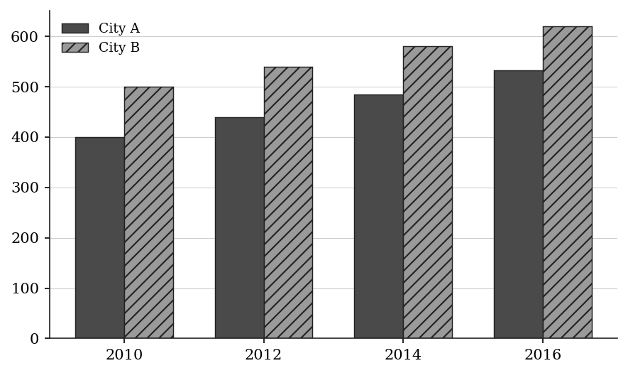

**Q21** · `DAT-TBL-KMF-001` · MCQ · 90s

The table shows the land area of each of the six regions of the planet Veyra and, separately, the percent of Veyra's total water area occupied by each of its four named oceans.

Total land area of Veyra: 124,800,000 square kilometers

Total water area of Veyra: 325,000,000 square kilometers

Which of the following is closest to the ratio of Veyra's land area to Veyra's water area?

| Region | Land Area (sq km) | Ocean | Percent of Veyra's Total Water Area |
|---|---|---|---|
| Aurelis | 36,400,000 | Talassa | 41.5% |
| Brendal | 24,900,000 | Verdan | 27.0% |
| Corveth | 21,600,000 | Wrenth | 18.5% |
| Dunmar | 18,300,000 | Xanth | 4.5% |
| Eskil | 13,200,000 |  |  |
| Fenlow | 10,400,000 |  |  |

**(A)** 1 to 4  
**(B)** 3 to 8  
**(C)** 5 to 12  
**(D)** 1 to 2  
**(E)** 5 to 8

**Q22** · `DAT-TBL-KMF-006` · MCQ · 110s

The table shows reading and writing statistics for five students in a journalism course. Which student wrote the longest essays, as measured by the average (arithmetic mean) number of words per essay written?

| Student | Essays Read | Words Read (thousands) | Essays Written | Words Written (thousands) |
|---|---|---|---|---|
| P | 25 | 20.0 | 6 | 7.2 |
| Q | 15 | 15.0 | 8 | 8.8 |
| R | 22 | 19.8 | 10 | 9.0 |
| S | 30 | 21.0 | 5 | 6.5 |
| T | 18 | 18.6 | 7 | 8.4 |

**(A)** P  
**(B)** Q  
**(C)** R  
**(D)** S  
**(E)** T

**Q23** · `DAT-TBL-KMF2-004` · MCQ · 70s

COMMUNITY CENTER SURVEY OF PROGRAM OFFERINGS

responses from 180 centers

If the responses summarized in the table represent a 75 percent return from the total number of centers that received the questionnaire, how many centers received the questionnaire?

| Type of Program | Percent of Centers Offering Each Type |
|---|---|
| After-school tutoring | 65% |
| Adult literacy | 50% |
| Job training | 40% |
| Senior fitness | 35% |
| Music instruction | 25% |
| Community garden | 10% |

**(A)** 135  
**(B)** 180  
**(C)** 216  
**(D)** 225  
**(E)** 240

---

### Level 3 · Hard — 7 questions · ~12 min

*where 162+ is won or lost*

**Q24** · `DAT-TBL-027` · MCQ · 80s

The contingency table below shows data on 500 employees classified by department and performance rating.

High   Medium   Low   Total

If an employee is selected at random from those with a 'Low' performance rating, what is the probability that the employee is from the Marketing department?

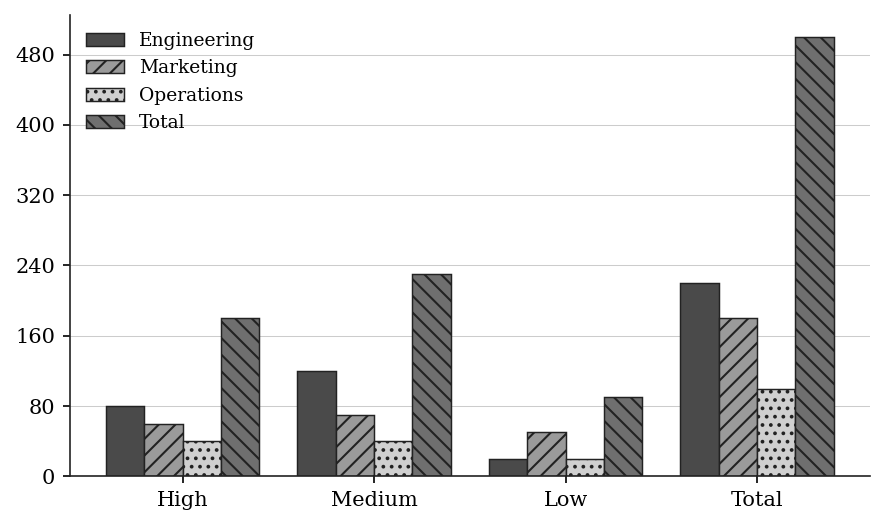

**(A)** 1/10  
**(B)** 5/18  
**(C)** 1/3  
**(D)** 4/9  
**(E)** 5/9

**Q25** · `DAT-TBL-030` · MCQ · 95s

Table 1 shows the production rate (units per hour) for three machines. Table 2 shows the number of hours each machine operates per day.

Table 1 — Production Rate:

Table 2 — Daily Hours:

Machine   Hours/Day

P            6

Q            4

R            6

If one day's total production from all three machines is worth $3,600, what is the value per unit produced (assuming all units are worth the same amount)?

| Machine | Units/Hour |
|---|---|
| P | 80 |
| Q | 90 |
| R | 100 |
| Machine | Hours/Day |
| P | 6 |
| Q | 4 |
| R | 6 |

**(A)** $2.25  
**(B)** $2.40  
**(C)** $2.50  
**(D)** $2.75  
**(E)** $3.00

**Q26** · `DAT-TBL-032` · Select all that apply · 90s

The two-way table below shows the results of a drug trial with 240 participants.

Recovered   Did Not Recover   Total

Which of the following statements are true? Select all that apply.

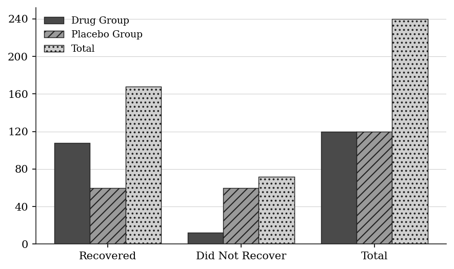

**(A)** The probability of recovery given the drug is exactly 90%.  
**(B)** The probability of recovery given the placebo is 50%.  
**(C)** A participant who recovered is more likely to have taken the drug than the placebo.  
**(D)** The drug group and placebo group have the same total size.  
**(E)** P(recovered) for the whole trial is less than 65%.

**Q27** · `DAT-TBL-036` · QC · 90s

The table below shows the number of items sold by a store across two product categories in four quarters.

Q1    Q2    Q3    Q4

> **Quantity A:**  The median quarterly sales for Category X
> **Quantity B:**  The median quarterly sales for Category Y

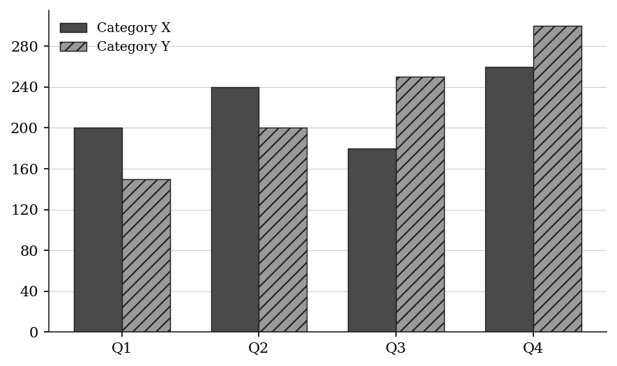

**Q28** · `DAT-TBL-038` · Numeric Entry · 120s

The partially completed two-way table below shows data from a survey of 200 employees at a firm.

Additional information:

- 25% of all employees have an MBA.

- Exactly half of all MBA holders are managers.

What is the total number of managers at the firm?

| Has MBA | No MBA | Total |
|---|---|---|
| Manager: | ? | 30 | ? |
| Non-Manager: | ? | ? | ? |
| Total: | ? | 150 | 200 |

*Numeric entry — write the number.*

**Q29** · `DAT-TBL-KMF-020` · MCQ · 120s

The table gives the start and end of the blooming periods of crocuses, poppies and asters in six gardens during one year. Times are in months from January 1, and the year runs from 0 to 12. During how many months of the year was no crocus or poppy in bloom in any of the six gardens?

| Garden | Crocus start | Crocus end | Poppy start | Poppy end | Aster start | Aster end |
|---|---|---|---|---|---|---|
| Alder | 2 | 4 | 5 | 8 | 8.5 | 10.5 |
| Birch | 1.5 | 4.5 | 5.5 | 8.5 | 9 | 11 |
| Cedar | 3 | 4.5 | 6 | 9 | 8 | 11.5 |
| Dunmore | 1 | 3.5 | 5 | 7 | 7.5 | 10 |
| Elm | 2.5 | 4.5 | 6.5 | 9.5 | 9 | 11 |
| Fairfield | 0.5 | 3.5 | 5 | 9.5 | 6.5 | 11.5 |

**(A)** 0.5  
**(B)** 2.5  
**(C)** 3.0  
**(D)** 3.5  
**(E)** 8.5

**Q30** · `DAT-TBL-KMF-022` · Select all that apply · 150s

Ten patients came to a clinic one afternoon and were each attended by one of two nurses, in the order the patients had arrived. A nurse finished with one patient completely before seeing the next, and a patient who had to wait was taken by the first nurse to become free. The table gives each patient's arrival time and the times the consultation started and ended, in whole minutes after 1:00 PM. Which of the following patients were seen by the same nurse who saw Patient 3?

Indicate all such patients.

| Patient | Arrived | Consultation started | Consultation ended |
|---|---|---|---|
| 1 | 0 | 0 | 9 |
| 2 | 3 | 3 | 14 |
| 3 | 6 | 9 | 17 |
| 4 | 12 | 14 | 20 |
| 5 | 15 | 17 | 26 |
| 6 | 21 | 21 | 27 |
| 7 | 24 | 26 | 33 |
| 8 | 25 | 27 | 31 |
| 9 | 29 | 31 | 40 |
| 10 | 34 | 34 | 41 |

**(A)** Patient 2  
**(B)** Patient 4  
**(C)** Patient 5  
**(D)** Patient 6  
**(E)** Patient 7  
F. Patient 9  
G. Patient 10

---

## Part B — Answer Key

| Q | ID | Level | Type | Answer |
|---|---|---|---|---|
| 1 | `DAT-TBL-001` | easy | MCQ | **C** |
| 2 | `DAT-TBL-003` | easy | Numeric Entry | **140** |
| 3 | `DAT-TBL-006` | easy | Numeric Entry | **35** |
| 4 | `DAT-TBL-007` | easy | QC | **B** |
| 5 | `DAT-TBL-009` | easy | MCQ | **D** |
| 6 | `DAT-TBL-KMF-009` | easy | MCQ | **B** |
| 7 | `DAT-TBL-KMF-013` | easy | MCQ | **D** |
| 8 | `DAT-TBL-011` | medium | MCQ | **D** |
| 9 | `DAT-TBL-012` | medium | Numeric Entry | **7.4** |
| 10 | `DAT-TBL-013` | medium | MCQ | **B** |
| 11 | `DAT-TBL-014` | medium | QC | **C** |
| 12 | `DAT-TBL-016` | medium | Select all that apply | **A, C, E** |
| 13 | `DAT-TBL-019` | medium | QC | **C** |
| 14 | `DAT-TBL-020` | medium | Select all that apply | **A, B, C, D** |
| 15 | `DAT-TBL-021` | medium | Numeric Entry | **40.1** |
| 16 | `DAT-TBL-022` | medium | MCQ | **A** |
| 17 | `DAT-TBL-024` | medium | Select all that apply | **A, B, D** |
| 18 | `DAT-TBL-025` | medium | MCQ | **D** |
| 19 | `DAT-TBL-026` | medium | Numeric Entry | **180** |
| 20 | `DAT-TBL-029` | medium | QC | **A** |
| 21 | `DAT-TBL-KMF-001` | medium | MCQ | **B** |
| 22 | `DAT-TBL-KMF-006` | medium | MCQ | **D** |
| 23 | `DAT-TBL-KMF2-004` | medium | MCQ | **E** |
| 24 | `DAT-TBL-027` | hard | MCQ | **E** |
| 25 | `DAT-TBL-030` | hard | MCQ | **C** |
| 26 | `DAT-TBL-032` | hard | Select all that apply | **A, B, C, D** |
| 27 | `DAT-TBL-036` | hard | QC | **B** |
| 28 | `DAT-TBL-038` | hard | Numeric Entry | **55** |
| 29 | `DAT-TBL-KMF-020` | hard | MCQ | **D** |
| 30 | `DAT-TBL-KMF-022` | hard | Select all that apply | **C, E, G** |

---

## Part C — Worked Solutions

### Q1 · `DAT-TBL-001` — Answer: C

Locate the row for Store B and the column for February. The value at that intersection is 110.

**Trap.** Students may confuse the February column with the March column, reading 105 instead of 110.

### Q2 · `DAT-TBL-003` — Answer: 140

Sum all department values: 45 + 28 + 34 + 13 + 20 = 140.

**Trap.** Students may skip one department (e.g., forget Finance), giving 120 instead of 140.

### Q3 · `DAT-TBL-006` — Answer: 35

Sum all frequencies: 2 + 5 + 8 + 10 + 6 + 4 = 35 students total.

**Trap.** Students may sum the Score column (0+1+2+3+4+5 = 15) instead of the Frequency column.

### Q4 · `DAT-TBL-007` — Answer: B

Rep A total: 30 + 45 + 25 = 100. Rep B total: 40 + 35 + 30 = 105. Quantity B (105) > Quantity A (100), so Quantity B is greater.

**Trap.** Students may compare only one region (e.g., South, where Rep A leads 45 vs 35) and incorrectly conclude Quantity A is greater without summing all regions.

### Q5 · `DAT-TBL-009` — Answer: D

Percent passed in School A = 180 / 200 × 100 = 90%.

**Trap.** Students may divide 180 by the grand total (200 + 150 = 350), giving 180/350 ≈ 51.4%, confusing the marginal total (School A) with the grand total.

### Q6 · `DAT-TBL-KMF-009` — Answer: B

Read the 25-centimeter row: linen $4.90, hemp $4.20, jute $3.50.
The least expensive is jute at $3.50 and the most expensive is linen at $4.90.
Ratio = 3.50/4.90.
Divide both by 0.70: 3.50/0.70 = 5 and 4.90/0.70 = 7.
So the ratio is exactly 5 to 7, which equals 0.714 approximately.
Compare the options as decimals: 3 to 5 = 0.600; 5 to 7 = 0.714; 5 to 6 = 0.833; 6 to 7 = 0.857; 7 to 5 = 1.400.
Check: 5/7 matches the computed value exactly, so option B is closest.

**Trap.** Inverting the ratio and dividing the most expensive price by the least expensive gives 7 to 5, option E.

### Q7 · `DAT-TBL-KMF-013` — Answer: D

Owning no more than 2 bicycles is the complement of owning at least 3.
Households with at least 3 bicycles = 210.
Households with at most 2 = 750 - 210 = 540.
Chance = 540 / 750 = 18/25.
Check: 1 - 210/750 = 1 - 7/25 = 18/25.

**Trap.** Reporting the 'at least 3' share, 210/750 = 7/25, answers the complementary event and gives choice A; using the 'at least 2' row (465/750 = 31/50) misreads 'no more than 2' and gives choice C.

### Q8 · `DAT-TBL-011` — Answer: D

Of all tea-preferring respondents, the total number is 110 (the Tea column total). Among these, 70 are aged 30 or older. The fraction is 70/110 = 7/11.

**Trap.** Students may divide 70 by 200 (the grand total), getting 70/200 = 7/20, confusing the marginal frequency (110 tea drinkers) with the grand total.

### Q9 · `DAT-TBL-012` — Answer: 7.4

Mean = sum(score × frequency) / sum(frequency).
Sum of frequencies: 3 + 7 + 10 + 12 + 6 + 2 = 40.
Sum of (score × frequency): (5×3) + (6×7) + (7×10) + (8×12) + (9×6) + (10×2)
= 15 + 42 + 70 + 96 + 54 + 20 = 297.
Mean = 297 / 40 = 7.425, which rounds to 7.4.

**Trap.** Students may compute the mean of the Score column values only (5+6+7+8+9+10 = 45, divided by 6 = 7.5), forgetting to weight each score by its frequency.

### Q10 · `DAT-TBL-013` — Answer: B

Product B's West sales = 70. Total West sales = 220. Percent = (70 / 220) × 100 = 31.818...% ≈ 31.8%.

**Trap.** Students may divide 70 by the Product B total (270) rather than the West region total (220), getting 70/270 ≈ 25.9%.

### Q11 · `DAT-TBL-014` — Answer: C

Quantity A: P(exercises daily | age < 40) = 90/150 = 0.60.
Quantity B: P(age < 40 | exercises daily) = 90/150 = 0.60.
Both equal 0.60, so the two quantities are equal.

**Trap.** Students may assume these conditional probabilities are different because they condition on different events. In this symmetric table both happen to equal 90/150.

### Q12 · `DAT-TBL-016` — Answer: A, C, E

Step 1 — Compute the mean: (42 + 35 + 48 + 38 + 45) / 5 = 208 / 5 = 41.6 hours.
Step 2 — Identify who worked more than 41.6 hours:
Ana: 42 > 41.6 ✓
Ben: 35 < 41.6 ✗
Cara: 48 > 41.6 ✓
Dan: 38 < 41.6 ✗
Eva: 45 > 41.6 ✓
Correct answers: A, C, E.

**Trap.** Students may use 40 as a round-number mean estimate and include Ana (42 > 40) correctly but also include Ben (35) and Dan (38) if they miscompute the mean as something lower than 38.

### Q13 · `DAT-TBL-019` — Answer: C

Revenue from Product X = 15 × 80 = $1,200.
Revenue from Product Z = 10 × 120 = $1,200.
Both revenues are equal, so the two quantities are equal.

**Trap.** Students may compare price alone ($15 vs $10, so X appears greater) or quantity alone (80 vs 120, so Z appears greater) without computing the actual revenue product.

### Q14 · `DAT-TBL-020` — Answer: A, B, C, D

Total = 480.
A. Home = 168. 168/480 = 35% > 30%. True.
B. Library = 144. 144/480 = 0.30 = 30% exactly. True.
C. Dorm Room = 72. 72/480 = 15% < 20%. True.
D. Cafe + Dorm = 96 + 72 = 168. 1/3 of 480 = 160. Since 168 > 160, they account for more than one-third. True.
E. Home (168) vs. 2 × Cafe (2 × 96 = 192). 168 ≠ 192, so this is false.
Correct answers: A, B, C, D.

**Trap.** Students may confuse option E: 168 is not twice 96 (which would be 192). They may also overlook option D, assuming 168/480 is less than 1/3 without checking that 1/3 of 480 = 160 < 168.

### Q15 · `DAT-TBL-021` — Answer: 40.1

Mean = sum(midpoint × frequency) / total frequency.
Numerator: (24.5 × 8) + (34.5 × 15) + (44.5 × 18) + (54.5 × 9)
= 196 + 517.5 + 801 + 490.5 = 2005.
Denominator: 8 + 15 + 18 + 9 = 50.
Mean = 2005 / 50 = 40.1.

**Trap.** Students may average the four midpoints directly: (24.5 + 34.5 + 44.5 + 54.5)/4 = 158/4 = 39.5, ignoring the frequency weights.

### Q16 · `DAT-TBL-022` — Answer: A

Percent change = (Year 2 − Year 1) / Year 1 × 100.
Partner A: (400 − 320)/320 × 100 = 80/320 × 100 = 25%.
Partner B: (216 − 180)/180 × 100 = 36/180 × 100 = 20%.
Partner C: (275 − 250)/250 × 100 = 25/250 × 100 = 10%.
Partner D: (120 − 150)/150 × 100 = −20% (a decrease).
Highest percentage increase: Partner A at 25%.

**Trap.** Students may pick Partner B because it has a smaller base (180 vs 320), assuming a smaller base means a larger percent change. But 36/180 = 20% is less than 80/320 = 25%. Always compute the full ratio rather than guessing from inspection.

### Q17 · `DAT-TBL-024` — Answer: A, B, D

A. P(remote AND satisfied) = 140/400 = joint frequency / grand total. CORRECT.
B. P(satisfied | remote) = 140/200 = remote-satisfied / all remote. CORRECT.
C. P(remote | satisfied) = 140/230, NOT 140/170. The denominator should be all satisfied workers (230), not all not-satisfied (170). INCORRECT.
D. P(remote) = 200/400 = marginal frequency / grand total. CORRECT.
E. P(not satisfied | office) = 110/200, NOT 110/400. The denominator should be all office workers (200). INCORRECT.

**Trap.** For option C, students confuse the satisfied total (230) with the not-satisfied total (170). For option E, students forget that the denominator for a conditional probability is the conditioning group total, not the grand total.

### Q18 · `DAT-TBL-025` — Answer: D

February Footwear sales = 170. Total February sales = 440. Fraction = 170/440 = 17/44.

**Trap.** A: students divide February Footwear by the grand total for all three months, 170/1,350. B: students use January's Footwear, 150, over the February total. C: students divide by the total Footwear sales, 170/450. E: students divide by February Apparel, 170/180.

### Q19 · `DAT-TBL-026` — Answer: 180

Increase for Engineers = Year 2 − Year 1 = $1,380 − $1,200 = $180.

**Trap.** Students may compute the percent increase (15%) instead of the dollar increase, or may read the Accountant row values instead of the Engineer row.

### Q20 · `DAT-TBL-029` — Answer: A

Quantity A: City A percent increase = (532 − 400)/400 × 100 = 132/400 × 100 = 33%.
Quantity B: City B percent increase = (620 − 500)/500 × 100 = 120/500 × 100 = 24%.
Quantity A (33%) > Quantity B (24%), so Quantity A is greater.

**Trap.** Students may compare absolute increases: City A gained 132 thousand; City B gained 120 thousand. City A wins here too, but students may instead focus on the absolute size (City B is larger) and incorrectly assume City B has a greater percent change.

### Q21 · `DAT-TBL-KMF-001` — Answer: B

Land area = 124,800,000 sq km; water area = 325,000,000 sq km.
Ratio = 124,800,000 / 325,000,000 = 0.384.
Convert each option to a decimal: 1 to 4 = 0.250; 3 to 8 = 0.375; 5 to 12 = 0.4167; 1 to 2 = 0.500; 5 to 8 = 0.625.
Distances from 0.384: |0.384 - 0.375| = 0.009; |0.384 - 0.4167| = 0.033; |0.384 - 0.250| = 0.134; |0.384 - 0.500| = 0.116; |0.384 - 0.625| = 0.241.
The smallest distance is 0.009, so 3 to 8 is closest.
Check: 3/8 of 325,000,000 = 121,875,000, which is within 3,000,000 of the stated land area - no other option comes that close.

**Trap.** Students round 0.384 up to 0.4 and then, not finding 2 to 5 among the options, jump to the nearest 'friendly' ratio 1 to 2 (option D) instead of comparing 0.384 against every option's decimal value.

### Q22 · `DAT-TBL-KMF-006` — Answer: D

Compute words per essay written (Words Written in thousands * 1000 / Essays Written) for each student:
P: 7200/6 = 1200. Q: 8800/8 = 1100. R: 9000/10 = 900. S: 6500/5 = 1300. T: 8400/7 = 1200.
The greatest average is Student S, with 1300 words per essay.

**Trap.** Students use the 'Essays Read' and 'Words Read' columns instead of the 'Written' columns, since both column pairs look similar, and arrive at a different student.

### Q23 · `DAT-TBL-KMF2-004` — Answer: E

The 180 centers that responded are 75 percent of the centers that received the questionnaire. Letting n be that total,
0.75n = 180,
so n = 180/0.75 = 240.
As a check, 75 percent of 240 is 180.

**Trap.** 135 is 0.75 × 180, which takes 75 percent of the responses instead of recognizing the responses as the 75 percent. 225 comes from adding a quarter of 180 to 180, which would be right only if 180 were 80 percent of the total. 180 is the number that responded, not the number that received it.

### Q24 · `DAT-TBL-027` — Answer: E

We need P(Marketing | Low rating). The condition restricts us to the Low column only: 90 employees total have a Low rating. Among these, 50 are from Marketing. P(Marketing | Low) = 50/90 = 5/9.

**Trap.** Students may compute 50/500 = 1/10 (using the grand total as denominator) or 50/180 (using the Marketing row total), failing to restrict the sample space to only the 90 Low-rated employees.

### Q25 · `DAT-TBL-030` — Answer: C

Step 1 — Compute daily production per machine using both tables:
Machine P: 80 units/hr × 6 hr = 480 units.
Machine Q: 90 units/hr × 4 hr = 360 units.
Machine R: 100 units/hr × 6 hr = 600 units.
Step 2 — Total daily production: 480 + 360 + 600 = 1,440 units.
Step 3 — Value per unit: $3,600 / 1,440 = $2.50.

**Trap.** Students may compute the production rate per machine without multiplying by hours (treating the units/hour as units/day), or may use only one table without cross-referencing the second table.

### Q26 · `DAT-TBL-032` — Answer: A, B, C, D

A. P(recover | drug) = 108/120 = 0.90 = 90%. True.
B. P(recover | placebo) = 60/120 = 0.50 = 50%. True.
C. P(drug | recovered) = 108/168 ≈ 64.3%. P(placebo | recovered) = 60/168 ≈ 35.7%. Drug is more likely. True.
D. Drug = 120, Placebo = 120. Same size. True.
E. P(recovered overall) = 168/240 = 70% > 65%. So this statement is false.

**Trap.** For option E, students may quickly estimate 168/240 as 'around 60%' without careful computation. 168/240 = 7/10 = 70%, which exceeds 65%, so E is false.

### Q27 · `DAT-TBL-036` — Answer: B

For a data set of 4 values, the median is the average of the 2nd and 3rd values when sorted.
Category X sorted: 180, 200, 240, 260. Median = (200 + 240)/2 = 220.
Category Y sorted: 150, 200, 250, 300. Median = (200 + 250)/2 = 225.
Quantity A = 220, Quantity B = 225. Quantity B is greater.

**Trap.** Students may compute the means instead of the medians: X mean = (200+240+180+260)/4 = 880/4 = 220; Y mean = (150+200+250+300)/4 = 900/4 = 225. The means also give B > A, so the final answer is the same, but the method is wrong. Students may also sort incorrectly and get a different median.

### Q28 · `DAT-TBL-038` — Answer: 55

Step 1 — Total MBA holders = 25% of 200 = 50. So total Non-MBA = 150 (confirmed by table).
Step 2 — Managers with MBA = half of all MBA holders = 50 / 2 = 25.
Step 3 — Managers without MBA = 30 (given directly in the table).
Step 4 — Total managers = 25 + 30 = 55.
Verification: Non-managers with MBA = 50 − 25 = 25. Non-managers without MBA = 150 − 30 = 120. Total non-managers = 25 + 120 = 145. Grand total = 55 + 145 = 200. ✓

**Trap.** Students may try to use the Non-MBA column total (150) directly to find managers: 200 − 150 = 50, then conclude there are 50 managers. This confuses the total MBA count (50) with the total manager count. The correct path is: use 25% to find MBA count (50), then halve it to find MBA managers (25), then add the given Non-MBA managers (30).

### Q29 · `DAT-TBL-KMF-020` — Answer: D

Crocus periods across the gardens: 2-4, 1.5-4.5, 3-4.5, 1-3.5, 2.5-4.5, 0.5-3.5. They overlap into one block from 0.5 to 4.5.
Poppy periods: 5-8, 5.5-8.5, 6-9, 5-7, 6.5-9.5, 5-9.5. They form one block from 5 to 9.5.
The two blocks do not touch: there is a gap from 4.5 to 5.
Months with a crocus or poppy somewhere: 4 + 4.5 = 8.5.
Months with none: 12 - 8.5 = 3.5, made of 0 to 0.5 (0.5), 4.5 to 5 (0.5) and 9.5 to 12 (2.5).
Check: 0.5 + 0.5 + 2.5 = 3.5.

**Trap.** Missing the short gap between the end of the crocus block and the start of the poppy block, giving 0.5 + 2.5 = 3.0 (choice C); or reporting the covered time instead of the uncovered time, 8.5 (choice E).

### Q30 · `DAT-TBL-KMF-022` — Answer: C, E, G

1. Patient 1 is seen 0-9 and Patient 2 is seen 3-14, so they overlap and use different nurses. Call them X and Y.
2. Patient 3 starts at 9, exactly when Patient 1 finishes while Y is busy until 14, so Patient 3 is with nurse X (busy 9-17).
3. Patient 4 starts at 14 when Y becomes free while X is busy: nurse Y (14-20).
4. Patient 5 starts at 17 when X finishes Patient 3 while Y is busy until 20: nurse X (17-26).
5. Patient 6 starts at 21, after Y became free at 20, while X is busy until 26: nurse Y (21-27).
6. Patient 7 starts at 26 when X finishes Patient 5 while Y is busy until 27: nurse X (26-33).
7. Patient 8 starts at 27 when Y finishes Patient 6 while X is busy: nurse Y (27-31). Patient 9 starts at 31 when Y finishes Patient 8 while X is busy until 33: nurse Y (31-40).
8. Patient 10 starts at 34 after X became free at 33 while Y is busy until 40: nurse X.
9. Nurse X saw patients 1, 3, 5, 7 and 10; nurse Y saw 2, 4, 6, 8 and 9.
10. Option by option: A false, B false, C true, D false, E true, F false, G true. Check: no nurse's consultations overlap in time within either list.

**Trap.** Assuming the two nurses simply alternate, so every odd-numbered patient goes with Patient 3; that selects Patients 5, 7 and 9 (choices C, E and F) and misses that Patient 8 and 9 stay with the same nurse because Patient 8 ends just before 9 starts.
