# Multi-Graph Sets & Percent Change — Practice Set

**Bank code:** `DAT-MXG` · **Section:** Data Interpretation · **30 questions** — Easy 7 · Medium 16 · Hard 7

**Lecture capsule:** [05-multi-graph-sets.md](../../08-data-interpretation/05-multi-graph-sets.md)

> When two exhibits appear, one usually gives a total and the other a share, so the answer is a percent of a percent; percent change always divides by the earlier value.

Every question below is live in the question bank under the ID shown — the sheet and the portal are the same questions. Attempt a level with the clock running, then check Part C.

---

## Part A — Questions

> **Quantitative Comparison — the four choices are always the same, so they are not reprinted:**
> **(A)** Quantity A is greater · **(B)** Quantity B is greater · **(C)** The two quantities are equal · **(D)** The relationship cannot be determined from the information given

### Level 1 · Easy — 7 questions · ~6 min

*warm-up — these must be automatic*

**Q1** · `DAT-MGS-001` · MCQ · 40s

Use the following data for this question.

SET 1 — NORTHRIDGE ELECTRONICS: Annual Revenue & Product Mix

Table 1 shows Northridge Electronics' total annual revenue, in millions of dollars, for the years 2019 through 2023. Bar Chart 1 shows each product category's share of total 2023 revenue, as a percentage of that total.

According to Table 1, what was Northridge Electronics' total revenue in 2021?

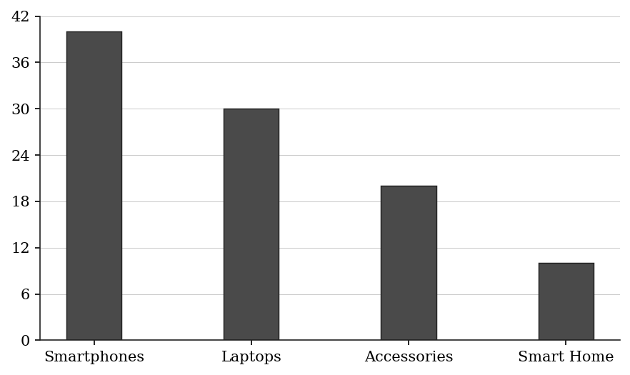

| Year | Revenue ($ millions) |
|---|---|
| 2019 | 120 |
| 2020 | 96 |
| 2021 | 108 |
| 2022 | 135 |
| 2023 | 150 |

**(A)** $96 million  
**(B)** $108 million  
**(C)** $120 million  
**(D)** $135 million  
**(E)** $150 million

**Q2** · `DAT-MGS-007` · QC · 70s

Use the following data for this question.

SET 2 — WESTFIELD UNIFIED SCHOOL DISTRICT: Enrollment & Graduation

The Line Graph shows total student enrollment across all grades, in thousands of students, for the years 2018 through 2023. The Pie Chart breaks down the 2023 enrollment by school level, as a percentage of 2023 total enrollment; its values are listed in the table below.

> **Quantity A:**  Number of High School students enrolled in 2023
> **Quantity B:**  Number of Elementary students enrolled in 2021

| School Level | Percentage of 2023 Enrollment |
|---|---|
| Elementary | 45% |
| Middle | 25% |
| High School | 30% |

**Q3** · `DAT-MXG-005` · QC · 55s

Bar Chart — Store Sales (units):

Table — Store B's Sales by Category:

> **Quantity A:**  Electronics units sold at Store B
> **Quantity B:**  Total units sold at Store A

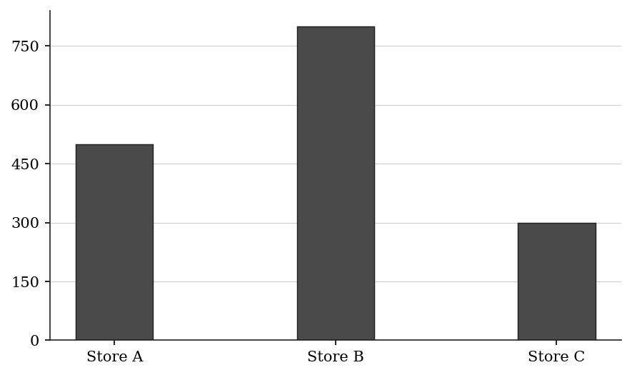

| Category | Share of Store B sales |
|---|---|
| Clothing | 25% |
| Electronics | 45% |
| Furniture | 30% |

**Q4** · `DAT-MXG-007` · Numeric Entry · 50s

Bar Chart - Annual Donations Received ($000s):

2019: 500 2020: 600 2021: 700 2022: 800

Pie Chart - 2022 Donations by Donor Type:

Individuals 40%, Corporations 35%, Foundations 25%

How many thousand dollars did Foundations donate in 2022?

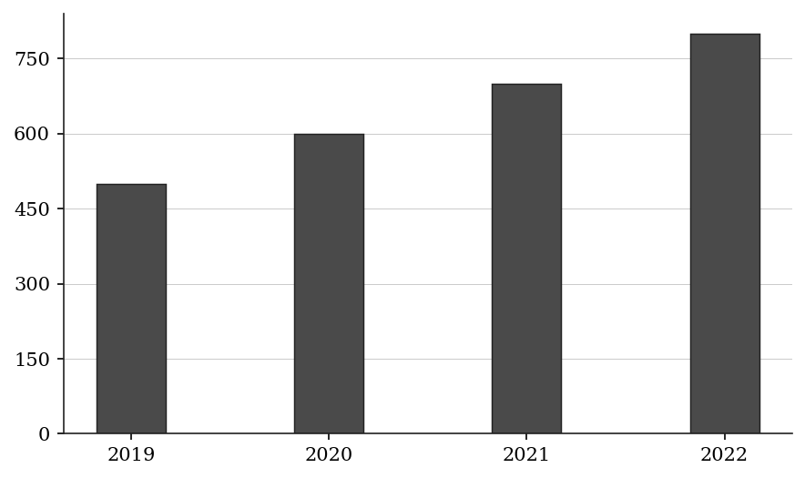

| Donor Type | Share of 2022 Donations |
|---|---|
| Individuals | 40% |
| Corporations | 35% |
| Foundations | 25% |

*Numeric entry — write the number.*

**Q5** · `DAT-PCG-001` · MCQ · 45s

The bar chart shows annual sales revenue (in $millions):

What was the percent change in revenue from 2019 to 2020?

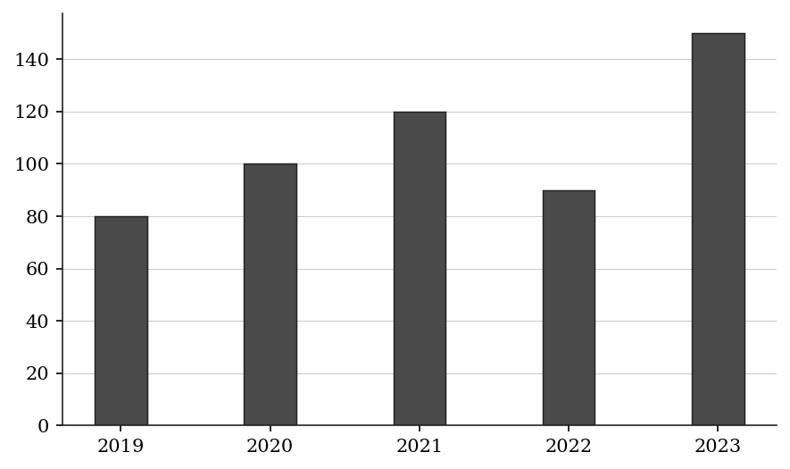

**(A)** 20%  
**(B)** 25%  
**(C)** 80%  
**(D)** 100%  
**(E)** 125%

**Q6** · `DAT-PCG-003` · Numeric Entry · 40s

The bar chart shows a city's population (in thousands):

By what percent did the population increase from 2015 to 2016?

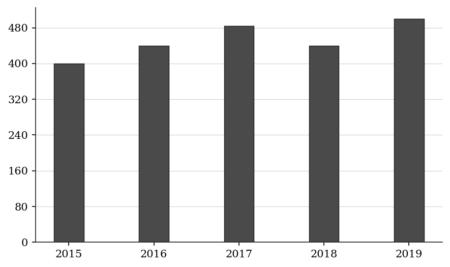

*Numeric entry — write the number.*

**Q7** · `DAT-PCG-KMF-011` · MCQ · 60s

At a school with 800 students, each student said whether he or she belongs to each of six clubs. The table shows the percent of the 800 students who belong to each club.

By what percent is the Debate club's membership smaller than the Robotics club's membership?

| Club | Percent of the 800 students |
|---|---|
| Robotics | 48% |
| Choir | 41% |
| Debate | 36% |
| Chess | 32% |
| Drama | 28% |
| Photography | 22% |

**(A)** 12%  
**(B)** 25%  
**(C)** 33%  
**(D)** 75%  
**(E)** 133%

---

### Level 2 · Medium — 16 questions · ~22 min

*two or three steps, one planted trap each*

**Q8** · `DAT-MGS-008` · Numeric Entry · 65s

Use the following data for this question.

SET 2 — WESTFIELD UNIFIED SCHOOL DISTRICT: Enrollment & Graduation

The Line Graph shows total student enrollment across all grades, in thousands of students, for the years 2018 through 2023. The Pie Chart breaks down the 2023 enrollment by school level, as a percentage of 2023 total enrollment; its values are listed in the table below.

The number of Elementary School students in 2023 was how many more than the number of High School students in 2023?

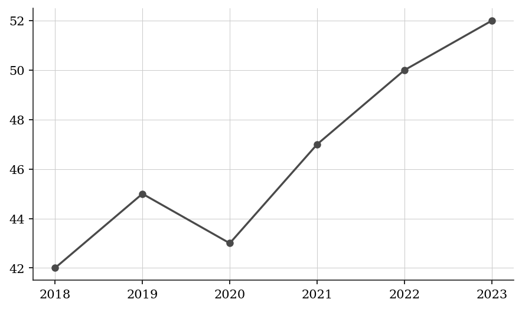

| School Level | Percentage of 2023 Enrollment |
|---|---|
| Elementary | 45% |
| Middle | 25% |
| High School | 30% |

*Numeric entry — write the number.*

**Q9** · `DAT-MGS-010` · MCQ · 70s

Use the following data for this question.

SET 3 — RIVER COUNTY POPULATION STUDY

Table 2 shows the population of each of four cities, in thousands, in 2015, 2020, and 2023. Bar Chart 2 shows the percentage of each city's 2023 population that was aged 65 or older.

Approximately how many residents aged 65 or older lived in Brentville in 2023?

| City | 2015 Population | 2020 Population | 2023 Population |
|---|---|---|---|
| Alderton | 80 | 88 | 96 |
| Brentville | 120 | 126 | 132 |
| Clarksburg | 60 | 72 | 78 |
| Dunmore | 40 | 44 | 40 |

**(A)** 20,400  
**(B)** 25,200  
**(C)** 26,400  
**(D)** 30,000  
**(E)** 33,000

**Q10** · `DAT-MGS-011` · Select all that apply · 90s

Use the following data for this question.

SET 3 — RIVER COUNTY POPULATION STUDY

Table 2 shows the population of each of four cities, in thousands, in 2015, 2020, and 2023. Bar Chart 2 shows the percentage of each city's 2023 population that was aged 65 or older.

In which of the following cities did the number of residents aged 65 or older exceed 14,000 in 2023?

Select all that apply.

| City | 2015 Population | 2020 Population | 2023 Population |
|---|---|---|---|
| Alderton | 80 | 88 | 96 |
| Brentville | 120 | 126 | 132 |
| Clarksburg | 60 | 72 | 78 |
| Dunmore | 40 | 44 | 40 |

**(A)** Alderton  
**(B)** Brentville  
**(C)** Clarksburg  
**(D)** Dunmore

**Q11** · `DAT-MGS-012` · QC · 80s

Use the following data for this question.

SET 3 — RIVER COUNTY POPULATION STUDY

Table 2 shows the population of each of four cities, in thousands, in 2015, 2020, and 2023. Bar Chart 2 shows the percentage of each city's 2023 population that was aged 65 or older.

> **Quantity A:**  Percent population growth of Clarksburg from 2015 to 2023
> **Quantity B:**  Percent population growth of Alderton from 2015 to 2023

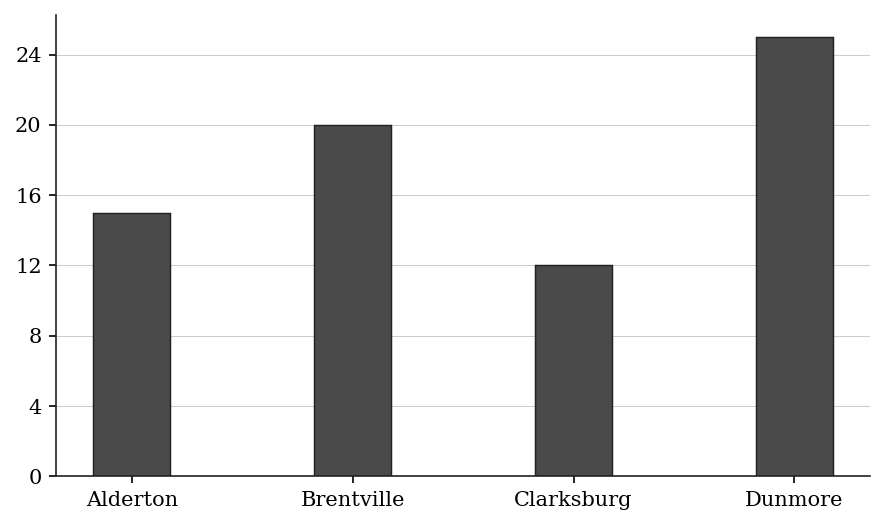

| City | 2015 Population | 2020 Population | 2023 Population |
|---|---|---|---|
| Alderton | 80 | 88 | 96 |
| Brentville | 120 | 126 | 132 |
| Clarksburg | 60 | 72 | 78 |
| Dunmore | 40 | 44 | 40 |

**Q12** · `DAT-MXG-011` · MCQ · 75s

Bar Chart — Units Sold by Month (Q1):

Table — Q1 Product Category Mix (applied uniformly each month):

What is the total number of Category Beta units sold across all three months of Q1?

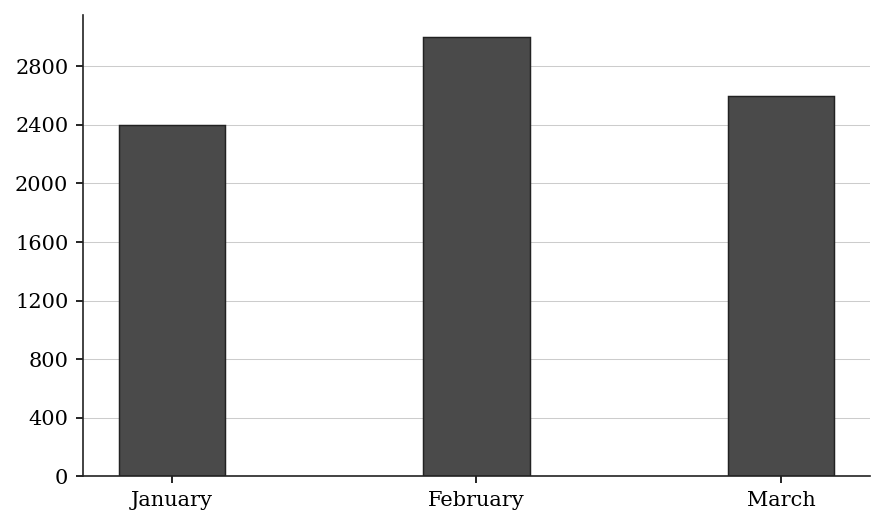

| Category | Share of units |
|---|---|
| Category Alpha | 35% |
| Category Beta | 40% |
| Category Gamma | 25% |

**(A)** 2,800  
**(B)** 3,000  
**(C)** 3,200  
**(D)** 3,360  
**(E)** 3,600

**Q13** · `DAT-MXG-013` · QC · 65s

Bar Chart — Students Enrolled per School:

Table — School Q's Enrollment by Grade:

> **Quantity A:**  Number of Grade 9 students at School Q
> **Quantity B:**  Total enrollment at School R

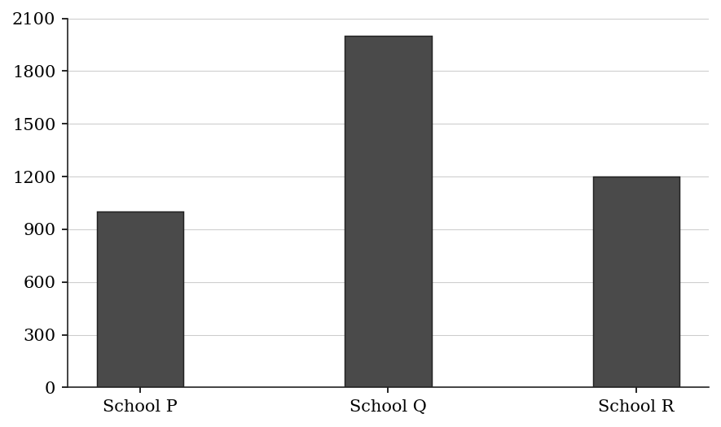

| Grade | Share of School Q enrollment |
|---|---|
| Grade 9 | 28% |
| Grade 10 | 26% |
| Grade 11 | 24% |
| Grade 12 | 22% |

**Q14** · `DAT-MXG-018` · Select all that apply · 80s

Bar Chart — Inventory Units by Warehouse:

Table — Warehouse 1 Inventory by Category:

Which of the following quantities are greater than 2,000 units? Indicate all such quantities.

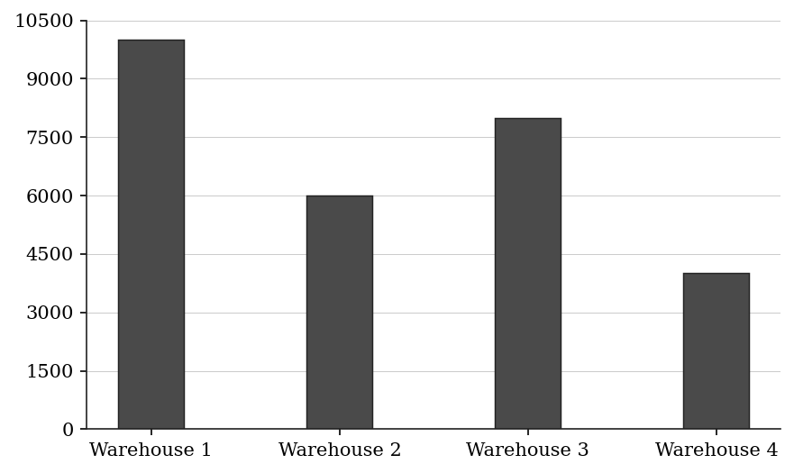

| Category | Share of Warehouse 1 inventory |
|---|---|
| Electronics | 30% |
| Clothing | 25% |
| Food | 20% |
| Tools | 15% |
| Other | 10% |

**(A)** Electronics units in Warehouse 1  
**(B)** Clothing units in Warehouse 1  
**(C)** Food units in Warehouse 1  
**(D)** Tools units in Warehouse 1  
**(E)** Other units in Warehouse 1

**Q15** · `DAT-MXG-030` · Numeric Entry · 130s

Bar Chart — Total Advertising Budget by Company ($millions):

Pie Chart — Company B's Budget Allocation:

Table — ROI per $million spent, by channel:

TV: 3.2x, Digital: 4.5x, Print: 2.0x, Sponsorships: 1.5x

Company B reallocates 10 percentage points from TV to Digital (TV becomes 25%, Digital becomes 50%), keeping the same total budget.

By how much does Company B's total revenue output change (in $millions) after the reallocation? Enter a positive number if it increases, negative if it decreases. Round to one decimal place.

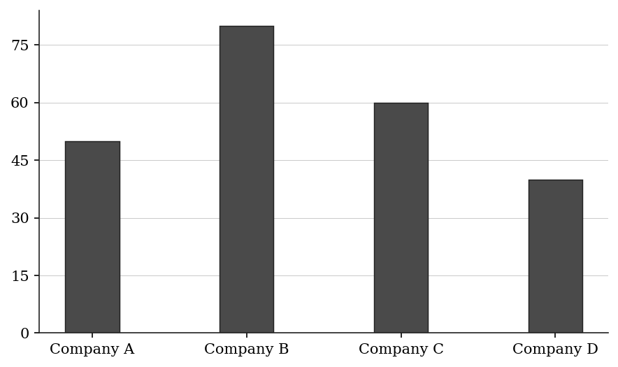

| Channel | Company B Budget Share | ROI per $million Spent |
|---|---|---|
| TV | 35% | 3.2x |
| Digital | 40% | 4.5x |
| Print | 15% | 2.0x |
| Sponsorships | 10% | 1.5x |

*Numeric entry — write the number.*

**Q16** · `DAT-MXG-KMF-002` · MCQ · 90s

The table gives enrollment at five campuses of a state college system, and the pie chart shows how the part-time students at Campus E in 2015 were distributed across program areas. About what percent of the 2015 enrollment of all five campuses combined consisted of Campus E's part-time Nursing students?

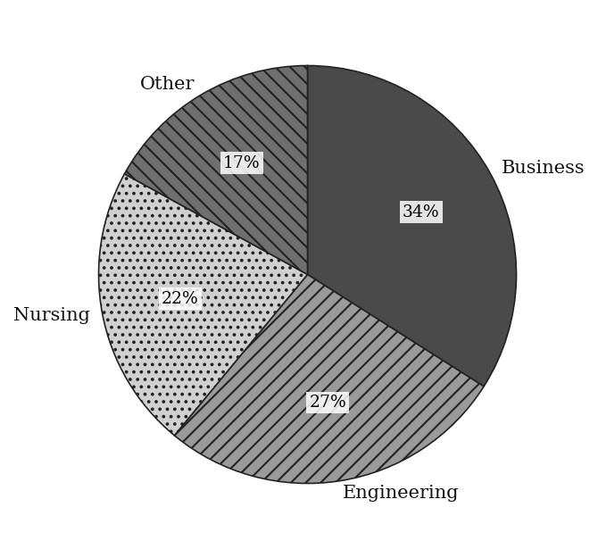

| Campus | Total enrollment 1995 | Total enrollment 2015 | Part-time students 1995 | Part-time students 2015 |
|---|---|---|---|---|
| A | 18,400 | 21,700 | 5,200 | 7,900 |
| B | 12,300 | 9,800 | 4,100 | 3,400 |
| C | 8,900 | 11,200 | 1,800 | 4,500 |
| D | 15,600 | 14,900 | 6,300 | 5,800 |
| E | 7,400 | 12,600 | 2,300 | 6,100 |
| Total | 62,600 | 70,200 | 19,700 | 27,700 |

**(A)** 2%  
**(B)** 5%  
**(C)** 11%  
**(D)** 22%  
**(E)** 34%

**Q17** · `DAT-MXG-KMF-013` · MCQ · 110s

The pie chart shows 1999 sales of coffee shops in County Y by chain, and the table shows how many chains and shops operated in each year. Assume that every coffee shop in the county belongs to one of the chains counted in the table. In 1999 the chain Q operated 40 of the shops in the county. Approximately how much greater, in dollars, were chain Q's average sales per shop than the average sales per shop of all of the other shops in the county?

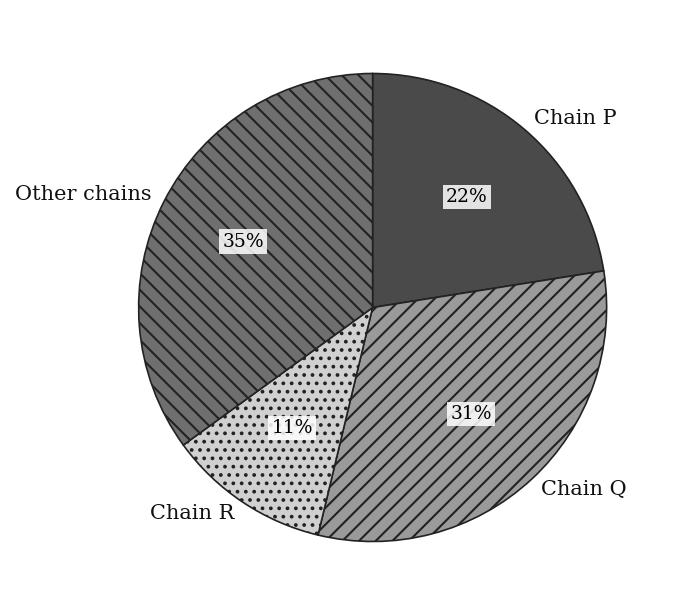

| Year | Number of chains | Total shops in the chains |
|---|---|---|
| 1995 | 18 | 190 |
| 1996 | 17 | 185 |
| 1997 | 15 | 170 |
| 1998 | 13 | 165 |
| 1999 | 12 | 160 |

**(A)** $62,000  
**(B)** $83,000  
**(C)** $229,000  
**(D)** $250,000  
**(E)** $313,000

**Q18** · `DAT-PCG-010` · MCQ · 80s

The bar chart shows annual production output (in thousands of units):

In which year-to-year period was the percent DECREASE the greatest in magnitude?

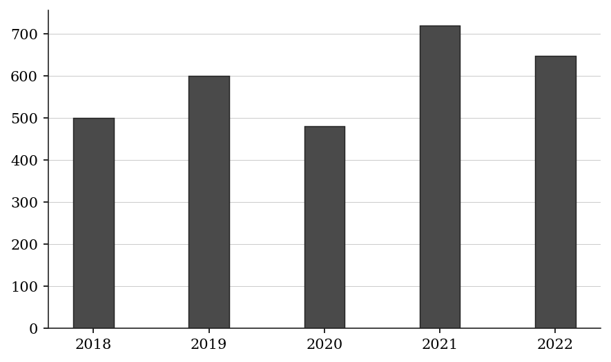

**(A)** 2019 to 2020  
**(B)** 2021 to 2022  
**(C)** The two decreases are equal in percent  
**(D)** 2018 to 2019  
**(E)** 2020 to 2021

**Q19** · `DAT-PCG-011` · QC · 70s

A bar chart shows the inflation rate (%) in two countries:

Country X: 2020: 4%, 2021: 6%

Country Y: 2020: 10%, 2021: 13%

> **Quantity A:**  Percent change in Country X's inflation rate from 2020 to 2021
> **Quantity B:**  Percent change in Country Y's inflation rate from 2020 to 2021

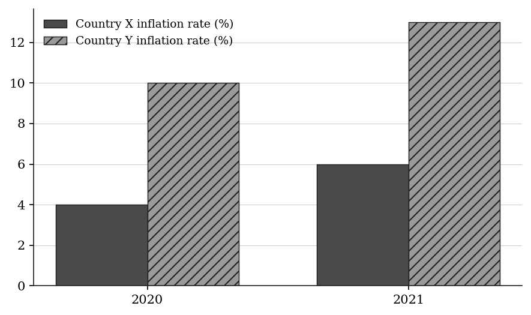

**Q20** · `DAT-PCG-016` · Numeric Entry · 75s

The bar chart shows a restaurant's weekly revenue (in $thousands):

If revenue in Week 6 increases by 25% compared to Week 5, what is the percent change in revenue from Week 1 to Week 6?

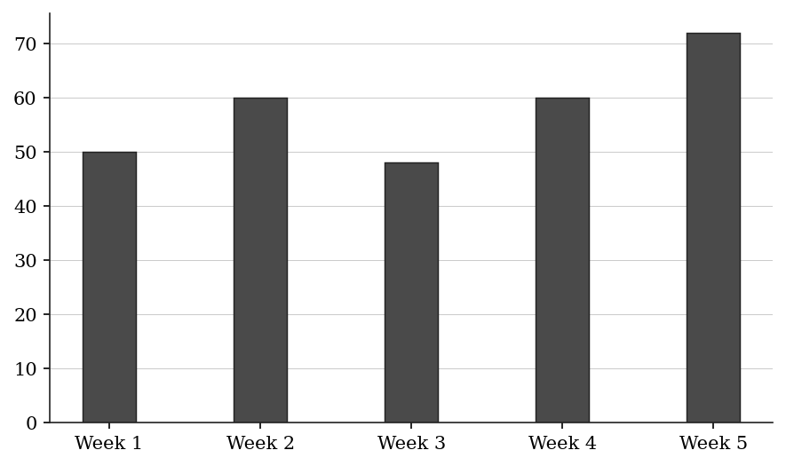

*Numeric entry — write the number.*

**Q21** · `DAT-PCG-017` · MCQ · 70s

A line graph shows the enrollment at a university (in thousands of students):

The enrollment grew by the same percent each year from 2015 to 2019. What was the annual growth rate?

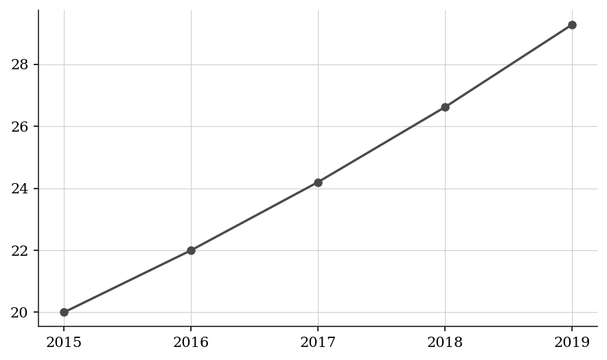

**(A)** 5%  
**(B)** 8%  
**(C)** 10%  
**(D)** 12%  
**(E)** 46.4%

**Q22** · `DAT-PCG-018` · Select all that apply · 95s

The bar chart shows the number of subscribers (in millions) for two streaming platforms:

Platform A: 2020: 10, 2021: 13, 2022: 16.9, 2023: 18.59

Platform B: 2020: 20, 2021: 22, 2022: 26.4, 2023: 29.04

In which periods did Platform A grow at a faster percent rate than Platform B? Select all that apply.

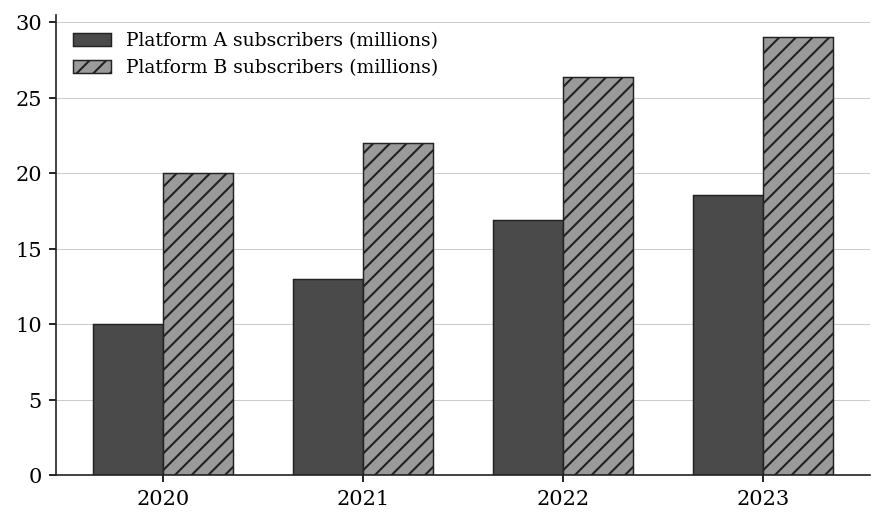

**(A)** 2020 to 2021  
**(B)** 2021 to 2022  
**(C)** 2022 to 2023  
**(D)** 2020 to 2023 (overall period)  
**(E)** None of the above

**Q23** · `DAT-PCG-019` · QC · 70s

A bar chart shows a country's GDP (in $billions):

> **Quantity A:**  Percent change in GDP from 2010 to 2015
> **Quantity B:**  Percent change in GDP from 2015 to 2020

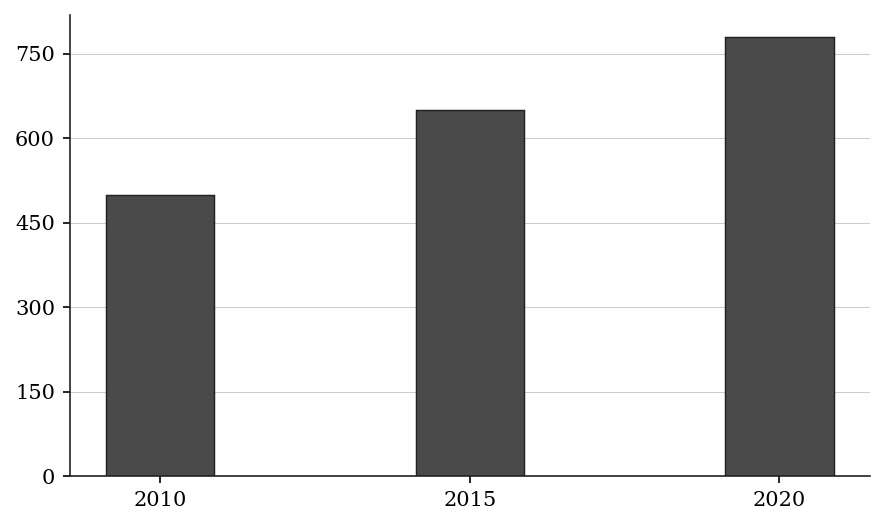

---

### Level 3 · Hard — 7 questions · ~12 min

*where 162+ is won or lost*

**Q24** · `DAT-MGS-016` · Select all that apply · 95s

Use the following data for this question:

SET 4 - NATIONAL BASKETBALL LEAGUE STATS: Team Performance

Table 3 below shows the season records for selected teams. The line graph below shows the Eagles' monthly win totals from October through March.

Which of the following months in the Eagles' win total was strictly above the team's average monthly wins for the season?

Select all that apply.

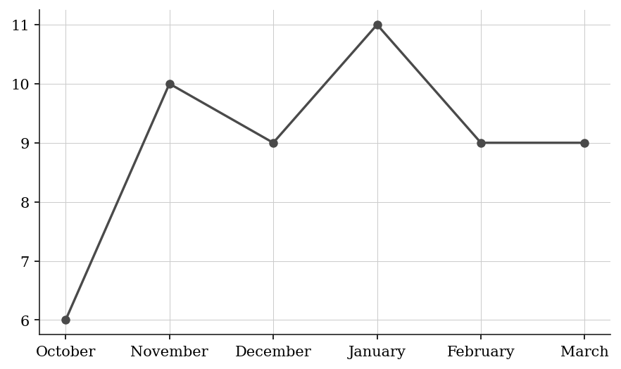

| Team | Games Played | Wins | Losses | Points For (avg/game) | Points Against (avg/game) |
|---|---|---|---|---|---|
| Eagles | 82 | 54 | 28 | 112 | 105 |
| Wolves | 82 | 47 | 35 | 108 | 107 |
| Panthers | 82 | 38 | 44 | 104 | 109 |
| Ravens | 82 | 29 | 53 | 98 | 114 |

**(A)** October  
**(B)** November  
**(C)** December  
**(D)** January  
**(E)** February

**Q25** · `DAT-MGS-022` · Numeric Entry · 85s

Use the following data for this question:

SET 6 - COUNTY HOSPITAL NETWORK: Patient & Cost Data

Table 4 below shows annual patient admissions by department. Line Graph 2 below shows the average cost per admission, in dollars, by year.

Approximately what was the total revenue generated by the Cardiology department in 2023? Give your answer in millions of dollars, rounded to the nearest tenth.

| Department | 2020 | 2021 | 2022 | 2023 |
|---|---|---|---|---|
| Cardiology | 4,800 | 5,100 | 5,400 | 5,700 |
| Orthopedics | 3,200 | 3,400 | 3,600 | 3,800 |
| Neurology | 2,100 | 2,300 | 2,500 | 2,400 |
| General Surgery | 6,500 | 6,200 | 6,800 | 7,200 |
| Pediatrics | 4,400 | 4,600 | 4,500 | 4,700 |

*Numeric entry — write the number.*

**Q26** · `DAT-MGS-024` · QC · 95s

Use the following data for this question:

SET 6 - COUNTY HOSPITAL NETWORK: Patient & Cost Data

Table 4 below shows annual patient admissions by department. Line Graph 2 below shows the average cost per admission, in dollars, by year.

> **Quantity A:**  Percent change in Neurology admissions from 2021 to 2023
> **Quantity B:**  Percent change in average cost per admission from 2021 to 2023

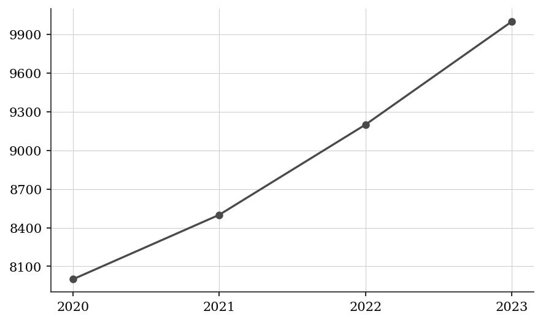

| Department | 2020 | 2021 | 2022 | 2023 |
|---|---|---|---|---|
| Cardiology | 4,800 | 5,100 | 5,400 | 5,700 |
| Orthopedics | 3,200 | 3,400 | 3,600 | 3,800 |
| Neurology | 2,100 | 2,300 | 2,500 | 2,400 |
| General Surgery | 6,500 | 6,200 | 6,800 | 7,200 |
| Pediatrics | 4,400 | 4,600 | 4,500 | 4,700 |

**Q27** · `DAT-MGS-KMF2-005` · MCQ · 115s

ANNUAL RESIDENTIAL AND COMMERCIAL ENERGY USAGE IN COUNTRY M, BY CATEGORY

The chart gives the percent of total annual residential energy usage for each category, and the table gives the percent of total annual commercial energy usage for each category.

The ratio of the total annual residential energy usage to the total annual commercial energy usage is x to y. Which of the following represents the fraction of the total annual energy usage, residential and commercial together, that is for lighting?

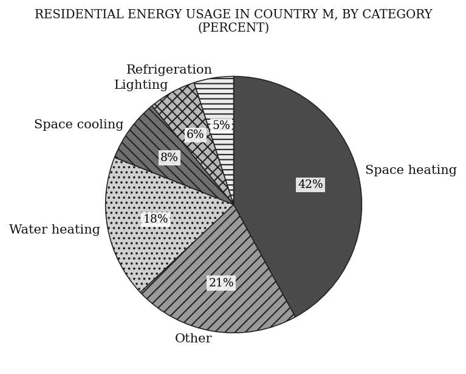

| Category | Percent of commercial usage |
|---|---|
| Space heating | 25% |
| Other | 23% |
| Lighting | 20% |
| Space cooling | 14% |
| Water heating | 10% |
| Refrigeration | 4% |
| Cooking | 2% |
| Computers | 2% |

**(A)** (6x + 20y)/(100(x + y))  
**(B)** (6x + 20y)/(x + y)  
**(C)** (3x + 10y)/(x + y)  
**(D)** 26(x + y)/100  
**(E)** (6x + 20y)/200

**Q28** · `DAT-MXG-021` · MCQ · 100s

Table - Total Revenue by Quarter ($millions):

Q1: 80, Q2: 100, Q3: 120, Q4: 140

Table - Q4 Revenue by Segment:

Segment A: 35%, Segment B: 30%, Segment C: 20%, Segment D: 15%

If Segment A's Q4 revenue grew by 40% from Q3 to Q4, what was Segment A's revenue in Q3 (in $millions)?

**(A)** 28  
**(B)** 30  
**(C)** 33  
**(D)** 35  
**(E)** 42

**Q29** · `DAT-MXG-027` · Select all that apply · 115s

Line Graph — Quarterly Net Income ($millions):

Table — Q4 2023 Net Income by Business Unit:

Which of the following statements are true? Select all that apply.

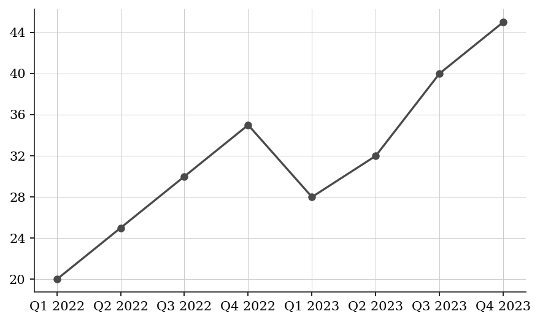

| Business unit | Share of Q4 2023 net income |
|---|---|
| Unit A | 40% |
| Unit B | 30% |
| Unit C | 20% |
| Unit D | 10% |

**(A)** Unit A's Q4 2023 income exceeds Q2 2022 net income  
**(B)** Unit B's Q4 2023 income exceeds Unit C's Q4 2023 income by exactly $4.5 million  
**(C)** Unit A's Q4 2023 income exceeds the combined Q4 2023 income of Units C and D  
**(D)** Unit A's Q4 2023 income is greater than Q1 2023 net income  
**(E)** Q4 2023 total income strictly exceeds the sum of Q1 and Q2 net income in 2022

**Q30** · `DAT-PCG-021` · MCQ · 90s

The bar chart shows a retail store's gross margin (%) and total revenue ($millions) over three years:

Gross Margin: 2021: 40%, 2022: 45%, 2023: 42%

Total Revenue: 2021: $200M, 2022: $180M, 2023: $220M

Gross profit = gross margin × total revenue.

What was the percent change in gross profit from 2021 to 2023?

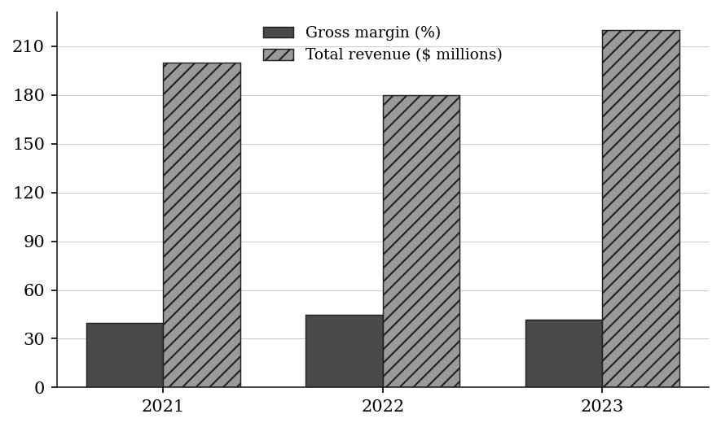

**(A)** 5%  
**(B)** 10%  
**(C)** 12%  
**(D)** 15.5%  
**(E)** 20%

---

## Part B — Answer Key

| Q | ID | Level | Type | Answer |
|---|---|---|---|---|
| 1 | `DAT-MGS-001` | easy | MCQ | **B** |
| 2 | `DAT-MGS-007` | easy | QC | **D** |
| 3 | `DAT-MXG-005` | easy | QC | **B** |
| 4 | `DAT-MXG-007` | easy | Numeric Entry | **200** |
| 5 | `DAT-PCG-001` | easy | MCQ | **B** |
| 6 | `DAT-PCG-003` | easy | Numeric Entry | **10** |
| 7 | `DAT-PCG-KMF-011` | easy | MCQ | **B** |
| 8 | `DAT-MGS-008` | medium | Numeric Entry | **7800** |
| 9 | `DAT-MGS-010` | medium | MCQ | **C** |
| 10 | `DAT-MGS-011` | medium | Select all that apply | **A, B** |
| 11 | `DAT-MGS-012` | medium | QC | **A** |
| 12 | `DAT-MXG-011` | medium | MCQ | **C** |
| 13 | `DAT-MXG-013` | medium | QC | **B** |
| 14 | `DAT-MXG-018` | medium | Select all that apply | **A, B** |
| 15 | `DAT-MXG-030` | medium | Numeric Entry | **10.4** |
| 16 | `DAT-MXG-KMF-002` | medium | MCQ | **A** |
| 17 | `DAT-MXG-KMF-013` | medium | MCQ | **B** |
| 18 | `DAT-PCG-010` | medium | MCQ | **A** |
| 19 | `DAT-PCG-011` | medium | QC | **A** |
| 20 | `DAT-PCG-016` | medium | Numeric Entry | **80** |
| 21 | `DAT-PCG-017` | medium | MCQ | **C** |
| 22 | `DAT-PCG-018` | medium | Select all that apply | **A, B, D** |
| 23 | `DAT-PCG-019` | medium | QC | **A** |
| 24 | `DAT-MGS-016` | hard | Select all that apply | **B, D** |
| 25 | `DAT-MGS-022` | hard | Numeric Entry | **57.0** |
| 26 | `DAT-MGS-024` | hard | QC | **B** |
| 27 | `DAT-MGS-KMF2-005` | hard | MCQ | **A** |
| 28 | `DAT-MXG-021` | hard | MCQ | **D** |
| 29 | `DAT-MXG-027` | hard | Select all that apply | **B, C** |
| 30 | `DAT-PCG-021` | hard | MCQ | **D** |

---

## Part C — Worked Solutions

### Q1 · `DAT-MGS-001` — Answer: B

Direct read from Table 1: the 2021 row shows revenue = $108 million. No calculation needed.

**Trap.** Students glance at the row above or below and accidentally pick $96 million (2020) or $120 million (2019).

### Q2 · `DAT-MGS-007` — Answer: D

Quantity A: High School in 2023 = 30% × 52,000 = 15,600 students.
Quantity B: Elementary students in 2021 — the Pie Chart only gives the 2023 breakdown. We do not have the 2021 breakdown by level. We only know total 2021 enrollment = 47,000. Without the 2021 level percentages, Quantity B cannot be determined.
Therefore, the relationship cannot be determined.

**Trap.** Students apply the 2023 pie chart percentages to 2021 enrollment, computing 45% × 47,000 = 21,150 and concluding Quantity B is greater. The pie chart percentages apply only to 2023 — we cannot assume the same distribution for 2021.

### Q3 · `DAT-MXG-005` — Answer: B

Quantity A: Electronics at Store B = 45% of 800 = 0.45 × 800 = 360 units.
Quantity B: Total units at Store A = 500 units.
360 < 500 → Quantity B is greater.

**Trap.** Students confuse 45% with the actual number, thinking Electronics = 45 units, making Quantity A appear much smaller (45 vs 500) and still arriving at Quantity B is greater — but for the wrong reason. Others who correctly compute 360 may then compare to Store C (300) instead of Store A (500) and erroneously choose Quantity A.

### Q4 · `DAT-MXG-007` — Answer: 200

Step 1: Total 2022 donations from bar chart → 800 (in $000s).
Step 2: Foundations share = 25% of 800 = 0.25 × 800 = 200.
Answer: 200 thousand dollars.

**Trap.** Students use the 2021 value (600) rather than 2022, computing 0.25 × 600 = 150.

### Q5 · `DAT-PCG-001` — Answer: B

Percent change = (New − Old) / Old × 100
= (100 − 80) / 80 × 100
= 20 / 80 × 100
= 25%
Revenue increased by 25% from 2019 to 2020.

**Trap.** Students compute (100 − 80) / 100 × 100 = 20%, using the new value (100) as the denominator instead of the original value (80). Percent change always divides by the ORIGINAL value.

### Q6 · `DAT-PCG-003` — Answer: 10

Percent change = (New − Old) / Old × 100
= (440 − 400) / 400 × 100
= 40 / 400 × 100
= 10%
The population increased by 10% from 2015 to 2016.

**Trap.** Students compute 440 / 400 = 1.10 and write '110' instead of recognizing the percent CHANGE is 10% (the index value minus 100).

### Q7 · `DAT-PCG-KMF-011` — Answer: B

1. Robotics has 48% of 800 = 384 students and Debate has 36% of 800 = 288 students.
2. The gap is 384 - 288 = 96 students.
3. Percent smaller, measured against Robotics: 96/384 = 0.25 = 25%.
Check: 25% of 384 is 96, and 384 - 96 = 288.

**Trap.** Dividing the gap by the smaller club (96/288) instead of the larger gives 33% (choice C).

### Q8 · `DAT-MGS-008` — Answer: 7800

Total 2023 enrollment = 52,000 students.
Elementary = 45% × 52,000 = 23,400 students.
High School = 30% × 52,000 = 15,600 students.
Difference = 23,400 − 15,600 = 7,800 students.

**Trap.** Students compute the difference in percentages (45% − 30% = 15%) and report 15,000 or 15% without multiplying by the actual total. The percentage difference must be applied to the real enrollment figure.

### Q9 · `DAT-MGS-010` — Answer: C

From Table 2, Brentville's 2023 population = 132,000.
From Bar Chart 2, Brentville has 20% aged 65+.
Residents aged 65+ = 20% × 132,000 = 0.20 × 132,000 = 26,400.

**Trap.** Students use Brentville's 2020 population (126,000) instead of 2023 (132,000), computing 20% × 126,000 = 25,200 (option B). The 65+ percentages shown in the bar chart correspond to 2023 populations.

### Q10 · `DAT-MGS-011` — Answer: A, B

Calculate 65+ count for each city using 2023 populations:
- Alderton: 15% × 96,000 = 14,400 > 14,000 ✓
- Brentville: 20% × 132,000 = 26,400 > 14,000 ✓
- Clarksburg: 12% × 78,000 = 9,360 < 14,000 ✗
- Dunmore: 25% × 40,000 = 10,000 < 14,000 ✗
Although Dunmore has the highest percentage (25%), its small total population makes the absolute count only 10,000. Cities A and B qualify.

**Trap.** Students select Dunmore (D) because it has the highest percentage (25%), not realizing that 25% of a small population (40,000) yields only 10,000 residents — less than the 14,000 threshold. Absolute count = percentage × base, and the base matters.

### Q11 · `DAT-MGS-012` — Answer: A

Clarksburg: (78 − 60) / 60 × 100 = 18/60 × 100 = 30%.
Alderton: (96 − 80) / 80 × 100 = 16/80 × 100 = 20%.
30% > 20%, so Quantity A is greater.

**Trap.** Students compare absolute growth (Clarksburg +18 thousand versus Alderton +16 thousand) or divide by the 2023 population instead of the 2015 base.

### Q12 · `DAT-MXG-011` — Answer: C

Step 1: Total Q1 units = 2,400 + 3,000 + 2,600 = 8,000.
Step 2: Category Beta = 40% of 8,000 = 0.40 × 8,000 = 3,200.
Answer: 3,200.

**Trap.** Students apply 40% to only one month (e.g., February: 0.40 × 3,000 = 1,200) then multiply by 3 months, getting 3,600 — ignoring that months have different totals.

### Q13 · `DAT-MXG-013` — Answer: B

Quantity A: Grade 9 at School Q = 28% of 2,000 = 0.28 × 2,000 = 560.
Quantity B: School R total = 1,200.
560 < 1,200 → Quantity B is greater.

**Trap.** Students confuse School Q's total (2,000) with being compared to School R (1,200) directly, concluding Quantity A is greater because 2,000 > 1,200, without applying the 28% grade split.

### Q14 · `DAT-MXG-018` — Answer: A, B

Warehouse 1 holds 10,000 units, and the table splits them 30, 25, 20, 15 and 10 percent.
A: Electronics = 0.30 × 10,000 = 3,000 > 2,000. True.
B: Clothing = 0.25 × 10,000 = 2,500 > 2,000. True.
C: Food = 0.20 × 10,000 = 2,000, equal to the threshold and so not greater than it. False.
D: Tools = 0.15 × 10,000 = 1,500. False.
E: Other = 0.10 × 10,000 = 1,000. False.
Answer: A and B.

**Trap.** C is exactly 2,000 units. 'Greater than' is strict, so a value equal to the threshold does not qualify. Reading the percentages off the table without multiplying by the 10,000-unit warehouse total is the other common error.

### Q15 · `DAT-MXG-030` — Answer: 10.4

Step 1: Company B total budget = $80M.
BEFORE reallocation:
TV = 35% × 80 = $28M → Revenue = 28 × 3.2 = $89.6M
Digital = 40% × 80 = $32M → Revenue = 32 × 4.5 = $144.0M
Print = 15% × 80 = $12M → Revenue = 12 × 2.0 = $24.0M
Sponsorships = 10% × 80 = $8M → Revenue = 8 × 1.5 = $12.0M
Total before = 89.6 + 144.0 + 24.0 + 12.0 = $269.6M
AFTER reallocation (TV: 25%, Digital: 50%, Print: 15%, Sponsorships: 10%):
TV = 25% × 80 = $20M → Revenue = 20 × 3.2 = $64.0M
Digital = 50% × 80 = $40M → Revenue = 40 × 4.5 = $180.0M
Print = 15% × 80 = $12M → Revenue = 12 × 2.0 = $24.0M
Sponsorships = 10% × 80 = $8M → Revenue = 8 × 1.5 = $12.0M
Total after = 64.0 + 180.0 + 24.0 + 12.0 = $280.0M
Change = 280.0 − 269.6 = +$10.4M.
Answer: 10.4 (increase).

**Trap.** Students compute the revenue change only for TV (−$8M spent × 3.2 = −$25.6M lost) and Digital (+$8M spent × 4.5 = +$36M gained) giving $10.4M — actually this is correct. A common error is applying the ROI to the full budget instead of the channel-specific spend, or forgetting that Print and Sponsorships are unchanged.

### Q16 · `DAT-MXG-KMF-002` — Answer: A

Campus E part-time students in 2015: 6,100. Nursing is 22% of them: 0.22 * 6,100 = 1,342.
Combined 2015 enrollment of all five campuses (Total row): 70,200.
Percent = 1,342 / 70,200 = 0.0191, or about 1.9%, which rounds to 2%.
Check: 2% of 70,200 is 1,404, close to 1,342.

**Trap.** Dividing by Campus E's own 2015 enrollment (12,600) gives 1,342/12,600 = about 11% (choice C); dividing by the combined part-time count (27,700) gives about 5% (choice B); reporting the pie-chart share itself gives 22% (choice D).

### Q17 · `DAT-MXG-KMF-013` — Answer: B

Total 1999 sales = 9.0 + 12.5 + 4.5 + 14.0 = 40.0 million dollars; total shops in 1999 = 160.
Chain Q: 12,500,000 / 40 = 312,500 dollars per shop.
Other shops: sales = 40.0 - 12.5 = 27.5 million; shops = 160 - 40 = 120; average = 27,500,000 / 120 = 229,167 dollars per shop.
Difference = 312,500 - 229,167 = 83,333, or about $83,000.
Check: weighted mean of the two averages = (40*312,500 + 120*229,167)/160 = 250,000 = 40,000,000/160, which matches.

**Trap.** Comparing chain Q to the all-shop average of $250,000 instead of to the other shops gives 312,500 - 250,000 = 62,500, about $62,000 (choice A).

### Q18 · `DAT-PCG-010` — Answer: A

Only two periods show decreases: 2019 to 2020 (600 to 480) and 2021 to 2022 (720 to 648).
2019 to 2020: (600 - 480)/600 = 120/600 = 20%.
2021 to 2022: (720 - 648)/720 = 72/720 = 10%.
The 2019-to-2020 decrease is the greater, so the answer is A.

**Trap.** Students who ignore direction pick E (2020 to 2021), the largest percent change at 50%, or D (2018 to 2019), whose 20% change matches A in size; both are increases. Students who compare absolute drops (120 vs 72) land on A only by luck and miss that percent depends on the base.

### Q19 · `DAT-PCG-011` — Answer: A

This asks for percent change IN the inflation rate value (not the inflation rate itself).
Quantity A — Country X:
= (6 − 4) / 4 × 100
= 2 / 4 × 100
= 50%
Quantity B — Country Y:
= (13 − 10) / 10 × 100
= 3 / 10 × 100
= 30%
Quantity A (50%) > Quantity B (30%).

**Trap.** Students compare the absolute increase in percentage points: X gained 2 pp and Y gained 3 pp, so they choose Quantity B. But percent change requires dividing by the original: 2/4 = 50% vs 3/10 = 30%. The smaller starting value for X amplifies its percent change.

### Q20 · `DAT-PCG-016` — Answer: 80

Step 1: Calculate Week 6 revenue.
Week 5 = 72
Week 6 = 72 × 1.25 = 90
Step 2: Percent change from Week 1 to Week 6.
= (90 − 50) / 50 × 100
= 40 / 50 × 100
= 80%
Revenue increased by 80% from Week 1 to Week 6.

**Trap.** Students add 25 to 72 (treating 25% as a dollar amount) to get 97, then compute (97 − 50)/50 × 100 = 94%. Always apply percent increases as multipliers: 72 × 1.25 = 90, not 72 + 25.

### Q21 · `DAT-PCG-017` — Answer: C

Read the growth from any one year to the next:
(22 − 20) / 20 × 100 = 2/20 × 100 = 10%
Verification:
20 × 1.10 = 22 ✓
22 × 1.10 = 24.2 ✓
24.2 × 1.10 = 26.62 ✓
26.62 × 1.10 ≈ 29.28 ✓
The annual growth rate is 10%.

**Trap.** Students compute total growth from 2015 to 2019: (29.28 − 20) / 20 × 100 ≈ 46.4%, then divide by 4 years to get ~11.6% ≈ 12%. This arithmetic-mean approach is invalid for compound growth. The correct method is to read the year-over-year rate directly.

### Q22 · `DAT-PCG-018` — Answer: A, B, D

Calculate percent change for each period:
2020→2021:
A: (13 − 10) / 10 × 100 = 30%
B: (22 − 20) / 20 × 100 = 10%
A faster ✓
2021→2022:
A: (16.9 − 13) / 13 × 100 = 3.9/13 × 100 = 30%
B: (26.4 − 22) / 22 × 100 = 4.4/22 × 100 = 20%
A faster ✓
2022→2023:
A: (18.59 − 16.9) / 16.9 × 100 = 1.69/16.9 × 100 = 10%
B: (29.04 − 26.4) / 26.4 × 100 = 2.64/26.4 × 100 = 10%
Equal — A is NOT faster.
2020→2023 overall:
A: (18.59 − 10) / 10 × 100 = 85.9%
B: (29.04 − 20) / 20 × 100 = 45.2%
A faster ✓
Answers: A, B, D.

**Trap.** For 2022→2023, students see A gained 1.69M while B gained 2.64M (larger absolute) and conclude B grew faster. But both grew at exactly 10%. Percent change, not absolute subscriber count, determines the growth rate.

### Q23 · `DAT-PCG-019` — Answer: A

Quantity A (2010→2015):
= (650 − 500) / 500 × 100
= 150 / 500 × 100
= 30%
Quantity B (2015→2020):
= (780 − 650) / 650 × 100
= 130 / 650 × 100
= 20%
Quantity A (30%) > Quantity B (20%).

**Trap.** Students see that the absolute GDP gain from 2010→2015 is $150B (larger) and from 2015→2020 is $130B (smaller), and assume the larger gain implies a larger percent. While intuition is correct here, students must verify: 150/500 = 30% vs 130/650 = 20% — different bases matter.

### Q24 · `DAT-MGS-016` — Answer: B, D

From the Line Graph, Eagles' total wins = 6+10+9+11+9+9 = 54 (consistent with Table 3).
Months = 6, so average monthly wins = 54 ÷ 6 = 9.0.
Months STRICTLY above 9:
- October: 6 < 9 ✗
- November: 10 > 9 ✓
- December: 9 = 9 ✗ (not strictly above)
- January: 11 > 9 ✓
- February: 9 = 9 ✗ (not strictly above)
- March: 9 = 9 ✗
Only November and January exceed the average.

**Trap.** Students include December, February, and March because they are 'at or above' average, missing the word 'strictly.' The question says strictly above, which excludes months equal to the mean (9). Only months with more than 9 wins qualify.

### Q25 · `DAT-MGS-022` — Answer: 57.0

Cardiology admissions in 2023 = 5,700 (from Table 4).
Average cost per admission in 2023 = $10,000 (from Line Graph 2).
Total revenue = 5,700 × $10,000 = $57,000,000 = $57.0 million.

**Trap.** Students use the 2022 cost per admission ($9,200) with 2023 admissions, computing 5,700 × $9,200 = $52.44M — mixing data from different years. Each question about a specific year requires using that year's cost figure from the line graph AND that year's admissions from the table.

### Q26 · `DAT-MGS-024` — Answer: B

Quantity A: Neurology 2021 = 2,300; Neurology 2023 = 2,400.
Percent change = (2,400 − 2,300)/2,300 × 100 = 100/2,300 × 100 = 4.35%.
Quantity B: Avg cost 2021 = $8,500; Avg cost 2023 = $10,000.
Percent change = (10,000 − 8,500)/8,500 × 100 = 1,500/8,500 × 100 = 17.65%.
4.35% < 17.65%, so Quantity B is greater.

**Trap.** Students compare absolute changes: Quantity A is 2,400−2,300 = 100 and Quantity B is 10,000−8,500 = 1,500, then conclude B is obviously larger — which happens to give the right answer for the wrong reason. The question tests percent change, not absolute change. For QC percent-change problems, always divide by the original.

### Q27 · `DAT-MGS-KMF2-005` — Answer: A

Because only the ratio of the two totals is given, take the residential total to be x units and the commercial total to be y units; any pair in that ratio gives the same fraction.
Lighting is 6 percent of residential usage and 20 percent of commercial usage, so the energy used for lighting is
0.06x + 0.20y, which is (6x + 20y)/100.
The total annual energy usage, residential and commercial together, is x + y.
The fraction asked for is the first divided by the second:
[(6x + 20y)/100]/(x + y) = (6x + 20y)/(100(x + y)).

**Trap.** B drops the division by 100, so it reports a percent where a fraction was asked for and is 100 times too large. C halves the numerator correctly but then drops the 50 that should remain in the denominator. D adds the two lighting percents as though they could simply be summed, which would require the residential and commercial totals to be equal. E divides by 200, treating the two charts as contributing 100 each, but the totals are x and y, not 100 and 100.

### Q28 · `DAT-MXG-021` — Answer: D

Segment A's Q4 revenue is 35% × 140 = 49. Since Q4 revenue is 40% more than Q3 revenue, Q3 revenue = 49 / 1.40 = 35.

**Trap.** Students apply the 35% share to the Q3 total, 35% × 120 = 42, instead of working backward from Q4 revenue with the 40% growth.

### Q29 · `DAT-MXG-027` — Answer: B, C

Q4 2023 net income is $45 million, split 40, 30, 20 and 10 percent: Unit A $18 million, Unit B $13.5 million, Unit C $9 million, Unit D $4.5 million.
A: $18 million against Q2 2022's $25 million. False.
B: 13.5 − 9 = $4.5 million. True.
C: Units C and D together are 9 + 4.5 = $13.5 million, less than Unit A's $18 million. True.
D: $18 million against Q1 2023's $28 million. False.
E: Q1 2022 + Q2 2022 = 20 + 25 = $45 million, equal to Q4 2023's $45 million, so it is not strictly exceeded. False.
Answer: B and C.

**Trap.** E is an exact tie at $45 million, and 'strictly exceeds' rules it out. A and D compare a single business unit's share against a whole quarter's income; 40 percent of the largest quarter is still smaller than most whole quarters here.

### Q30 · `DAT-PCG-021` — Answer: D

Step 1: Calculate gross profit for each year.
2021 gross profit: 40% × $200M = $80M
2023 gross profit: 42% × $220M = $92.4M
Step 2: Percent change in gross profit.
= (92.4 − 80) / 80 × 100
= 12.4 / 80 × 100
= 15.5%

**Trap.** Students see the margin rose from 40% to 42% (2 pp gain) and revenue rose from $200M to $220M (10% gain) and try to add or combine these directly, arriving at roughly 12% or 12%. The correct method computes actual gross profit for each year, then takes the percent change between those dollar figures.
